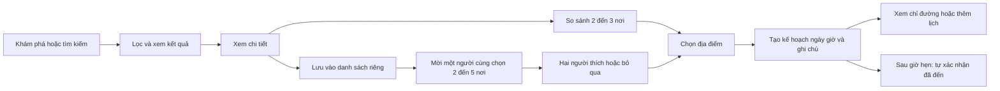
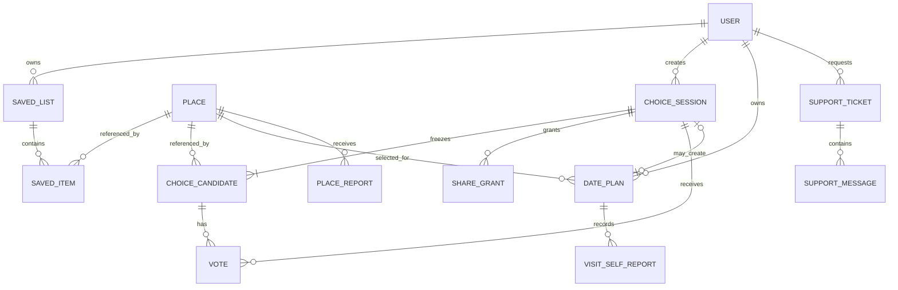
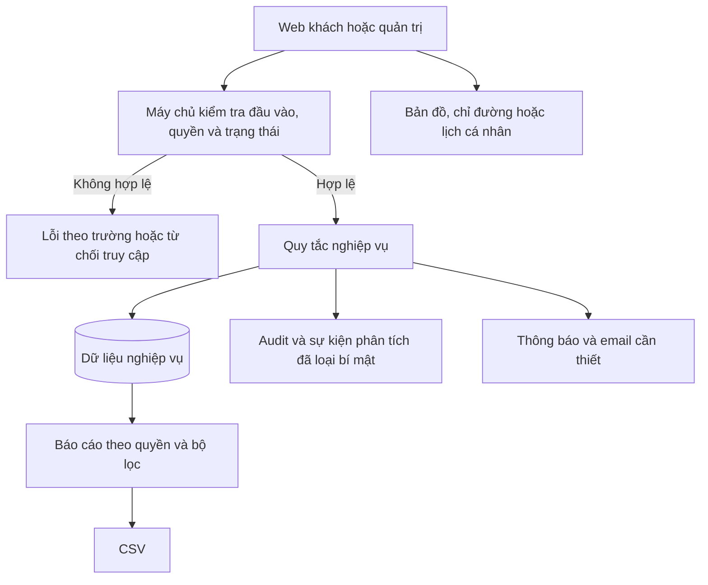
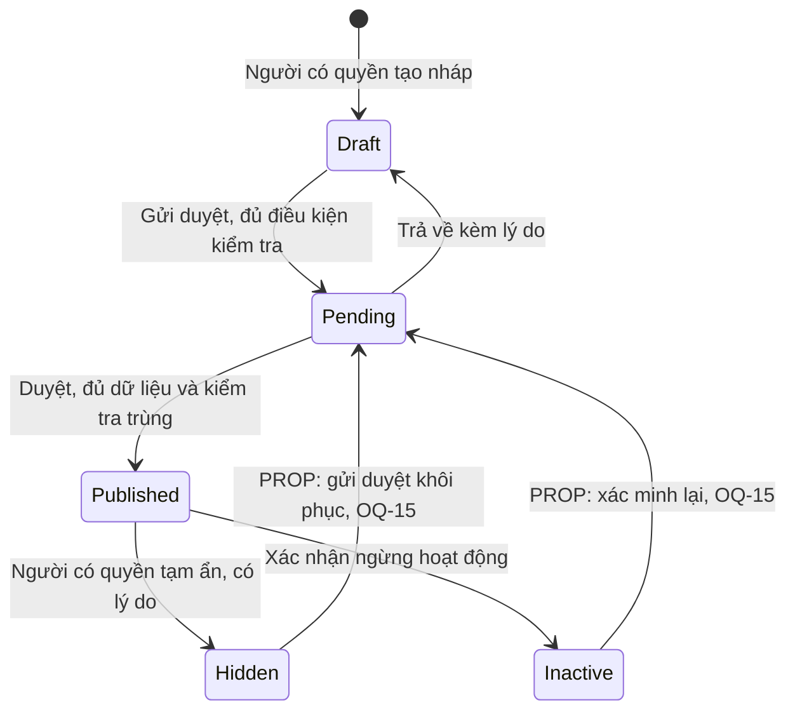
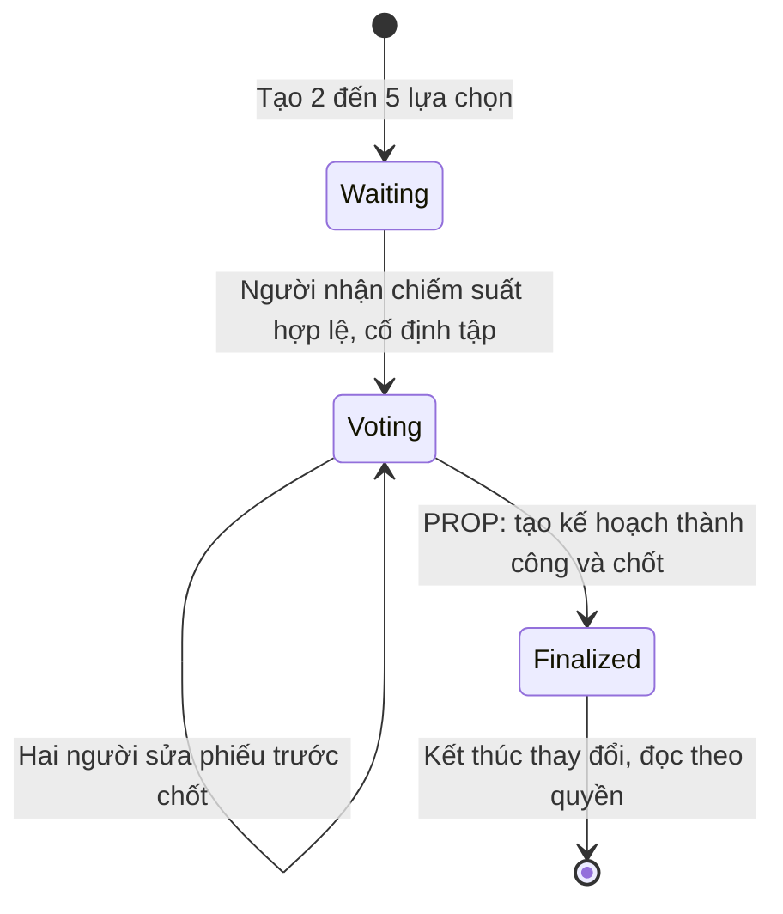
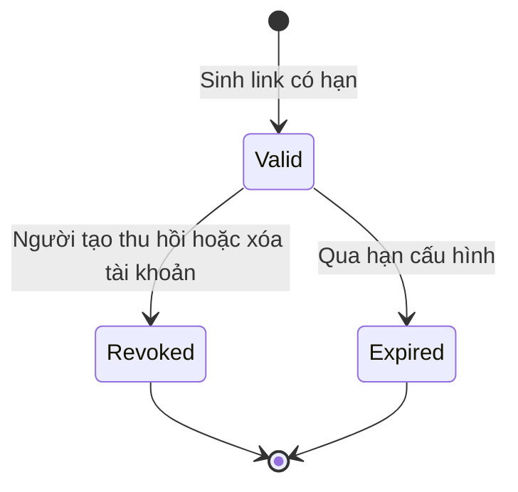
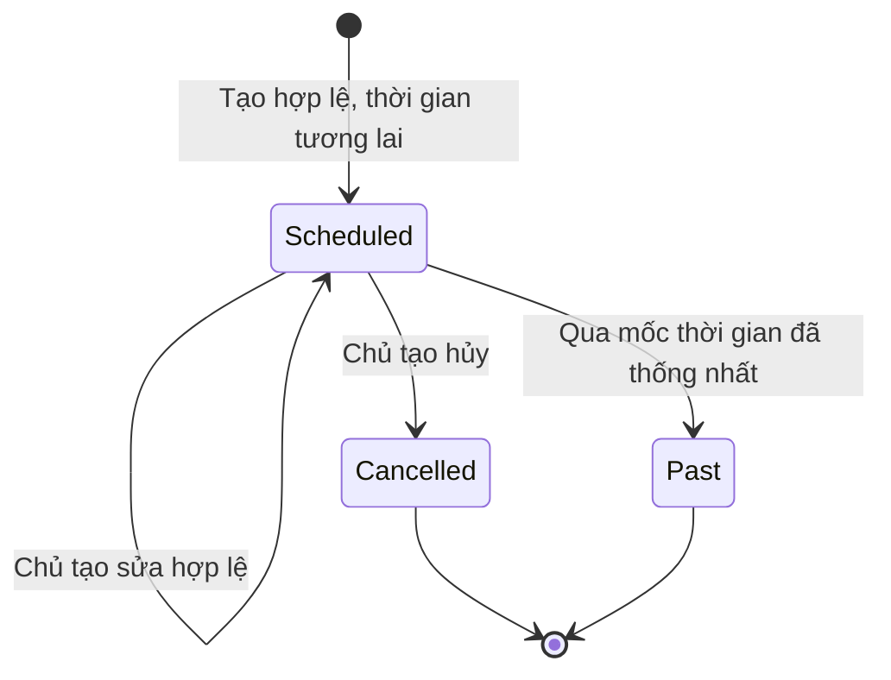
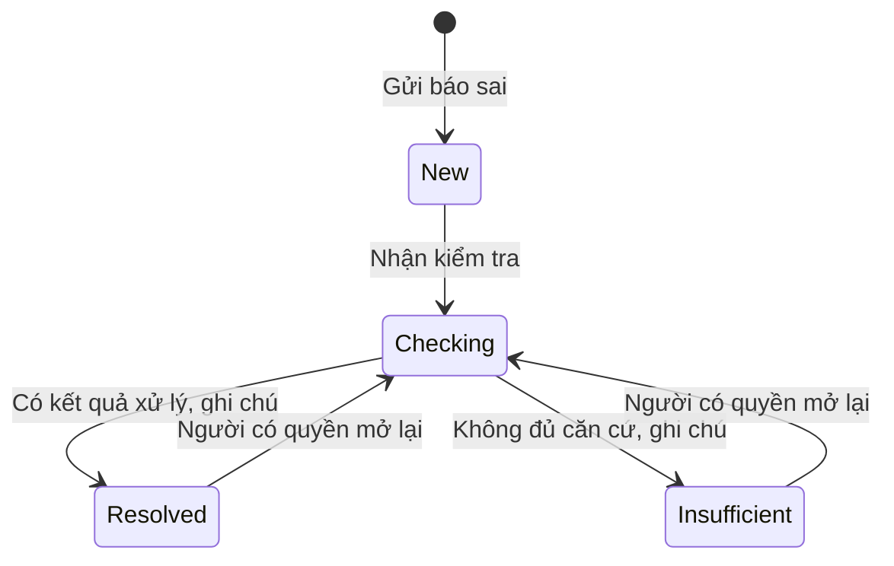
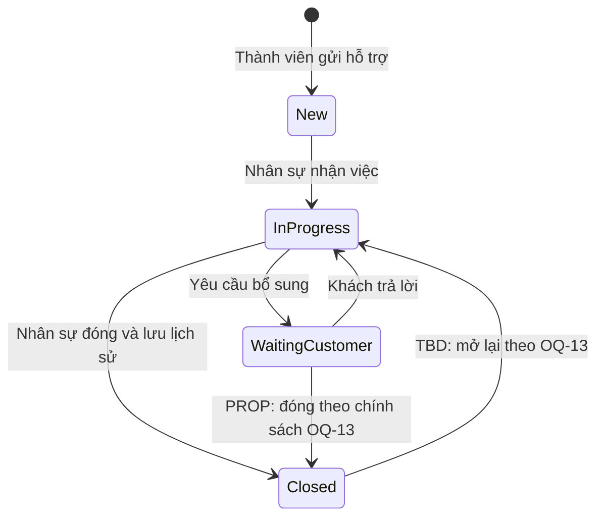

# GoWithBae — Đặc tả yêu cầu phần mềm (SRS) hợp nhất G1

| Thuộc tính | Giá trị |
|---|---|
| Mã tài liệu | GWB-SRS-G1 |
| Phiên bản / ngày tổng hợp | 1.1 / 16-11-2026, giờ Việt Nam |
| Trạng thái | **Draft — tổng hợp nguồn, chưa phải baseline production; không phê duyệt thay PO** |
| Phạm vi | Web khách hàng G1 + quản trị nội bộ; G2 chỉ định hướng |
| Đối tượng | Product Owner, BA, thiết kế, FE, BE, QA, nội dung và vận hành |
| Tài liệu gốc | GWB-REQ-G1 v1.0 ngày 13-11-2026 |
| Nguồn bổ sung | UI Handoff v1.0, README UI Review ngày 13-11-2026, Audit v1.0 ngày 14-11-2026, artifacts local |
| Vị trí phát hành | `gowithbae-be/docs/SRS.md` và `gowithbae-fe/docs/SRS.md`: cùng nội dung, cùng phiên bản |
| Người tổng hợp | Codex; theo phạm vi người yêu cầu xác nhận ngày 16-11-2026 |

## Hướng dẫn đọc và kiểm soát yêu cầu

Tài liệu này hợp nhất nội dung nghiệp vụ, mô hình dữ liệu, UI, nghiệm thu, câu hỏi mở và audit trong folder `srs`. Không cần mở các tài liệu nguồn để hiểu yêu cầu G1. Bản yêu cầu nhúng trong UI Handoff giống bản Requirements nên chỉ giữ một lần. Các chỉ dẫn thao tác công cụ Gemini/Stitch và lời đánh giá quảng bá không chuyển thành yêu cầu sản phẩm.

- **[SRC]**: có trong đề xuất nghiệp vụ nguồn; không có nghĩa đã được khách ký duyệt.
- **[CONF]**: phạm vi/đối tượng đọc được xác nhận trong nguồn; việc đồng ý tổng hợp không phê duyệt toàn bộ nghiệp vụ.
- **[DER]**: hệ quả phân tích; chưa phải chính sách mới đã duyệt.
- **[PROP]**: phương án đề xuất, gồm kiến nghị audit và lựa chọn thiết kế tạm; cần duyệt trước khi áp dụng.
- **[TBD] / OQ-xx**: chưa đủ thông tin; owner và mốc quyết định nằm tại §13.
- **[AUDIT]**: nhận định/khuyến nghị của báo cáo rà soát, không tự nâng thành yêu cầu bắt buộc dù nguồn dùng từ “bắt buộc”.
- **[OBS]**: quan sát trực tiếp file local ngày 16-11-2026; không thay thế việc kiểm chứng trên Stitch hoặc nghiệm thu hệ thống.
- **Shall / Phải** chỉ bắt buộc trong phạm vi được duyệt; Should / Nên là khuyến nghị; May / Có thể là tùy chọn. Các mục tiêu số được ghi đề xuất vẫn là đề xuất.

Giữ nguyên mã BR/FR/RULE/UC/AC/NFR/OQ từ Requirements để truy vết. Mã audit C-xx/H-xx/M-xx khác mã màn hình C01–C08. Các cột “Nguồn”, “§x” trong bảng kế thừa trỏ tới tài liệu đề xuất khách hàng ngày 12-11-2026; tham chiếu §x trong phần diễn giải của SRS này trỏ tới mục cùng số ở đây. Tiền tố `UI01–UI08` là nhóm chức năng, `C01–C08/E01–E06` là màn/biến thể review; A01–A06 trong các nguồn có cách gom nhóm khác nhau, xem §15.2.

**Thứ tự xử lý nguồn:** giữ Requirements làm căn cứ nghiệp vụ; UI bổ sung chi tiết hiển thị nhưng không thay quy tắc; audit bổ sung rủi ro/phương án cần duyệt. Khi mâu thuẫn, ghi vào §15.2, giữ quy tắc gốc và chờ PO. Không coi mock, API/schema đã có hoặc mã nguồn triển khai là bằng chứng PO đã duyệt OQ.

**Giới hạn nguồn:** đề xuất khách hàng ngày 12-11-2026 và các file UC, Gap Analysis, Verification Report, Implementation Backlog mà Requirements dẫn tới không có trong folder `srs`. Các mã UC được bảo toàn trong §12.2 để truy vết, nhưng không tuyên bố đã đọc hay có đủ đặc tả Given/When/Then từng UC. SHA-256 của đề xuất khách hàng do Requirements ghi lại là thông tin kế thừa, chưa kiểm chứng bản gốc.

**Đọc theo vai trò:** PO đọc §1–5, §12–15; FE đọc §3–5, §7–9, §12–15; BE đọc §3–7, §9–15; QA đọc toàn bộ và dùng fixture §8.4. Cách làm việc xem [DEVELOPMENT.md](DEVELOPMENT.md); quyết định giải pháp hiện tại xem [TECHSTACK.md](../TECHSTACK.md). SRS mô tả hành vi cần đạt, không xác nhận chức năng đã hoàn thành.

Mục lục: §1 bối cảnh; §2 phạm vi; §3 quyền; §4 chức năng; §5 quy tắc; §6 dữ liệu; §7 trạng thái/tích hợp; §8 UI/fixture; §9 NFR; §10 đo lường; §11 G2; §12 nghiệm thu; §13 quyết định mở; §14 bàn giao/thay đổi; §15 audit/mâu thuẫn; §16 nguồn và tính toàn vẹn.

## 1. Bối cảnh, mục tiêu và quy trình nghiệp vụ

### 1.1 AS-IS — hiện trạng theo mô tả khách hàng

Các cặp đôi tìm chỗ hẹn hò qua Facebook, TikTok và nhiều nguồn rời rạc. Nội dung dễ thấy tập trung vào bài viral, chưa phản ánh đầy đủ lựa chọn. Người dùng tự gom thông tin, kiểm tra giá/giờ, so sánh và trao đổi để chốt. Chưa có số liệu nền về thời gian lựa chọn hoặc tỷ lệ thất bại; không tự suy ra tỷ lệ cải thiện.

### 1.2 TO-BE — quy trình mong muốn

Người dùng tìm trong danh mục đã duyệt, lọc theo nhu cầu, xem giá cho hai người và thông tin có nguồn. Họ so sánh, lưu lựa chọn, mời một người cùng đánh dấu sở thích, rồi chủ động chốt một địa điểm và tạo kế hoạch. Nhân sự nội bộ nhập, kiểm tra, duyệt và duy trì dữ liệu; tiếp nhận báo sai, hỗ trợ và xem hiệu quả sử dụng.

Có thể tạo kế hoạch trực tiếp từ chi tiết hoặc so sánh; cùng chọn không phải bước bắt buộc. Kế hoạch G1 không đặt chỗ, không nhận tiền và không chứng minh người dùng đã đến địa điểm.

### 1.3 Yêu cầu nghiệp vụ và thước đo

| Mã | Yêu cầu nghiệp vụ | Thước đo/điều kiện thành công | Nguồn |
|---|---|---|---|
| BR-01 | Phải giúp tìm địa điểm phù hợp với vị trí, ngân sách, hoạt động và thời gian | Bộ dữ liệu nghiệm thu trả đúng kết quả theo bộ lọc; theo dõi tỷ lệ không có kết quả | [SRC] §1, §3, §10.1 |
| BR-02 | Phải giúp người dùng đối chiếu lựa chọn trên cùng tiêu chí | So sánh 2–3 nơi, biểu diễn rõ dữ liệu thiếu, chi phí cho hai người | [SRC] §4 |
| BR-03 | Phải hỗ trợ hai người cùng lựa chọn và người tạo quyết định cuối | Kết quả giao của lượt thích chính xác; không tự chốt | [SRC] §5.2 |
| BR-04 | Phải lưu và quản lý kế hoạch riêng tư | Chủ sở hữu sửa/hủy được, người nhận chỉ xem, người ngoài bị chặn | [SRC] §5.3, §6.4 |
| BR-05 | Phải có quy trình duy trì dữ liệu đáng tin cậy | Có nguồn/ngày kiểm tra; duyệt trước xuất bản; báo sai không tự sửa công khai | [SRC] §4.2, §6.2, §7 |
| BR-06 | Phải đo được hành trình khám phá đến tạo kế hoạch | Báo cáo khớp dữ liệu kiểm thử và xuất CSV đúng quyền/bộ lọc | [SRC] §10 |
| BR-07 | Phải vận hành G1 trên web thuận tiện cho điện thoại | Kiểm tra UI ở 360 px, bàn phím và các trình duyệt đã thống nhất | [SRC] §11; [CONF] web G1 |

Mục tiêu kinh doanh định lượng như tỷ lệ chốt tối thiểu, số người dùng thử, số địa điểm ban đầu và thời gian giảm được: **[TBD — OQ-02]**. Các chỉ số §10 là công cụ đo, không tự coi là KPI đã cam kết.

### 1.4 Thuật ngữ thống nhất

| Thuật ngữ | Nghĩa sử dụng trong đặc tả |
|---|---|
| Địa điểm / Place | Một chi nhánh cụ thể; cùng thương hiệu khác địa chỉ có mã riêng |
| Giá chuẩn hai người | Con số dùng lọc/sắp giá; khác khoảng giá minh họa; nội dung bao gồm phải được xác minh |
| Danh sách đã lưu | Bộ địa điểm riêng của một thành viên, không phải phiên cùng chọn |
| Phiên cùng chọn / ChoiceSession | Một tập lựa chọn gửi cho một người nhận, có phiếu của hai người và quyết định của người tạo |
| Cấp quyền chia sẻ / ShareGrant | Quyền truy cập từ một lời mời, có hạn và có thể thu hồi; không phải quyền sở hữu kế hoạch |
| Phiên truy cập / AccessSession | Danh tính truy cập của tài khoản hoặc người nhận; máy chủ xét quyền hiện tại mỗi thao tác |
| Phiên phân tích / Analytics session | Khoảng hoạt động dùng tính chỉ số; đề xuất kết thúc sau 30 phút không hoạt động, không tự đăng xuất tài khoản |
| Kế hoạch buổi hẹn / DatePlan | Một nơi + ngày giờ + ghi chú; G1 chưa giữ chỗ hoặc thanh toán |
| Tự xác nhận đã đi | Người có quyền trả lời Có/Không; không phải bằng chứng đối tác xác nhận đã sử dụng |
| Baseline | Phiên bản yêu cầu được người có trách nhiệm phê duyệt để triển khai/đo thay đổi |

## 2. Phạm vi và đối tượng liên quan

### 2.1 Trong phạm vi G1

Web responsive tiếng Việt; khám phá, tìm/lọc, danh sách/bản đồ, chi tiết, so sánh, danh sách riêng, cùng chọn hai người, kế hoạch một địa điểm, tài khoản, báo sai, hỗ trợ và thông báo trong tài khoản. Quản trị gồm địa điểm, duyệt, danh mục, bộ sưu tập, tài khoản/phân quyền, báo sai/hỗ trợ, báo cáo, CSV và nhật ký. Bao gồm cấu hình tích hợp email, bản đồ, ảnh, máy chủ và giám sát cần cho G1; nhà cung cấp chưa được chọn.

Thử nghiệm TP.HCM, VND, giờ Việt Nam là **giả định thiết kế của nguồn**, cần chốt trước thiết kế theo OQ-01. Một kế hoạch phục vụ hai người; mỗi chi nhánh là một địa điểm.

### 2.2 Ngoài phạm vi G1

- G2: cổng đối tác, gói/suất, đặt chỗ, thanh toán, hoàn tiền, đối soát, đánh giá công khai và app native.
- Mạng xã hội, chat riêng/thời gian thực, hồ sơ cặp đôi cố định, ghép đôi tìm người yêu, ví, chia tiền, trả góp, thu cọc, gợi ý AI, lịch trình nhiều điểm tự động.
- Thu thập tự động nội dung/ảnh/đánh giá nền tảng khác khi chưa được phép; tự sinh đánh giá, số sao, hoặc khẳng định dữ liệu chưa xác minh.
- Lựa chọn framework, database, token và endpoint chi tiết thuộc thiết kế giải pháp riêng; xem TECHSTACK.md và contract của repo. Câu “chưa chọn” trong nguồn phản ánh thời điểm 13-11-2026, không mô tả hiện trạng repo ngày tổng hợp. Việc lựa chọn giải pháp không tự chốt chính sách nghiệp vụ.

### 2.3 Stakeholder và trách nhiệm

| Vai trò | Trách nhiệm | Người cụ thể |
|---|---|---|
| Khách hàng / Product Owner (PO) | Quyết định phạm vi, chính sách nghiệp vụ, duyệt và nghiệm thu | [TBD — OQ-23] |
| Cặp đôi/người dùng thử | Phản hồi trải nghiệm tìm, cùng chọn và lên kế hoạch | [TBD — nhóm thử nghiệm] |
| Kinh doanh/nội dung | Cung cấp và xác minh dữ liệu, ảnh có quyền dùng, cách tính giá | [TBD — OQ-23] |
| Duyệt nội dung | Kiểm tra trùng, chất lượng và điều kiện xuất bản | [TBD — phân công vận hành] |
| Hỗ trợ | Nhận, trả lời, xử lý báo sai và yêu cầu hỗ trợ | [TBD — OQ-16] |
| Đội thiết kế/phát triển/QA | Đề xuất giải pháp, đặc tả kỹ thuật, xây và kiểm thử theo mã yêu cầu | [TBD — OQ-23] |
| Vận hành/hạ tầng | Tài khoản dịch vụ, giám sát, sao lưu, khôi phục và bảo trì | [TBD — OQ-16] |
| Đối tác | G1 gửi thông tin qua nhân sự; chưa có tài khoản đối tác | [SRC] §1.1 |

## 3. Actor và phân quyền

### 3.1 Ma trận quyền G1

| Tài nguyên/thao tác | Khách | Thành viên | Người nhận link | Biên tập | Duyệt nội dung | Hỗ trợ | Quản trị cao nhất |
|---|---|---|---|---|---|---|---|
| Địa điểm công khai: tìm/xem/so sánh | Có | Có | Có | Theo quyền khách | Theo quyền khách | Theo quyền khách | Có |
| Danh sách cá nhân | Không | Chỉ của mình | Không thấy danh sách gốc | Không có quyền riêng tư mặc định | Không có quyền riêng tư mặc định | Không có quyền riêng tư mặc định | [TBD — OQ-18] |
| Tạo phiên cùng chọn | Không | Của mình | Không | Không mặc định | Không mặc định | Không mặc định | Không mặc định |
| Tham gia/bỏ phiếu | Link hợp lệ | Phiên của mình/link hợp lệ | Chỉ phiên được cấp | Không mặc định | Không mặc định | Không mặc định | Không mặc định |
| Tạo/sửa/hủy kế hoạch | Không | Chỉ kế hoạch mình tạo | Chỉ xem kế hoạch được chia sẻ | Không mặc định | Không mặc định | Không mặc định | [TBD — OQ-18] |
| Gửi báo sai | Có, chống lạm dụng | Có | Như khách | Có | Có | Có | Có |
| Gửi/xem/trả lời hỗ trợ | Không | Chỉ yêu cầu của mình | Không nếu chưa đăng nhập | Không mặc định | Không mặc định | Theo phân công/quyền | Theo quyền được duyệt |
| Tạo/sửa nháp, nhập CSV | Không | Không | Không | Có | Không mặc định nếu chưa có vai trò biên tập | Không mặc định | Theo cấu hình quyền |
| Duyệt/trả về/ẩn, quản lý nhãn | Không | Không | Không | Không tự xuất bản | Có | Không | Theo cấu hình quyền |
| Quản lý bộ sưu tập | Không | Không | Không | [TBD — OQ-18] | [TBD — OQ-18] | Không mặc định | Theo cấu hình quyền |
| Xử lý báo sai | Không | Không | Không | Tiếp nhận | Theo quyền cập nhật/duyệt | Xử lý theo phân công | Theo cấu hình quyền |
| Khóa/mở tài khoản, cấp vai trò, xem nhật ký | Không | Không | Không | Không | Không | Không | Có |
| Báo cáo/xuất CSV | Không | Không | Không | Theo quyền riêng [TBD] | Theo quyền riêng [TBD] | Theo quyền riêng [TBD] | Theo quyền được duyệt |

**Nguyên tắc:** [SRC] kiểm tra quyền tại máy chủ; một người có thể có nhiều vai trò. [DER] Chưa được cấp quyền thì từ chối; vai trò nhân viên không mặc nhiên được đọc dữ liệu riêng tư. [TBD — OQ-18] Khách yêu cầu biên tập không tự xuất bản; cần chốt người có cả hai vai trò có được duyệt nội dung chính mình tạo không. Không mặc định “quản trị cao nhất” được đọc mọi dữ liệu riêng tư.

Tài khoản bị khóa không tạo/chỉnh sửa dữ liệu. Khả năng tiếp tục đọc dữ liệu cá nhân sau khóa và thời điểm thu hồi phiên: OQ-17. Người nhận dùng phiên riêng để đọc/chọn; có link không đồng nghĩa có quyền sửa kế hoạch.

## 4. Danh mục chức năng và yêu cầu chi tiết

Các FR trong §4 là **Shall** sau khi được duyệt, trừ nội dung ghi rõ đề xuất/TBD. Hành vi, ngoại lệ, quyền và validation được quy định ở §3–7; tiêu chí cấp sản phẩm và truy vết ở §12. Các file UC chi tiết không được cung cấp trong nguồn, nên QA cần bổ sung Given/When/Then theo module trước nghiệm thu, không coi mã UC là đặc tả đã có sẵn.

### 4.1 Khám phá, tìm kiếm và hồ sơ địa điểm

| Mã / nguồn | Đầu vào và xử lý | Kết quả và xử lý ngoại lệ |
|---|---|---|
| FR-01 — Khám phá; §2.2, §7.1/A03 | Người dùng mở trang, chọn bộ sưu tập hoặc hoạt động. Chỉ dùng nội dung trong thời gian hiển thị và địa điểm đã duyệt đang hiển thị | Trang khám phá có tìm kiếm, khu vực, ngân sách, hoạt động và bộ sưu tập. Trống/lỗi có hướng dẫn; không lộ nháp/địa điểm ẩn |
| FR-02 — Tìm kiếm; §3.1/F01 | Từ khóa tên/khu vực/hoạt động; không phân biệt hoa/thường, hỗ trợ không dấu. Không yêu cầu hiểu câu tự nhiên dài | Thẻ gồm ảnh, tên, khu vực, giá hai người, tối đa 3 nhãn, lưu/so sánh. Mặc định: khớp từ khóa → thông tin xác minh mới hơn → mã ổn định. Cách tính mức khớp/tìm rỗng: OQ-04 |
| FR-03 — Bộ lọc; §3.2–3.3/F02 | Áp dụng đồng thời khu vực hoặc tâm/bán kính, ngân sách, ngày giờ và các nhóm nhãn; kết hợp theo RULE-02–05 | Kết quả đáp ứng bộ lọc; giữ nguyên điều kiện khi 0 kết quả; chỉ nới khi khách chọn. Không có giá/giờ không được giả định đạt điều kiện |
| FR-04 — Sắp xếp và bản đồ; §3.1–3.3 | Sắp mặc định/gần nhất/giá tăng. Chọn danh sách hoặc bản đồ; có thể dùng điểm xuất phát do người dùng cung cấp | Giá chưa rõ xếp cuối. Khoảng cách chỉ hiện khi có điểm gốc, ghi “ước tính”; không gọi là thời gian đi. Từ chối vị trí cho nhập thủ công; bản đồ lỗi vẫn xem danh sách. Công thức/bán kính: OQ-05 |
| FR-05 — Chi tiết; §4.1–4.3/F03 | Mã chi nhánh; chỉ địa điểm được phép xem. Dữ liệu thiếu là “Chưa có thông tin” | Thứ tự: ảnh/tên → giá → trải nghiệm → tiện ích → giờ/địa chỉ → lưu ý → ngày cập nhật; gọi, chỉ đường, lưu, so sánh, chọn kế hoạch, báo sai. Không dựng sao/đánh giá giả; link địa điểm ẩn: OQ-11 |
| FR-06 — So sánh; §4.4/F04 | Chọn 2 hoặc 3 mã khác nhau; điều chỉnh danh sách so sánh | Bảng giá hai người, khu vực/khoảng cách, giờ, hoạt động, không khí, tiện ích, đặt trước. Thiếu trường ghi rõ; chặn nơi thứ 4 và chỉ cách bỏ bớt. Khách có thể chọn nơi để tạo kế hoạch nhưng phải đăng nhập trước khi lưu |

### 4.2 Tài khoản, lưu, cùng chọn và kế hoạch

| Mã / nguồn | Đầu vào và xử lý | Kết quả và xử lý ngoại lệ |
|---|---|---|
| FR-07 — Đăng nhập; §6.1/F08 | **Đề xuất:** email và mã một lần; xác minh email, kiểm tra hạn/số lần sai/giới hạn gửi lại | Thành viên có tài khoản riêng; không hỏi tình trạng quan hệ/thông tin người yêu. Mã không hợp lệ không tạo phiên; email lỗi có cách thử lại. Phương thức và cấu hình phải chốt OQ-06 |
| FR-08 — Hồ sơ; §6.1, §6.4 | Sửa tên, ảnh tùy chọn; đổi email sau xác minh email mới; đăng xuất; yêu cầu xóa tài khoản | Không cho sửa tài khoản khác; khóa chặn tạo/sửa. Xóa phải thu hồi phiên và link riêng, không đồng nghĩa đã chốt quy tắc giữ/xóa toàn bộ dữ liệu: OQ-17 |
| FR-09 — Danh sách đã lưu; §5.1/F05 | Thành viên tạo/đổi tên/xóa danh sách, thêm/bỏ địa điểm; kiểm tra chủ sở hữu | Mặc định riêng tư; cặp danh sách–địa điểm không trùng. Xóa danh sách không xóa địa điểm/kế hoạch; nơi ẩn vẫn hiện tên/cảnh báo trong danh sách cũ, không được chốt mới |
| FR-10 — Tạo lời mời; §5.2/F06 | Người tạo chọn 2–5 địa điểm đã lưu và tạo phiên, sinh link khó đoán | Cảnh báo ai có link hợp lệ có thể xem và chiếm suất; không index công khai. **Đề xuất nguồn:** link hết hạn sau 7 ngày. Không lộ toàn bộ danh sách cá nhân; chọn nơi ẩn/đổi danh sách trước khi tham gia: OQ-07, OQ-11 |
| FR-11 — Tham gia; §5.2 | Người nhận mở link hợp lệ, nhập tên hiển thị, máy chủ kiểm tra hạn/thu hồi/suất còn lại | Một người tạo + một người nhận; không cần đăng ký. Cấp phiên riêng, cố định tập địa điểm sau khi tham gia. [DER] Hai người cùng nhận một suất phải chỉ có một người thành công; người còn lại được giải thích |
| FR-12 — Bỏ phiếu và kết quả; §5.2 | Mỗi người chọn Thích/Bỏ qua trên từng nơi; chưa chọn là Chưa trả lời; được sửa trước chốt | Hiển thị các nơi cả hai thích riêng; vẫn xem nơi còn lại. Không trùng thì gợi ý chọn lại hoặc tạo phiên mới. Không có lượt chọn không có nghĩa là Bỏ qua; không tự chốt. Có được nhìn phiếu riêng của nhau không: OQ-07 |
| FR-13 — Chốt từ phiên; §5.2–5.3 | Chỉ người tạo chọn nơi cuối rồi điền ngày giờ/ghi chú; kiểm tra điều kiện kế hoạch | Tạo kế hoạch theo FR-15 và phiên chuyển chỉ xem sau khi chốt thành công. [PROP] Lưu kế hoạch và chốt phiên như một thao tác nhất quán để không chốt khi lưu thất bại; mốc chốt/cần cả hai trả lời: OQ-08 |
| FR-14 — Quản lý quyền chia sẻ; §5.2, §6.4 | Người tạo thu hồi link, loại người nhận, cấp link mới; người nhận mất phiên cần được mời lại | Link cũ mất quyền ngay; [DER] phải kiểm tra hiệu lực cấp quyền cả khi dùng phiên người nhận cũ. Không xóa/sửa ý nghĩa phiếu cũ. Quy tắc tái sử dụng phiếu, quyền kế hoạch sau thu hồi và hết hạn: OQ-07–09 |
| FR-15 — Tạo kế hoạch; §5.3/F07 | Thành viên chọn 1 địa điểm đang hiển thị, thời gian tương lai, ghi chú tùy chọn, người nhận nếu có | Giờ xác minh là đóng thì chặn; giờ chưa rõ thì cảnh báo, không tự coi mở. Ghi kế hoạch Đã lên lịch; hiển thị “Kế hoạch này chưa giữ chỗ tại địa điểm”. Không yêu cầu cùng chọn trước |
| FR-16 — Quản lý kế hoạch; §5.3 | Chủ sở hữu sửa giờ/ghi chú, đổi địa điểm hoặc hủy; người nhận chỉ xem bản được chia sẻ | Đổi nơi kiểm tra lại; ghi thời điểm sửa và tạo thông báo tài khoản liên quan. Khách nhận link xem bản mới khi mở lại. Lưu thất bại không báo thành công; nơi bị ẩn sau tạo và sửa kế hoạch đã qua giờ: OQ-10–11 |
| FR-17 — Tiện ích buổi hẹn; §5.3 | Mở chỉ đường hoặc thêm lịch cá nhân | Dùng địa điểm/ngày giờ hiện tại; lịch ghi rõ giờ Việt Nam. Chọn tải lịch hay tích hợp tài khoản lịch: OQ-12; không mặc định đồng bộ hai chiều hoặc tự nhắc hẹn |
| FR-18 — Sau giờ hẹn; §5.3, §10 | Kế hoạch qua mốc giờ, hệ thống đổi Đã qua giờ và hỏi đã đến chưa; ghi Có/Không/Chưa trả lời riêng | Không đổi kế hoạch đã hủy thành đã qua giờ; không coi hết giờ/đánh dấu Có là lượt sử dụng đã được đối tác xác minh. Mốc qua giờ, ai được trả lời, sửa câu trả lời: OQ-10 |

### 4.3 Báo sai, hỗ trợ, thông báo và quyền riêng tư

| Mã / nguồn | Đầu vào và xử lý | Kết quả và xử lý ngoại lệ |
|---|---|---|
| FR-19 — Gửi báo sai; §6.2/F09 | Khách/thành viên chọn sai giá, giờ, địa chỉ, đóng cửa, ảnh hoặc khác; mô tả và ảnh tùy chọn; chống gửi hàng loạt | Mã báo sai, địa điểm, nội dung, người gửi nếu có, thời điểm, trạng thái Mới. Không tự sửa địa điểm. Không cho khách ẩn danh tra cứu báo sai của người khác bằng đoán mã |
| FR-20 — Yêu cầu hỗ trợ; §6.3/F10 | Thành viên gửi chủ đề/nhóm/nội dung/tệp; xem và bổ sung trong yêu cầu của mình | Có mã, người phụ trách, trạng thái, lịch sử phản hồi; không chat thời gian thực. Khách không xem ghi chú nội bộ. Trả lời khi đã đóng và thời gian xử lý: OQ-13, OQ-16 |
| FR-21 — Thông báo; §6.4 | Sự kiện cập nhật buổi hẹn/hỗ trợ tạo thông báo đúng tài khoản; email cho xác thực và xử lý cần thiết | Không gửi riêng tư cho người ngoài; tiếp thị chỉ khi có lựa chọn nhận riêng. Không cam kết email/push nhắc hẹn khi chưa thống nhất. Chi tiết đọc/chưa đọc và email cần thiết: OQ-14 |
| FR-22 — Quyền riêng tư; §6.4, §11.2 | Mọi thao tác riêng kiểm tra người dùng, vai trò, sở hữu hoặc cấp quyền chia sẻ tại máy chủ | Đổi mã đối tượng/phiên không được lộ email, lịch sử tìm, danh sách, vị trí hoặc ghi chú người khác; không theo dõi vị trí liên tục. Thu hồi link có hiệu lực ngay, kể cả nội dung cũ đang mở khi gửi yêu cầu tiếp theo |

### 4.4 Quản trị và dữ liệu vận hành

| Mã / nguồn | Đầu vào và xử lý | Kết quả và xử lý ngoại lệ |
|---|---|---|
| FR-23 — Biên tập địa điểm; §4, §7/A01 | Nhân sự có quyền tạo/sửa nháp, xem trước, lọc khu vực/trạng thái, gửi duyệt | Kiểm tra dữ liệu/nguồn/quyền ảnh, mã chi nhánh, trùng; Nháp → Chờ duyệt. Sửa địa điểm đã xuất bản phải giữ nguyên yêu cầu duyệt; cách quản lý phiên bản công khai: OQ-15 |
| FR-24 — Duyệt và ngừng hiển thị; §4.2, §7 | Người có quyền duyệt kiểm tra điều kiện xuất bản, trùng, nguồn/ngày; duyệt hoặc trả về có lý do; ẩn/ngừng hoạt động | Không cho biên tập tự xuất bản; không xóa lịch sử có kế hoạch/đơn. Nhật ký trước/sau/lý do. Phục hồi từ ẩn/ngừng hoạt động phải qua điều kiện nào: OQ-15 |
| FR-25 — Danh mục; §7/A02 | Người có quyền quản lý loại hình, nhãn, khu vực, ngừng dùng nhãn | Dữ liệu cũ còn tham chiếu; không xóa dây chuyền địa điểm. Cách gộp/đổi tên nhãn và hiện nhãn ngừng dùng: OQ-18 |
| FR-26 — Bộ sưu tập; §7/A03 | Người có quyền tạo tên/nội dung/ảnh, chọn nơi, thứ tự, lịch hiển thị | Chỉ xuất hiện theo lịch và nơi đủ điều kiện hiển thị; không đưa nơi ẩn trở lại tìm kiếm. Quyền duyệt bộ sưu tập: OQ-18 |
| FR-27 — Tài khoản và vai trò; §7/A04 | Quản trị tìm tài khoản, xem trạng thái, khóa/mở có lý do, gán/bỏ vai trò | Ghi nhật ký thay quyền; ngăn gọi trực tiếp API vượt quyền; áp dụng chính sách tài khoản bị khóa. Cách ngăn mất quản trị cuối cùng và quyền tự đổi vai trò: OQ-18 |
| FR-28 — Xử lý báo sai; §6.2, §7/A05 | Hàng chờ, giao việc, kiểm tra, ghi chú, cập nhật trạng thái | Mới → Đang kiểm tra → Đã xử lý/Không đủ căn cứ; đóng có ghi chú, người có quyền mở lại. Cập nhật địa điểm đi qua quyền biên tập/duyệt, không bỏ quy trình xuất bản |
| FR-29 — Xử lý hỗ trợ; §6.3, §7/A05 | Nhân sự nhận việc, phản hồi, ghi chú nội bộ, chuyển trạng thái, đóng | Mới/Đang xử lý/Chờ khách phản hồi/Đã đóng; lưu lịch sử và thông báo. Tách trả lời công khai với ghi chú nội bộ. Mở lại: OQ-13 |
| FR-30 — Nhập CSV; §7.3 | Nhân sự có quyền tải mẫu và nhập thử; kiểm tra thiếu trường, mã trùng, tọa độ sai; ảnh gắn riêng theo mã | Báo lỗi từng dòng, không âm thầm bỏ lỗi; dữ liệu nhập chưa tự xuất bản. [PROP] Mặc định chỉ ghi khi toàn bộ lô hợp lệ; nhập phần hợp lệ/update hay create-only cần chốt OQ-19 |
| FR-31 — Nhật ký; §7.3 | Ghi chủ thể/thời điểm/đối tượng/giá trị trước–sau/lý do cho duyệt, ẩn, đổi giá, khóa và cấp quyền | Nhân viên không sửa/xóa nhật ký qua UI; không đưa mã xác thực/khóa riêng vào log. Quyền xem, thời hạn giữ và dữ liệu cần che: OQ-17–18 |
| FR-32 — Sự kiện phân tích; §10.3 | Ghi sự kiện theo §10, có mã chống trùng, thời gian, phiên, nền tảng, người dùng/khách, đối tượng và thuộc tính phù hợp | Không ghi từng ký tự thành tìm kiếm; không ghi mã đăng nhập, thẻ hoặc ghi chú riêng. Tách người dùng tự báo đã đi với giao dịch G2; quy tắc phiên/ghép định danh: OQ-20 |
| FR-33 — Báo cáo; §7/A06, §10 | Người có quyền chọn thời gian, khu vực, loại hình, nền tảng; tính theo công thức §10 | Có số liệu sử dụng/chất lượng dữ liệu và thời điểm cập nhật; G1 cập nhật trong 24 giờ. Phân biệt tài khoản và khách ẩn danh; không khẳng định một người xuyên thiết bị |
| FR-34 — Xuất CSV; §7/A06, §10.3 | Chỉ người được cấp quyền xuất; giữ nguyên bộ lọc và phạm vi truy cập của báo cáo | CSV đối chiếu được với số tổng/chi tiết; không lộ thêm dữ liệu riêng. Lỗi xuất báo rõ và thử lại; khối lượng/hình thức xuất: OQ-20 |

## 5. Quy tắc nghiệp vụ và validation

### 5.1 Danh mục bộ lọc ban đầu [SRC §3.2]

| Nhóm | Giá trị ban đầu / cách chọn | Cách kết hợp trong nhóm |
|---|---|---|
| Khu vực | Danh mục khu vực; hoặc một điểm và bán kính | Hai chế độ, chọn kết hợp hay loại trừ nhau: OQ-05 |
| Ngân sách hai người | Miễn phí; dưới 200.000; 200.000 đến dưới 400.000; 400.000 đến 700.000; trên 700.000 VND | Theo giá chuẩn; ranh giới tại RULE-03 |
| Ngày giờ | Ngày và giờ dự định đến | Xét lịch tuần và ngoại lệ |
| Hoạt động | Ăn uống, cà phê, vẽ tranh, làm gốm, làm bánh, xem phim, triển lãm, trò chơi, vận động | OR — ít nhất một |
| Không khí | Yên tĩnh, lãng mạn, sôi động, ấm áp, riêng tư | AND — phải đủ |
| Phong cách | Vintage, tối giản, hiện đại, nghệ thuật, sân vườn | OR |
| Cảnh quan | Nhiều cây, ven hồ, ven sông, rooftop, ngắm hoàng hôn | OR |
| Đặc điểm | Có mèo tại quán, có chó tại quán, cho mang thú cưng, band nhạc, ngoài trời | AND |
| Tiện ích | Khu không hút thuốc, tiếp cận xe lăn | AND |
| Dịp hẹn | Hẹn đầu, cuối tuần, kỷ niệm, sinh nhật | OR |

### 5.2 Danh mục quy tắc

| Mã | Quy tắc và kiểm tra | Khi vi phạm / phục hồi | Nguồn, tình trạng |
|---|---|---|---|
| RULE-01 | Chỉ địa điểm đã duyệt và đang hiển thị được khám phá/tìm/chốt mới | Loại khỏi kết quả; chốt thất bại yêu cầu chọn lại; lịch sử giữ tên/cảnh báo theo quyền | [SRC] §3–5 |
| RULE-02 | Các nhóm lọc kết hợp AND; hoạt động/phong cách/cảnh quan/dịp OR; không khí/tiện ích/đặc điểm AND | Không trả kết quả thiếu bất kỳ điều kiện bắt buộc; không tự nới | [SRC] §3.3 |
| RULE-03 | Giá lọc là giá chuẩn cho hai người, không phải lấy giao của khoảng giá. Khoảng nguồn: miễn phí, dưới 200k, 200k–<400k, 400k–700k, >700k | Giá chưa biết loại khỏi lọc ngân sách; giá không hợp lệ không lưu. [PROP] Tách miễn phí `p=0`; dưới 200k là `0<p<200000`, đến 700k gồm đúng 700000; OQ-03 | [SRC]+[PROP] §3 |
| RULE-04 | Không có dữ liệu giá/giờ/tiện ích không đồng nghĩa bằng 0/đang mở/không có | Hiển thị “Chưa có thông tin”; không thỏa bộ lọc cần chứng minh thuộc tính đó | [SRC]+[DER] §3.3, §4.1 |
| RULE-05 | Lịch ngoại lệ phải được đối chiếu cùng lịch tuần; thời điểm kế hoạch tương lai; đã xác minh đóng cửa thì chặn tạo | Đổi giờ hoặc chọn nơi khác; chưa có giờ chỉ cảnh báo khi tạo nhưng không đạt lọc đang mở. [PROP] Ngoại lệ ưu tiên lịch tuần; ranh giới/qua đêm OQ-04 | [SRC]+[PROP] §3.2, §5.3 |
| RULE-06 | So sánh đúng 2–3 địa điểm khác nhau | Trùng không thêm lần hai; nơi thứ 4 bị chặn; chưa đủ 2 gợi ý thêm nơi | [SRC]+[DER] §4.4 |
| RULE-07 | Danh sách riêng thuộc một người; cặp list–place duy nhất | Sai sở hữu bị chặn; thêm lặp không tạo bản ghi mới; xóa list không xóa place/plan | [SRC] §5.1 |
| RULE-08 | Phiên cùng chọn lấy 2–5 địa điểm đã lưu; một người tạo + một người nhận | Sai số lượng chặn tạo; suất đã có người chặn tham gia khác; nơi ẩn OQ-11 | [SRC] §5.2 |
| RULE-09 | Cố định tập địa điểm sau người nhận tham gia; muốn đổi tạo phiên mới | Chặn sửa tập đang dùng, giữ nghĩa phiếu; hướng dẫn tạo mới | [SRC] §5.2 |
| RULE-10 | Phiếu thuộc từng người/từng nơi, giá trị Thích/Bỏ qua/Chưa trả lời; chỉ sửa trước chốt | Sai người/nơi/trạng thái bị chặn; cả hai thích mới là giao; không có giao không tự chốt | [SRC] §5.2 |
| RULE-11 | Chỉ người tạo chốt; hệ thống không tự chốt theo phiếu; chốt xong chỉ xem | Người nhận chốt/sửa phiếu sau chốt bị từ chối; lưu plan lỗi không được báo chốt thành công | [SRC]+[DER] §5.2 |
| RULE-12 | Link khó đoán, không index; hết hạn/thu hồi không cho truy cập; phiên khách riêng phụ thuộc cấp quyền còn hiệu lực | Báo link không hợp lệ; không lộ nội dung; chủ tạo mời lại. Hạn 7 ngày là đề xuất; OQ-07, OQ-09 | [SRC]+[DER] §5.2, §6.4 |
| RULE-13 | Kế hoạch có một địa điểm, chủ tạo, ngày giờ, ghi chú tùy chọn, người nhận nếu có | Thiếu/sai trường hoặc nơi không hợp lệ chặn lưu; không có đặt chỗ/thanh toán G1 | [SRC] §5.3 |
| RULE-14 | Chủ tạo được sửa/hủy, người nhận chỉ xem; kiểm tra quyền tại máy chủ | Từ chối sửa/hủy của người khác; không chỉ ẩn nút. Chuyển kế hoạch đã qua giờ: OQ-10 | [SRC] §5.3 |
| RULE-15 | Đã qua giờ là trạng thái kế hoạch, tự báo đã đi là trường riêng | Không tự gán đã đi; không đổi kế hoạch hủy thành qua giờ; không gắn nhãn sử dụng đã xác minh | [SRC]+[DER] §5.3, §10 |
| RULE-16 | Mã đăng nhập dùng một lần, có hạn và giới hạn gửi/nhập; email mới cần xác minh | Sai/hết hạn/tái dùng bị từ chối; không cấp phiên; cấu hình OQ-06 | [SRC] §6.1 |
| RULE-17 | Tài khoản khóa không tạo/sửa; xóa thu hồi phiên/link; hồ sơ không yêu cầu tình trạng quan hệ | Chặn thao tác không hợp lệ; chưa tuyên bố xóa dữ liệu hoàn tất khi mới nhận yêu cầu | [SRC] §6 |
| RULE-18 | Báo sai được gửi ẩn danh có chống lạm dụng; không sửa công khai tự động; đóng có ghi chú | Quá hạn mức chặn và cho biết cách thử lại; thiếu ghi chú chặn đóng; mở lại theo quyền | [SRC] §6.2 |
| RULE-19 | Hỗ trợ chỉ thành viên; phân biệt phản hồi khách với ghi chú nội bộ | Người ngoài không đọc/trả lời; ghi chú nội bộ không trả ra giao diện khách; trạng thái đóng OQ-13 | [SRC]+[DER] §6.3, §7 |
| RULE-20 | Xuất bản cần tên, loại hình, địa chỉ, tọa độ, mô tả, ảnh có quyền, hoạt động chính, trạng thái giá/giờ, nguồn/ngày kiểm tra và kiểm tra trùng | Thiếu thì giữ nháp/chờ duyệt, liệt kê lỗi; không bắt buộc biết giá/giờ thực nếu đã ghi chưa rõ | [SRC] §4.2 |
| RULE-21 | Biên tập không tự xuất bản; quản lý quyền, duyệt/ẩn/giá/khóa có nhật ký | Từ chối thao tác vượt quyền; thay đổi quan trọng không được mất dấu vết; vai trò kép OQ-18 | [SRC] §7 |
| RULE-22 | Không xóa lịch sử địa điểm đã tham chiếu; nhãn ngừng dùng không làm mất dữ liệu cũ | Chặn xóa phá tham chiếu; dùng trạng thái/vô hiệu hóa phù hợp | [SRC] §4.2, §7 |
| RULE-23 | CSV có kiểm tra thử và báo lỗi dòng, mã trùng, tọa độ; ảnh gắn mã riêng | Không âm thầm bỏ dòng lỗi; chưa ghi lô chưa hợp lệ theo chính sách OQ-19 | [SRC] §7.3 |
| RULE-24 | Thông báo đúng đối tượng, tiếp thị có lựa chọn riêng; chia sẻ không lộ dữ liệu ngoài phạm vi | Không gửi khi thiếu quyền; lỗi thông báo không được làm người dùng tưởng thao tác nghiệp vụ chưa được lưu | [SRC]+[DER] §6.4 |
| RULE-25 | Sự kiện có mã chống trùng; báo cáo tách khách/tài khoản, tự báo/đơn; không ghi dữ liệu nhạy cảm đã cấm | Loại sự kiện lặp khỏi tổng; không hợp nhất xuyên thiết bị khi chưa có căn cứ | [SRC] §10 |
| RULE-26 | Báo cáo/CSV cùng bộ lọc và quyền, G1 độ trễ tối đa 24 giờ | Từ chối xuất vượt quyền; dữ liệu chưa đủ kỳ không gán tỷ lệ giả; hiển thị cập nhật | [SRC]+[DER] §10 |
| RULE-27 | Tệp giới hạn định dạng/kích thước, kiểm tra nội dung; không công khai token/khóa; nhân viên dùng 2 bước trước vận hành | Tệp bị từ chối không tạo liên kết công khai; lỗi có mã tra cứu, không trả bí mật | [SRC] §11.2 |
| RULE-28 | Chỉ dữ liệu có quyền sử dụng được công bố; minh họa phải gắn nhãn và tách môi trường thật | Không xuất bản ảnh không có quyền; không dùng dữ liệu giả làm số liệu kinh doanh | [SRC] §11.4 |

Thông báo validation đề xuất: “Bạn chỉ có thể so sánh tối đa 3 địa điểm”; “Hãy chọn từ 2 đến 5 địa điểm”; “Liên kết không còn hiệu lực”; “Địa điểm đóng cửa vào thời gian bạn chọn”; “Chưa có thông tin giờ mở cửa”; “Bạn không có quyền thực hiện thao tác này”. Nội dung UX cuối do PO/thiết kế duyệt, không làm lộ sự tồn tại tài nguyên riêng.

## 6. Mô hình dữ liệu nghiệp vụ

Đây là mô hình logic, chưa phải schema vật lý hoặc quyết định công nghệ. Độ dài chuỗi, dung lượng tệp, chính sách lưu trữ và cách phân trang cần chốt; không tự dùng các giá trị mặc định như yêu cầu khách hàng.

| Thực thể | Trường nghiệp vụ và validation chính | Quan hệ / quyền |
|---|---|---|
| User | id duy nhất, tên hiển thị, email xác thực, ảnh tùy chọn, ngày tạo, trạng thái; email mới xác minh trước thay | Một người nhiều list, plan, ticket; quản lý hồ sơ chính mình |
| LoginChallenge / AccessSession | Danh tính, thời điểm tạo/hết hạn, số lần thử, đã dùng/thu hồi; bí mật không xuất ra log | Mã một lần; phiên có thể bị thu hồi; cấu hình OQ-06 |
| Role / Permission / UserRole | Mã quyền, vai trò, người gán và thời điểm | Nhiều vai trò/người; thay đổi ghi audit |
| Place | Mã mỗi chi nhánh, tên, loại hình, địa chỉ, khu vực, tọa độ, mô tả, liên hệ/lưu ý, trạng thái, người tạo/duyệt | Không xóa phá lịch sử; chỉ công khai bản được duyệt |
| PlacePrice | Trạng thái known/unknown; giá chuẩn 2 người; min/max; phần bao gồm; nguồn/ngày kiểm tra | [DER] Giá known phải có giá chuẩn và khoảng hợp lệ, `0 ≤ min ≤ standard ≤ max`; cách tính/thuế/phụ phí OQ-03 |
| OpeningHours / DateException | Trạng thái known/unknown, lịch tuần nhiều khoảng/ngày, nghỉ/giờ ngoại lệ ngày cụ thể | Giờ local Việt Nam; khoảng qua đêm và ranh giới OQ-04; lịch rỗng không tự coi đóng |
| PlaceImage | Mã ảnh, place, thứ tự/ảnh đại diện, mô tả, nguồn/quyền sử dụng | Ít nhất 1 ảnh có quyền trước xuất bản; upload theo RULE-27 |
| Taxonomy / PlaceTag | Nhóm, mã, tên, trạng thái, quan hệ với place | Nhãn thiếu khác nhãn không có; ngừng dùng không phá lịch sử |
| SavedList / SavedListItem | id list, chủ sở hữu, tên, ngày tạo; list_id/place_id duy nhất | Mặc định riêng tư; xóa list không xóa plan/place |
| ChoiceSession / ChoiceCandidate | id, creator, trạng thái, thời điểm; tập 2–5 place, phiên bản tập lựa chọn | Cố định sau người nhận tham gia; không đồng nhất với list gốc |
| ShareGrant / RecipientSession | Mã liên kết bí mật, hạn, thu hồi, phiên cùng chọn, người nhận/tên, phiên truy cập riêng | Chỉ 1 suất người nhận; link/phiên hết quyền không tiếp tục truy cập; OQ-09 |
| Vote | choice_id, candidate_id, participant, preference, thời điểm sửa | Một phiếu hiện tại/người/nơi; thiếu bản ghi tương đương Chưa trả lời, không Bỏ qua |
| DatePlan | id, owner, place, thời điểm, ghi chú, người nhận nếu có, trạng thái, created/updated | 1 nơi; quyền người nhận chỉ xem; chốt từ phiên có liên kết choice_id |
| VisitSelfReport | plan, người trả lời, Có/Không/Chưa trả lời, thời điểm | Tách khỏi trạng thái plan và dữ liệu G2; OQ-10 về actor/đổi câu trả lời |
| PlaceReport | id, place, lý do, mô tả, ảnh tùy chọn, sender nếu có, phụ trách, trạng thái, ghi chú xử lý | Chống gửi hàng loạt; không sửa place tự động |
| SupportTicket / SupportMessage | id, owner, nhóm, chủ đề/nội dung/tệp, phụ trách, trạng thái; tác giả, thời điểm, loại public/internal | Khách chỉ xem của mình và message public; không chat realtime |
| Notification | id, người nhận, loại, đối tượng, nội dung tối thiểu, thời điểm; trạng thái đọc [PROP] | Phải kiểm tra quyền khi mở đối tượng; thu hồi chia sẻ thì link thông báo không cấp quyền mới |
| Collection / CollectionItem | id, tiêu đề/nội dung/ảnh, thứ tự, thời gian hiển thị; các place | Chỉ hiển thị các place đang công khai; quyền quản lý OQ-18 |
| AuditLog | actor, thời gian, hành động, đối tượng, trước/sau, lý do, mã truy vết | Không sửa/xóa qua UI; thời hạn giữ/che dữ liệu OQ-17 |
| AnalyticsEvent | event_id, thời gian, session_id, user_id hoặc anonymous_id, nền tảng, đối tượng, thuộc tính | Chống trùng; không token, ghi chú riêng, thẻ; định danh OQ-20 |
| ImportBatch / ImportRowResult | batch, người nhập, phiên bản mẫu, số dòng, lỗi theo dòng, kết quả ghi | [DER] Cần truy nguyên lô/đối chiếu lỗi; cơ chế commit OQ-19 |

Tọa độ hợp lệ: [DER] latitude trong [-90, 90], longitude trong [-180, 180]. Giá là số VND không âm; ngày giờ có múi giờ nhất quán; id tham chiếu phải tồn tại/được phép dùng. URL/điện thoại/email sai định dạng phải báo trường cần sửa; bộ quy tắc chuẩn hóa và giới hạn chuỗi do đội giải pháp đề xuất trước triển khai.

Số bản ghi VisitSelfReport và quyền người nhận kế hoạch chưa được nguồn chốt (OQ-10); quan hệ nhiều thể hiện khả năng nhiều câu trả lời, không khẳng định chính sách đã duyệt.

## 7. Luồng dữ liệu, tích hợp và trạng thái

### 7.1 Luồng dữ liệu và ranh giới tin cậy

| Tích hợp | Mục đích | Khi lỗi / yêu cầu dữ liệu | Quyết định còn thiếu |
|---|---|---|---|
| Email | Mã đăng nhập, email mới, thông báo xử lý cần thiết | Không báo đã xác thực nếu chưa xác minh; cho gửi lại trong hạn mức; theo dõi lỗi | Nhà cung cấp, chi phí, cấu hình OQ-06, OQ-22 |
| Bản đồ/vị trí | Kết quả bản đồ, điểm xuất phát, chỉ đường | Không theo dõi liên tục; từ chối vị trí nhập thủ công; bản đồ lỗi danh sách vẫn dùng | Nhà cung cấp, phép tính, điều khoản và phí OQ-05, OQ-22 |
| Lưu tệp/ảnh | Ảnh địa điểm, avatar, minh chứng/tệp hỗ trợ | Kiểm tra nội dung và quyền truy cập; lỗi upload có retry, không lưu URL hỏng như thành công | Loại/kích thước/giữ dữ liệu OQ-21 |
| Lịch cá nhân | Thêm một kế hoạch vào lịch | Lỗi tải/mở lịch không xóa kế hoạch; thông tin ngày giờ/địa điểm đúng | Cơ chế thêm và cập nhật/hủy OQ-12 |
| Máy chủ/giám sát/sao lưu | Duy trì G1 | Mã tra cứu lỗi, người nhận cảnh báo, kiểm tra khôi phục | Tài khoản dự án, ngân sách/bảo trì OQ-16, OQ-22 |

Không có tích hợp thanh toán G1. API công khai/nội bộ chi tiết, phân trang, mã lỗi kỹ thuật và giao thức xác thực sẽ là tài liệu thiết kế giải pháp riêng; requirement này quy định hành vi đầu vào/đầu ra/quyền thay vì chọn trước endpoint.

### 7.2 Vòng đời địa điểm

Đang hiển thị là trạng thái tiếp tục vận hành, không phải trạng thái kết thúc. Khôi phục là đề xuất cần duyệt. Cơ chế nháp sửa đổi song song bản đã công khai chưa chốt; sơ đồ không ngụ ý sửa trực tiếp bản công khai không cần duyệt.

### 7.3 Phiên cùng chọn và quyền chia sẻ

Chờ người nhận/Đang chọn/Đã chốt là tên trạng thái **[DER/PROP]** để mô hình hóa hành vi, chưa phải tên hiển thị khách duyệt. Trước khi có người nhận có được bỏ phiếu/chốt hay không: OQ-08. Thu hồi/hết hạn **thuộc cấp quyền chia sẻ**, không tự đồng nghĩa xóa phiên cùng chọn hoặc hủy kế hoạch.

Link mới là một ShareGrant mới; không chuyển link cũ từ Revoked về Valid. Khi hết hạn link sau khi đã tham gia có chấm dứt phiên người nhận không: OQ-09. Thu hồi phải chặn quyền của phiên truy cập bắt nguồn từ lời mời bị thu hồi để tránh lách qua URL cũ.

### 7.4 Kế hoạch buổi hẹn

Đã hủy/Đã qua giờ là kết thúc vòng đời theo mô hình hiện tại; mở lại/sửa kế hoạch đã qua giờ chưa có chính sách (OQ-10). Câu trả lời đã đi là dữ liệu riêng, không tạo thêm trạng thái “Hoàn tất” của kế hoạch.

### 7.5 Báo sai và hỗ trợ

Sơ đồ hỗ trợ diễn giải các trạng thái nguồn; các chuyển gắn PROP/TBD chưa được phép tự áp dụng. Mỗi yêu cầu phải giữ phản hồi và người thực hiện; không cần kết nối chat thời gian thực.

## 8. Màn hình và trải nghiệm

| Mã nguồn | Màn hình / thành phần | Hành vi bắt buộc |
|---|---|---|
| UI01 | Khám phá | Tìm kiếm, khu vực/ngân sách/hoạt động, bộ sưu tập |
| UI02 | Kết quả | Số kết quả, lọc, sắp xếp, thẻ, danh sách/bản đồ; bộ lọc mobile có Áp dụng/Xóa bộ lọc |
| UI03 | Chi tiết | Thông tin theo FR-05; hiển thị dữ liệu chưa rõ; nút hành động phù hợp đăng nhập/quyền |
| UI04 | So sánh | 2–3 cột/biểu diễn tương đương trên mobile, cùng hàng tiêu chí, thêm/bỏ/chọn |
| UI05 | Đã lưu | CRUD danh sách và địa điểm; riêng tư; cảnh báo nơi ẩn |
| UI06 | Cùng chọn | Lời mời, tên người nhận, lựa chọn, Thích/Bỏ qua/Chưa trả lời, giao lượt thích, chốt theo quyền |
| UI07 | Buổi hẹn | Địa điểm, thời gian, ghi chú, trạng thái, sửa/hủy theo quyền, chỉ đường/thêm lịch, cảnh báo chưa giữ chỗ |
| UI08 | Tài khoản/hỗ trợ | Đăng nhập, hồ sơ, email mới, xóa tài khoản, hỗ trợ, thông báo và đăng xuất |
| A01–A06 | Quản trị | Danh sách/bộ lọc, biểu mẫu, xem trước, hàng chờ, quyền, lịch sử, báo cáo và CSV đúng vai trò |

Điều hướng chính: Khám phá, Đã lưu, Buổi hẹn, Tài khoản. UI09/UI10 đặt chỗ/đơn thuộc G2, không xuất hiện như chức năng G1 đã hoạt động.

Phong cách theo nguồn: trẻ trung, nhẹ nhàng, dễ thương; xanh da trời/trắng, nhấn cam nhạt theo logo trong file nguồn; nút và thẻ bo góc nhẹ. Mã màu, font, asset logo gốc và thiết kế tương tác cần duyệt (OQ-01).

Mỗi màn hình dữ liệu có loading, empty và error/retry; lỗi không làm mất dữ liệu người dùng vừa nhập nếu có thể giữ an toàn. Nút đang xử lý không cho bấm lặp tạo kết quả trùng. Chưa đăng nhập được xem trước; khi cần đăng nhập để lưu/kế hoạch, thiết kế đường quay lại thao tác đang làm **[PROP]**. Ô nhập có nhãn, lỗi nêu trường cần sửa, dùng bàn phím được và ảnh có mô tả phù hợp. Không tràn chữ/nút/bảng quan trọng ở 360 px.

### 8.1 Hướng thiết kế [PROP — UI Handoff §3]

Theo §8 nguồn: trẻ trung, nhẹ nhàng, dễ thương; **xanh da trời/trắng, nhấn cam nhạt**, nút/thẻ bo nhẹ. Không có logo gốc trong gói này: dùng wordmark tạm `GoWithBae`; không tự nhận đã tái tạo logo chính thức.

Đây là giao diện làm việc giúp chọn nơi, không phải landing page quảng cáo. Màn đầu phải có công cụ tìm và địa điểm ngay, tránh hero quá cao, slogan dài hoặc dãy KPI trang trí.

| Thành phần | Đề xuất tạm để thiết kế, chưa được khách duyệt |
|---|---|
| Nền | trắng `#FFFFFF`, nền phụ xanh rất nhạt `#F4F9FD` |
| CTA chính | xanh đậm `#1760A8`, chữ trắng; xanh trời `#DCEFFD` cho nền chọn |
| Điểm nhấn | cam nhạt `#FFE1C2`, chữ nâu đậm `#754116`; không dùng cam nhạt làm chữ trên trắng |
| Chữ | `#17324D` chính, `#506176` phụ; font Be Vietnam Pro nếu có, fallback sans-serif hỗ trợ tiếng Việt |
| Kích thước | nội dung 16px, metadata 14px, tiêu đề màn 24–32px; không ép chữ nhỏ để nhét nội dung |
| Bố cục | thang khoảng cách 4/8/12/16/24/32; radius 12px cho thẻ, 10px cho nút; viền nhẹ, ít bóng |
| Ảnh | ảnh không gian quán/workshop/chỗ hẹn; ảnh minh họa có quyền dùng hoặc được sinh, không gán là ảnh thật của địa điểm |
| Tương tác | trạng thái chọn có icon + nhãn; focus rõ; vùng bấm đề xuất ít nhất 44px; chuyển động ngắn, giảm được |

Các mã màu và kích thước là đề xuất thiết kế, không phải yêu cầu nguồn. Kiểm tra tương phản trên preview; không tuyên bố chứng nhận accessibility. Không dùng emoji làm icon thao tác chính, không phủ tim/nơ khiến ảnh và thông tin khó đọc.

Điểm nhấn đặc trưng: **“Hai người cùng thích”** trình bày như vùng kết quả có hai dấu chọn, không giống ứng dụng ghép đôi. Sự dễ thương nằm ở câu chữ và chi tiết nhỏ; bảng quản trị cần gọn và dễ quét.

Desktop khách hàng 1440px: nội dung tối đa khoảng 1200px, kết quả 3 cột và vùng lọc phù hợp. Mobile thiết kế chính 390px, kiểm tra thêm 360px: một cột, thanh điều hướng dưới `Khám phá / Đã lưu / Buổi hẹn / Tài khoản`. Bộ lọc mở sheet có `Áp dụng` và `Xóa bộ lọc`. CTA cố định không che nội dung/bàn phím/safe area. Admin desktop 1440px, có phương án thu gọn điều hướng và xem từng bản ghi ở 390px.

### 8.2 Màn hình đợt A và truy vết [PROP — UI Handoff §4]

#### Bộ mẫu đợt A

Phạm vi review đợt A yêu cầu 9 màn logic dưới đây. Mỗi dòng ghi rõ frame bắt buộc, tránh tạo một ảnh dài chứa nhiều màn thu nhỏ.

| ID / frame | Nội dung và bố cục phải thấy | Tham chiếu |
|---|---|---|
| C01 / desktop + mobile | Khám phá: wordmark, khu vực TP.HCM (minh họa), tiêu đề “Buổi hẹn tới, mình đi đâu?”, tìm kiếm, ngân sách hai người, hoạt động; bộ sưu tập “Một chiều thật chậm”, “Cùng làm điều mới”; địa điểm hiển thị ngay | UI01, FR-01 |
| C02 / desktop + mobile | Kết quả: từ khóa, số kết quả thật của fixture, chips đã lọc, sắp xếp mặc định/gần nhất/giá tăng; chuyển danh sách/bản đồ; thẻ ảnh/tên/khu vực/giá cho hai người/tối đa 3 nhãn/lưu/so sánh; khay so sánh 2–3 nơi | UI02, FR-02–04 |
| C03 / desktop + mobile | Chi tiết: ảnh/tên → giá và phần bao gồm → trải nghiệm → tiện ích → giờ/địa chỉ → lưu ý → ngày/nguồn kiểm tra minh họa; lưu, so sánh, “Lên kế hoạch”, gọi/chỉ đường/báo sai | UI03, FR-05 |
| C04 / desktop + mobile | So sánh 3 nơi theo cùng hàng: giá hai người, khu vực/khoảng cách nếu có gốc, giờ, hoạt động, không khí, tiện ích, yêu cầu liên hệ trước; bỏ/thay/chọn nơi. Mobile giữ nhãn tiêu chí khi cuộn ngang hoặc có selector 2 nơi rõ ràng | UI04, FR-06 |
| C05 / mobile | Danh sách đã lưu “Cuối tuần của mình”, nhãn Riêng tư; chọn 2–5 nơi để mời; đếm số đã chọn; tạo/đổi tên/xóa danh sách; nơi ẩn có cảnh báo và không được chọn mới | UI05, FR-09–10 |
| C06 / mobile, 3 biến thể | Người tạo tạo lời mời; người nhận nhập tên tham gia; màn bỏ phiếu Thích/Bỏ qua/Chưa trả lời và tiến độ của chính mình. Chỉ một người nhận, không phải nhóm nhiều thành viên | UI06, FR-10–12 |
| C07 / mobile | Kết quả có vùng “Hai người cùng thích”, vẫn xem lựa chọn còn lại; chỉ người tạo có “Chọn nơi này” để sang form kế hoạch; người nhận chỉ xem kết quả theo quyền | UI06, FR-12–14 |
| C08 / mobile, form + kết quả | Một nơi, ngày/giờ tương lai, ghi chú tùy chọn; nút “Lưu kế hoạch”; màn thành công có “Kế hoạch này chưa giữ chỗ tại địa điểm”, chỉ đường, thêm lịch; chủ sở hữu sửa/hủy, người nhận chỉ xem | UI07, FR-15–17 |
| A01 / desktop, danh sách + chi tiết | Quản trị: hàng chờ địa điểm, lọc trạng thái/khu vực; bản chi tiết đối chiếu nguồn/ảnh/giá/giờ/ngày kiểm tra/trùng chi nhánh; duyệt hoặc trả về có lý do; đổi vai trò demo giữa Biên tập và Duyệt nội dung | A01, FR-23–24, FR-31 |

Đợt A có 9 màn logic, nhiều frame do responsive và biến thể; đừng tuyên bố “9 ảnh” khi số xuất thực tế khác.

### 8.3 Màn hình đợt B và ngoại lệ [PROP — UI Handoff §4]

| ID | Màn/biến thể cần tạo | Tham chiếu |
|---|---|---|
| E01 | Loading; tìm không có kết quả giữ nguyên lọc và nút sửa/xóa do người dùng chọn; lỗi tải/thử lại; từ chối vị trí cho nhập điểm gốc; bản đồ lỗi quay về danh sách | FR-01–04, AC-P02/09 |
| E02 | Sheet lọc đủ nhóm ở §5.1; xem bản đồ với marker và thẻ được chọn, ghi “Bản đồ minh họa” nếu là mock; giá/giờ chưa biết hiển thị đúng | FR-03–05 |
| E03 | Thêm nơi thứ 4 vào so sánh bị chặn và chỉ cách bỏ bớt; cùng chọn dưới 2/trên 5 bị chặn; danh sách lưu trống và nơi bị ẩn | RULE-06–08 |
| E04 | Link hết hạn/thu hồi/đã có người tham gia không lộ nội dung riêng; chưa có giao lượt thích, chưa trả lời hết; lưu kế hoạch lỗi không hiện chốt thành công | FR-11–14 |
| E05 | Danh sách buổi hẹn; chi tiết chủ sở hữu/người nhận; xác nhận hủy; Đã qua giờ tách khỏi câu hỏi “Bạn đã đến đây chưa?” Có/Không/Chưa trả lời | FR-16–18 |
| E06 | Email và mã một lần dạng phương án đề xuất; sai/hết hạn/gửi lại/thất bại; hồ sơ/đổi email/xóa tài khoản; thông báo; ticket hỗ trợ và báo sai thông tin | UI08, FR-07–08/19–22 |
| A02 | Form nháp địa điểm, validation, xem trước/gửi duyệt; nhập thử CSV báo dòng/cột/lỗi, chưa tự xuất bản | FR-23/30 |
| A03 | Quản lý danh mục và bộ sưu tập: trạng thái, thứ tự, lịch hiển thị; chỉ chứa nơi được phép công khai | FR-25–26 |
| A04 | Tài khoản/vai trò, khóa/mở kèm lý do, audit chỉ đọc; không coi admin có quyền đọc danh sách/kế hoạch riêng | FR-27/31 |
| A05 | Hàng chờ báo sai và ticket; người phụ trách/trạng thái/ghi chú xử lý; phân biệt rõ phản hồi khách với ghi chú nội bộ | FR-28–29 |
| A06 | Báo cáo có kỳ/khu vực/loại hình/nền tảng; chất lượng dữ liệu; thời điểm cập nhật; CSV cùng bộ lọc/quyền; mẫu số 0 là “Chưa có dữ liệu” | FR-32–34 |

Mọi màn dữ liệu cần đặc tả loading/empty/error/retry; đợt B tạo frame đại diện tái sử dụng thay vì nhân bản mọi màn. Các nhóm chưa có preview thật phải ghi “Chưa tạo”, không tính là đã hoàn thành chỉ vì được liệt kê ở đây.

### 8.4 Fixture nhất quán [dữ liệu giả lập — UI Handoff §6]

Tất cả là **dữ liệu giả lập**, không đại diện địa điểm hay báo giá thật. Hiển thị nhãn gọn “Bản mẫu · Dữ liệu minh họa” trên màn khách; giải thích chi tiết trong ghi chú bàn giao, không chèn FR/OQ/API vào UI khách.

| ID | Tên giả lập / khu vực minh họa | Giá chuẩn cho hai người | Khoảng tham khảo / phần bao gồm giả lập | Giờ / hoạt động / nhãn |
|---|---|---|---|---|
| P01 | Mây Bên Hiên / Khu A, TP.HCM | 180.000đ | 150.000–220.000đ, hai đồ uống | 08:00–22:00; Cà phê; Yên tĩnh, Sân vườn |
| P02 | Gốm Một Chiều / Khu B, TP.HCM | 480.000đ | 400.000–600.000đ, hai suất trải nghiệm gốm cơ bản | 09:00–20:00; Làm gốm; Nghệ thuật, Ấm áp |
| P03 | Hiên Hoàng Hôn / Khu A, TP.HCM | 360.000đ | 300.000–450.000đ, hai đồ uống và món chia sẻ | 16:00–23:00; Cà phê; Rooftop, Ngắm hoàng hôn |
| P04 | Xưởng Màu Nhỏ / Khu C, TP.HCM | Chưa có thông tin giá | Không hiển thị khoảng giả | Chưa có thông tin giờ; Vẽ tranh; tiện ích xe lăn chưa có thông tin |
| P05 | Vườn Dạo Chơi / Khu D, TP.HCM | Miễn phí (0đ) | Minh họa miễn phí vào cửa, không gồm dịch vụ phát sinh | 06:00–18:00; Vận động; Ngoài trời, Nhiều cây |
| P06 | Góc Hẹn Cũ / Khu B, TP.HCM | Không dùng tạo mới | Chỉ xuất hiện trong danh sách lưu cũ | Đã ẩn; không có trong tìm kiếm, không chọn mới |

Địa chỉ ghi “Địa chỉ minh họa — chưa dùng để chỉ đường thật”, không tự dùng số điện thoại/địa chỉ doanh nghiệp thật. Nguồn/ngày kiểm tra ghi rõ là fixture, ví dụ “Nguồn minh họa: phiếu nội dung P01 · 13/11/2026”. Ảnh có caption minh họa; không dựng review, sao hoặc badge xác minh thật.

Kết quả không lọc có P01–P05: 5 nơi. Lọc `Cà phê` và giá dưới 400.000đ: P01/P03, 2 nơi. P04 bị loại khi yêu cầu giá biết; P06 luôn vắng khỏi kết quả công khai. Không hiển thị “128 kết quả” với dataset này.

So sánh P01/P02/P03. Danh sách lưu demo có P01/P02/P03/P06; mời chọn P01/P02/P03. Người tạo Linh: thích P01/P02, bỏ qua P03; người nhận An: bỏ qua P01, thích P02/P03. Giao chính xác P02. Biến thể chưa trả lời: An chưa chọn P03 thì ghi Chưa trả lời; không đổi thành Bỏ qua. Biến thể không giao dùng fixture riêng và reset rõ ràng.

Kế hoạch demo: P02, ngày 21/11/2026 lúc 15:00 giờ Việt Nam, ghi chú “Mặc đồ thoải mái, đến sớm một chút”. Ngày này dùng cho bản review 13/11/2026; nếu chạy brief sau mốc đó thì đổi fixture sang tương lai và cập nhật đồng bộ mọi frame. Không hard-code ngày quá khứ vào form tạo mới.

### 8.5 Hợp đồng giao diện và trạng thái mock [PROP — UI Handoff §7]

Áp dụng contract-first để cùng dữ liệu, trạng thái và lỗi có cùng nghĩa trên mọi màn. Bảng này mô tả ý nghĩa dữ liệu/UI; không thay contract API của repo và không chọn lại framework, database, provider hay giao thức token.

| Khối / thao tác mock | Đầu vào | Đầu ra / trạng thái UI cần phân biệt |
|---|---|---|
| PlaceCard / PlaceDetail | placeId chi nhánh, tên, ảnh, khu vực, giá chuẩn/khoảng/bao gồm, giờ, nhãn, nguồn/ngày kiểm tra | price = known/unknown; tiện ích = yes/no/unknown; không có unknown giả thành 0 hoặc false |
| SearchResults | từ khóa, nhóm bộ lọc, sort, điểm gốc tùy chọn, con trỏ trang tùy chọn | items, tổng phù hợp fixture, trang kế tiếp nếu có; loading/ready/empty/error; mock phân trang không lặp nơi |
| SavedList | listId, owner, tập placeId riêng | thêm/bỏ/đổi tên/xóa; trùng là đã lưu, không tạo mục thứ hai |
| Comparison | 2–3 placeId khác nhau | bảng cùng tiêu chí; canAdd=false khi đủ 3; lỗi dưới 2 hoặc nơi thứ 4 có cách sửa |
| ChoiceSession | tập 2–5 placeId, người tạo, một suất người nhận, phiếu từng người | waiting/voting/finalized là tên đề xuất; grant hợp lệ/hết hạn/thu hồi là trục riêng, không tự hủy plan |
| Vote | sessionId, candidateId, participant, like/skip/unanswered | ownVotes và mutualPlaceIds; không trả phiếu riêng người khác theo phương án tạm OQ-07 |
| SavePlan / FinalizeChoice | placeId, thời điểm tương lai, ghi chú, choiceId nếu có; một intent lưu cho mỗi lần bấm thực sự | idle/saving/success/error; khi timeout chưa rõ kết quả, hướng dẫn kiểm tra/thử lại, không tạo demo thành công kép; chốt chỉ sau lưu thành công theo PROP OQ-08 |
| Permissions | actor, sở hữu hoặc quyền chia sẻ còn hiệu lực, vai trò nội bộ | canEdit/canCancel/canVote/canFinalize/canApprove; các flag dùng vẽ UI, production vẫn bắt buộc kiểm tra server |
| Admin review | placeId, hành động, lý do, vai trò | validation theo trường; pending/success/error; cập nhật hàng chờ + audit nhất quán |

Lỗi mock thống nhất: `code`, `message`, `fieldErrors` tùy chọn, `retryable`. Mã chỉ nằm trong ghi chú kỹ thuật: VALIDATION_ERROR, SIGN_IN_REQUIRED, ACCESS_DENIED, LINK_UNAVAILABLE, RECIPIENT_SLOT_TAKEN, PLACE_UNAVAILABLE, OPENING_HOURS_CONFLICT, SAVE_FAILED, RESULT_UNKNOWN. Copy khách phải rõ trường cần sửa, không lộ sự tồn tại tài nguyên riêng, stack trace hoặc token. Không gán HTTP status/endpoint chính thức từ bản mẫu.

Nếu xuất prototype HTML: dữ liệu và chuyển cảnh nằm trong mock adapter, không gọi email/GPS/map/payment thật; role switch và state switch để ở thanh công cụ demo tách biệt, không giả là chức năng sản phẩm. Nếu chỉ tạo frame Stitch, dùng bảng này kiểm tra tính nhất quán giữa frame, không hứa chức năng chạy được.

### 8.6 Copy và quyền hiển thị cần giữ

- Trước sao chép link: “Ai có liên kết hợp lệ đều có thể xem lời mời và tham gia nếu còn suất. Chỉ gửi cho người bạn muốn mời.” [UI Handoff §5; FR-10/22].
- Sau lưu kế hoạch: “Kế hoạch này chưa giữ chỗ tại địa điểm”. Không dùng CTA “Đặt ngay”, “Thanh toán”, “Đã giữ chỗ”; không gán sao, đánh giá, lời chứng thực hoặc chỉ số kinh doanh giả [FR-05/15; UI Handoff §2/5].
- Phiếu cá nhân: bản mẫu chỉ hiển thị ownVotes và giao lượt thích; chưa được coi bỏ phiếu kín là chính sách đã duyệt [OQ-07].
- Tạm minh họa thời hạn link 7 ngày; không biến thành hạn production cố định [OQ-07/09].
- Không có giao: gợi ý xem lại lựa chọn hoặc tạo phiên mới; không sửa tập địa điểm đã cố định hoặc tự reset phiếu [RULE-09/10; OQ-07/08; §15.2].
- Đang lưu thì chặn bấm lặp; timeout chưa rõ kết quả hiển thị trạng thái chưa rõ và cách kiểm tra, không báo thất bại chắc chắn hoặc thành công kép [UI Handoff §7; NFR-08].
- Không chèn FR/OQ/API, công cụ chuyển vai demo hoặc nút chuyển trạng thái test vào luồng sản phẩm khách hàng [UI Handoff §6/7].
- Khoảng cách chỉ có khi có điểm gốc và ghi “ước tính”; không tự suy ra phút di chuyển. Tiện ích unknown không vẽ dấu X, giá unknown không ghi “Miễn phí” [FR-03–05].
## 9. Yêu cầu phi chức năng, bảo mật và vận hành

| Mã | Yêu cầu / cách kiểm chứng | Trạng thái / nguồn |
|---|---|---|
| NFR-01 | Tìm kiếm ≤2 giây ở p95 với 1.000 địa điểm, 100 người đồng thời; báo cáo ghi hạ tầng/dữ liệu/mạng/kịch bản | **Mục tiêu đề xuất, chưa cam kết**; OQ-22; §11.1 |
| NFR-02 | Responsive từ 360 px đến desktop; kiểm tra Chrome/Safari/Edge hiện hành lúc bàn giao, ghi phiên bản cụ thể | Phải; §11.1. Chiều rộng desktop/danh sách thiết bị OQ-22 |
| NFR-03 | Thao tác chính dùng được bàn phím; nhãn ô nhập, mô tả ảnh, lỗi rõ, độ tương phản dễ đọc | Phải; §11.1. Không tự tuyên bố chứng nhận tiêu chuẩn tiếp cận cụ thể |
| NFR-04 | Kiểm tra sở hữu/quyền server cho list, plan, ticket, vote/share và quản trị; thử thay id, tài khoản khác, link thu hồi, vai trò thấp | Phải; §6.1/6.4/11.2 |
| NFR-05 | Nhân viên quản trị dùng xác thực hai bước trước vận hành thật; token/link/khóa không công khai, không log bí mật | Phải; §11.2; cơ chế OQ-06 |
| NFR-06 | Giới hạn dò mã, gửi OTP, báo sai; tệp giới hạn loại/kích thước và kiểm tra nội dung | Phải; tham số TBD OQ-06/OQ-21; §11.2 |
| NFR-07 | Không theo dõi vị trí liên tục; không hiển thị dữ liệu riêng người khác; thu hồi link/phiên theo yêu cầu; tiếp thị có lựa chọn riêng | Phải; §6.4; lưu/xóa cụ thể OQ-17 |
| NFR-08 | Thao tác chọn suất người nhận, lưu lặp, chốt kế hoạch và sự kiện không được tạo kết quả trùng khi bấm lặp/đồng thời | [DER] từ §2.3/5/10; cần test cạnh tranh; cơ chế kỹ thuật do đội giải pháp chọn |
| NFR-09 | Báo cáo G1 cập nhật trong 24 giờ; không dùng báo cáo trễ để thay quyền/trạng thái nghiệp vụ đang hiệu lực | Phải; §10.3 |
| NFR-10 | Sao lưu hằng ngày, giữ 30 ngày, mục tiêu mất ≤24 giờ dữ liệu và khôi phục ≤8 giờ; chạy thử phục hồi trước phát hành | **Đề xuất/mục tiêu theo nguồn**, phải chốt OQ-22; §11.3 |
| NFR-11 | Theo dõi lỗi ứng dụng/email/bản đồ/công việc nền; lỗi có mã truy vết; phân công người và kênh phản hồi | Phải; thời gian hỗ trợ TBD OQ-16; §11.3 |
| NFR-12 | Tách test và production; dữ liệu minh họa có nhãn; tài khoản dịch vụ và tên miền thuộc dự án; báo giá phí khởi tạo/định kỳ/theo sử dụng | Phải; §11.4/12.3 |

Thời gian uptime, deadline, ngân sách, tốc độ các màn hình ngoài tìm kiếm, số lượng danh sách/phiên tối đa chưa có yêu cầu số cụ thể. Ghi TBD thay vì đưa số trong ví dụ template của skill vào yêu cầu khách hàng.

## 10. Đo lường và báo cáo

### 10.1 Định nghĩa chỉ số G1

| Chỉ số | Công thức / quy tắc |
|---|---|
| Người dùng hoạt động | Đếm mã tài khoản có sự kiện trong kỳ và mã khách ẩn danh có sự kiện trong kỳ, trình bày riêng |
| Lượt tìm | Đếm lần gửi truy vấn hoặc áp dụng bộ lọc; không đếm từng ký tự; đề xuất mỗi lượt có search_id để đối chiếu kết quả |
| Tỷ lệ không ra kết quả | Số lượt tìm có results_count=0 / tổng lượt tìm trong cùng kỳ/bộ lọc |
| Xem địa điểm | Số sự kiện mở chi tiết và số định danh xem khác nhau, tách khách/tài khoản |
| Lượt lưu | Chỉ lần thêm thành công; tách số lượt và số người, không đếm thêm trùng bị từ chối |
| Tỷ lệ chốt từ tìm | Số phiên có tìm kiếm và tạo kế hoạch / số phiên có tìm kiếm, cùng bộ lọc |
| Thời gian đến chốt | Trung vị khoảng từ tìm đầu đến kế hoạch đầu của phiên có chốt; thứ tự timestamp phải hợp lệ |
| Quay lại 30 ngày | Người trong cohort phiên đầu có hoạt động vào ngày 1–30; chỉ tính cohort đã đủ cửa sổ 30 ngày; định danh OQ-20 |
| Chất lượng dữ liệu | Số nơi thiếu giá, thiếu giờ, quá hạn xác minh và báo sai còn mở; ngưỡng quá hạn OQ-20 |

[DER] Mẫu số 0 phải hiển thị “Chưa có dữ liệu/Không áp dụng”, không tự gán 0% hoặc chia lỗi. Kỳ chưa đủ 30 ngày hiển thị chưa đủ điều kiện đo. Ngày phân nhóm theo giờ Việt Nam; không ghép ngày tạo kế hoạch với ngày trải nghiệm như một chỉ số.

### 10.2 Sự kiện và cấu trúc

Sự kiện nguồn G1: `search_submitted`, `results_shown`, `place_viewed`, `place_saved`, `comparison_opened`, `invite_created`, `vote_submitted`, `date_plan_created`, `visit_self_reported`.

Mỗi sự kiện có event_id chống trùng, occurred_at, session_id, platform, user_id hoặc anonymous_id, object_id và thuộc tính liên quan. [PROP] Gắn search_id cho search/results, candidate_id cho vote, kết quả thành công mới ghi saved/plan-created. Không đưa token, OTP, vị trí chính xác không cần thiết hoặc ghi chú riêng vào analytics. Thiết kế whitelist thuộc tính do đội giải pháp rà soát trước triển khai.

Phiên kết thúc sau 30 phút không hoạt động là **đề xuất nguồn**; không đồng nhất với hết phiên đăng nhập hoặc phiên cùng chọn. Ghép khách đã đăng nhập vào cohort và xử lý sự kiện đến muộn là OQ-20. Báo cáo lọc ngày/khu vực/loại hình/nền tảng, CSV cùng quyền/bộ lọc, có đối chiếu dữ liệu mẫu đã biết trước.

## 11. G2 — định hướng bảo toàn, không đưa vào nghiệm thu G1

| Nhóm | Hành vi được nguồn mô tả | Điều kiện trước khi xây |
|---|---|---|
| Đối tác B01 | Đăng nhập, chỉ quản lý nơi được gán, phân quyền nội dung/đơn/đối soát; sửa công khai qua duyệt; đóng suất được ngay | Duyệt đối tác, quy trình gán nơi, vai trò; chưa có cổng G1 |
| Gói và suất B01 | Gói có dịch vụ/số người/giá/phần bao gồm/phụ phí/chính sách/hạn; suất có thời gian/sức chứa/còn lại/mở đóng | Chốt cách tính sức chứa và số lượng; một gói hai người thể hiện rõ |
| Đặt chỗ B02 | Một đơn = một gói/một nơi/một suất; đối tác/gói hợp lệ; giữ suất Chờ thanh toán; xác nhận khi đã trả hợp lệ | Giữ 10 phút chỉ là đề xuất; chống bán vượt suất; xử lý tiền đến muộn, mã dùng lặp/sai đối tác |
| Trạng thái đơn | Chờ thanh toán, Đã xác nhận, Đã sử dụng, Hoàn tất, Đã hủy, Hết hạn, Không đến | Chốt tác nhân/điều kiện Hoàn tất/Không đến; không suy từ thiếu đánh giá |
| Thanh toán P01 | Trả trước toàn bộ qua nhà cung cấp; hoa hồng; snapshot giá/gói/chính sách/hoa hồng trên đơn | Chọn nhà cung cấp và hợp đồng; không tin trang success phía khách, chống callback lặp/sai tiền/tiền tệ |
| Trạng thái tiền | Chưa trả, Đang xử lý, Đã trả, Thất bại, Đang hoàn, Đã hoàn một phần/toàn bộ | Tách trạng thái đơn; tra soát giao dịch chưa rõ trước thu lại, không lưu thẻ đầy đủ/CVV |
| Hủy/hoàn P02 | Hiển thị chính sách trước trả; tính hoàn dự kiến; chỉ hoàn trong tiền thực thu còn lại; xác nhận bởi nhà cung cấp | Chính sách hủy/không đến, ngưỡng người thứ hai duyệt, thông báo hoàn lỗi |
| Đối soát P03 | Từng đơn, dịch vụ/hủy/hoàn/hoa hồng/phí/khuyến mãi/điều chỉnh; Nháp → Chờ duyệt → Được duyệt → Đã thanh toán | Kỳ/thuế/hóa đơn/ai chịu phí; tiền đối tác chuyển bên ngoài, nhập chứng từ; đánh dấu không tự phát lệnh chuyển |
| Đánh giá B03 | Một đánh giá/thành viên/địa điểm, sửa có lịch sử, 1–5 sao/nhận xét/ảnh; báo vi phạm và duyệt/ẩn có lý do | Chỉ nhãn “Đã đặt và sử dụng” khi có đơn phù hợp; không tự ẩn vì điểm thấp |
| App/báo cáo G2 | iOS/Android dùng chung tài khoản/list/plan; push của app; báo cáo đơn/tiền/hoa hồng/đối tác | Nền tảng/phiên bản, chính sách dữ liệu, sao lưu giao dịch và nguồn lực riêng |

Nguồn: §8–9, §10.2, T09–T10. Không dùng tổng tiền khách trả làm doanh thu hoa hồng/lợi nhuận; tỷ lệ 10% trong nguồn chỉ là ví dụ. OQ-24 lưu các quyết định cần trước G2, không chặn G1.

## 12. Tiêu chí chấp thuận và truy vết

### 12.1 Điều kiện nghiệm thu cấp sản phẩm

- AC-P01: Khách chưa đăng nhập tìm không dấu, lọc ngân sách + tiện ích đúng RULE-02–05; nơi thiếu thuộc tính không tự đạt lọc.
- AC-P02: Không kết quả/từ chối vị trí/bản đồ lỗi vẫn có cách tiếp tục, giữ lựa chọn hiện tại.
- AC-P03: Thông tin chưa rõ hiển thị đúng; nơi ẩn không được chọn mới; lịch sử hợp lệ giữ cảnh báo.
- AC-P04: So sánh tối đa 3; lưu lặp không tạo trùng; xóa list không xóa plan.
- AC-P05: Kết quả cùng thích đúng; chỉ 1 người nhận; link hết hạn/thu hồi và phiên đã bị thu hồi không đọc được dữ liệu.
- AC-P06: Tạo/sửa/hủy theo đúng sở hữu; đổi id/link không xem dữ liệu riêng; không tự xác nhận đã đến.
- AC-P07: Biên tập không tự xuất bản; vai trò thấp không cấp quyền/xem dữ liệu ngoài phạm vi; audit ghi thao tác quan trọng.
- AC-P08: Báo cáo/CSV khớp dữ liệu mẫu, đúng quyền/bộ lọc; mẫu số 0 và cohort chưa đủ tuổi không báo sai.
- AC-P09: UI mobile/desktop, trạng thái loading/empty/error, bàn phím và trình duyệt đạt danh sách đã duyệt.
- AC-P10: Chạy kiểm tra bảo mật quyền, email, upload, sao lưu/khôi phục và kiểm thử hiệu năng theo cấu hình đã chốt.

AC-P01–08 phát triển từ T01–T08 của nguồn; AC-P09–10 từ yêu cầu phi chức năng nguồn. Các AC-P là điều kiện cấp sản phẩm; các file AC-xxx/Given/When/Then từng UC chưa được cung cấp, không được coi là bộ kiểm thử đầy đủ. T09–T10 chỉ dành G2.

### 12.2 Ma trận nguồn → đặc tả → nghiệm thu

| Nguồn | FR | UC liên quan | Nghiệm thu |
|---|---|---|---|
| §2.2/UI01, §3/F01–F02 | FR-01–04 | UC-001 | AC-P01–02; AC chi tiết UC-001 chưa có trong gói nguồn |
| §4/F03–F04 | FR-05–06 | UC-002–003 | AC-P03–04 |
| §6.1/F08 | FR-07–08 | UC-004–005 | AC-P06, AC-P10 |
| §5.1/F05 | FR-09 | UC-006 | AC-P03–04 |
| §5.2/F06 | FR-10–14 | UC-007–011 | AC-P05–06 |
| §5.3/F07 | FR-15–18 | UC-012–014 | AC-P03, AC-P06 |
| §6.2/F09 | FR-19, FR-28 | UC-015, UC-024 | AC-P03, AC-P07 |
| §6.3/F10 | FR-20, FR-29 | UC-016, UC-025 | AC-P06–07 |
| §6.4 | FR-21–22 | UC-005, UC-011, UC-017 và mọi UC riêng tư | AC-P05–06, AC-P10 |
| §7/A01, §4.2 | FR-23–24 | UC-018–019 | AC-P03, AC-P07 |
| §7/A02–A04 | FR-25–27 | UC-020–022 | AC-P07 |
| §7.3 | FR-30–31 | UC-023, UC-018–022, UC-024 | AC-P07, AC-P10 |
| §7/A06, §10 | FR-32–34 | UC-026 | AC-P08 |
| §11 | NFR-01–12 | Tất cả theo tác động | AC-P09–10 |
| §8–9, §10.2, T09–10 | §11 định hướng G2 | Không có UC triển khai G1 | Ngoài nghiệm thu G1 |
| §12.2–12.3 | §13–14 | Quyết định/bàn giao | Danh sách chốt và biên bản bàn giao |

### 12.3 Kịch bản review 5–7 phút [UI Handoff §9, UI Review §2]

1. Khách mở C01, tìm cà phê, lọc dưới 400.000đ, sang C02 thấy P01/P03. Xóa lọc để thấy đủ 5 nơi, thử trạng thái không kết quả và tự sửa lọc.
2. Xem C03 của P01; chỉ ra giá cho hai người, phần bao gồm, nguồn/ngày kiểm tra. So sánh P01/P02/P03 ở C04; thử thêm nơi thứ 4 bị chặn.
3. Từ C05 chọn ba nơi đã lưu, tạo link. Chuyển vai trò demo sang An; nhập tên và bỏ phiếu ở C06. Không yêu cầu người nhận đăng ký.
4. C07 hiển thị P02 là nơi cả hai thích. Chuyển về Linh để chốt; An không có quyền chốt.
5. C08 lưu kế hoạch, thấy thông báo chưa giữ chỗ. Kiểm tra biến thể lưu lỗi không thành công, người nhận chỉ xem, chủ sở hữu sửa/hủy. Thử thêm kế hoạch trực tiếp từ C03.
6. A01: biên tập gửi duyệt; người duyệt xem dữ liệu và trả về có lý do hoặc duyệt; không có nút tự xuất bản cho vai trò biên tập.

Với frame tĩnh, người dẫn trình bày theo thứ tự và mô tả hotspot; không yêu cầu khách bấm nút vốn chưa liên kết.

### 12.4 Checklist nghiệm thu mẫu UI [chưa phải kết quả đã kiểm chứng]

- [ ] Preview từng frame ở kích thước đã tạo; chữ Việt đầy đủ, không mất dấu, không tràn ở 360/390px.
- [ ] Đợt A đủ 9 màn logic và frame/biến thể đã yêu cầu; ghi danh sách còn thiếu nếu công cụ giới hạn.
- [ ] Tên, ảnh, giá, khoảng giá, số kết quả và giao lượt thích nhất quán fixture; unknown không bị hiểu sai.
- [ ] CTA chính rõ, trạng thái chọn/lỗi có chữ, nhãn form đủ, focus/keyboard được kiểm tra nếu có prototype chạy được.
- [ ] Bottom nav/khay so sánh/nút cố định không che nội dung; bảng mobile đọc được.
- [ ] Không có booking/payment/review/AI/chat hoặc claim kinh doanh giả.
- [ ] Thể hiện rõ mock, chưa giữ chỗ, danh sách riêng, người nhận chỉ xem plan, người tạo mới chốt.
- [ ] Loading/empty/error/retry và quyền/link lỗi có ít nhất frame đại diện ở đợt B.
- [ ] Nội dung admin không lộ vào UI khách; phản hồi hỗ trợ tách ghi chú nội bộ; audit chỉ đọc.
- [ ] Link preview/ID là kết quả thật từ MCP. Ghi rõ đã kiểm tra ảnh hay tương tác, không lẫn hai mức.

### 12.5 Câu hỏi review với khách hàng [UI Review §3]

1. **Bố cục Tìm kiếm & Bộ lọc (C01, C02):** Cách sắp xếp bộ lọc ngân sách theo *chi phí cho 2 người* và các nút hoạt động có trực quan và thuận tiện khi thao tác không?
2. **Minh bạch Giá & Tiện ích (C03):** Cách thể hiện "Giá chuẩn 2 người" kèm "Khoảng tham khảo" và "Phần bao gồm" có giúp loại bỏ hoàn toàn băn khoăn về chi phí ẩn không?
3. **Bảng so sánh 3 nơi (C04):** Bảng đối chiếu cùng hàng giữa 3 địa điểm có thực sự giải quyết được bài toán khó chọn chỗ hẹn hò của cặp đôi không?
4. **Cơ chế Cùng chọn & Khối "Hai người cùng thích" (C05, C06, C07):** Luồng gửi link cho người yêu bỏ phiếu kín và hiển thị vùng match chung có tạo cảm giác thú vị, dễ thương và gắn kết không?
5. **Thông điệp Kế hoạch (C08):** Hộp cảnh báo *"Kế hoạch này chưa phải đặt chỗ/giữ bàn tại quán"* đã đủ rõ ràng để tránh hiểu nhầm dịch vụ chưa?

Đợt review phải ghi rõ frame nào đã xem, vai trò nào đã thử, giả định nào được đồng ý và điểm còn mở; không suy từ “mẫu đẹp/dễ dùng” thành phê duyệt toàn bộ FR/RULE/OQ. Các câu hỏi trên là câu hỏi định tính, không chứng minh loại bỏ hoàn toàn rủi ro chi phí hoặc hiểu nhầm đặt chỗ. Với khối quản trị, bổ sung xác nhận phân quyền biên tập/duyệt và quy trình trả về có lý do.

## 13. Câu hỏi, giả định và quyết định cần chốt

Các owner dưới đây là vai trò; PO phải chỉ định người cụ thể theo OQ-23. **Chặn** nghĩa là không triển khai phần phụ thuộc bằng suy đoán; các phần độc lập vẫn có thể thiết kế/xây sau khi baseline tương ứng được duyệt. Chưa có ngày dự án, mốc dưới đây là mốc nghiệp vụ thay cho ngày tự đặt.

| Mã | Quyết định/câu hỏi cần trả lời | Phương án hiện có / tình trạng | Owner | Mốc / ảnh hưởng |
|---|---|---|---|---|
| OQ-01 | Chốt TP.HCM, tiếng Việt/VND/giờ Việt Nam, danh mục khu vực, logo gốc/màu và bộ lọc? | Giả định nguồn; web G1 + quản trị đã CONF, G2 định hướng | PO + thiết kế | Trước thiết kế; chặn phần phân vùng/thiết kế cuối |
| OQ-02 | KPI, số nơi/người thử ban đầu, deadline, ngân sách, tiêu chí thành công kinh doanh? | Không có baseline/target; không tự đặt | PO/kinh doanh | Trước lập kế hoạch và nghiệm thu kinh doanh |
| OQ-03 | Giá chuẩn hai người gồm món/gói/thuế/phụ phí nào? Ai xác minh? Miễn phí có nằm trong “dưới 200k”? | PROP tách 0 khỏi khoảng dưới 200k, gồm 700k ở nhóm 400–700k; giá min ≤ chuẩn ≤ max | PO + nội dung | **Chặn lọc giá/nhập giá**, trước baseline dữ liệu |
| OQ-04 | Tìm rỗng/mức khớp từ khóa ra sao? Lịch qua đêm/ngày nghỉ/giờ đóng tính biên nào? Lọc thời điểm hay cả thời lượng? | PROP ngoại lệ ưu tiên lịch tuần; chưa định nghĩa công thức relevance hoặc lịch qua đêm | PO + nội dung + đội giải pháp | **Chặn chi tiết search/giờ**, trước triển khai UC-001/012 |
| OQ-05 | Chế độ khu vực/tâm bán kính kết hợp thế nào; đơn vị/giới hạn bán kính; khoảng cách thẳng hay đường đi; gần nhất khi thiếu gốc? | Chỉ hiển thị ước tính; chưa chọn nhà bản đồ | PO + đội giải pháp | Chặn phần bản đồ/lọc vị trí trước xây |
| OQ-06 | Duyệt email OTP? Hạn mã/gửi lại/lần sai/thời hạn phiên; email lỗi và 2 bước nhân viên? | Nguồn chỉ đề xuất, chưa có cấu hình | PO + đội giải pháp/vận hành | **Chặn xác thực production**, trước xây auth/kiểm thử bảo mật |
| OQ-07 | Thời hạn link; sửa tập trước join; người dùng thấy phiếu riêng của nhau không; thay người nhận có giữ/xóa phiếu nào? | 7 ngày đề xuất; tập cố định sau join; không được làm sai nghĩa phiếu cũ | PO | **Chặn vòng đời cùng chọn**, trước UC-007–011 |
| OQ-08 | Chốt khi chưa có người nhận/chưa trả lời hết/không có giao được không? Mốc chốt trước hay sau lưu plan? Một phiên bao nhiêu plan? | PROP 1 phiên tạo tối đa 1 plan, chốt cùng lúc lưu thành công, chỉ chủ tạo | PO + đội giải pháp | **Chặn chốt**, UC-010 |
| OQ-09 | Hết hạn link có thu hồi phiên người đã join? Thu hồi mời ảnh hưởng quyền xem plan thế nào? Cơ chế chia sẻ plan trực tiếp không qua cùng chọn? | Thu hồi phải mất quyền ngay; đề xuất ràng buộc phiên vào grant. Chưa tự chọn chính sách hết hạn/plan | PO + đội giải pháp | **Chặn quyền chia sẻ**, UC-008/011/013 |
| OQ-10 | Mốc “đã qua giờ” là giờ bắt đầu hay kết thúc? Cho sửa/hủy plan đã qua giờ không? Ai tự báo đã đi và có sửa lại được? | Chỉ có thời điểm bắt đầu/thời lượng dự kiến của nơi; chưa có quy tắc cuối | PO | **Chặn scheduler/hậu buổi hẹn**, UC-013–014 |
| OQ-11 | Nơi bị ẩn trong phiên/so sánh/plan cũ hiện dữ liệu nào? Có cho tạo lời mời chứa nơi ẩn? Nơi đổi giờ sau khi lên kế hoạch xử lý ra sao? | Không chốt mới nơi ẩn; list cũ giữ tên/cảnh báo. PROP chốt kiểm tra lại dữ liệu hiện tại | PO + nội dung | **Chặn xử lý biến động nơi**, UC-002/007/010/013 |
| OQ-12 | Thêm lịch bằng file tải hay OAuth? Khi sửa/hủy có cập nhật lịch ngoài không? | PROP xuất lịch một lần, hiển thị lưu ý phải cập nhật lại; chưa duyệt | PO + đội giải pháp | Trước xây FR-17 |
| OQ-13 | Hỗ trợ đã đóng có được khách trả lời/mở lại? Ai đóng khi chờ khách, sau bao lâu? | Không có quy định; không tự đóng do timeout | PO + hỗ trợ | Trước xây trạng thái ticket, UC-016/025 |
| OQ-14 | Thông báo gồm sự kiện nào; đọc/chưa đọc; email xử lý cần thiết nào; có chọn tắt loại nào? | Không tự thêm push/email nhắc hẹn; PROP trạng thái đọc | PO + hỗ trợ | Trước xây UC-017 |
| OQ-15 | Sửa địa điểm công khai dùng nháp phiên bản riêng? Khôi phục nơi ẩn/ngừng hoạt động qua duyệt thế nào? | PROP bản cũ còn công khai đến khi bản sửa được duyệt; khôi phục gửi duyệt lại | PO + duyệt nội dung | **Chặn workflow quản trị**, UC-018/019 |
| OQ-16 | Người trực/giờ hỗ trợ, thời gian phản hồi, bảo trì/bảo hành, kênh cảnh báo và người chịu trách nhiệm? | Chưa có cam kết SLA/uptime | PO + vận hành/hỗ trợ | Trước nghiệm thu và vận hành thật |
| OQ-17 | Xóa tài khoản tự xử lý hay duyệt; xóa/ẩn danh/giữ dữ liệu nào bao lâu? Khóa có thu hồi phiên/cho đọc không? Log giữ bao lâu? | Phải thu hồi phiên/link khi xóa; chưa có chính sách retention | PO + vận hành/chủ dữ liệu | **Chặn xử lý xóa/khóa hoàn chỉnh**, trước production |
| OQ-18 | Ma trận quyền chi tiết cho collections/báo cáo/CSV/nhật ký; vai trò kép tự duyệt; quản trị đọc riêng; ngừng/gộp nhãn; bảo vệ admin cuối? | Mặc định từ chối quyền chưa cấp, không mặc định đọc dữ liệu riêng | PO + quản trị | **Chặn cấu hình phân quyền cuối**, trước triển khai quản trị |
| OQ-19 | CSV create-only hay cập nhật? Toàn lô hay phần hợp lệ? Mẫu cột/encoding/giới hạn; xử lý nhập lại và trùng chi nhánh? | PROP toàn lô hợp lệ mới commit; mã trùng báo lỗi, không âm thầm bỏ | PO + nội dung + đội giải pháp | **Chặn commit CSV**, UC-023 |
| OQ-20 | Hạn xác minh dữ liệu; 30 phút phiên có duyệt không; ghép khách→user/cohort; sự kiện muộn; quyền/cột/giới hạn CSV? | Chưa có threshold xác minh/cách ghép; không khẳng định unique xuyên thiết bị | PO + phân tích/đội giải pháp | **Chặn công thức báo cáo cuối**, UC-026 |
| OQ-21 | Loại/kích thước/số file, độ dài tên/mô tả/ghi chú, quota danh sách/phiên, cơ chế kiểm tra tệp và lưu trữ? | Chưa có con số; QA cần boundary cụ thể | PO + đội giải pháp/vận hành | Trước xây validation và kiểm thử boundary |
| OQ-22 | Nhà cung cấp/chi phí; môi trường, thiết bị, công cụ tải; duyệt mục tiêu hiệu năng/backup/RPO/RTO? | Các mục tiêu nguồn chưa phải cam kết; tài khoản phải thuộc dự án | PO + đội giải pháp/vận hành | Trước cam kết chi phí; trước nghiệm thu NFR |
| OQ-23 | Ai duyệt yêu cầu/thay đổi/nghiệm thu; ai cung cấp dữ liệu/ảnh; milestone và ngày bàn giao? | Chưa có tên người và lịch | PO | Trước baseline/phân công dự án |
| OQ-24 | Trước G2 chốt thanh toán/hủy/không đến/giữ suất/hoa hồng/phí/khuyến mãi/kỳ đối soát/duyệt hoàn/Hoàn tất/dữ liệu chứng từ? | G2 ngoài đợt, không chặn G1 | PO + kinh doanh/kế toán + đội giải pháp | Trước mở dự án G2 |

### 13.1 Phân loại trạng thái quyết định

- **Đã xác nhận:** phạm vi web G1 + quản trị; G2 định hướng; tài liệu cho cả khách và dev.
- **Đã có trong đề xuất nguồn:** hành trình và FR G1, giới hạn 3 so sánh/2–5 cùng chọn/1 người nhận, riêng tư, duyệt dữ liệu, hỗ trợ và báo cáo.
- **Cần duyệt thêm:** tất cả PROP; các cấu hình nguồn gọi là đề xuất; các OQ ảnh hưởng chính sách. Không xem việc người dùng chưa trả lời là đồng ý.

## 14. Phụ thuộc, rủi ro, bàn giao và thay đổi

### 14.1 Phụ thuộc và rủi ro

| Rủi ro/phụ thuộc | Khả năng / tác động (đánh giá BA, chưa có dữ liệu thống kê) | Cách xử lý / owner |
|---|---|---|
| Giá, giờ, ảnh thiếu hoặc hết hạn xác minh | Cao / Cao | Nội dung cung cấp nguồn/quyền/ngày; giữ unknown; báo cáo chất lượng; PO chốt cách tính giá |
| Chính sách chia sẻ thiếu gây lộ riêng tư hoặc mất quyền sai | Trung bình / Cao | Chốt OQ-07–09; kiểm thử link/phiên cũ và truy cập trực tiếp |
| Vai trò nhân viên/duyệt phiên bản chưa rõ | Trung bình / Cao | PO duyệt ma trận; mặc định từ chối; không bỏ qua duyệt/audit |
| Chi phí/quota bản đồ, email, ảnh tăng | Trung bình / Trung bình | Đội giải pháp báo chi phí theo sử dụng, hạn mức và cảnh báo; tài khoản dự án |
| Demo bị mở rộng thành thanh toán/app/AI | Trung bình / Cao | Scope OUT rõ; G2 tách; thay đổi có đánh giá tác động và phê duyệt |
| Chưa có nhân sự hỗ trợ/bảo trì sau bàn giao | Trung bình / Cao | Chốt OQ-16/23 trước production; chạy thử khôi phục và cảnh báo |
| KPI/định danh chưa rõ làm báo cáo gây hiểu nhầm | Trung bình / Trung bình | Dataset biết trước, tách guest/user, đủ cửa sổ cohort, duyệt định nghĩa |

### 14.2 Điều kiện sẵn sàng triển khai và nghiệm thu

1. PO duyệt phạm vi, danh mục FR/RULE và giải quyết OQ chặn của module sắp xây; phân biệt baseline module với bản Draft tổng thể.
2. Thiết kế màn hình/luồng có thể bấm thử, kể cả empty/error, được thống nhất trước xây giao diện theo nguồn §12.3.
3. Đội giải pháp lập thiết kế dữ liệu/API/tích hợp và chi phí, không tự bổ sung chính sách nghiệp vụ.
4. QA truy vết FR → UC → AC, chuẩn bị dữ liệu biên: 0/200k/400k/700k, thiếu giá/giờ, giờ qua ngày, link thu hồi, 2 người nhận đồng thời, vai trò thấp, CSV lỗi và mẫu số 0.
5. Chạy T01–T08/AC-P01–10, NFR đã chốt; báo rõ lỗi còn lại và ảnh hưởng. Không tuyên bố đạt KPI/hiệu năng/khôi phục khi chưa đo trên hệ thống.

### 14.3 Bàn giao cần có [SRC §12.3]

- Thiết kế màn hình và prototype đã duyệt; tài liệu yêu cầu baseline và lịch sử quyết định/thay đổi.
- Mã nguồn, hướng dẫn cài đặt, cấu trúc dữ liệu, giao tiếp hệ thống, cấu hình dịch vụ ngoài và môi trường test/production tách biệt.
- Tài khoản quản trị/tên miền/dịch vụ thuộc dự án; hướng dẫn nhập địa điểm, duyệt, phân quyền, hỗ trợ, báo cáo, sao lưu/khôi phục.
- Kết quả kiểm thử theo mã yêu cầu, cấu hình đo NFR, danh sách lỗi, phạm vi bảo hành/bảo trì và chi phí duy trì.
- Bảng đội IT phản hồi gồm phần đã bao gồm/chưa bao gồm, phụ thuộc phía kinh doanh, ước lượng thời gian/chi phí. Nhận định nguồn ngày 13-11-2026 là chưa có codebase/đội triển khai/giải pháp để ước lượng. Tại ngày tổng hợp đã có hai repo; vẫn chưa có căn cứ trong gói SRS để đặt ngày công hoặc báo giá.

### 14.4 Kiểm soát thay đổi

Mỗi thay đổi sau duyệt ghi mã CR, người đề nghị, lý do, FR/RULE/UC/AC liên quan, tác động phạm vi/dữ liệu/quyền/chi phí/lịch, người duyệt và ngày hiệu lực; tăng phiên bản requirement và cập nhật truy vết. Bản hợp nhất 1.1 không thay thế các quyết định còn TBD bằng mặc định của lập trình viên.

| Phiên bản | Ngày | Nội dung | Trạng thái |
|---|---|---|---|
| 1.0 | 13-11-2026 | Chuyển đề xuất khách thành requirement web G1 + quản trị, gap analysis, UC, Mermaid, backlog và verification | Draft, chờ duyệt các OQ/PROP |
| 1.1 | 16-11-2026 | Hợp nhất Requirements, UI Handoff, UI Review và audit; giữ mã yêu cầu và OQ, bổ sung truy vết mâu thuẫn/giới hạn artifacts | Draft; chỉ xác nhận cách tổng hợp, chưa duyệt các PROP/OQ |

## 15. Kết quả audit, mâu thuẫn và quyết định chờ duyệt

### 15.1 Rủi ro và kiến nghị [AUDIT — chưa phê duyệt]

Báo cáo GWB-AUDIT-G1-v1.0 nhận định dự án chưa đủ điều kiện baseline production, chủ yếu vì chia sẻ ẩn danh, chốt/lưu không nhất quán, hiểu nhầm đặt chỗ, dữ liệu thiếu, đồng thời và quy trình nhập liệu. Đây là đánh giá tĩnh ngày 14-11-2026, không phải kết quả pentest hoặc test runtime. Nguy cơ dựa trên một cách triển khai giả định không chứng minh code hiện tại có lỗ hổng đó.

| Mã / mức | Rủi ro / phạm vi | Kiến nghị nguồn, giữ trạng thái đề xuất | Truy vết / người cần quyết định |
|---|---|---|---|
| C-01 / Critical | Người có link đến trước chiếm suất người nhận, giả mạo tên; FR-10/11/22, RULE-12 | PIN 4 số hoặc loại người nhận/mở lại suất; G2 xác thực người nhận tối thiểu. PIN là chức năng mới chưa duyệt; quyền thu hồi/mời lại đã có nhưng xử lý phiếu còn mở | OQ-07/09; PO + BE/security |
| C-02 / Critical | Phiên đã chốt nhưng lưu kế hoạch thất bại; FR-13/15 | Gộp finalize và create plan trong một transaction; chỉ chốt khi plan lưu thành công. Cơ chế transaction là phương án kỹ thuật, số plan/phiên và điều kiện chốt vẫn cần PO | OQ-08; NFR-08; PO + BE |
| C-03 / Critical | Người dùng hiểu kế hoạch là đã đặt bàn; C08, FR-15/16 | Nhãn “Đã lưu lịch cá nhân (Chưa đặt chỗ)”, xác nhận hiểu cảnh báo lần đầu và nút gọi quán. Cảnh báo chưa giữ chỗ đã có trong Requirements; đổi tên trạng thái/thêm xác nhận chưa duyệt | OQ-01 và duyệt copy/UX; PO + FE |
| H-01 / High | Bộ lọc AND cùng unknown tạo nhiều kết quả rỗng; FR-03, RULE-02/04 | Chế độ Strict/Include Unknown, giải thích nguyên nhân và gợi ý xem nơi thiếu thông tin. Chưa áp dụng chế độ mới vì trái quy tắc lọc gốc | OQ-03/04 và quyết định thay RULE-02/04; PO + nội dung + FE/BE |
| H-02 / High | Không có nơi cùng thích gây bế tắc; FR-12, C07 | Reset phiếu, thêm 1–2 nơi ngay trong phiên, câu chữ hòa giải. Chỉ gợi ý xem lại/tạo phiên mới phù hợp nguồn; reset hoặc sửa tập sau join cần thay quy tắc | OQ-07/08; RULE-09/10; PO |
| H-03 / High | Request đồng thời ghi đè phiếu; FR-12 | Bảng Vote riêng, unique theo phiên/nơi/người tham gia, ghi atomic; không dùng một mảng JSON read-modify-write chứa tất cả phiếu | RULE-10; NFR-08; BE + QA |
| H-04 / High | Đoán ID để truy cập dữ liệu riêng; FR-22 | UUID v4 hoặc NanoID 21 ký tự; kiểm tra quyền trên mọi API. ID khó đoán không thay kiểm tra sở hữu/grant; định dạng ID là thiết kế kỹ thuật, không tự chốt entropy token mời | RULE-12/14; NFR-04; BE/security |
| M-01 / Medium | CSV có dòng lỗi, chưa rõ commit toàn lô hay một phần; FR-30 | All-or-Nothing + lỗi theo dòng/cột; chưa chốt create-only/update, chống nhập lại và giới hạn | OQ-19/21; PO + nội dung + BE |
| M-02 / Medium | JWT còn hiệu lực sau khóa; FR-08/27 | Token invalidation list hoặc mốc token_valid_after; không mặc định cần Redis. Khóa phải chặn tạo/sửa; khả năng đọc, thu hồi mọi phiên/link và retention chưa chốt | OQ-06/17; PO + BE/security |
| M-03 / Medium | Chưa rõ ranh giới phiên analytics; FR-32/33 | 30 phút không hoạt động hoặc đóng trình duyệt, tách anonymous/user. “Đóng trình duyệt” là phần bổ sung audit, chưa có trong chính sách gốc | OQ-20; PO + phân tích |

Đánh giá độ trưởng thành của audit (định tính, không phải tiến độ thực hiện): khám phá Medium–High; so sánh High; cùng chọn Medium–Low; kế hoạch Medium; xác thực Low–Medium; quản trị Medium; hỗ trợ Medium; analytics Low–Medium. Không dùng bảng này thay kết quả nghiệm thu.

### 15.2 Sổ mâu thuẫn và giới hạn hợp nhất

| Mã hợp nhất | Nguồn / điểm khác nhau | Cách đọc trong SRS này | Quyết định còn chờ |
|---|---|---|---|
| SYN-01 | Audit H-01 đề nghị Include Unknown; RULE-04 loại unknown khỏi bộ lọc cần chứng minh | Giữ RULE-02/04: không tự nới, người dùng chủ động sửa lọc. Chế độ lọc mới chỉ là PROP | PO phê duyệt sửa hành vi trước triển khai |
| SYN-02 | Audit H-02 đề nghị thêm nơi trong phiên sau khi đã join; RULE-09 cố định tập | Giữ tập cố định; muốn đổi tạo phiên mới. Không coi “thêm 1–2 nơi” là yêu cầu đã chốt | OQ-07/08 |
| SYN-03 | Audit bảng OQ-08 đề nghị nhường người nhận chốt; FR-13/RULE-11 chỉ chủ tạo chốt | Giữ quyền chốt của chủ tạo; chưa thêm ủy quyền | OQ-08 + cập nhật ma trận quyền nếu duyệt |
| SYN-04 | Audit OQ-06 đề nghị Google Social Login; nguồn chỉ đề xuất email OTP | Google Login là PROP riêng; không tự mở scope. Hướng auth trong repo không tự duyệt thời hạn/quota/2FA | OQ-06 |
| SYN-05 | Audit C-03 đổi nhãn kế hoạch và thêm xác nhận bắt buộc; nguồn dùng Đã lên lịch | Giữ vòng đời Scheduled/Cancelled/Past và cảnh báo chưa giữ chỗ; copy/checkbox mới cần duyệt | PO + thiết kế; không thêm trạng thái booking |
| SYN-06 | Audit đề nghị NestJS/Fastify, Prisma, React/Next.js; giải pháp repo là Spring Boot + React + Supabase Postgres | Các lựa chọn trong audit chỉ là gợi ý lịch sử; xem TECHSTACK.md của repo cho giải pháp. Không sửa SRS thành yêu cầu NestJS/Prisma | Không có quyết định nghiệp vụ mới |
| SYN-07 | Audit dùng ChoiceSession–ShareGrant 0..1; Requirements cho nhiều grant và cấp link mới | Giữ nhiều grant lịch sử, mỗi link mới là grant mới; không hồi sinh link đã thu hồi. Một suất người nhận khác số grant lịch sử | OQ-07/09 về vòng đời và thay người nhận |
| SYN-08 | Audit M-03 thêm “đóng trình duyệt” kết thúc analytics; nguồn chỉ đề xuất 30 phút không hoạt động | Không tự dùng browser close làm ranh giới; analytics không phải phiên đăng nhập/phiên cùng chọn | OQ-20 |
| SYN-09 | Audit/HTML mô tả 4 mốc giá, thiếu Miễn phí hoặc ghi 200k–400k không rõ biên | Giữ đủ 5 nhóm §5.1; ranh giới 0/200k/400k/700k vẫn theo PROP RULE-03 | OQ-03 |
| SYN-10 | UI README khẳng định đủ 9 màn tĩnh; artifacts local chỉ 1 HTML hợp lệ, 17 file là JSON lỗi 401 | Không xác nhận đủ ảnh, mobile, tương tác hoặc đã duyệt. IDs chỉ là metadata nguồn; §16.2 ghi trạng thái quan sát | Chủ thiết kế xuất lại và kiểm tra preview |
| SYN-11 | Handoff P06 = Góc Hẹn Cũ, đã ẩn; C01 HTML có P06 = Góc Nhạc Dịu Êm giá 250.000đ, hiển thị công khai | Giữ fixture P06 đã ẩn ở §8.4 để kiểm thử; không dùng hai nghĩa cho cùng ID. HTML cần sửa riêng nếu tái sử dụng | Thiết kế/QA đối chiếu fixture; không đổi RULE-01 |
| SYN-12 | Handoff đề xuất màu/font; HTML C01 dùng primary #004885, nền #F6F9FF, headline Plus Jakarta Sans | Ghi nhận biến thể HTML, không coi là nhận diện cuối. Token §8.1 là đề xuất; asset/font/màu chờ duyệt | OQ-01 |
| SYN-13 | A01–A06 nguồn Requirements là nhóm quản trị; Handoff dùng A01 hàng chờ, A02 form/CSV, A03 danh mục+collection | Dùng FR làm khóa truy vết chính, không gán quyền hoặc endpoint chỉ theo mã màn. Bảng §8.2/8.3 thể hiện mã brief UI | Thiết kế/FE/QA thống nhất tên route khi triển khai |
| SYN-14 | Requirements tham chiếu UC/specs/Gap/Backlog không có trong gói nguồn | Giữ ID và ma trận, không tạo liên kết hỏng hay tuyên bố đã có AC chi tiết. SRS này chứa nội dung thực sự được cung cấp | BA/QA bổ sung UC trước baseline module |
| SYN-15 | Audit gọi bỏ phiếu “kín”; README review dùng cùng cách gọi, nhưng nguồn để OQ-07 | Chỉ ownVotes + giao là phương án UI tạm, không xác nhận người kia vĩnh viễn không thấy phiếu | OQ-07 |

### 15.3 Truy vết quyết định bổ sung và trình tự chuẩn bị

Danh sách này bổ sung §13, không thay thế hoặc đóng bất kỳ OQ nào.

| Nhóm OQ | Nội dung bổ sung từ audit / UI | Owner / điều kiện hoàn tất |
|---|---|---|
| OQ-01 | Wordmark, bộ màu/font, khu vực; kiểm tra lại khả năng truy cập preview | PO + thiết kế; ghi bằng chứng duyệt |
| OQ-03–05 | Giá gồm thuế/phụ phí; unknown; lọc/bản đồ/giờ qua ngày | PO + nội dung + đội giải pháp; thống nhất dataset biên |
| OQ-06 | Email OTP/Google Login/PIN không phải cùng một quyết định; 2FA nhân viên và quota còn thiếu | PO + BE/vận hành; auth production chỉ sau chốt |
| OQ-07–09 | PIN chống chiếm suất, bỏ phiếu kín, thay người nhận/phiếu, no-match, ủy quyền chốt, transaction và quyền plan sau thu hồi | PO + BE/security + FE; không phá RULE-09/11 trước duyệt |
| OQ-10–12 | Qua giờ/tự báo đã đi, cập nhật nơi/giờ, lịch ngoài | PO + nội dung; phân biệt kế hoạch và lượt sử dụng |
| OQ-13–20 | Mở lại ticket, thông báo, nháp sửa đổi, quyền riêng tư, retention/khóa, CSV atomic, analytics | PO + vận hành/QA; giữ mọi quyết định mở ở §13 |
| OQ-21–23 | Giới hạn dữ liệu/tệp, NFR/khôi phục, owner và ngày giao | PO + đội giải pháp/vận hành; không tự đặt con số |

Lộ trình kiến nghị: (1) review UI và duyệt OQ theo module; (2) đối chiếu mô hình dữ liệu quan hệ với §6 và rủi ro §15.1; (3) đối chiếu contract API với FR/RULE/quyền, idempotency và lỗi; (4) hoàn thiện màn ngoại lệ/đợt B; (5) triển khai và kiểm thử quyền, cạnh tranh, hành trình chính. Đây là trình tự chuẩn bị, không phải cam kết mọi bước chưa được thực hiện hoặc đã hoàn tất. Không ấn định nhà cung cấp, deadline hay ước lượng mới.

## 16. Nguồn, tính toàn vẹn và cách đồng bộ

### 16.1 Danh mục nguồn

Các đường dẫn dưới đây là tên nguồn tương đối từ workspace gốc, không phải phụ thuộc bắt buộc của một repo khi clone riêng. Bản này giữ đủ nội dung nghiệp vụ có trong gói; không chép lại nguyên phần Requirements nhúng lần hai hoặc lệnh điều khiển Gemini.

| Mã nguồn hợp nhất | File / phạm vi sử dụng |
|---|---|
| SRC-REQ | `srs/GoWithBae_Requirements_G1_v1.0.md`: §1–14, BR/FR/RULE/NFR/AC/OQ, mô hình dữ liệu và sơ đồ |
| SRC-UI | `srs/GoWithBae_Stitch_Gemini_UI_Handoff.md`: thiết kế, màn/biến thể, fixture, mock contract, review/checklist; phụ lục Requirements trùng nguyên bản |
| SRC-AUDIT | `srs/GoWithBae_BA_Technical_Audit_Report.md`: C-01–03, H-01–04, M-01–03, maturity, OQ và trình tự kiến nghị; tích hợp §15 |
| SRC-REVIEW | `srs/GoWithBae_UI_Review_v1/README.md`: metadata màn, kịch bản và câu hỏi review; tuyên bố hoàn thành là thông tin nguồn, không được kiểm chứng lại |
| SRC-HTML | `srs/GoWithBae_UI_Review_v1/C01_Kham_pha_Desktop.html`: HTML minh họa, token và độ lệch fixture; chỉ đọc tĩnh |
| SRC-EMPTY | `srs/note.md`: file trống, không bổ sung yêu cầu |
| SRC-ERROR | 17 artifacts HTML/PNG còn lại: chứa JSON lỗi `401 / UNAUTHENTICATED`; không cung cấp nội dung thiết kế sử dụng được |

Requirements ghi SHA-256 đề xuất khách hàng ngày 12-11-2026: `CC17DB1E2BF3B76C5DC41AF6541D14618A699D54C40DCDAE8A047A77AA452F5E`. Không có file đó trong folder nên chưa đối chiếu hash. Phương pháp phân tích được nguồn ghi là srs-agent, commit `f26e0874f5bcf6e31d26044134cc4a562cb4fadf`; đây là provenance lịch sử, không tuyên bố đã chạy lại skill đó.

### 16.2 Tình trạng artifacts UI tại ngày tổng hợp [OBS]

Stitch project ID do SRC-REVIEW ghi: `7952218105812848348`, tên `GoWithBae G1 — Client UI Review — 2026-11-13`. Chưa kiểm tra dự án online hoặc quyền truy cập tài khoản. Không suy từ sự tồn tại ID thành preview khả dụng hoặc khách đã phê duyệt.

| Màn | Screen ID theo README | File local / mức kiểm chứng |
|---|---|---|
| C01 desktop | `32141cfcf3464c4ca18828255bc58400` | HTML đọc được; PNG là JSON 401; HTML khác fixture P06, chưa render/test tương tác |
| C02 desktop | `58393455c5044691aa629c3abd452936` | HTML và PNG là JSON 401 |
| C03 desktop | `6d00f2c6b1aa4446a862838fae64f411` | HTML và PNG là JSON 401 |
| C04 desktop | `b99e49f489f045b282680951e4955000` | HTML và PNG là JSON 401 |
| C05 mobile | `21399908500f4fb5b43838e09db643fa` | HTML và PNG là JSON 401 |
| C06 mobile | `0478209f7bf7411987174c38603ec530` | HTML và PNG là JSON 401 |
| C07 mobile | `1362a8f4568444ea875a97bfc211a70d` | HTML và PNG là JSON 401 |
| C08 mobile | `1f49d8b6a575425db86126577befe2b0` | HTML và PNG là JSON 401 |
| A01 desktop | `b1a7343ca7864ff3bccfbb2c5dce8d75` | HTML và PNG là JSON 401 |

Đợt B và các frame responsive/biến thể bổ sung: có yêu cầu trong Handoff, chưa có artifact hợp lệ để kiểm chứng. README báo mẫu tĩnh, không phải bằng chứng prototype bấm thử hoặc frontend production. Không đưa lỗi tải artifact thành lỗi sản phẩm.

### 16.3 Phát hành và đồng bộ hai repo

- Hai file `docs/SRS.md` là hai bản sao của cùng tài liệu GWB-SRS-G1, không phải hai đặc tả FE/BE riêng.
- Mỗi lần thay đổi, cập nhật phiên bản/ngày/lịch sử §14.4 và cả hai bản; so sánh SHA-256 trước bàn giao. Không sửa một bản rồi để bản kia khác nghiệp vụ.
- Giữ nguyên folder `srs` làm nguồn lịch sử. Thay đổi yêu cầu sau baseline cần CR và phê duyệt theo §14.4; không tự đóng OQ khi code đã có giá trị mặc định.
- API request/response/endpoint chi tiết được quản lý trong `gowithbae-be/api/openapi.yaml`; SRS xác định hành vi và quyền. Không sao chép YAML vào đây để tránh hai contract lệch nhau. Khi clone riêng FE, đường dẫn contract là định danh repo nguồn, không giả định file nằm trong repo FE.
- Tài liệu này không xác nhận trạng thái build/test/deploy hoặc mức hoàn thiện code. Việc tổng hợp chỉ sửa tài liệu, không thay đổi code, schema, API hay dữ liệu production.
