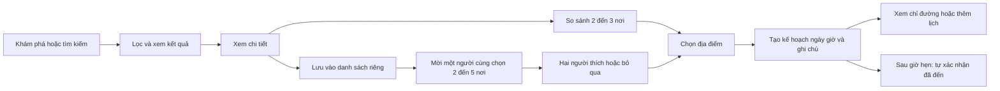
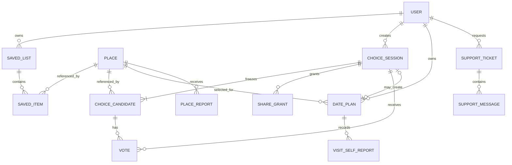
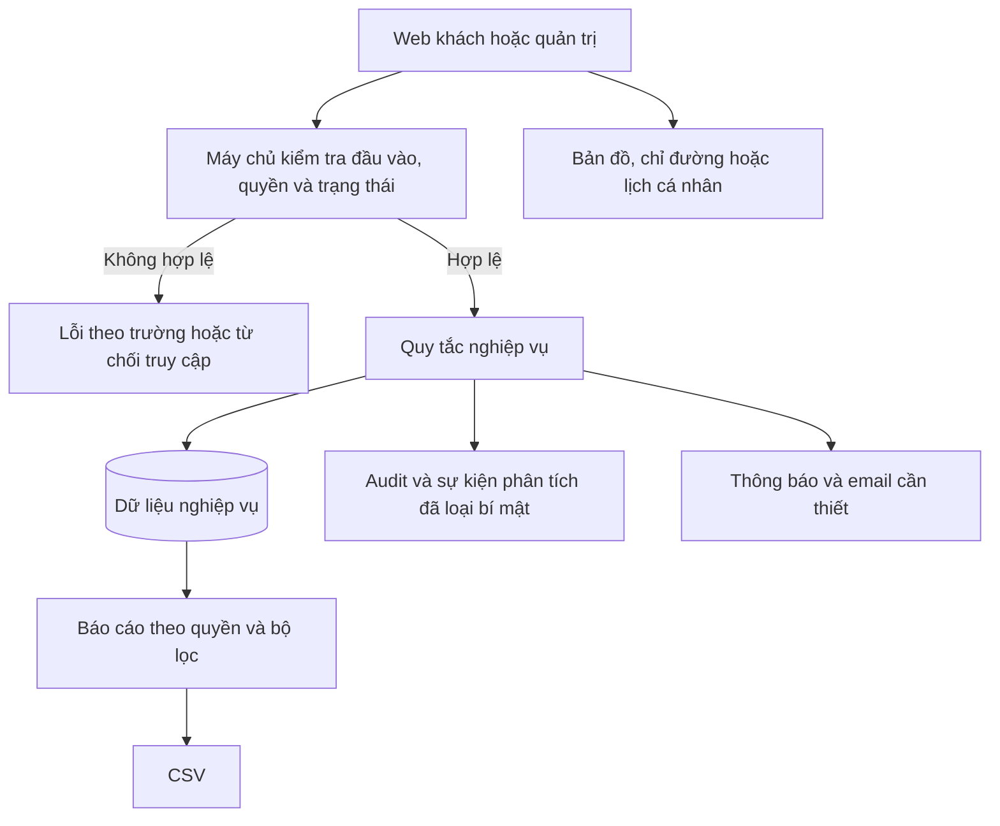
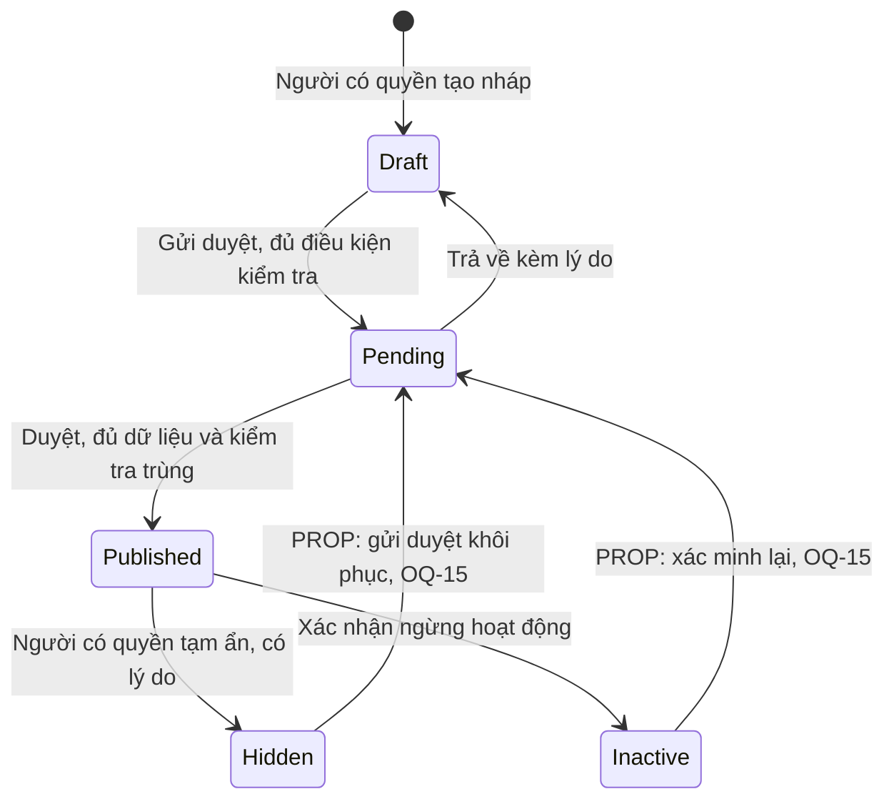
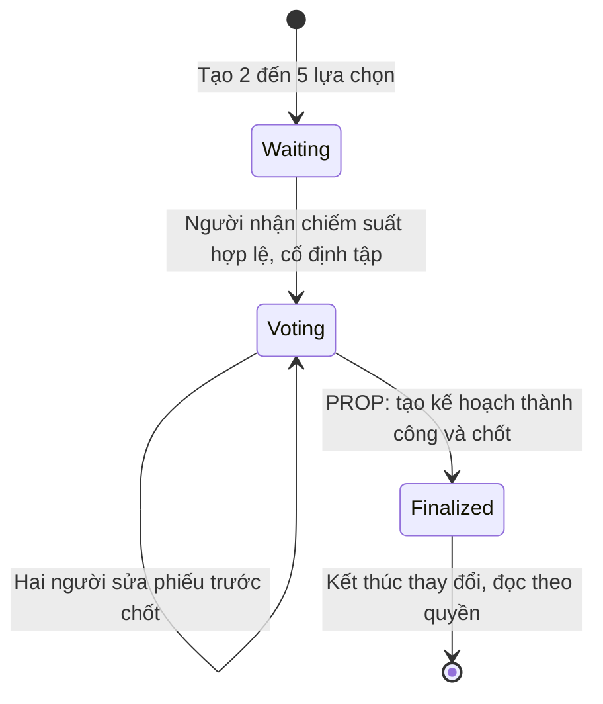
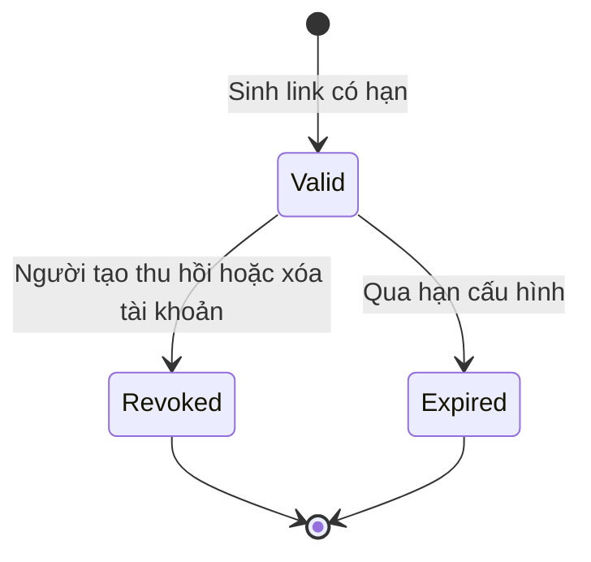
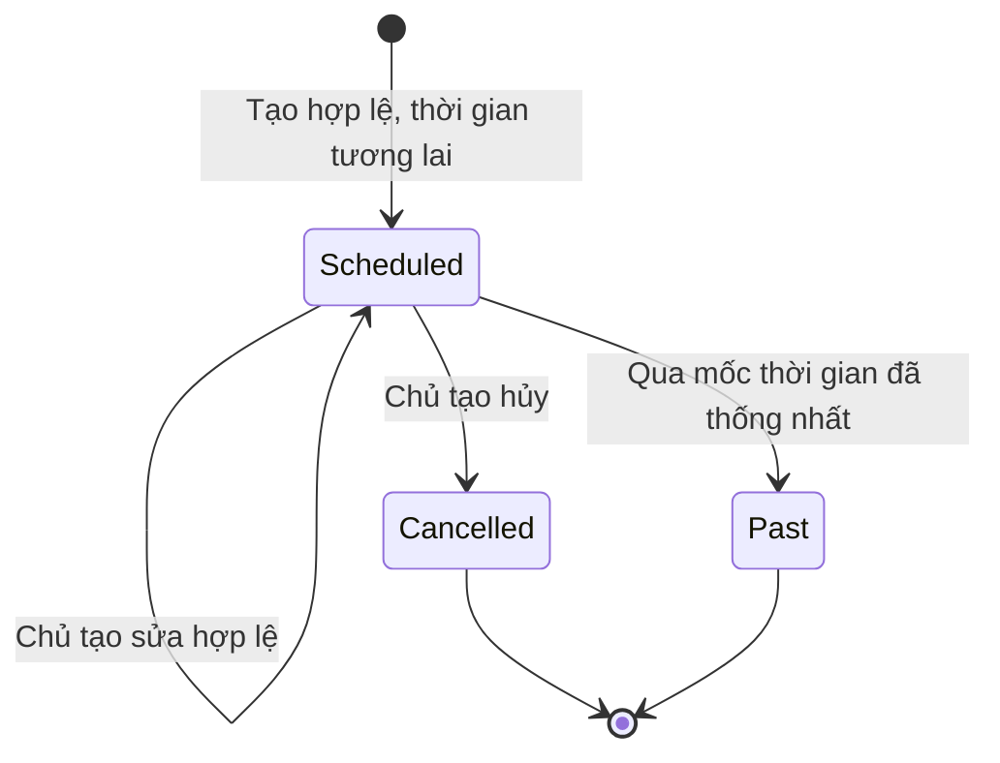
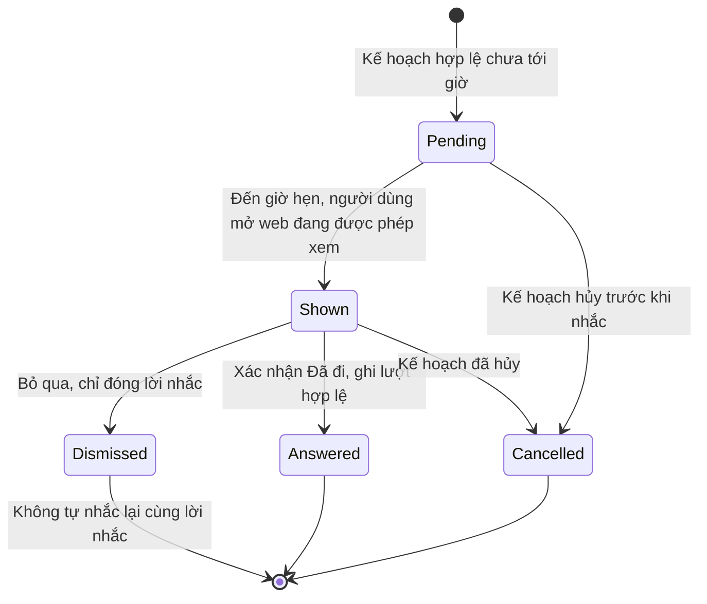
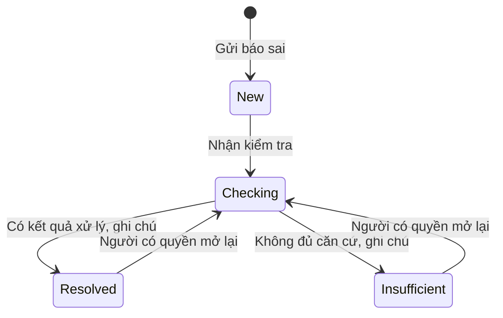
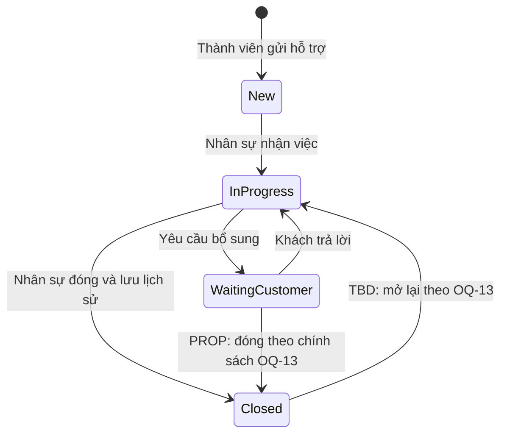

# GoWithBae — Đặc tả yêu cầu phần mềm (SRS) hợp nhất G1

| Thuộc tính | Giá trị |
|---|---|
| Mã tài liệu | GWB-SRS-G1 |
| Phiên bản / ngày tổng hợp | 1.3 / 17-11-2026, giờ Việt Nam |
| Trạng thái | **Draft — tổng hợp nguồn, chưa phải baseline production; không phê duyệt thay PO** |
| Phạm vi | Web khách hàng G1 + quản trị nội bộ; G2 chỉ định hướng |
| Đối tượng | Product Owner, BA, thiết kế, FE, BE, QA, nội dung và vận hành |
| Tài liệu gốc | GWB-REQ-G1 v1.1 ngày 15-11-2026; CR-001 |
| Nguồn bổ sung | GoWithBae: đề xuất gốc, 27 UC/58 AC, gap/backlog/verification/truy vết; UI Handoff, UI Review và Audit lịch sử |
| Vị trí phát hành | `gowithbae-be/docs/SRS.md` và `gowithbae-fe/docs/SRS.md`: cùng nội dung, cùng phiên bản |
| Người tổng hợp | Codex; theo phạm vi người yêu cầu xác nhận ngày 16-11-2026 |

## Hướng dẫn đọc và kiểm soát yêu cầu

Tài liệu này hợp nhất nội dung nghiệp vụ, mô hình dữ liệu, UI, nghiệm thu, câu hỏi mở và audit trong folder `srs`, bổ sung bộ nguồn đầy đủ hơn trong `GoWithBae`. Không cần mở các tài liệu nguồn để hiểu yêu cầu G1. Bản yêu cầu nhúng trong UI Handoff giống bản Requirements nên chỉ giữ một lần. Các chỉ dẫn thao tác công cụ Gemini/Stitch và lời đánh giá quảng bá không chuyển thành yêu cầu sản phẩm.

- **[SRC]**: có trong đề xuất nghiệp vụ nguồn; không có nghĩa đã được khách ký duyệt.
- **[CONF]**: phạm vi/đối tượng đọc đã xác nhận; CR-001 ngày 15-11-2026 xác nhận số lần đã đi, Bỏ qua lời nhắc chỉ đóng và xem link bằng khách không đăng nhập. Việc đồng ý tổng hợp không phê duyệt các PROP/OQ khác.
- **[DER]**: hệ quả phân tích; chưa phải chính sách mới đã duyệt.
- **[PROP]**: phương án đề xuất, gồm kiến nghị audit và lựa chọn thiết kế tạm; cần duyệt trước khi áp dụng.
- **[TBD] / OQ-xx**: chưa đủ thông tin; owner và mốc quyết định nằm tại §13.
- **[AUDIT]**: nhận định/khuyến nghị của báo cáo rà soát, không tự nâng thành yêu cầu bắt buộc dù nguồn dùng từ “bắt buộc”.
- **[OBS]**: quan sát trực tiếp file local ngày 16-11-2026; không thay thế việc kiểm chứng trên Stitch hoặc nghiệm thu hệ thống.
- **Shall / Phải** chỉ bắt buộc trong phạm vi được duyệt; Should / Nên là khuyến nghị; May / Có thể là tùy chọn. Các mục tiêu số được ghi đề xuất vẫn là đề xuất.

Giữ nguyên mã BR/FR/RULE/UC/AC/NFR/OQ từ Requirements để truy vết. Mã audit C-xx/H-xx/M-xx khác mã màn hình C01–C08. Các cột “Nguồn”, “§x” trong bảng kế thừa trỏ tới tài liệu đề xuất khách hàng ngày 12-11-2026; tham chiếu §x trong phần diễn giải của SRS này trỏ tới mục cùng số ở đây. Tiền tố `UI01–UI08` là nhóm chức năng, `C01–C08/E01–E06` là màn/biến thể review; A01–A06 trong các nguồn có cách gom nhóm khác nhau, xem §15.2.

**Thứ tự xử lý nguồn:** Requirements v1.1 và CR-001 là căn cứ hiện hành; v1.0, UI Handoff/Review và audit cũ chỉ bổ sung phần không bị thay thế. UI không thay quy tắc; audit bổ sung rủi ro/phương án cần duyệt. Khi mâu thuẫn, ghi vào §15.2, giữ quy tắc gốc và chờ PO. Không coi mock, API/schema đã có hoặc mã nguồn triển khai là bằng chứng PO đã duyệt OQ.

**Nguồn được bổ sung ngày 16-11-2026:** đã có đề xuất khách hàng gốc, Requirements v1.1, 27 UC, 58 AC Given/When/Then, Gap Analysis, Verification Report, Implementation Backlog và traceability trong `GoWithBae`. Hash đề xuất gốc đã đối chiếu khớp. §17 tích hợp UC/AC; §18 tích hợp backlog và khoảng trống. Các báo cáo kiểm tra nguồn chỉ chứng minh tài liệu, không chứng nhận runtime.

**Đọc theo vai trò:** PO đọc §1–5, §12–15; FE đọc §3–5, §7–9, §12–15; BE đọc §3–7, §9–15; QA đọc toàn bộ và dùng fixture §8.4. Cách làm việc xem [DEVELOPMENT.md](DEVELOPMENT.md); quyết định giải pháp hiện tại xem [TECHSTACK.md](../TECHSTACK.md). SRS mô tả hành vi cần đạt, không xác nhận chức năng đã hoàn thành.

Mục lục: §1 bối cảnh; §2 phạm vi; §3 quyền; §4 chức năng; §5 quy tắc; §6 dữ liệu; §7 trạng thái/tích hợp; §8 UI/fixture; §9 NFR; §10 đo lường; §11 G2; §12 nghiệm thu; §13 quyết định mở; §14 bàn giao/thay đổi; §15 audit/mâu thuẫn; §16 nguồn và tính toàn vẹn; §17 use case/AC; §18 backlog và khoảng trống.

## 1. Bối cảnh, mục tiêu và quy trình nghiệp vụ

### 1.1 AS-IS — hiện trạng theo mô tả khách hàng

Các cặp đôi tìm chỗ hẹn hò qua Facebook, TikTok và nhiều nguồn rời rạc. Nội dung dễ thấy tập trung vào bài viral, chưa phản ánh đầy đủ lựa chọn. Người dùng tự gom thông tin, kiểm tra giá/giờ, so sánh và trao đổi để chốt. Chưa có số liệu nền về thời gian lựa chọn hoặc tỷ lệ thất bại; không tự suy ra tỷ lệ cải thiện.

### 1.2 TO-BE — quy trình mong muốn

Người dùng tìm trong danh mục đã duyệt, lọc theo nhu cầu, xem giá cho hai người và thông tin có nguồn. Họ so sánh, lưu lựa chọn, mời một người cùng đánh dấu sở thích, rồi chủ động chốt một địa điểm và tạo kế hoạch. Nhân sự nội bộ nhập, kiểm tra, duyệt và duy trì dữ liệu; tiếp nhận báo sai, hỗ trợ và xem hiệu quả sử dụng.

Có thể tạo kế hoạch trực tiếp từ chi tiết hoặc so sánh; cùng chọn không phải bước bắt buộc. Kế hoạch G1 không đặt chỗ, không nhận tiền và không chứng minh người dùng đã đến địa điểm.

### 1.3 Yêu cầu nghiệp vụ và thước đo

| Mã | Yêu cầu nghiệp vụ | Thước đo/điều kiện thành công | Nguồn |
|---|---|---|---|
| BR-01 | Phải giúp tìm địa điểm phù hợp với vị trí, ngân sách, hoạt động và thời gian | Bộ dữ liệu nghiệm thu trả đúng kết quả theo bộ lọc; theo dõi tỷ lệ không có kết quả | [SRC] §1, §3, §10.1 |
| BR-02 | Phải giúp người dùng đối chiếu lựa chọn trên cùng tiêu chí | So sánh 2–3 nơi, biểu diễn rõ dữ liệu thiếu, chi phí cho hai người | [SRC] §4 |
| BR-03 | Phải hỗ trợ hai người cùng lựa chọn và người tạo quyết định cuối | Kết quả giao của lượt thích chính xác; không tự chốt | [SRC] §5.2 |
| BR-04 | Phải lưu và quản lý kế hoạch riêng tư | Chủ sở hữu sửa/hủy được, người nhận chỉ xem, người ngoài bị chặn | [SRC] §5.3, §6.4 |
| BR-05 | Phải có quy trình duy trì dữ liệu đáng tin cậy | Có nguồn/ngày kiểm tra; duyệt trước xuất bản; báo sai không tự sửa công khai | [SRC] §4.2, §6.2, §7 |
| BR-06 | Phải đo được hành trình khám phá đến tạo kế hoạch | Báo cáo khớp dữ liệu kiểm thử và xuất CSV đúng quyền/bộ lọc | [SRC] §10 |
| BR-07 | Phải vận hành G1 trên web thuận tiện cho điện thoại | Kiểm tra UI ở 360 px, bàn phím và các trình duyệt đã thống nhất | [SRC] §11; [CONF] web G1 |

Mục tiêu kinh doanh định lượng như tỷ lệ chốt tối thiểu, số người dùng thử, số địa điểm ban đầu và thời gian giảm được: **[TBD — OQ-02]**. Các chỉ số §10 là công cụ đo, không tự coi là KPI đã cam kết.

### 1.4 Thuật ngữ thống nhất

| Thuật ngữ | Nghĩa sử dụng trong đặc tả |
|---|---|
| Địa điểm / Place | Một chi nhánh cụ thể; cùng thương hiệu khác địa chỉ có mã riêng |
| Giá chuẩn hai người | Con số dùng lọc/sắp giá; khác khoảng giá minh họa; nội dung bao gồm phải được xác minh |
| Danh sách đã lưu | Bộ địa điểm riêng của một thành viên, không phải phiên cùng chọn |
| Phiên cùng chọn / ChoiceSession | Một tập lựa chọn gửi cho một người nhận, có phiếu của hai người và quyết định của người tạo |
| Cấp quyền chia sẻ / ShareGrant | Quyền truy cập từ một lời mời, có hạn và có thể thu hồi; không phải quyền sở hữu kế hoạch |
| Phiên truy cập / AccessSession | Phiên tài khoản đã đăng nhập hoặc phiên khách nhận link. Phiên khách được hệ thống tạo để nhớ quyền theo link, **không phải đăng nhập tài khoản**; máy chủ xét quyền hiện tại mỗi thao tác |
| Phiên phân tích / Analytics session | Khoảng hoạt động dùng tính chỉ số; đề xuất kết thúc sau 30 phút không hoạt động, không tự đăng xuất tài khoản |
| Kế hoạch buổi hẹn / DatePlan | Một nơi + ngày giờ + ghi chú; G1 chưa giữ chỗ hoặc thanh toán |
| Tự xác nhận đã đi | Người có quyền đánh dấu Đã đi; câu trả lời chuyến đi tách riêng trạng thái kế hoạch và trạng thái đóng lời nhắc; chưa phải bằng chứng đối tác xác nhận sử dụng |
| Streak / Số lần đã đi | Bộ đếm số lần tự xác nhận đã đi tại cùng chi nhánh; UI hiển thị “Đã đi X lần”. Chưa có yêu cầu chuỗi ngày/tuần liên tiếp hoặc reset khi ngắt chuỗi |
| Bỏ qua lời nhắc | Đóng lời nhắc “Đi chưa?” cho buổi hẹn đó; không đồng nghĩa xác nhận chưa đi, hủy hoặc đổi lịch |
| Baseline | Phiên bản yêu cầu được người có trách nhiệm phê duyệt để triển khai/đo thay đổi |

## 2. Phạm vi và đối tượng liên quan

### 2.1 Trong phạm vi G1

[CONF — CR-001] G1 bổ sung hiển thị số lần đã đi tại địa điểm, lời nhắc “Đi chưa?” trong web với thao tác Bỏ qua chỉ đóng, và xem link bằng phiên khách không đăng nhập. Chi tiết tại FR-11/18/35; chưa thêm thanh toán vào G1.

Web responsive tiếng Việt; khám phá, tìm/lọc, danh sách/bản đồ, chi tiết, so sánh, danh sách riêng, cùng chọn hai người, kế hoạch một địa điểm, tài khoản, báo sai, hỗ trợ và thông báo trong tài khoản. Quản trị gồm địa điểm, duyệt, danh mục, bộ sưu tập, tài khoản/phân quyền, báo sai/hỗ trợ, báo cáo, CSV và nhật ký. Bao gồm cấu hình tích hợp email, bản đồ, ảnh, máy chủ và giám sát cần cho G1; nhà cung cấp chưa được chọn.

Thử nghiệm TP.HCM, VND, giờ Việt Nam là **giả định thiết kế của nguồn**, cần chốt trước thiết kế theo OQ-01. Một kế hoạch phục vụ hai người; mỗi chi nhánh là một địa điểm.

### 2.2 Ngoài phạm vi G1

- G2: cổng đối tác, gói/suất, đặt chỗ, thanh toán, hoàn tiền, đối soát, đánh giá công khai và app native.
- Mạng xã hội, chat riêng/thời gian thực, hồ sơ cặp đôi cố định, ghép đôi tìm người yêu, ví, chia tiền, trả góp, thu cọc, gợi ý AI, lịch trình nhiều điểm tự động.
- Thu thập tự động nội dung/ảnh/đánh giá nền tảng khác khi chưa được phép; tự sinh đánh giá, số sao, hoặc khẳng định dữ liệu chưa xác minh.
- Framework, database, token và endpoint thuộc thiết kế giải pháp; xem TECHSTACK.md và contract của repo. Các câu “chưa chọn/chưa có codebase” trong nguồn mô tả thời điểm lập tài liệu, không phủ nhận hai repo hiện hữu và không tự chốt chính sách nghiệp vụ.

### 2.3 Stakeholder và trách nhiệm

| Vai trò | Trách nhiệm | Người cụ thể |
|---|---|---|
| Khách hàng / Product Owner (PO) | Quyết định phạm vi, chính sách nghiệp vụ, duyệt và nghiệm thu | [TBD — OQ-23] |
| Cặp đôi/người dùng thử | Phản hồi trải nghiệm tìm, cùng chọn và lên kế hoạch | [TBD — nhóm thử nghiệm] |
| Kinh doanh/nội dung | Cung cấp và xác minh dữ liệu, ảnh có quyền dùng, cách tính giá | [TBD — OQ-23] |
| Duyệt nội dung | Kiểm tra trùng, chất lượng và điều kiện xuất bản | [TBD — phân công vận hành] |
| Hỗ trợ | Nhận, trả lời, xử lý báo sai và yêu cầu hỗ trợ | [TBD — OQ-16] |
| Đội thiết kế/phát triển/QA | Đề xuất giải pháp, đặc tả kỹ thuật, xây và kiểm thử theo mã yêu cầu | [TBD — OQ-23] |
| Vận hành/hạ tầng | Tài khoản dịch vụ, giám sát, sao lưu, khôi phục và bảo trì | [TBD — OQ-16] |
| Đối tác | G1 gửi thông tin qua nhân sự; chưa có tài khoản đối tác | [SRC] §1.1 |

## 3. Actor và phân quyền

### 3.1 Ma trận quyền G1

| Tài nguyên/thao tác | Khách | Thành viên | Người nhận link | Biên tập | Duyệt nội dung | Hỗ trợ | Quản trị cao nhất |
|---|---|---|---|---|---|---|---|
| Địa điểm công khai: tìm/xem/so sánh | Có | Có | Có | Theo quyền khách | Theo quyền khách | Theo quyền khách | Có |
| Danh sách cá nhân | Không | Chỉ của mình | Không thấy danh sách gốc | Không có quyền riêng tư mặc định | Không có quyền riêng tư mặc định | Không có quyền riêng tư mặc định | [TBD — OQ-18] |
| Tạo phiên cùng chọn | Không | Của mình | Không | Không mặc định | Không mặc định | Không mặc định | Không mặc định |
| Tham gia/bỏ phiếu | Link hợp lệ | Phiên của mình/link hợp lệ | Chỉ phiên được cấp | Không mặc định | Không mặc định | Không mặc định | Không mặc định |
| Tạo/sửa/hủy kế hoạch | Không | Chỉ kế hoạch mình tạo | Chỉ xem kế hoạch được chia sẻ | Không mặc định | Không mặc định | Không mặc định | [TBD — OQ-18] |
| Gửi báo sai | Có, chống lạm dụng | Có | Như khách | Có | Có | Có | Có |
| Gửi/xem/trả lời hỗ trợ | Không | Chỉ yêu cầu của mình | Không nếu chưa đăng nhập | Không mặc định | Không mặc định | Theo phân công/quyền | Theo quyền được duyệt |
| Tạo/sửa nháp, nhập CSV | Không | Không | Không | Có | Không mặc định nếu chưa có vai trò biên tập | Không mặc định | Theo cấu hình quyền |
| Duyệt/trả về/ẩn, quản lý nhãn | Không | Không | Không | Không tự xuất bản | Có | Không | Theo cấu hình quyền |
| Quản lý bộ sưu tập | Không | Không | Không | [TBD — OQ-18] | [TBD — OQ-18] | Không mặc định | Theo cấu hình quyền |
| Xử lý báo sai | Không | Không | Không | Tiếp nhận | Theo quyền cập nhật/duyệt | Xử lý theo phân công | Theo cấu hình quyền |
| Khóa/mở tài khoản, cấp vai trò, xem nhật ký | Không | Không | Không | Không | Không | Không | Có |
| Báo cáo/xuất CSV | Không | Không | Không | Theo quyền riêng [TBD] | Theo quyền riêng [TBD] | Theo quyền riêng [TBD] | Theo quyền được duyệt |

**Nguyên tắc:** [SRC] kiểm tra quyền tại máy chủ; một người có thể có nhiều vai trò. [DER] Chưa được cấp quyền thì từ chối; vai trò nhân viên không mặc nhiên được đọc dữ liệu riêng tư. [TBD — OQ-18] Khách yêu cầu biên tập không tự xuất bản; cần chốt người có cả hai vai trò có được duyệt nội dung chính mình tạo không. Không mặc định “quản trị cao nhất” được đọc mọi dữ liệu riêng tư.

Tài khoản bị khóa không tạo/chỉnh sửa dữ liệu. Khả năng tiếp tục đọc dữ liệu cá nhân sau khóa và thời điểm thu hồi phiên: OQ-17. **[CONF 15-11-2026] Người nhận link không cần đăng ký hoặc đăng nhập để xem.** Khi tham gia/chọn, hệ thống giữ một **phiên khách theo link**, không phải phiên đăng nhập tài khoản; có link không đồng nghĩa có quyền sửa kế hoạch. Lưu yêu thích, tạo/quản lý dữ liệu cá nhân, xem số lần đã đi của riêng mình cần tài khoản. Thanh toán cũng cần đăng nhập khi triển khai G2, không bổ sung thanh toán vào G1.

## 4. Danh mục chức năng và yêu cầu chi tiết

Thích/Bỏ qua địa điểm trong phiên được mời là thao tác được cấp quyền theo link, vẫn dùng được bằng phiên khách. Nó khác nút “Bỏ qua lời nhắc” của buổi hẹn: bỏ qua địa điểm là một lá phiếu; bỏ qua lời nhắc chỉ đóng nhắc, không phải lá phiếu hoặc câu trả lời đã đi.

Các FR trong §4 là **Shall** sau khi được duyệt, trừ nội dung ghi rõ đề xuất/TBD. CR-001 có các hành vi CONF như chỉ rõ. §17 chứa danh mục UC, tiêu chí Given/When/Then và đặc tả luồng; §12 giữ nghiệm thu cấp sản phẩm.

### 4.1 Khám phá, tìm kiếm và hồ sơ địa điểm

| Mã / nguồn | Đầu vào và xử lý | Kết quả và xử lý ngoại lệ |
|---|---|---|
| FR-01 — Khám phá; §2.2, §7.1/A03 | Người dùng mở trang, chọn bộ sưu tập hoặc hoạt động. Chỉ dùng nội dung trong thời gian hiển thị và địa điểm đã duyệt đang hiển thị | Trang khám phá có tìm kiếm, khu vực, ngân sách, hoạt động và bộ sưu tập. Trống/lỗi có hướng dẫn; không lộ nháp/địa điểm ẩn |
| FR-02 — Tìm kiếm; §3.1/F01 | Từ khóa tên/khu vực/hoạt động; không phân biệt hoa/thường, hỗ trợ không dấu. Không yêu cầu hiểu câu tự nhiên dài | Thẻ gồm ảnh, tên, khu vực, giá hai người, tối đa 3 nhãn, lưu/so sánh. Mặc định: khớp từ khóa → thông tin xác minh mới hơn → mã ổn định. Cách tính mức khớp/tìm rỗng: OQ-04 |
| FR-03 — Bộ lọc; §3.2–3.3/F02 | Áp dụng đồng thời khu vực hoặc tâm/bán kính, ngân sách, ngày giờ và các nhóm nhãn; kết hợp theo RULE-02–05 | Kết quả đáp ứng bộ lọc; giữ nguyên điều kiện khi 0 kết quả; chỉ nới khi khách chọn. Không có giá/giờ không được giả định đạt điều kiện |
| FR-04 — Sắp xếp và bản đồ; §3.1–3.3 | Sắp mặc định/gần nhất/giá tăng. Chọn danh sách hoặc bản đồ; có thể dùng điểm xuất phát do người dùng cung cấp | Giá chưa rõ xếp cuối. Khoảng cách chỉ hiện khi có điểm gốc, ghi “ước tính”; không gọi là thời gian đi. Từ chối vị trí cho nhập thủ công; bản đồ lỗi vẫn xem danh sách. Công thức/bán kính: OQ-05 |
| FR-05 — Chi tiết; §4.1–4.3/F03 | Mã chi nhánh; chỉ địa điểm được phép xem. Dữ liệu thiếu là “Chưa có thông tin” | Thứ tự: ảnh/tên → giá → trải nghiệm → tiện ích → giờ/địa chỉ → lưu ý → ngày cập nhật; gọi, chỉ đường, lưu, so sánh, chọn kế hoạch, báo sai. Không dựng sao/đánh giá giả; link địa điểm ẩn: OQ-11 |
| FR-06 — So sánh; §4.4/F04 | Chọn 2 hoặc 3 mã khác nhau; điều chỉnh danh sách so sánh | Bảng giá hai người, khu vực/khoảng cách, giờ, hoạt động, không khí, tiện ích, đặt trước. Thiếu trường ghi rõ; chặn nơi thứ 4 và chỉ cách bỏ bớt. Khách có thể chọn nơi để tạo kế hoạch nhưng phải đăng nhập trước khi lưu |

### 4.2 Tài khoản, lưu, cùng chọn và kế hoạch

| Mã / nguồn | Đầu vào và xử lý | Kết quả và xử lý ngoại lệ |
|---|---|---|
| FR-07 — Đăng nhập; §6.1/F08 | **Đề xuất:** email và mã một lần; xác minh email, kiểm tra hạn/số lần sai/giới hạn gửi lại | Thành viên có tài khoản riêng; không hỏi tình trạng quan hệ/thông tin người yêu. Mã không hợp lệ không tạo phiên; email lỗi có cách thử lại. Phương thức và cấu hình phải chốt OQ-06 |
| FR-08 — Hồ sơ; §6.1, §6.4 | Sửa tên, ảnh tùy chọn; đổi email sau xác minh email mới; đăng xuất; yêu cầu xóa tài khoản | Không cho sửa tài khoản khác; khóa chặn tạo/sửa. Xóa phải thu hồi phiên và link riêng, không đồng nghĩa đã chốt quy tắc giữ/xóa toàn bộ dữ liệu: OQ-17 |
| FR-09 — Danh sách đã lưu; §5.1/F05 | Thành viên tạo/đổi tên/xóa danh sách, thêm/bỏ địa điểm; kiểm tra chủ sở hữu | Mặc định riêng tư; cặp danh sách–địa điểm không trùng. Xóa danh sách không xóa địa điểm/kế hoạch; nơi ẩn vẫn hiện tên/cảnh báo trong danh sách cũ, không được chốt mới |
| FR-10 — Tạo lời mời; §5.2/F06 | Người tạo chọn 2–5 địa điểm đã lưu và tạo phiên, sinh link khó đoán | Cảnh báo ai có link hợp lệ có thể xem và chiếm suất; không index công khai. **Đề xuất nguồn:** link hết hạn sau 7 ngày. Không lộ toàn bộ danh sách cá nhân; chọn nơi ẩn/đổi danh sách trước khi tham gia: OQ-07, OQ-11 |
| FR-11 — Tham gia; §5.2 + CR-001 | [CONF] Người nhận mở link hợp lệ xem được nội dung chia sẻ ngay, không bị chặn bằng màn hình đăng nhập. Khi tham gia cùng chọn, nhập tên hiển thị; máy chủ kiểm tra hạn/thu hồi/suất | Một người tạo + một người nhận; không cần đăng ký/đăng nhập. Hệ thống tạo phiên khách để nhớ người nhận và quyền theo link; cố định tập sau khi tham gia. [DER] Hai người nhận đồng thời chỉ một người chiếm suất thành công. Thao tác cá nhân vẫn yêu cầu đăng nhập |
| FR-12 — Bỏ phiếu và kết quả; §5.2 | Mỗi người chọn Thích/Bỏ qua trên từng nơi; chưa chọn là Chưa trả lời; được sửa trước chốt | Hiển thị các nơi cả hai thích riêng; vẫn xem nơi còn lại. Không trùng thì gợi ý chọn lại hoặc tạo phiên mới. Không có lượt chọn không có nghĩa là Bỏ qua; không tự chốt. Có được nhìn phiếu riêng của nhau không: OQ-07 |
| FR-13 — Chốt từ phiên; §5.2–5.3 | Chỉ người tạo chọn nơi cuối rồi điền ngày giờ/ghi chú; kiểm tra điều kiện kế hoạch | Tạo kế hoạch theo FR-15 và phiên chuyển chỉ xem sau khi chốt thành công. [PROP] Lưu kế hoạch và chốt phiên như một thao tác nhất quán để không chốt khi lưu thất bại; mốc chốt/cần cả hai trả lời: OQ-08 |
| FR-14 — Quản lý quyền chia sẻ; §5.2, §6.4 | Người tạo thu hồi link, loại người nhận, cấp link mới; người nhận mất phiên cần được mời lại | Link cũ mất quyền ngay; [DER] phải kiểm tra hiệu lực cấp quyền cả khi dùng phiên người nhận cũ. Không xóa/sửa ý nghĩa phiếu cũ. Quy tắc tái sử dụng phiếu, quyền kế hoạch sau thu hồi và hết hạn: OQ-07–09 |
| FR-15 — Tạo kế hoạch; §5.3/F07 | Thành viên chọn 1 địa điểm đang hiển thị, thời gian tương lai, ghi chú tùy chọn, người nhận nếu có | Giờ xác minh là đóng thì chặn; giờ chưa rõ thì cảnh báo, không tự coi mở. Ghi kế hoạch Đã lên lịch; hiển thị “Kế hoạch này chưa giữ chỗ tại địa điểm”. Không yêu cầu cùng chọn trước |
| FR-16 — Quản lý kế hoạch; §5.3 | Chủ sở hữu sửa giờ/ghi chú, đổi địa điểm hoặc hủy; người nhận chỉ xem bản được chia sẻ | Đổi nơi kiểm tra lại; ghi thời điểm sửa và tạo thông báo tài khoản liên quan. Khách nhận link xem bản mới khi mở lại. Lưu thất bại không báo thành công; nơi bị ẩn sau tạo và sửa kế hoạch đã qua giờ: OQ-10–11 |
| FR-17 — Tiện ích buổi hẹn; §5.3 | Mở chỉ đường hoặc thêm lịch cá nhân | Dùng địa điểm/ngày giờ hiện tại; lịch ghi rõ giờ Việt Nam. Chọn tải lịch hay tích hợp tài khoản lịch: OQ-12; không mặc định đồng bộ hai chiều hoặc tự nhắc hẹn |
| FR-18 — Lời nhắc đến giờ hẹn; §5.3, §10 + CR-001 | [CONF] Đến ngày giờ buổi hẹn, hiển thị lời nhắc “Đi chưa?”. Người dùng có thể xác nhận Đã đi hoặc bấm “Bỏ qua lời nhắc” | Bỏ qua thì lời nhắc biến mất, không mở popup gợi ý quán khác/lịch mới; không đổi lịch, không hủy, không tự đánh dấu Chưa đi. [DER] Lưu trạng thái đã bỏ qua để lời nhắc của chính buổi hẹn không hiện lại khi tải trang; không tăng số lần đã đi. Trạng thái kế hoạch/đã đi/nhắc tách biệt; lịch hủy không nhắc. Actor trả lời và sửa trả lời còn ở OQ-10 |

### 4.2.1 Số lần đã đi và hành vi lời nhắc [CR-001]

| Mã / nguồn | Đầu vào và xử lý | Kết quả và xử lý ngoại lệ |
|---|---|---|
| FR-35 — Streak / số lần đã đi; CR-001 ngày 15-11-2026 | [CONF] Khi người dùng xác nhận đã đi đến một địa điểm, hệ thống ghi nhận lượt đi; lần quay lại tiếp theo hiển thị tổng số lần đã đi tại nơi đó. [DER] Gắn số đếm với tài khoản và mã chi nhánh; mỗi lượt đi hợp lệ chỉ tính một lần | UI hiển thị “Đã đi X lần” ở chi tiết địa điểm và buổi hẹn của tài khoản đó. Xác nhận lại/bấm lặp/tải trang không cộng thêm; một buổi hẹn khác được xác nhận đã đi tại cùng nơi mới tăng thêm lượt. Bỏ qua nhắc, thời gian trôi qua hoặc chỉ tạo kế hoạch không tăng. Không công khai lịch sử cá nhân cho khách nhận link; không tự xây chuỗi ngày/tuần hay reset. Chính sách sửa câu trả lời/lượt đi ngoài kế hoạch còn ở OQ-10/25 |

**Luồng lời nhắc:** đến giờ hẹn → “Đi chưa?” → **Đã đi**: ghi nhận tự xác nhận, cập nhật số lần, đóng lời nhắc; hoặc **Bỏ qua lời nhắc**: chỉ đóng lời nhắc. Không có bước tự mở popup khác hoặc tự đổi quán/đổi lịch. Nếu thiết kế còn dùng nhãn “Chưa đi” tại lời nhắc, phải đổi thành “Bỏ qua lời nhắc” để tránh nhầm với một câu trả lời Không trong lịch sử.

**Dữ liệu khi bỏ qua:** [DER] chỉ lưu trạng thái kỹ thuật `dismissed` và thời điểm để nhớ lời nhắc đã bị đóng; câu trả lời chuyến đi giữ nguyên (nếu chưa trả lời thì vẫn Chưa trả lời). Không tự ghi `visit_self_reported=Không`. Có thể ghi `date_reminder_dismissed` riêng cho vận hành/phân tích theo whitelist, không đưa ghi chú riêng vào log. Chưa có yêu cầu trì hoãn rồi nhắc lại hoặc popup gợi ý khác.

### 4.3 Báo sai, hỗ trợ, thông báo và quyền riêng tư

| Mã / nguồn | Đầu vào và xử lý | Kết quả và xử lý ngoại lệ |
|---|---|---|
| FR-19 — Gửi báo sai; §6.2/F09 | Khách/thành viên chọn sai giá, giờ, địa chỉ, đóng cửa, ảnh hoặc khác; mô tả và ảnh tùy chọn; chống gửi hàng loạt | Mã báo sai, địa điểm, nội dung, người gửi nếu có, thời điểm, trạng thái Mới. Không tự sửa địa điểm. Không cho khách ẩn danh tra cứu báo sai của người khác bằng đoán mã |
| FR-20 — Yêu cầu hỗ trợ; §6.3/F10 | Thành viên gửi chủ đề/nhóm/nội dung/tệp; xem và bổ sung trong yêu cầu của mình | Có mã, người phụ trách, trạng thái, lịch sử phản hồi; không chat thời gian thực. Khách không xem ghi chú nội bộ. Trả lời khi đã đóng và thời gian xử lý: OQ-13, OQ-16 |
| FR-21 — Thông báo; §6.4 + CR-001 | Sự kiện cập nhật buổi hẹn/hỗ trợ tạo thông báo đúng tài khoản; đến giờ hiển thị lời nhắc trong web theo FR-18; email cho xác thực và xử lý cần thiết | Bỏ qua lời nhắc theo FR-18, không popup khác. Không gửi riêng tư cho người ngoài; tiếp thị có lựa chọn riêng; chưa bổ sung email/push nhắc hẹn. Đọc/chưa đọc và email cần thiết còn ở OQ-14 |
| FR-22 — Quyền riêng tư; §6.4, §11.2 | Mọi thao tác riêng kiểm tra người dùng, vai trò, sở hữu hoặc cấp quyền chia sẻ tại máy chủ | Đổi mã đối tượng/phiên không được lộ email, lịch sử tìm, danh sách, vị trí hoặc ghi chú người khác; không theo dõi vị trí liên tục. Thu hồi link có hiệu lực ngay, kể cả nội dung cũ đang mở khi gửi yêu cầu tiếp theo |

### 4.4 Quản trị và dữ liệu vận hành

| Mã / nguồn | Đầu vào và xử lý | Kết quả và xử lý ngoại lệ |
|---|---|---|
| FR-23 — Biên tập địa điểm; §4, §7/A01 | Nhân sự có quyền tạo/sửa nháp, xem trước, lọc khu vực/trạng thái, gửi duyệt | Kiểm tra dữ liệu/nguồn/quyền ảnh, mã chi nhánh, trùng; Nháp → Chờ duyệt. Sửa địa điểm đã xuất bản phải giữ nguyên yêu cầu duyệt; cách quản lý phiên bản công khai: OQ-15 |
| FR-24 — Duyệt và ngừng hiển thị; §4.2, §7 | Người có quyền duyệt kiểm tra điều kiện xuất bản, trùng, nguồn/ngày; duyệt hoặc trả về có lý do; ẩn/ngừng hoạt động | Không cho biên tập tự xuất bản; không xóa lịch sử có kế hoạch/đơn. Nhật ký trước/sau/lý do. Phục hồi từ ẩn/ngừng hoạt động phải qua điều kiện nào: OQ-15 |
| FR-25 — Danh mục; §7/A02 | Người có quyền quản lý loại hình, nhãn, khu vực, ngừng dùng nhãn | Dữ liệu cũ còn tham chiếu; không xóa dây chuyền địa điểm. Cách gộp/đổi tên nhãn và hiện nhãn ngừng dùng: OQ-18 |
| FR-26 — Bộ sưu tập; §7/A03 | Người có quyền tạo tên/nội dung/ảnh, chọn nơi, thứ tự, lịch hiển thị | Chỉ xuất hiện theo lịch và nơi đủ điều kiện hiển thị; không đưa nơi ẩn trở lại tìm kiếm. Quyền duyệt bộ sưu tập: OQ-18 |
| FR-27 — Tài khoản và vai trò; §7/A04 | Quản trị tìm tài khoản, xem trạng thái, khóa/mở có lý do, gán/bỏ vai trò | Ghi nhật ký thay quyền; ngăn gọi trực tiếp API vượt quyền; áp dụng chính sách tài khoản bị khóa. Cách ngăn mất quản trị cuối cùng và quyền tự đổi vai trò: OQ-18 |
| FR-28 — Xử lý báo sai; §6.2, §7/A05 | Hàng chờ, giao việc, kiểm tra, ghi chú, cập nhật trạng thái | Mới → Đang kiểm tra → Đã xử lý/Không đủ căn cứ; đóng có ghi chú, người có quyền mở lại. Cập nhật địa điểm đi qua quyền biên tập/duyệt, không bỏ quy trình xuất bản |
| FR-29 — Xử lý hỗ trợ; §6.3, §7/A05 | Nhân sự nhận việc, phản hồi, ghi chú nội bộ, chuyển trạng thái, đóng | Mới/Đang xử lý/Chờ khách phản hồi/Đã đóng; lưu lịch sử và thông báo. Tách trả lời công khai với ghi chú nội bộ. Mở lại: OQ-13 |
| FR-30 — Nhập CSV; §7.3 | Nhân sự có quyền tải mẫu và nhập thử; kiểm tra thiếu trường, mã trùng, tọa độ sai; ảnh gắn riêng theo mã | Báo lỗi từng dòng, không âm thầm bỏ lỗi; dữ liệu nhập chưa tự xuất bản. [PROP] Mặc định chỉ ghi khi toàn bộ lô hợp lệ; nhập phần hợp lệ/update hay create-only cần chốt OQ-19 |
| FR-31 — Nhật ký; §7.3 | Ghi chủ thể/thời điểm/đối tượng/giá trị trước–sau/lý do cho duyệt, ẩn, đổi giá, khóa và cấp quyền | Nhân viên không sửa/xóa nhật ký qua UI; không đưa mã xác thực/khóa riêng vào log. Quyền xem, thời hạn giữ và dữ liệu cần che: OQ-17–18 |
| FR-32 — Sự kiện phân tích; §10.3 | Ghi sự kiện theo §10, có mã chống trùng, thời gian, phiên, nền tảng, người dùng/khách, đối tượng và thuộc tính phù hợp | Không ghi từng ký tự thành tìm kiếm; không ghi mã đăng nhập, thẻ hoặc ghi chú riêng. Tách người dùng tự báo đã đi với giao dịch G2; quy tắc phiên/ghép định danh: OQ-20 |
| FR-33 — Báo cáo; §7/A06, §10 | Người có quyền chọn thời gian, khu vực, loại hình, nền tảng; tính theo công thức §10 | Có số liệu sử dụng/chất lượng dữ liệu và thời điểm cập nhật; G1 cập nhật trong 24 giờ. Phân biệt tài khoản và khách ẩn danh; không khẳng định một người xuyên thiết bị |
| FR-34 — Xuất CSV; §7/A06, §10.3 | Chỉ người được cấp quyền xuất; giữ nguyên bộ lọc và phạm vi truy cập của báo cáo | CSV đối chiếu được với số tổng/chi tiết; không lộ thêm dữ liệu riêng. Lỗi xuất báo rõ và thử lại; khối lượng/hình thức xuất: OQ-20 |

## 5. Quy tắc nghiệp vụ và validation

### 5.1 Danh mục bộ lọc ban đầu [SRC §3.2]

| Nhóm | Giá trị ban đầu / cách chọn | Cách kết hợp trong nhóm |
|---|---|---|
| Khu vực | Danh mục khu vực; hoặc một điểm và bán kính | Hai chế độ, chọn kết hợp hay loại trừ nhau: OQ-05 |
| Ngân sách hai người | Miễn phí; dưới 200.000; 200.000 đến dưới 400.000; 400.000 đến 700.000; trên 700.000 VND | Theo giá chuẩn; ranh giới tại RULE-03 |
| Ngày giờ | Ngày và giờ dự định đến | Xét lịch tuần và ngoại lệ |
| Hoạt động | Ăn uống, cà phê, vẽ tranh, làm gốm, làm bánh, xem phim, triển lãm, trò chơi, vận động | OR — ít nhất một |
| Không khí | Yên tĩnh, lãng mạn, sôi động, ấm áp, riêng tư | AND — phải đủ |
| Phong cách | Vintage, tối giản, hiện đại, nghệ thuật, sân vườn | OR |
| Cảnh quan | Nhiều cây, ven hồ, ven sông, rooftop, ngắm hoàng hôn | OR |
| Đặc điểm | Có mèo tại quán, có chó tại quán, cho mang thú cưng, band nhạc, ngoài trời | AND |
| Tiện ích | Khu không hút thuốc, tiếp cận xe lăn | AND |
| Dịp hẹn | Hẹn đầu, cuối tuần, kỷ niệm, sinh nhật | OR |

### 5.2 Danh mục quy tắc

| Mã | Quy tắc và kiểm tra | Khi vi phạm / phục hồi | Nguồn, tình trạng |
|---|---|---|---|
| RULE-01 | Chỉ địa điểm đã duyệt và đang hiển thị được khám phá/tìm/chốt mới | Loại khỏi kết quả; chốt thất bại yêu cầu chọn lại; lịch sử giữ tên/cảnh báo theo quyền | [SRC] §3–5 |
| RULE-02 | Các nhóm lọc kết hợp AND; hoạt động/phong cách/cảnh quan/dịp OR; không khí/tiện ích/đặc điểm AND | Không trả kết quả thiếu bất kỳ điều kiện bắt buộc; không tự nới | [SRC] §3.3 |
| RULE-03 | Giá lọc là giá chuẩn cho hai người, không phải lấy giao của khoảng giá. Khoảng nguồn: miễn phí, dưới 200k, 200k–<400k, 400k–700k, >700k | Giá chưa biết loại khỏi lọc ngân sách; giá không hợp lệ không lưu. [PROP] Tách miễn phí `p=0`; dưới 200k là `0<p<200000`, đến 700k gồm đúng 700000; OQ-03 | [SRC]+[PROP] §3 |
| RULE-04 | Không có dữ liệu giá/giờ/tiện ích không đồng nghĩa bằng 0/đang mở/không có | Hiển thị “Chưa có thông tin”; không thỏa bộ lọc cần chứng minh thuộc tính đó | [SRC]+[DER] §3.3, §4.1 |
| RULE-05 | Lịch ngoại lệ phải được đối chiếu cùng lịch tuần; thời điểm kế hoạch tương lai; đã xác minh đóng cửa thì chặn tạo | Đổi giờ hoặc chọn nơi khác; chưa có giờ chỉ cảnh báo khi tạo nhưng không đạt lọc đang mở. [PROP] Ngoại lệ ưu tiên lịch tuần; ranh giới/qua đêm OQ-04 | [SRC]+[PROP] §3.2, §5.3 |
| RULE-06 | So sánh đúng 2–3 địa điểm khác nhau | Trùng không thêm lần hai; nơi thứ 4 bị chặn; chưa đủ 2 gợi ý thêm nơi | [SRC]+[DER] §4.4 |
| RULE-07 | Danh sách riêng thuộc một người; cặp list–place duy nhất | Sai sở hữu bị chặn; thêm lặp không tạo bản ghi mới; xóa list không xóa place/plan | [SRC] §5.1 |
| RULE-08 | Phiên cùng chọn lấy 2–5 địa điểm đã lưu; một người tạo + một người nhận | Sai số lượng chặn tạo; suất đã có người chặn tham gia khác; nơi ẩn OQ-11 | [SRC] §5.2 |
| RULE-09 | Cố định tập địa điểm sau người nhận tham gia; muốn đổi tạo phiên mới | Chặn sửa tập đang dùng, giữ nghĩa phiếu; hướng dẫn tạo mới | [SRC] §5.2 |
| RULE-10 | Phiếu thuộc từng người/từng nơi, giá trị Thích/Bỏ qua/Chưa trả lời; chỉ sửa trước chốt | Sai người/nơi/trạng thái bị chặn; cả hai thích mới là giao; không có giao không tự chốt | [SRC] §5.2 |
| RULE-11 | Chỉ người tạo chốt; hệ thống không tự chốt theo phiếu; chốt xong chỉ xem | Người nhận chốt/sửa phiếu sau chốt bị từ chối; lưu plan lỗi không được báo chốt thành công | [SRC]+[DER] §5.2 |
| RULE-12 | Link khó đoán, không index; hết hạn/thu hồi không cho truy cập; phiên khách riêng phụ thuộc cấp quyền còn hiệu lực | Báo link không hợp lệ; không lộ nội dung; chủ tạo mời lại. Hạn 7 ngày là đề xuất; OQ-07, OQ-09 | [SRC]+[DER] §5.2, §6.4 |
| RULE-13 | Kế hoạch có một địa điểm, chủ tạo, ngày giờ, ghi chú tùy chọn, người nhận nếu có | Thiếu/sai trường hoặc nơi không hợp lệ chặn lưu; không có đặt chỗ/thanh toán G1 | [SRC] §5.3 |
| RULE-14 | Chủ tạo được sửa/hủy, người nhận chỉ xem; kiểm tra quyền tại máy chủ | Từ chối sửa/hủy của người khác; không chỉ ẩn nút. Chuyển kế hoạch đã qua giờ: OQ-10 | [SRC] §5.3 |
| RULE-15 | Trạng thái plan, câu trả lời đã đi và trạng thái lời nhắc là ba dữ liệu riêng. Đến giờ hỏi “Đi chưa?”; Bỏ qua chỉ đóng nhắc | Không tự gán Không/Có khi bỏ qua, không đổi/hủy lịch hay gợi ý popup; không đổi plan hủy thành qua giờ; không gắn nhãn sử dụng đã xác minh | [SRC]+[CONF]+[DER] §5.3, §10, CR-001 |
| RULE-16 | Mã đăng nhập dùng một lần, có hạn và giới hạn gửi/nhập; email mới cần xác minh | Sai/hết hạn/tái dùng bị từ chối; không cấp phiên; cấu hình OQ-06 | [SRC] §6.1 |
| RULE-17 | Tài khoản khóa không tạo/sửa; xóa thu hồi phiên/link; hồ sơ không yêu cầu tình trạng quan hệ | Chặn thao tác không hợp lệ; chưa tuyên bố xóa dữ liệu hoàn tất khi mới nhận yêu cầu | [SRC] §6 |
| RULE-18 | Báo sai được gửi ẩn danh có chống lạm dụng; không sửa công khai tự động; đóng có ghi chú | Quá hạn mức chặn và cho biết cách thử lại; thiếu ghi chú chặn đóng; mở lại theo quyền | [SRC] §6.2 |
| RULE-19 | Hỗ trợ chỉ thành viên; phân biệt phản hồi khách với ghi chú nội bộ | Người ngoài không đọc/trả lời; ghi chú nội bộ không trả ra giao diện khách; trạng thái đóng OQ-13 | [SRC]+[DER] §6.3, §7 |
| RULE-20 | Xuất bản cần tên, loại hình, địa chỉ, tọa độ, mô tả, ảnh có quyền, hoạt động chính, trạng thái giá/giờ, nguồn/ngày kiểm tra và kiểm tra trùng | Thiếu thì giữ nháp/chờ duyệt, liệt kê lỗi; không bắt buộc biết giá/giờ thực nếu đã ghi chưa rõ | [SRC] §4.2 |
| RULE-21 | Biên tập không tự xuất bản; quản lý quyền, duyệt/ẩn/giá/khóa có nhật ký | Từ chối thao tác vượt quyền; thay đổi quan trọng không được mất dấu vết; vai trò kép OQ-18 | [SRC] §7 |
| RULE-22 | Không xóa lịch sử địa điểm đã tham chiếu; nhãn ngừng dùng không làm mất dữ liệu cũ | Chặn xóa phá tham chiếu; dùng trạng thái/vô hiệu hóa phù hợp | [SRC] §4.2, §7 |
| RULE-23 | CSV có kiểm tra thử và báo lỗi dòng, mã trùng, tọa độ; ảnh gắn mã riêng | Không âm thầm bỏ dòng lỗi; chưa ghi lô chưa hợp lệ theo chính sách OQ-19 | [SRC] §7.3 |
| RULE-24 | Thông báo đúng đối tượng, tiếp thị có lựa chọn riêng; chia sẻ không lộ dữ liệu ngoài phạm vi | Không gửi khi thiếu quyền; lỗi thông báo không được làm người dùng tưởng thao tác nghiệp vụ chưa được lưu | [SRC]+[DER] §6.4 |
| RULE-25 | Sự kiện có mã chống trùng; báo cáo tách khách/tài khoản, tự báo/đơn; không ghi dữ liệu nhạy cảm đã cấm | Loại sự kiện lặp khỏi tổng; không hợp nhất xuyên thiết bị khi chưa có căn cứ | [SRC] §10 |
| RULE-26 | Báo cáo/CSV cùng bộ lọc và quyền, G1 độ trễ tối đa 24 giờ | Từ chối xuất vượt quyền; dữ liệu chưa đủ kỳ không gán tỷ lệ giả; hiển thị cập nhật | [SRC]+[DER] §10 |
| RULE-27 | Tệp giới hạn định dạng/kích thước, kiểm tra nội dung; không công khai token/khóa; nhân viên dùng 2 bước trước vận hành | Tệp bị từ chối không tạo liên kết công khai; lỗi có mã tra cứu, không trả bí mật | [SRC] §11.2 |
| RULE-28 | Chỉ dữ liệu có quyền sử dụng được công bố; minh họa phải gắn nhãn và tách môi trường thật | Không xuất bản ảnh không có quyền; không dùng dữ liệu giả làm số liệu kinh doanh | [SRC] §11.4 |
| RULE-29 | [CONF] Số lần đã đi tăng từ lượt tự xác nhận Đã đi; [DER] đếm theo tài khoản + chi nhánh, một kế hoạch được xác nhận hợp lệ tối đa một lượt, retry không tăng | Không đếm theo số lần bấm/nhắc/tạo kế hoạch; Bỏ qua/Chưa trả lời/Không không tăng; dữ liệu bị thay đổi cần tính lại theo OQ-10/25, không tự dùng chuỗi thời gian liên tiếp | [CONF]+[DER] CR-001 |
| RULE-30 | [CONF] Xem link hợp lệ không cần tài khoản; phiên khách được cấp theo link, không phải đăng nhập. Dữ liệu/thao tác cá nhân cần tài khoản | Không redirect sang đăng nhập chỉ để xem link; link hết hạn/thu hồi vẫn chặn. Khách bấm lưu yêu thích được yêu cầu đăng nhập, không cấp quyền xem toàn bộ dữ liệu cá nhân người gửi | [CONF]+[DER] CR-001 |

Thông báo validation đề xuất: “Bạn chỉ có thể so sánh tối đa 3 địa điểm”; “Hãy chọn từ 2 đến 5 địa điểm”; “Liên kết không còn hiệu lực”; “Địa điểm đóng cửa vào thời gian bạn chọn”; “Chưa có thông tin giờ mở cửa”; “Bạn không có quyền thực hiện thao tác này”. Nội dung UX cuối do PO/thiết kế duyệt, không làm lộ sự tồn tại tài nguyên riêng.

## 6. Mô hình dữ liệu nghiệp vụ

Đây là mô hình logic, chưa phải schema vật lý hoặc quyết định công nghệ. Độ dài chuỗi, dung lượng tệp, chính sách lưu trữ và cách phân trang cần chốt; không tự dùng các giá trị mặc định như yêu cầu khách hàng.

| Thực thể | Trường nghiệp vụ và validation chính | Quan hệ / quyền |
|---|---|---|
| User | id duy nhất, tên hiển thị, email xác thực, ảnh tùy chọn, ngày tạo, trạng thái; email mới xác minh trước thay | Một người nhiều list, plan, ticket; quản lý hồ sơ chính mình |
| LoginChallenge / AccessSession | Danh tính, thời điểm tạo/hết hạn, số lần thử, đã dùng/thu hồi; bí mật không xuất ra log | Mã một lần; phiên có thể bị thu hồi; cấu hình OQ-06 |
| Role / Permission / UserRole | Mã quyền, vai trò, người gán và thời điểm | Nhiều vai trò/người; thay đổi ghi audit |
| Place | Mã mỗi chi nhánh, tên, loại hình, địa chỉ, khu vực, tọa độ, mô tả, liên hệ/lưu ý, trạng thái, người tạo/duyệt | Không xóa phá lịch sử; chỉ công khai bản được duyệt |
| PlacePrice | Trạng thái known/unknown; giá chuẩn 2 người; min/max; phần bao gồm; nguồn/ngày kiểm tra | [DER] Giá known phải có giá chuẩn và khoảng hợp lệ, `0 ≤ min ≤ standard ≤ max`; cách tính/thuế/phụ phí OQ-03 |
| OpeningHours / DateException | Trạng thái known/unknown, lịch tuần nhiều khoảng/ngày, nghỉ/giờ ngoại lệ ngày cụ thể | Giờ local Việt Nam; khoảng qua đêm và ranh giới OQ-04; lịch rỗng không tự coi đóng |
| PlaceImage | Mã ảnh, place, thứ tự/ảnh đại diện, mô tả, nguồn/quyền sử dụng | Ít nhất 1 ảnh có quyền trước xuất bản; upload theo RULE-27 |
| Taxonomy / PlaceTag | Nhóm, mã, tên, trạng thái, quan hệ với place | Nhãn thiếu khác nhãn không có; ngừng dùng không phá lịch sử |
| SavedList / SavedListItem | id list, chủ sở hữu, tên, ngày tạo; list_id/place_id duy nhất | Mặc định riêng tư; xóa list không xóa plan/place |
| ChoiceSession / ChoiceCandidate | id, creator, trạng thái, thời điểm; tập 2–5 place, phiên bản tập lựa chọn | Cố định sau người nhận tham gia; không đồng nhất với list gốc |
| ShareGrant / RecipientSession | Mã liên kết bí mật, hạn, thu hồi, phiên cùng chọn, người nhận/tên, phiên truy cập riêng | Chỉ 1 suất người nhận; link/phiên hết quyền không tiếp tục truy cập; OQ-09 |
| Vote | choice_id, candidate_id, participant, preference, thời điểm sửa | Một phiếu hiện tại/người/nơi; thiếu bản ghi tương đương Chưa trả lời, không Bỏ qua |
| DatePlan | id, owner, place, thời điểm, ghi chú, người nhận nếu có, trạng thái, created/updated | 1 nơi; quyền người nhận chỉ xem; chốt từ phiên có liên kết choice_id |
| VisitSelfReport | plan, tài khoản/người có quyền trả lời, Có/Không/Chưa trả lời, thời điểm, mã lượt để chống lặp | Đã đi tương ứng Có; Bỏ qua lời nhắc không đổi trường này. Tách khỏi trạng thái plan/G2; OQ-10 về actor/đổi câu trả lời |
| DateReminder | plan, người được nhắc, scheduled_at, trạng thái pending/shown/dismissed/answered/cancelled, dismissed_at/answered_at | [DER] Một lời nhắc hiệu lực theo buổi hẹn/người được nhắc; bỏ qua nhớ ở máy chủ, không hiện lại khi tải trang; hủy plan thì không nhắc. Đổi giờ sau khi đã bỏ qua theo OQ-25 |
| PlaceVisitCount (dữ liệu tính toán) | user_id, place_id, visit_count, ngày cập nhật; tính từ các lượt Đã đi hợp lệ | [DER] Không dùng số lần click làm tổng; mỗi plan/người có quyền chỉ góp tối đa một lượt. Chỉ tài khoản đó xem số cá nhân, không tạo hồ sơ cặp đôi |
| PlaceReport | id, place, lý do, mô tả, ảnh tùy chọn, sender nếu có, phụ trách, trạng thái, ghi chú xử lý | Chống gửi hàng loạt; không sửa place tự động |
| SupportTicket / SupportMessage | id, owner, nhóm, chủ đề/nội dung/tệp, phụ trách, trạng thái; tác giả, thời điểm, loại public/internal | Khách chỉ xem của mình và message public; không chat realtime |
| Notification | id, người nhận, loại, đối tượng, nội dung tối thiểu, thời điểm; trạng thái đọc [PROP] | Phải kiểm tra quyền khi mở đối tượng; thu hồi chia sẻ thì link thông báo không cấp quyền mới |
| Collection / CollectionItem | id, tiêu đề/nội dung/ảnh, thứ tự, thời gian hiển thị; các place | Chỉ hiển thị các place đang công khai; quyền quản lý OQ-18 |
| AuditLog | actor, thời gian, hành động, đối tượng, trước/sau, lý do, mã truy vết | Không sửa/xóa qua UI; thời hạn giữ/che dữ liệu OQ-17 |
| AnalyticsEvent | event_id, thời gian, session_id, user_id hoặc anonymous_id, nền tảng, đối tượng, thuộc tính | Chống trùng; không token, ghi chú riêng, thẻ; định danh OQ-20 |
| ImportBatch / ImportRowResult | batch, người nhập, phiên bản mẫu, số dòng, lỗi theo dòng, kết quả ghi | [DER] Cần truy nguyên lô/đối chiếu lỗi; cơ chế commit OQ-19 |

Tọa độ hợp lệ: [DER] latitude trong [-90, 90], longitude trong [-180, 180]. Giá là số VND không âm; ngày giờ có múi giờ nhất quán; id tham chiếu phải tồn tại/được phép dùng. URL/điện thoại/email sai định dạng phải báo trường cần sửa; bộ quy tắc chuẩn hóa và giới hạn chuỗi do đội giải pháp đề xuất trước triển khai.

Số bản ghi VisitSelfReport và quyền người nhận kế hoạch chưa được nguồn chốt (OQ-10); quan hệ nhiều thể hiện khả năng nhiều câu trả lời, không khẳng định chính sách đã duyệt.

## 7. Luồng dữ liệu, tích hợp và trạng thái

### 7.1 Luồng dữ liệu và ranh giới tin cậy

| Tích hợp | Mục đích | Khi lỗi / yêu cầu dữ liệu | Quyết định còn thiếu |
|---|---|---|---|
| Email | Mã đăng nhập, email mới, thông báo xử lý cần thiết | Không báo đã xác thực nếu chưa xác minh; cho gửi lại trong hạn mức; theo dõi lỗi | Nhà cung cấp, chi phí, cấu hình OQ-06, OQ-22 |
| Bản đồ/vị trí | Kết quả bản đồ, điểm xuất phát, chỉ đường | Không theo dõi liên tục; từ chối vị trí nhập thủ công; bản đồ lỗi danh sách vẫn dùng | Nhà cung cấp, phép tính, điều khoản và phí OQ-05, OQ-22 |
| Lưu tệp/ảnh | Ảnh địa điểm, avatar, minh chứng/tệp hỗ trợ | Kiểm tra nội dung và quyền truy cập; lỗi upload có retry, không lưu URL hỏng như thành công | Loại/kích thước/giữ dữ liệu OQ-21 |
| Lịch cá nhân | Thêm một kế hoạch vào lịch | Lỗi tải/mở lịch không xóa kế hoạch; thông tin ngày giờ/địa điểm đúng | Cơ chế thêm và cập nhật/hủy OQ-12 |
| Máy chủ/giám sát/sao lưu | Duy trì G1 | Mã tra cứu lỗi, người nhận cảnh báo, kiểm tra khôi phục | Tài khoản dự án, ngân sách/bảo trì OQ-16, OQ-22 |

Không có tích hợp thanh toán G1. API công khai/nội bộ chi tiết, phân trang, mã lỗi kỹ thuật và giao thức xác thực sẽ là tài liệu thiết kế giải pháp riêng; requirement này quy định hành vi đầu vào/đầu ra/quyền thay vì chọn trước endpoint.

### 7.2 Vòng đời địa điểm

Đang hiển thị là trạng thái tiếp tục vận hành, không phải trạng thái kết thúc. Khôi phục là đề xuất cần duyệt. Cơ chế nháp sửa đổi song song bản đã công khai chưa chốt; sơ đồ không ngụ ý sửa trực tiếp bản công khai không cần duyệt.

### 7.3 Phiên cùng chọn và quyền chia sẻ

Chờ người nhận/Đang chọn/Đã chốt là tên trạng thái **[DER/PROP]** để mô hình hóa hành vi, chưa phải tên hiển thị khách duyệt. Trước khi có người nhận có được bỏ phiếu/chốt hay không: OQ-08. Thu hồi/hết hạn **thuộc cấp quyền chia sẻ**, không tự đồng nghĩa xóa phiên cùng chọn hoặc hủy kế hoạch.

Link mới là một ShareGrant mới; không chuyển link cũ từ Revoked về Valid. Khi hết hạn link sau khi đã tham gia có chấm dứt phiên người nhận không: OQ-09. Thu hồi phải chặn quyền của phiên truy cập bắt nguồn từ lời mời bị thu hồi để tránh lách qua URL cũ.

### 7.4 Kế hoạch buổi hẹn

Đã hủy/Đã qua giờ là kết thúc vòng đời theo mô hình hiện tại; mở lại/sửa kế hoạch đã qua giờ chưa có chính sách (OQ-10). Câu trả lời đã đi là dữ liệu riêng, không tạo thêm trạng thái “Hoàn tất” của kế hoạch.

### 7.4.1 Lời nhắc buổi hẹn [CR-001]

[DER] Web đang mở có thể hiển thị khi đến giờ; nếu đóng web thì xét lời nhắc còn hiệu lực ở lần mở phù hợp tiếp theo. Chưa bổ sung email/push nền. Mốc Đến giờ của lời nhắc là thời điểm hẹn đã lưu; trạng thái Đã qua giờ của kế hoạch vẫn có chính sách riêng ở OQ-10. Bỏ qua không chuyển visit_answer sang Không, không hủy plan, không tăng count. Thay đổi giờ sau dismiss cần OQ-25, không tự khởi tạo nhắc lại.

### 7.5 Báo sai và hỗ trợ

Sơ đồ hỗ trợ diễn giải các trạng thái nguồn; các chuyển gắn PROP/TBD chưa được phép tự áp dụng. Mỗi yêu cầu phải giữ phản hồi và người thực hiện; không cần kết nối chat thời gian thực.

## 8. Màn hình và trải nghiệm

| Mã nguồn | Màn hình / thành phần | Hành vi bắt buộc |
|---|---|---|
| UI01 | Khám phá | Tìm kiếm, khu vực/ngân sách/hoạt động, bộ sưu tập |
| UI02 | Kết quả | Số kết quả, lọc, sắp xếp, thẻ, danh sách/bản đồ; bộ lọc mobile có Áp dụng/Xóa bộ lọc |
| UI03 | Chi tiết | Thông tin theo FR-05; dữ liệu chưa rõ; nút theo quyền; người có tài khoản xem “Đã đi X lần” của riêng mình theo FR-35 |
| UI04 | So sánh | 2–3 cột/biểu diễn tương đương trên mobile, cùng hàng tiêu chí, thêm/bỏ/chọn |
| UI05 | Đã lưu | CRUD danh sách và địa điểm; riêng tư; cảnh báo nơi ẩn |
| UI06 | Cùng chọn | Xem link hợp lệ không cần đăng nhập; tham gia với tên hiển thị và phiên khách; Thích/Bỏ qua/Chưa trả lời, giao lượt thích, chốt theo quyền |
| UI07 | Buổi hẹn | Địa điểm, thời gian, ghi chú, trạng thái, sửa/hủy, chỉ đường/lịch, chưa giữ chỗ; đến giờ có “Đi chưa?” và Bỏ qua lời nhắc; số lần đã đi chỉ cho đúng tài khoản |
| UI08 | Tài khoản/hỗ trợ | Đăng nhập, hồ sơ, email mới, xóa tài khoản, hỗ trợ, thông báo và đăng xuất |
| A01–A06 | Quản trị | Danh sách/bộ lọc, biểu mẫu, xem trước, hàng chờ, quyền, lịch sử, báo cáo và CSV đúng vai trò |

Điều hướng chính: Khám phá, Đã lưu, Buổi hẹn, Tài khoản. UI09/UI10 đặt chỗ/đơn thuộc G2, không xuất hiện như chức năng G1 đã hoạt động.

Phong cách theo nguồn: trẻ trung, nhẹ nhàng, dễ thương; xanh da trời/trắng, nhấn cam nhạt theo logo trong file nguồn; nút và thẻ bo góc nhẹ. Mã màu, font, asset logo gốc và thiết kế tương tác cần duyệt (OQ-01).

Mỗi màn hình dữ liệu có loading, empty và error/retry; lỗi không làm mất dữ liệu người dùng vừa nhập nếu có thể giữ an toàn. Nút đang xử lý không cho bấm lặp tạo kết quả trùng. Chưa đăng nhập được xem trước; khi cần đăng nhập để lưu/kế hoạch, thiết kế đường quay lại thao tác đang làm **[PROP]**. Ô nhập có nhãn, lỗi nêu trường cần sửa, dùng bàn phím được và ảnh có mô tả phù hợp. Không tràn chữ/nút/bảng quan trọng ở 360 px.

### 8.1 Hướng thiết kế [PROP — UI Handoff §3; cập nhật hành vi theo CR-001]

Theo §8 nguồn: trẻ trung, nhẹ nhàng, dễ thương; **xanh da trời/trắng, nhấn cam nhạt**, nút/thẻ bo nhẹ. Không có logo gốc trong gói này: dùng wordmark tạm `GoWithBae`; không tự nhận đã tái tạo logo chính thức.

Đây là giao diện làm việc giúp chọn nơi, không phải landing page quảng cáo. Màn đầu phải có công cụ tìm và địa điểm ngay, tránh hero quá cao, slogan dài hoặc dãy KPI trang trí.

| Thành phần | Đề xuất tạm để thiết kế, chưa được khách duyệt |
|---|---|
| Nền | trắng `#FFFFFF`, nền phụ xanh rất nhạt `#F4F9FD` |
| CTA chính | xanh đậm `#1760A8`, chữ trắng; xanh trời `#DCEFFD` cho nền chọn |
| Điểm nhấn | cam nhạt `#FFE1C2`, chữ nâu đậm `#754116`; không dùng cam nhạt làm chữ trên trắng |
| Chữ | `#17324D` chính, `#506176` phụ; font Be Vietnam Pro nếu có, fallback sans-serif hỗ trợ tiếng Việt |
| Kích thước | nội dung 16px, metadata 14px, tiêu đề màn 24–32px; không ép chữ nhỏ để nhét nội dung |
| Bố cục | thang khoảng cách 4/8/12/16/24/32; radius 12px cho thẻ, 10px cho nút; viền nhẹ, ít bóng |
| Ảnh | ảnh không gian quán/workshop/chỗ hẹn; ảnh minh họa có quyền dùng hoặc được sinh, không gán là ảnh thật của địa điểm |
| Tương tác | trạng thái chọn có icon + nhãn; focus rõ; vùng bấm đề xuất ít nhất 44px; chuyển động ngắn, giảm được |

Các mã màu và kích thước là đề xuất thiết kế, không phải yêu cầu nguồn. Kiểm tra tương phản trên preview; không tuyên bố chứng nhận accessibility. Không dùng emoji làm icon thao tác chính, không phủ tim/nơ khiến ảnh và thông tin khó đọc.

Điểm nhấn đặc trưng: **“Hai người cùng thích”** trình bày như vùng kết quả có hai dấu chọn, không giống ứng dụng ghép đôi. Sự dễ thương nằm ở câu chữ và chi tiết nhỏ; bảng quản trị cần gọn và dễ quét.

Desktop khách hàng 1440px: nội dung tối đa khoảng 1200px, kết quả 3 cột và vùng lọc phù hợp. Mobile thiết kế chính 390px, kiểm tra thêm 360px: một cột, thanh điều hướng dưới `Khám phá / Đã lưu / Buổi hẹn / Tài khoản`. Bộ lọc mở sheet có `Áp dụng` và `Xóa bộ lọc`. CTA cố định không che nội dung/bàn phím/safe area. Admin desktop 1440px, có phương án thu gọn điều hướng và xem từng bản ghi ở 390px.

### 8.2 Màn hình đợt A và truy vết [PROP — UI Handoff §4]

#### Bộ mẫu đợt A

Phạm vi review đợt A yêu cầu 9 màn logic dưới đây. Mỗi dòng ghi rõ frame bắt buộc, tránh tạo một ảnh dài chứa nhiều màn thu nhỏ.

| ID / frame | Nội dung và bố cục phải thấy | Tham chiếu |
|---|---|---|
| C01 / desktop + mobile | Khám phá: wordmark, khu vực TP.HCM (minh họa), tiêu đề “Buổi hẹn tới, mình đi đâu?”, tìm kiếm, ngân sách hai người, hoạt động; bộ sưu tập “Một chiều thật chậm”, “Cùng làm điều mới”; địa điểm hiển thị ngay | UI01, FR-01 |
| C02 / desktop + mobile | Kết quả: từ khóa, số kết quả thật của fixture, chips đã lọc, sắp xếp mặc định/gần nhất/giá tăng; chuyển danh sách/bản đồ; thẻ ảnh/tên/khu vực/giá cho hai người/tối đa 3 nhãn/lưu/so sánh; khay so sánh 2–3 nơi | UI02, FR-02–04 |
| C03 / desktop + mobile | Chi tiết: ảnh/tên → giá và phần bao gồm → trải nghiệm → tiện ích → giờ/địa chỉ → lưu ý → ngày/nguồn kiểm tra minh họa; lưu, so sánh, “Lên kế hoạch”, gọi/chỉ đường/báo sai | UI03, FR-05 |
| C04 / desktop + mobile | So sánh 3 nơi theo cùng hàng: giá hai người, khu vực/khoảng cách nếu có gốc, giờ, hoạt động, không khí, tiện ích, yêu cầu liên hệ trước; bỏ/thay/chọn nơi. Mobile giữ nhãn tiêu chí khi cuộn ngang hoặc có selector 2 nơi rõ ràng | UI04, FR-06 |
| C05 / mobile | Danh sách đã lưu “Cuối tuần của mình”, nhãn Riêng tư; chọn 2–5 nơi để mời; đếm số đã chọn; tạo/đổi tên/xóa danh sách; nơi ẩn có cảnh báo và không được chọn mới | UI05, FR-09–10 |
| C06 / mobile, 3 biến thể | Người tạo tạo lời mời; người nhận nhập tên tham gia; màn bỏ phiếu Thích/Bỏ qua/Chưa trả lời và tiến độ của chính mình. Chỉ một người nhận, không phải nhóm nhiều thành viên | UI06, FR-10–12 |
| C07 / mobile | Kết quả có vùng “Hai người cùng thích”, vẫn xem lựa chọn còn lại; chỉ người tạo có “Chọn nơi này” để sang form kế hoạch; người nhận chỉ xem kết quả theo quyền | UI06, FR-12–14 |
| C08 / mobile, form + kết quả | Một nơi, ngày/giờ tương lai, ghi chú tùy chọn; nút “Lưu kế hoạch”; màn thành công có “Kế hoạch này chưa giữ chỗ tại địa điểm”, chỉ đường, thêm lịch; chủ sở hữu sửa/hủy, người nhận chỉ xem | UI07, FR-15–17 |
| A01 / desktop, danh sách + chi tiết | Quản trị: hàng chờ địa điểm, lọc trạng thái/khu vực; bản chi tiết đối chiếu nguồn/ảnh/giá/giờ/ngày kiểm tra/trùng chi nhánh; duyệt hoặc trả về có lý do; đổi vai trò demo giữa Biên tập và Duyệt nội dung | A01, FR-23–24, FR-31 |

Đợt A có 9 màn logic, nhiều frame do responsive và biến thể; đừng tuyên bố “9 ảnh” khi số xuất thực tế khác.

### 8.3 Màn hình đợt B và ngoại lệ [PROP — UI Handoff §4]

| ID | Màn/biến thể cần tạo | Tham chiếu |
|---|---|---|
| E01 | Loading; tìm không có kết quả giữ nguyên lọc và nút sửa/xóa do người dùng chọn; lỗi tải/thử lại; từ chối vị trí cho nhập điểm gốc; bản đồ lỗi quay về danh sách | FR-01–04, AC-P02/09 |
| E02 | Sheet lọc đủ nhóm ở §5.1; xem bản đồ với marker và thẻ được chọn, ghi “Bản đồ minh họa” nếu là mock; giá/giờ chưa biết hiển thị đúng | FR-03–05 |
| E03 | Thêm nơi thứ 4 vào so sánh bị chặn và chỉ cách bỏ bớt; cùng chọn dưới 2/trên 5 bị chặn; danh sách lưu trống và nơi bị ẩn | RULE-06–08 |
| E04 | Link hết hạn/thu hồi/đã có người tham gia không lộ nội dung riêng; chưa có giao lượt thích, chưa trả lời hết; lưu kế hoạch lỗi không hiện chốt thành công | FR-11–14 |
| E05 | Danh sách buổi hẹn, quyền sửa/hủy; lời nhắc Đi chưa tại giờ hẹn có Đã đi/Bỏ qua lời nhắc; tải lại sau dismiss không hiện lại; Đã đi X lần riêng cho tài khoản | FR-16–18/35; CR-001 |
| E06 | Email và mã một lần dạng phương án đề xuất; sai/hết hạn/gửi lại/thất bại; hồ sơ/đổi email/xóa tài khoản; thông báo; ticket hỗ trợ và báo sai thông tin | UI08, FR-07–08/19–22 |
| A02 | Form nháp địa điểm, validation, xem trước/gửi duyệt; nhập thử CSV báo dòng/cột/lỗi, chưa tự xuất bản | FR-23/30 |
| A03 | Quản lý danh mục và bộ sưu tập: trạng thái, thứ tự, lịch hiển thị; chỉ chứa nơi được phép công khai | FR-25–26 |
| A04 | Tài khoản/vai trò, khóa/mở kèm lý do, audit chỉ đọc; không coi admin có quyền đọc danh sách/kế hoạch riêng | FR-27/31 |
| A05 | Hàng chờ báo sai và ticket; người phụ trách/trạng thái/ghi chú xử lý; phân biệt rõ phản hồi khách với ghi chú nội bộ | FR-28–29 |
| A06 | Báo cáo có kỳ/khu vực/loại hình/nền tảng; chất lượng dữ liệu; thời điểm cập nhật; CSV cùng bộ lọc/quyền; mẫu số 0 là “Chưa có dữ liệu” | FR-32–34 |

Mọi màn dữ liệu cần đặc tả loading/empty/error/retry; đợt B tạo frame đại diện tái sử dụng thay vì nhân bản mọi màn. Các nhóm chưa có preview thật phải ghi “Chưa tạo”, không tính là đã hoàn thành chỉ vì được liệt kê ở đây.

### 8.4 Fixture nhất quán [dữ liệu giả lập — UI Handoff §6]

Tất cả là **dữ liệu giả lập**, không đại diện địa điểm hay báo giá thật. Hiển thị nhãn gọn “Bản mẫu · Dữ liệu minh họa” trên màn khách; giải thích chi tiết trong ghi chú bàn giao, không chèn FR/OQ/API vào UI khách.

| ID | Tên giả lập / khu vực minh họa | Giá chuẩn cho hai người | Khoảng tham khảo / phần bao gồm giả lập | Giờ / hoạt động / nhãn |
|---|---|---|---|---|
| P01 | Mây Bên Hiên / Khu A, TP.HCM | 180.000đ | 150.000–220.000đ, hai đồ uống | 08:00–22:00; Cà phê; Yên tĩnh, Sân vườn |
| P02 | Gốm Một Chiều / Khu B, TP.HCM | 480.000đ | 400.000–600.000đ, hai suất trải nghiệm gốm cơ bản | 09:00–20:00; Làm gốm; Nghệ thuật, Ấm áp |
| P03 | Hiên Hoàng Hôn / Khu A, TP.HCM | 360.000đ | 300.000–450.000đ, hai đồ uống và món chia sẻ | 16:00–23:00; Cà phê; Rooftop, Ngắm hoàng hôn |
| P04 | Xưởng Màu Nhỏ / Khu C, TP.HCM | Chưa có thông tin giá | Không hiển thị khoảng giả | Chưa có thông tin giờ; Vẽ tranh; tiện ích xe lăn chưa có thông tin |
| P05 | Vườn Dạo Chơi / Khu D, TP.HCM | Miễn phí (0đ) | Minh họa miễn phí vào cửa, không gồm dịch vụ phát sinh | 06:00–18:00; Vận động; Ngoài trời, Nhiều cây |
| P06 | Góc Hẹn Cũ / Khu B, TP.HCM | Không dùng tạo mới | Chỉ xuất hiện trong danh sách lưu cũ | Đã ẩn; không có trong tìm kiếm, không chọn mới |

Địa chỉ ghi “Địa chỉ minh họa — chưa dùng để chỉ đường thật”, không tự dùng số điện thoại/địa chỉ doanh nghiệp thật. Nguồn/ngày kiểm tra ghi rõ là fixture, ví dụ “Nguồn minh họa: phiếu nội dung P01 · 13/11/2026”. Ảnh có caption minh họa; không dựng review, sao hoặc badge xác minh thật.

Kết quả không lọc có P01–P05: 5 nơi. Lọc `Cà phê` và giá dưới 400.000đ: P01/P03, 2 nơi. P04 bị loại khi yêu cầu giá biết; P06 luôn vắng khỏi kết quả công khai. Không hiển thị “128 kết quả” với dataset này.

So sánh P01/P02/P03. Danh sách lưu demo có P01/P02/P03/P06; mời chọn P01/P02/P03. Người tạo Linh: thích P01/P02, bỏ qua P03; người nhận An: bỏ qua P01, thích P02/P03. Giao chính xác P02. Biến thể chưa trả lời: An chưa chọn P03 thì ghi Chưa trả lời; không đổi thành Bỏ qua. Biến thể không giao dùng fixture riêng và reset rõ ràng.

Kế hoạch demo: P02, ngày 21/11/2026 lúc 15:00 giờ Việt Nam, ghi chú “Mặc đồ thoải mái, đến sớm một chút”. Ngày này dùng cho bản review 13/11/2026; nếu chạy brief sau mốc đó thì đổi fixture sang tương lai và cập nhật đồng bộ mọi frame. Không hard-code ngày quá khứ vào form tạo mới.

### 8.5 Hợp đồng giao diện và trạng thái mock [PROP — UI Handoff §7]

Áp dụng contract-first để cùng dữ liệu, trạng thái và lỗi có cùng nghĩa trên mọi màn. Bảng này mô tả ý nghĩa dữ liệu/UI; không thay contract API của repo và không chọn lại framework, database, provider hay giao thức token.

| Khối / thao tác mock | Đầu vào | Đầu ra / trạng thái UI cần phân biệt |
|---|---|---|
| PlaceCard / PlaceDetail | placeId chi nhánh, tên, ảnh, khu vực, giá chuẩn/khoảng/bao gồm, giờ, nhãn, nguồn/ngày kiểm tra | price = known/unknown; tiện ích = yes/no/unknown; không có unknown giả thành 0 hoặc false |
| SearchResults | từ khóa, nhóm bộ lọc, sort, điểm gốc tùy chọn, con trỏ trang tùy chọn | items, tổng phù hợp fixture, trang kế tiếp nếu có; loading/ready/empty/error; mock phân trang không lặp nơi |
| SavedList | listId, owner, tập placeId riêng | thêm/bỏ/đổi tên/xóa; trùng là đã lưu, không tạo mục thứ hai |
| Comparison | 2–3 placeId khác nhau | bảng cùng tiêu chí; canAdd=false khi đủ 3; lỗi dưới 2 hoặc nơi thứ 4 có cách sửa |
| ChoiceSession | tập 2–5 placeId, người tạo, một suất người nhận, phiếu từng người | waiting/voting/finalized là tên đề xuất; grant hợp lệ/hết hạn/thu hồi là trục riêng, không tự hủy plan |
| Vote | sessionId, candidateId, participant, like/skip/unanswered | ownVotes và mutualPlaceIds; không trả phiếu riêng người khác theo phương án tạm OQ-07 |
| SavePlan / FinalizeChoice | placeId, thời điểm tương lai, ghi chú, choiceId nếu có; một intent lưu cho mỗi lần bấm thực sự | idle/saving/success/error; khi timeout chưa rõ kết quả, hướng dẫn kiểm tra/thử lại, không tạo demo thành công kép; chốt chỉ sau lưu thành công theo PROP OQ-08 |
| Permissions | actor, sở hữu hoặc quyền chia sẻ còn hiệu lực, vai trò nội bộ | canEdit/canCancel/canVote/canFinalize/canApprove; các flag dùng vẽ UI, production vẫn bắt buộc kiểm tra server |
| Admin review | placeId, hành động, lý do, vai trò | validation theo trường; pending/success/error; cập nhật hàng chờ + audit nhất quán |

Lỗi mock thống nhất: `code`, `message`, `fieldErrors` tùy chọn, `retryable`. Mã chỉ nằm trong ghi chú kỹ thuật: VALIDATION_ERROR, SIGN_IN_REQUIRED, ACCESS_DENIED, LINK_UNAVAILABLE, RECIPIENT_SLOT_TAKEN, PLACE_UNAVAILABLE, OPENING_HOURS_CONFLICT, SAVE_FAILED, RESULT_UNKNOWN. Copy khách phải rõ trường cần sửa, không lộ sự tồn tại tài nguyên riêng, stack trace hoặc token. Không gán HTTP status/endpoint chính thức từ bản mẫu.

Nếu xuất prototype HTML: dữ liệu và chuyển cảnh nằm trong mock adapter, không gọi email/GPS/map/payment thật; role switch và state switch để ở thanh công cụ demo tách biệt, không giả là chức năng sản phẩm. Nếu chỉ tạo frame Stitch, dùng bảng này kiểm tra tính nhất quán giữa frame, không hứa chức năng chạy được.

### 8.6 Copy và quyền hiển thị cần giữ

- Trước sao chép link: “Ai có liên kết hợp lệ đều có thể xem lời mời và tham gia nếu còn suất. Chỉ gửi cho người bạn muốn mời.” [UI Handoff §5; FR-10/22].
- Sau lưu kế hoạch: “Kế hoạch này chưa giữ chỗ tại địa điểm”. Không dùng CTA “Đặt ngay”, “Thanh toán”, “Đã giữ chỗ”; không gán sao, đánh giá, lời chứng thực hoặc chỉ số kinh doanh giả [FR-05/15; UI Handoff §2/5].
- Phiếu cá nhân: bản mẫu chỉ hiển thị ownVotes và giao lượt thích; chưa được coi bỏ phiếu kín là chính sách đã duyệt [OQ-07].
- Tạm minh họa thời hạn link 7 ngày; không biến thành hạn production cố định [OQ-07/09].
- Không có giao: gợi ý xem lại lựa chọn hoặc tạo phiên mới; không sửa tập địa điểm đã cố định hoặc tự reset phiếu [RULE-09/10; OQ-07/08; §15.2].
- Đang lưu thì chặn bấm lặp; timeout chưa rõ kết quả hiển thị trạng thái chưa rõ và cách kiểm tra, không báo thất bại chắc chắn hoặc thành công kép [UI Handoff §7; NFR-08].
- Không chèn FR/OQ/API, công cụ chuyển vai demo hoặc nút chuyển trạng thái test vào luồng sản phẩm khách hàng [UI Handoff §6/7].
- Khoảng cách chỉ có khi có điểm gốc và ghi “ước tính”; không tự suy ra phút di chuyển. Tiện ích unknown không vẽ dấu X, giá unknown không ghi “Miễn phí” [FR-03–05].
### 8.7 Điều chỉnh UI theo CR-001 [CONF và DER tương ứng §4–7]

- C03/C08: “Đã đi X lần” là tổng lượt cá nhân theo tài khoản và chi nhánh; không công khai qua link, không phải chuỗi ngày liên tiếp, không đếm analytics.
- Đến scheduled_at hiển thị “Đi chưa?” khi web đang mở hoặc ở lần mở phù hợp nếu nhắc còn hiệu lực; không cần đợi plan thành PAST, không tự thêm email/push.
- Hai thao tác là “Đã đi” và “Bỏ qua lời nhắc”. Bỏ qua chỉ đóng và lưu dismissed, tải lại không hiện lại; không ghi NO, không hủy/đổi lịch, không popup gợi ý khác.
- Xem link không đòi tài khoản hoặc nhập tên. Tên chỉ cần lúc tham gia chiếm suất. Lưu yêu thích mới yêu cầu đăng nhập; phiếu Thích/Bỏ qua vẫn dùng phiên khách theo link.
- Các frame Handoff cũ có Có/Không/Chưa trả lời phải được đọc là lịch sử visit_answer; nhãn “Chưa đi” không dùng thay nút Bỏ qua lời nhắc.
- Fixture bổ sung cho QA: cùng tài khoản có hai plan khác nhau tại P02, cả hai xác nhận YES thì count=2; retry một plan vẫn 2; tài khoản khác, P01 và người nhận link không được thấy tổng của chủ tạo. Dismiss lời nhắc không tăng count.
- Actor có quyền xác nhận, sửa lượt, lượt ngoài kế hoạch và nhắc lại sau đổi giờ còn OQ-10/25. FE phải dựa capability từ server; khung UI không tự cấp quyền này.

## 9. Yêu cầu phi chức năng, bảo mật và vận hành

| Mã | Yêu cầu / cách kiểm chứng | Trạng thái / nguồn |
|---|---|---|
| NFR-01 | Tìm kiếm ≤2 giây ở p95 với 1.000 địa điểm, 100 người đồng thời; báo cáo ghi hạ tầng/dữ liệu/mạng/kịch bản | **Mục tiêu đề xuất, chưa cam kết**; OQ-22; §11.1 |
| NFR-02 | Responsive từ 360 px đến desktop; kiểm tra Chrome/Safari/Edge hiện hành lúc bàn giao, ghi phiên bản cụ thể | Phải; §11.1. Chiều rộng desktop/danh sách thiết bị OQ-22 |
| NFR-03 | Thao tác chính dùng được bàn phím; nhãn ô nhập, mô tả ảnh, lỗi rõ, độ tương phản dễ đọc | Phải; §11.1. Không tự tuyên bố chứng nhận tiêu chuẩn tiếp cận cụ thể |
| NFR-04 | Kiểm tra sở hữu/quyền server cho list, plan, ticket, vote/share và quản trị; thử thay id, tài khoản khác, link thu hồi, vai trò thấp | Phải; §6.1/6.4/11.2 |
| NFR-05 | Nhân viên quản trị dùng xác thực hai bước trước vận hành thật; token/link/khóa không công khai, không log bí mật | Phải; §11.2; cơ chế OQ-06 |
| NFR-06 | Giới hạn dò mã, gửi OTP, báo sai; tệp giới hạn loại/kích thước và kiểm tra nội dung | Phải; tham số TBD OQ-06/OQ-21; §11.2 |
| NFR-07 | Không theo dõi vị trí liên tục; không hiển thị dữ liệu riêng người khác; thu hồi link/phiên theo yêu cầu; tiếp thị có lựa chọn riêng | Phải; §6.4; lưu/xóa cụ thể OQ-17 |
| NFR-08 | Thao tác chọn suất người nhận, lưu lặp, chốt kế hoạch và sự kiện không được tạo kết quả trùng khi bấm lặp/đồng thời | [DER] từ §2.3/5/10; cần test cạnh tranh; cơ chế kỹ thuật do đội giải pháp chọn |
| NFR-09 | Báo cáo G1 cập nhật trong 24 giờ; không dùng báo cáo trễ để thay quyền/trạng thái nghiệp vụ đang hiệu lực | Phải; §10.3 |
| NFR-10 | Sao lưu hằng ngày, giữ 30 ngày, mục tiêu mất ≤24 giờ dữ liệu và khôi phục ≤8 giờ; chạy thử phục hồi trước phát hành | **Đề xuất/mục tiêu theo nguồn**, phải chốt OQ-22; §11.3 |
| NFR-11 | Theo dõi lỗi ứng dụng/email/bản đồ/công việc nền; lỗi có mã truy vết; phân công người và kênh phản hồi | Phải; thời gian hỗ trợ TBD OQ-16; §11.3 |
| NFR-12 | Tách test và production; dữ liệu minh họa có nhãn; tài khoản dịch vụ và tên miền thuộc dự án; báo giá phí khởi tạo/định kỳ/theo sử dụng | Phải; §11.4/12.3 |

Thời gian uptime, deadline, ngân sách, tốc độ các màn hình ngoài tìm kiếm, số lượng danh sách/phiên tối đa chưa có yêu cầu số cụ thể. Ghi TBD thay vì đưa số trong ví dụ template của skill vào yêu cầu khách hàng.

## 10. Đo lường và báo cáo

### 10.1 Định nghĩa chỉ số G1

| Chỉ số | Công thức / quy tắc |
|---|---|
| Người dùng hoạt động | Đếm mã tài khoản có sự kiện trong kỳ và mã khách ẩn danh có sự kiện trong kỳ, trình bày riêng |
| Lượt tìm | Đếm lần gửi truy vấn hoặc áp dụng bộ lọc; không đếm từng ký tự; đề xuất mỗi lượt có search_id để đối chiếu kết quả |
| Tỷ lệ không ra kết quả | Số lượt tìm có results_count=0 / tổng lượt tìm trong cùng kỳ/bộ lọc |
| Xem địa điểm | Số sự kiện mở chi tiết và số định danh xem khác nhau, tách khách/tài khoản |
| Lượt lưu | Chỉ lần thêm thành công; tách số lượt và số người, không đếm thêm trùng bị từ chối |
| Tỷ lệ chốt từ tìm | Số phiên có tìm kiếm và tạo kế hoạch / số phiên có tìm kiếm, cùng bộ lọc |
| Thời gian đến chốt | Trung vị khoảng từ tìm đầu đến kế hoạch đầu của phiên có chốt; thứ tự timestamp phải hợp lệ |
| Quay lại 30 ngày | Người trong cohort phiên đầu có hoạt động vào ngày 1–30; chỉ tính cohort đã đủ cửa sổ 30 ngày; định danh OQ-20 |
| Chất lượng dữ liệu | Số nơi thiếu giá, thiếu giờ, quá hạn xác minh và báo sai còn mở; ngưỡng quá hạn OQ-20 |

[DER] Mẫu số 0 phải hiển thị “Chưa có dữ liệu/Không áp dụng”, không tự gán 0% hoặc chia lỗi. Kỳ chưa đủ 30 ngày hiển thị chưa đủ điều kiện đo. Ngày phân nhóm theo giờ Việt Nam; không ghép ngày tạo kế hoạch với ngày trải nghiệm như một chỉ số.

### 10.2 Sự kiện và cấu trúc

Sự kiện nguồn G1: `search_submitted`, `results_shown`, `place_viewed`, `place_saved`, `comparison_opened`, `invite_created`, `vote_submitted`, `date_plan_created`, `visit_self_reported`.

[DER từ CR-001] Có thể ghi sự kiện `date_reminder_dismissed` riêng khi Bỏ qua; sự kiện này không phải `visit_self_reported`, không đổi số lần đi. Bộ đếm FR-35 tính từ dữ liệu lượt đi hợp lệ, không đếm tổng event phân tích để tránh sai do retry/event trễ.

Mỗi sự kiện có event_id chống trùng, occurred_at, session_id, platform, user_id hoặc anonymous_id, object_id và thuộc tính liên quan. [PROP] Gắn search_id cho search/results, candidate_id cho vote, kết quả thành công mới ghi saved/plan-created. Không đưa token, OTP, vị trí chính xác không cần thiết hoặc ghi chú riêng vào analytics. Thiết kế whitelist thuộc tính do đội giải pháp rà soát trước triển khai.

Phiên kết thúc sau 30 phút không hoạt động là **đề xuất nguồn**; không đồng nhất với hết phiên đăng nhập hoặc phiên cùng chọn. Ghép khách đã đăng nhập vào cohort và xử lý sự kiện đến muộn là OQ-20. Báo cáo lọc ngày/khu vực/loại hình/nền tảng, CSV cùng quyền/bộ lọc, có đối chiếu dữ liệu mẫu đã biết trước.

## 11. G2 — định hướng bảo toàn, không đưa vào nghiệm thu G1

| Nhóm | Hành vi được nguồn mô tả | Điều kiện trước khi xây |
|---|---|---|
| Đối tác B01 | Đăng nhập, chỉ quản lý nơi được gán, phân quyền nội dung/đơn/đối soát; sửa công khai qua duyệt; đóng suất được ngay | Duyệt đối tác, quy trình gán nơi, vai trò; chưa có cổng G1 |
| Gói và suất B01 | Gói có dịch vụ/số người/giá/phần bao gồm/phụ phí/chính sách/hạn; suất có thời gian/sức chứa/còn lại/mở đóng | Chốt cách tính sức chứa và số lượng; một gói hai người thể hiện rõ |
| Đặt chỗ B02 | Một đơn = một gói/một nơi/một suất; đối tác/gói hợp lệ; giữ suất Chờ thanh toán; xác nhận khi đã trả hợp lệ | Giữ 10 phút chỉ là đề xuất; chống bán vượt suất; xử lý tiền đến muộn, mã dùng lặp/sai đối tác |
| Trạng thái đơn | Chờ thanh toán, Đã xác nhận, Đã sử dụng, Hoàn tất, Đã hủy, Hết hạn, Không đến | Chốt tác nhân/điều kiện Hoàn tất/Không đến; không suy từ thiếu đánh giá |
| Thanh toán P01 | Trả trước toàn bộ qua nhà cung cấp; hoa hồng; snapshot giá/gói/chính sách/hoa hồng trên đơn | Chọn nhà cung cấp và hợp đồng; không tin trang success phía khách, chống callback lặp/sai tiền/tiền tệ |
| Trạng thái tiền | Chưa trả, Đang xử lý, Đã trả, Thất bại, Đang hoàn, Đã hoàn một phần/toàn bộ | Tách trạng thái đơn; tra soát giao dịch chưa rõ trước thu lại, không lưu thẻ đầy đủ/CVV |
| Hủy/hoàn P02 | Hiển thị chính sách trước trả; tính hoàn dự kiến; chỉ hoàn trong tiền thực thu còn lại; xác nhận bởi nhà cung cấp | Chính sách hủy/không đến, ngưỡng người thứ hai duyệt, thông báo hoàn lỗi |
| Đối soát P03 | Từng đơn, dịch vụ/hủy/hoàn/hoa hồng/phí/khuyến mãi/điều chỉnh; Nháp → Chờ duyệt → Được duyệt → Đã thanh toán | Kỳ/thuế/hóa đơn/ai chịu phí; tiền đối tác chuyển bên ngoài, nhập chứng từ; đánh dấu không tự phát lệnh chuyển |
| Đánh giá B03 | Một đánh giá/thành viên/địa điểm, sửa có lịch sử, 1–5 sao/nhận xét/ảnh; báo vi phạm và duyệt/ẩn có lý do | Chỉ nhãn “Đã đặt và sử dụng” khi có đơn phù hợp; không tự ẩn vì điểm thấp |
| App/báo cáo G2 | iOS/Android dùng chung tài khoản/list/plan; push của app; báo cáo đơn/tiền/hoa hồng/đối tác | Nền tảng/phiên bản, chính sách dữ liệu, sao lưu giao dịch và nguồn lực riêng |

Nguồn: §8–9, §10.2, T09–T10. Không dùng tổng tiền khách trả làm doanh thu hoa hồng/lợi nhuận; tỷ lệ 10% trong nguồn chỉ là ví dụ. OQ-24 lưu các quyết định cần trước G2, không chặn G1.

## 12. Tiêu chí chấp thuận và truy vết

### 12.1 Điều kiện nghiệm thu cấp sản phẩm

- AC-P01: Khách chưa đăng nhập tìm không dấu, lọc ngân sách + tiện ích đúng RULE-02–05; nơi thiếu thuộc tính không tự đạt lọc.
- AC-P02: Không kết quả/từ chối vị trí/bản đồ lỗi vẫn có cách tiếp tục, giữ lựa chọn hiện tại.
- AC-P03: Thông tin chưa rõ hiển thị đúng; nơi ẩn không được chọn mới; lịch sử hợp lệ giữ cảnh báo.
- AC-P04: So sánh tối đa 3; lưu lặp không tạo trùng; xóa list không xóa plan.
- AC-P05: Kết quả cùng thích đúng; chỉ 1 người nhận; link hết hạn/thu hồi và phiên đã bị thu hồi không đọc được dữ liệu.
- AC-P06: Tạo/sửa/hủy theo đúng sở hữu; đổi id/link không xem dữ liệu riêng; không tự xác nhận đã đến.
- AC-P07: Biên tập không tự xuất bản; vai trò thấp không cấp quyền/xem dữ liệu ngoài phạm vi; audit ghi thao tác quan trọng.
- AC-P08: Báo cáo/CSV khớp dữ liệu mẫu, đúng quyền/bộ lọc; mẫu số 0 và cohort chưa đủ tuổi không báo sai.
- AC-P09: UI mobile/desktop, trạng thái loading/empty/error, bàn phím và trình duyệt đạt danh sách đã duyệt.
- AC-P10: Chạy kiểm tra bảo mật quyền, email, upload, sao lưu/khôi phục và kiểm thử hiệu năng theo cấu hình đã chốt.
- AC-P11 [CR-001]: Lượt Đã đi đầu tiên hiển thị 1 lần; một buổi hẹn khác được xác nhận Đã đi ở cùng nơi hiển thị 2 lần; xác nhận lại/retry không tăng.
- AC-P12 [CR-001]: Đến giờ, Bỏ qua lời nhắc thì nhắc biến mất và không hiện lại khi tải trang; không popup gợi ý/đổi lịch, không tự ghi Chưa đi, không tăng lượt.
- AC-P13 [CR-001]: Trình duyệt chưa đăng nhập mở link hợp lệ xem được; tham gia/chọn bằng tên và phiên khách. Bấm Lưu yêu thích mới yêu cầu đăng nhập; link lỗi vẫn bị chặn.

AC-P01–08 phát triển từ T01–T08 của nguồn; AC-P09–10 từ §11. Các AC-P là điều kiện cấp sản phẩm, tiêu chí cụ thể AC-xxx trong từng UC cung cấp Given/When/Then. T09–T10 chỉ dành G2.

### 12.2 Ma trận nguồn → đặc tả → nghiệm thu

| Nguồn | FR | UC liên quan | Nghiệm thu |
|---|---|---|---|
| §2.2/UI01, §3/F01–F02 | FR-01–04 | UC-001 | AC-P01–02; AC trong UC-001 |
| §4/F03–F04 | FR-05–06 | UC-002–003 | AC-P03–04 |
| §6.1/F08 | FR-07–08 | UC-004–005 | AC-P06, AC-P10 |
| §5.1/F05 | FR-09 | UC-006 | AC-P03–04 |
| §5.2/F06 | FR-10–14 | UC-007–011 | AC-P05–06 |
| §5.3/F07 + CR-001 | FR-15–18, FR-35 | UC-012–014, UC-027 | AC-P03, AC-P06, AC-P11–12 |
| CR-001: xem link không đăng nhập | FR-11, FR-22, RULE-30 | UC-008–009 | AC-P13 |
| §6.2/F09 | FR-19, FR-28 | UC-015, UC-024 | AC-P03, AC-P07 |
| §6.3/F10 | FR-20, FR-29 | UC-016, UC-025 | AC-P06–07 |
| §6.4 | FR-21–22 | UC-005, UC-011, UC-017 và mọi UC riêng tư | AC-P05–06, AC-P10 |
| §7/A01, §4.2 | FR-23–24 | UC-018–019 | AC-P03, AC-P07 |
| §7/A02–A04 | FR-25–27 | UC-020–022 | AC-P07 |
| §7.3 | FR-30–31 | UC-023, UC-018–022, UC-024 | AC-P07, AC-P10 |
| §7/A06, §10 | FR-32–34 | UC-026 | AC-P08 |
| §11 | NFR-01–12 | Tất cả theo tác động | AC-P09–10 |
| §8–9, §10.2, T09–10 | §11 định hướng G2 | Không có UC triển khai G1 | Ngoài nghiệm thu G1 |
| §12.2–12.3 | §13–14 | Quyết định/bàn giao | Danh sách chốt và biên bản bàn giao |

### 12.3 Kịch bản review 5–7 phút [UI Handoff §9, UI Review §2]

1. Khách mở C01, tìm cà phê, lọc dưới 400.000đ, sang C02 thấy P01/P03. Xóa lọc để thấy đủ 5 nơi, thử trạng thái không kết quả và tự sửa lọc.
2. Xem C03 của P01; chỉ ra giá cho hai người, phần bao gồm, nguồn/ngày kiểm tra. So sánh P01/P02/P03 ở C04; thử thêm nơi thứ 4 bị chặn.
3. Từ C05 chọn ba nơi đã lưu, tạo link. Chuyển vai trò demo sang An; nhập tên và bỏ phiếu ở C06. Không yêu cầu người nhận đăng ký.
4. C07 hiển thị P02 là nơi cả hai thích. Chuyển về Linh để chốt; An không có quyền chốt.
5. C08 lưu kế hoạch, thấy thông báo chưa giữ chỗ. Kiểm tra biến thể lưu lỗi không thành công, người nhận chỉ xem, chủ sở hữu sửa/hủy. Thử thêm kế hoạch trực tiếp từ C03.
6. A01: biên tập gửi duyệt; người duyệt xem dữ liệu và trả về có lý do hoặc duyệt; không có nút tự xuất bản cho vai trò biên tập.

Với frame tĩnh, người dẫn trình bày theo thứ tự và mô tả hotspot; không yêu cầu khách bấm nút vốn chưa liên kết.

### 12.4 Checklist nghiệm thu mẫu UI [chưa phải kết quả đã kiểm chứng]

- [ ] Preview từng frame ở kích thước đã tạo; chữ Việt đầy đủ, không mất dấu, không tràn ở 360/390px.
- [ ] Đợt A đủ 9 màn logic và frame/biến thể đã yêu cầu; ghi danh sách còn thiếu nếu công cụ giới hạn.
- [ ] Tên, ảnh, giá, khoảng giá, số kết quả và giao lượt thích nhất quán fixture; unknown không bị hiểu sai.
- [ ] CTA chính rõ, trạng thái chọn/lỗi có chữ, nhãn form đủ, focus/keyboard được kiểm tra nếu có prototype chạy được.
- [ ] Bottom nav/khay so sánh/nút cố định không che nội dung; bảng mobile đọc được.
- [ ] Không có booking/payment/review/AI/chat hoặc claim kinh doanh giả.
- [ ] Thể hiện rõ mock, chưa giữ chỗ, danh sách riêng, người nhận chỉ xem plan, người tạo mới chốt.
- [ ] Loading/empty/error/retry và quyền/link lỗi có ít nhất frame đại diện ở đợt B.
- [ ] Nội dung admin không lộ vào UI khách; phản hồi hỗ trợ tách ghi chú nội bộ; audit chỉ đọc.
- [ ] Link preview/ID là kết quả thật từ MCP. Ghi rõ đã kiểm tra ảnh hay tương tác, không lẫn hai mức.

### 12.5 Câu hỏi review với khách hàng [UI Review §3]

1. **Bố cục Tìm kiếm & Bộ lọc (C01, C02):** Cách sắp xếp bộ lọc ngân sách theo *chi phí cho 2 người* và các nút hoạt động có trực quan và thuận tiện khi thao tác không?
2. **Minh bạch Giá & Tiện ích (C03):** Cách thể hiện "Giá chuẩn 2 người" kèm "Khoảng tham khảo" và "Phần bao gồm" có giúp loại bỏ hoàn toàn băn khoăn về chi phí ẩn không?
3. **Bảng so sánh 3 nơi (C04):** Bảng đối chiếu cùng hàng giữa 3 địa điểm có thực sự giải quyết được bài toán khó chọn chỗ hẹn hò của cặp đôi không?
4. **Cơ chế Cùng chọn & Khối "Hai người cùng thích" (C05, C06, C07):** Luồng gửi link cho người yêu bỏ phiếu kín và hiển thị vùng match chung có tạo cảm giác thú vị, dễ thương và gắn kết không?
5. **Thông điệp Kế hoạch (C08):** Hộp cảnh báo *"Kế hoạch này chưa phải đặt chỗ/giữ bàn tại quán"* đã đủ rõ ràng để tránh hiểu nhầm dịch vụ chưa?

Đợt review phải ghi rõ frame nào đã xem, vai trò nào đã thử, giả định nào được đồng ý và điểm còn mở; không suy từ “mẫu đẹp/dễ dùng” thành phê duyệt toàn bộ FR/RULE/OQ. Các câu hỏi trên là câu hỏi định tính, không chứng minh loại bỏ hoàn toàn rủi ro chi phí hoặc hiểu nhầm đặt chỗ. Với khối quản trị, bổ sung xác nhận phân quyền biên tập/duyệt và quy trình trả về có lý do.

## 13. Câu hỏi, giả định và quyết định cần chốt

Các owner dưới đây là vai trò; PO phải chỉ định người cụ thể theo OQ-23. **Chặn** nghĩa là không triển khai phần phụ thuộc bằng suy đoán; các phần độc lập vẫn có thể thiết kế/xây sau khi baseline tương ứng được duyệt. Chưa có ngày dự án, mốc dưới đây là mốc nghiệp vụ thay cho ngày tự đặt.

| Mã | Quyết định/câu hỏi cần trả lời | Phương án hiện có / tình trạng | Owner | Mốc / ảnh hưởng |
|---|---|---|---|---|
| OQ-01 | Chốt TP.HCM, tiếng Việt/VND/giờ Việt Nam, danh mục khu vực, logo gốc/màu và bộ lọc? | Giả định nguồn; web G1 + quản trị đã CONF, G2 định hướng | PO + thiết kế | Trước thiết kế; chặn phần phân vùng/thiết kế cuối |
| OQ-02 | KPI, số nơi/người thử ban đầu, deadline, ngân sách, tiêu chí thành công kinh doanh? | Không có baseline/target; không tự đặt | PO/kinh doanh | Trước lập kế hoạch và nghiệm thu kinh doanh |
| OQ-03 | Giá chuẩn hai người gồm món/gói/thuế/phụ phí nào? Ai xác minh? Miễn phí có nằm trong “dưới 200k”? | PROP tách 0 khỏi khoảng dưới 200k, gồm 700k ở nhóm 400–700k; giá min ≤ chuẩn ≤ max | PO + nội dung | **Chặn lọc giá/nhập giá**, trước baseline dữ liệu |
| OQ-04 | Tìm rỗng/mức khớp từ khóa ra sao? Lịch qua đêm/ngày nghỉ/giờ đóng tính biên nào? Lọc thời điểm hay cả thời lượng? | PROP ngoại lệ ưu tiên lịch tuần; chưa định nghĩa công thức relevance hoặc lịch qua đêm | PO + nội dung + đội giải pháp | **Chặn chi tiết search/giờ**, trước triển khai UC-001/012 |
| OQ-05 | Chế độ khu vực/tâm bán kính kết hợp thế nào; đơn vị/giới hạn bán kính; khoảng cách thẳng hay đường đi; gần nhất khi thiếu gốc? | Chỉ hiển thị ước tính; chưa chọn nhà bản đồ | PO + đội giải pháp | Chặn phần bản đồ/lọc vị trí trước xây |
| OQ-06 | Duyệt email OTP? Hạn mã/gửi lại/lần sai/thời hạn phiên; email lỗi và 2 bước nhân viên? | Nguồn chỉ đề xuất, chưa có cấu hình | PO + đội giải pháp/vận hành | **Chặn xác thực production**, trước xây auth/kiểm thử bảo mật |
| OQ-07 | Thời hạn link; sửa tập trước join; người dùng thấy phiếu riêng của nhau không; thay người nhận có giữ/xóa phiếu nào? | 7 ngày đề xuất; tập cố định sau join; không được làm sai nghĩa phiếu cũ | PO | **Chặn vòng đời cùng chọn**, trước UC-007–011 |
| OQ-08 | Chốt khi chưa có người nhận/chưa trả lời hết/không có giao được không? Mốc chốt trước hay sau lưu plan? Một phiên bao nhiêu plan? | PROP 1 phiên tạo tối đa 1 plan, chốt cùng lúc lưu thành công, chỉ chủ tạo | PO + đội giải pháp | **Chặn chốt**, UC-010 |
| OQ-09 | Hết hạn link có thu hồi phiên khách đã join? Thu hồi mời ảnh hưởng quyền xem plan thế nào? Cơ chế chia sẻ plan trực tiếp không qua cùng chọn? | **Đã chốt một phần CR-001:** xem link không cần đăng nhập; phiên nhận link là phiên khách. Thu hồi phải mất quyền ngay; các chính sách hết hạn/plan còn mở, không hỏi lại việc đăng nhập | PO + đội giải pháp | Chỉ chặn phần quyền chia sẻ còn mở; không chặn yêu cầu xem link bằng khách |
| OQ-10 | Mốc trạng thái Đã qua giờ; sửa/hủy plan đã qua giờ; ai được tự xác nhận và có sửa câu trả lời được không? | **Đã chốt một phần CR-001:** đến giờ hiện “Đi chưa?”, Bỏ qua thì đóng, không popup khác/đổi lịch; có bộ đếm đã đi. Bỏ qua không tự ghi Không. Còn chính sách actor/sửa dữ liệu/trạng thái plan | PO | Chỉ chặn phần hậu buổi hẹn còn mở; không hỏi lại hành vi Bỏ qua |
| OQ-11 | Nơi bị ẩn trong phiên/so sánh/plan cũ hiện dữ liệu nào? Có cho tạo lời mời chứa nơi ẩn? Nơi đổi giờ sau khi lên kế hoạch xử lý ra sao? | Không chốt mới nơi ẩn; list cũ giữ tên/cảnh báo. PROP chốt kiểm tra lại dữ liệu hiện tại | PO + nội dung | **Chặn xử lý biến động nơi**, UC-002/007/010/013 |
| OQ-12 | Thêm lịch bằng file tải hay OAuth? Khi sửa/hủy có cập nhật lịch ngoài không? | PROP xuất lịch một lần, hiển thị lưu ý phải cập nhật lại; chưa duyệt | PO + đội giải pháp | Trước xây FR-17 |
| OQ-13 | Hỗ trợ đã đóng có được khách trả lời/mở lại? Ai đóng khi chờ khách, sau bao lâu? | Không có quy định; không tự đóng do timeout | PO + hỗ trợ | Trước xây trạng thái ticket, UC-016/025 |
| OQ-14 | Thông báo gồm sự kiện nào; đọc/chưa đọc; email xử lý cần thiết nào; có chọn tắt loại nào? | Không tự thêm push/email nhắc hẹn; PROP trạng thái đọc | PO + hỗ trợ | Trước xây UC-017 |
| OQ-15 | Sửa địa điểm công khai dùng nháp phiên bản riêng? Khôi phục nơi ẩn/ngừng hoạt động qua duyệt thế nào? | PROP bản cũ còn công khai đến khi bản sửa được duyệt; khôi phục gửi duyệt lại | PO + duyệt nội dung | **Chặn workflow quản trị**, UC-018/019 |
| OQ-16 | Người trực/giờ hỗ trợ, thời gian phản hồi, bảo trì/bảo hành, kênh cảnh báo và người chịu trách nhiệm? | Chưa có cam kết SLA/uptime | PO + vận hành/hỗ trợ | Trước nghiệm thu và vận hành thật |
| OQ-17 | Xóa tài khoản tự xử lý hay duyệt; xóa/ẩn danh/giữ dữ liệu nào bao lâu? Khóa có thu hồi phiên/cho đọc không? Log giữ bao lâu? | Phải thu hồi phiên/link khi xóa; chưa có chính sách retention | PO + vận hành/chủ dữ liệu | **Chặn xử lý xóa/khóa hoàn chỉnh**, trước production |
| OQ-18 | Ma trận quyền chi tiết cho collections/báo cáo/CSV/nhật ký; vai trò kép tự duyệt; quản trị đọc riêng; ngừng/gộp nhãn; bảo vệ admin cuối? | Mặc định từ chối quyền chưa cấp, không mặc định đọc dữ liệu riêng | PO + quản trị | **Chặn cấu hình phân quyền cuối**, trước triển khai quản trị |
| OQ-19 | CSV create-only hay cập nhật? Toàn lô hay phần hợp lệ? Mẫu cột/encoding/giới hạn; xử lý nhập lại và trùng chi nhánh? | PROP toàn lô hợp lệ mới commit; mã trùng báo lỗi, không âm thầm bỏ | PO + nội dung + đội giải pháp | **Chặn commit CSV**, UC-023 |
| OQ-20 | Hạn xác minh dữ liệu; 30 phút phiên có duyệt không; ghép khách→user/cohort; sự kiện muộn; quyền/cột/giới hạn CSV? | Chưa có threshold xác minh/cách ghép; không khẳng định unique xuyên thiết bị | PO + phân tích/đội giải pháp | **Chặn công thức báo cáo cuối**, UC-026 |
| OQ-21 | Loại/kích thước/số file, độ dài tên/mô tả/ghi chú, quota danh sách/phiên, cơ chế kiểm tra tệp và lưu trữ? | Chưa có con số; QA cần boundary cụ thể | PO + đội giải pháp/vận hành | Trước xây validation và kiểm thử boundary |
| OQ-22 | Nhà cung cấp/chi phí; môi trường, thiết bị, công cụ tải; duyệt mục tiêu hiệu năng/backup/RPO/RTO? | Các mục tiêu nguồn chưa phải cam kết; tài khoản phải thuộc dự án | PO + đội giải pháp/vận hành | Trước cam kết chi phí; trước nghiệm thu NFR |
| OQ-23 | Ai duyệt yêu cầu/thay đổi/nghiệm thu; ai cung cấp dữ liệu/ảnh; milestone và ngày bàn giao? | Chưa có tên người và lịch | PO | Trước baseline/phân công dự án |
| OQ-24 | Trước G2 chốt thanh toán/hủy/không đến/giữ suất/hoa hồng/phí/khuyến mãi/kỳ đối soát/duyệt hoàn/Hoàn tất/dữ liệu chứng từ? | G2 ngoài đợt, không chặn G1; CR-001 xác nhận thao tác thanh toán phải đăng nhập khi được triển khai | PO + kinh doanh/kế toán + đội giải pháp | Trước mở dự án G2 |
| OQ-25 | Có nhập lượt đi ngoài kế hoạch? Khi sửa xác nhận/đổi nơi/giờ sau khi đã đi hoặc đã bỏ qua, tính lại lượt và tạo nhắc mới thế nào? | Đã chốt hiển thị X lần, không tự thêm chuỗi liên tiếp/reset. [DER] Cùng plan chỉ một lượt/người, khác plan Đã đi cùng nơi tăng thêm; chưa tự thêm ghi nhận ngoài plan hay nhắc lại sau sửa giờ | PO | Chỉ chặn nhánh sửa/bổ sung lượt và nhắc lại sau sửa; không chặn hiển thị count từ các lượt hợp lệ |

### 13.1 Phân loại trạng thái quyết định

- **Đã xác nhận:** phạm vi web G1 + quản trị; G2 định hướng; tài liệu cho cả khách và dev. CR-001 ngày 15-11-2026 bổ sung: số lần đã đi/streak; Bỏ qua lời nhắc chỉ đóng; xem link bằng khách không đăng nhập.
- **Đã có trong đề xuất nguồn:** hành trình và FR G1, giới hạn 3 so sánh/2–5 cùng chọn/1 người nhận, riêng tư, duyệt dữ liệu, hỗ trợ và báo cáo.
- **Cần duyệt thêm:** tất cả PROP; các cấu hình nguồn gọi là đề xuất; các OQ ảnh hưởng chính sách. Không xem việc người dùng chưa trả lời là đồng ý.

## 14. Phụ thuộc, rủi ro, bàn giao và thay đổi

### 14.1 Phụ thuộc và rủi ro

| Rủi ro/phụ thuộc | Khả năng / tác động (đánh giá BA, chưa có dữ liệu thống kê) | Cách xử lý / owner |
|---|---|---|
| Giá, giờ, ảnh thiếu hoặc hết hạn xác minh | Cao / Cao | Nội dung cung cấp nguồn/quyền/ngày; giữ unknown; báo cáo chất lượng; PO chốt cách tính giá |
| Chính sách chia sẻ thiếu gây lộ riêng tư hoặc mất quyền sai | Trung bình / Cao | Chốt OQ-07–09; kiểm thử link/phiên cũ và truy cập trực tiếp |
| Vai trò nhân viên/duyệt phiên bản chưa rõ | Trung bình / Cao | PO duyệt ma trận; mặc định từ chối; không bỏ qua duyệt/audit |
| Chi phí/quota bản đồ, email, ảnh tăng | Trung bình / Trung bình | Đội giải pháp báo chi phí theo sử dụng, hạn mức và cảnh báo; tài khoản dự án |
| Demo bị mở rộng thành thanh toán/app/AI | Trung bình / Cao | Scope OUT rõ; G2 tách; thay đổi có đánh giá tác động và phê duyệt |
| Chưa có nhân sự hỗ trợ/bảo trì sau bàn giao | Trung bình / Cao | Chốt OQ-16/23 trước production; chạy thử khôi phục và cảnh báo |
| KPI/định danh chưa rõ làm báo cáo gây hiểu nhầm | Trung bình / Trung bình | Dataset biết trước, tách guest/user, đủ cửa sổ cohort, duyệt định nghĩa |

### 14.2 Điều kiện sẵn sàng triển khai và nghiệm thu

1. PO duyệt phạm vi, danh mục FR/RULE và giải quyết OQ chặn của module sắp xây; phân biệt baseline module với bản Draft tổng thể.
2. Thiết kế màn hình/luồng có thể bấm thử, kể cả empty/error, được thống nhất trước xây giao diện theo nguồn §12.3.
3. Đội giải pháp lập thiết kế dữ liệu/API/tích hợp và chi phí, không tự bổ sung chính sách nghiệp vụ.
4. QA truy vết FR → UC → AC, chuẩn bị dữ liệu biên: 0/200k/400k/700k, thiếu giá/giờ, giờ qua ngày, link thu hồi, 2 người nhận đồng thời, vai trò thấp, CSV lỗi và mẫu số 0.
5. Chạy T01–T08/AC-P01–13 và AC của từng UC, NFR đã chốt; báo rõ lỗi còn lại và ảnh hưởng. Không tuyên bố đạt KPI/hiệu năng/khôi phục khi chưa đo trên hệ thống.

### 14.3 Bàn giao cần có [SRC §12.3]

- Thiết kế màn hình và prototype đã duyệt; tài liệu yêu cầu baseline và lịch sử quyết định/thay đổi.
- Mã nguồn, hướng dẫn cài đặt, cấu trúc dữ liệu, giao tiếp hệ thống, cấu hình dịch vụ ngoài và môi trường test/production tách biệt.
- Tài khoản quản trị/tên miền/dịch vụ thuộc dự án; hướng dẫn nhập địa điểm, duyệt, phân quyền, hỗ trợ, báo cáo, sao lưu/khôi phục.
- Kết quả kiểm thử theo mã yêu cầu, cấu hình đo NFR, danh sách lỗi, phạm vi bảo hành/bảo trì và chi phí duy trì.
- Bảng đội IT phản hồi gồm phần đã bao gồm/chưa bao gồm, phụ thuộc phía kinh doanh, ước lượng thời gian/chi phí. Nguồn lịch sử ghi chưa có codebase; hiện đã có hai repo khung, nhưng chưa có đủ căn cứ ước lượng ngày công hoặc báo giá.

### 14.4 Kiểm soát thay đổi

Mỗi thay đổi sau duyệt ghi mã CR, người đề nghị, lý do, FR/RULE/UC/AC liên quan, tác động phạm vi/dữ liệu/quyền/chi phí/lịch, người duyệt và ngày hiệu lực; tăng phiên bản requirement và cập nhật truy vết. Bản 1.1 này không thay thế các quyết định còn TBD bằng mặc định của lập trình viên.

| Phiên bản | Ngày | Nội dung | Trạng thái |
|---|---|---|---|
| 1.0 | 13-11-2026 | Chuyển đề xuất khách thành requirement web G1 + quản trị, gap analysis, UC, Mermaid, backlog và verification | Bản trước giữ để đối chiếu |
| 1.1 | 15-11-2026 | CR-001: thêm số lần đã đi, hoàn thiện Bỏ qua lời nhắc, làm rõ phiên khách không đăng nhập; cập nhật data/UC/AC/diagram/task và trạng thái OQ liên quan | Ba nội dung CR-001 đã CONF; các nội dung khác còn Draft/TBD theo nhãn |

### 14.5 CR-001 — Phản hồi khách hàng ngày 15-11-2026

| Quyết định | Phản hồi được chuyển lại | Yêu cầu áp dụng / khác với bản 1.0 |
|---|---|---|
| DEC-01 | Hỏi có hiển thị streak và X lần khi đã đi/quay lại; khách trả lời “có” | Thêm FR-35, RULE-29, UC-027, AC-P11; không tự diễn giải thành chuỗi ngày liên tiếp |
| DEC-02 | “hiện lời nhắc đi chưa -> nhấn bỏ qua lời nhắc rồi mất, ko cần popup khác” | FR-18/RULE-15/UC-014 và AC-P12 thay hành vi nhắc cũ; bỏ qua là đóng nhắc, không tự ghi Không, không đề xuất quán/lịch mới |
| DEC-03 | “ko cần đăng nhập cũng coi đc… lưu địa điểm yêu thích, thanh toán hay làm gì đó cá nhân thì mới đăng nhập” | Làm rõ FR-11/22, RULE-30, UC-008/009 và AC-P13: phiên khách theo link khác phiên tài khoản. Thanh toán vẫn thuộc G2 |

**Nguồn xác nhận:** người yêu cầu chuyển lại câu trả lời của khách trong cuộc trao đổi ngày 15-11-2026; chưa có danh tính/ngày phản hồi trực tiếp khác để ghi thêm. CR-001 chỉ duyệt ba hành vi trên, không mặc nhiên duyệt mọi PROP/TBD trong tài liệu.

### 14.6 Lịch sử bản SRS hợp nhất

| Phiên bản hợp nhất | Ngày | Thay đổi | Trạng thái |
|---|---|---|---|
| 1.1 | 16-11-2026 | Hợp nhất Requirements v1.0, UI và audit từ folder srs | Draft; chưa có bộ nguồn GoWithBae khi tổng hợp |
| 1.2 | 16-11-2026 | Đồng bộ Requirements v1.1/CR-001, 35 FR/30 RULE/25 OQ, 27 UC/58 AC và nguồn gốc đầy đủ; sửa các nhận định thiếu nguồn trước đây | CR-001 CONF; các PROP/OQ khác giữ trạng thái |

| 1.3 | 17-11-2026 | Bổ sung quyết định triển khai A tại §19, SMTP/TOTP, phiên/rate-limit, quyền và interface B/C; không tự baseline các OQ khác | Quyết định triển khai do người yêu cầu giao xử lý; cần review PR |

## 15. Kết quả audit, mâu thuẫn và quyết định chờ duyệt

### 15.1 Rủi ro và kiến nghị [AUDIT — chưa phê duyệt]

Báo cáo GWB-AUDIT-G1-v1.0 nhận định dự án chưa đủ điều kiện baseline production, chủ yếu vì chia sẻ ẩn danh, chốt/lưu không nhất quán, hiểu nhầm đặt chỗ, dữ liệu thiếu, đồng thời và quy trình nhập liệu. Đây là đánh giá tĩnh ngày 14-11-2026, không phải kết quả pentest hoặc test runtime. Nguy cơ dựa trên một cách triển khai giả định không chứng minh code hiện tại có lỗ hổng đó.

| Mã / mức | Rủi ro / phạm vi | Kiến nghị nguồn, giữ trạng thái đề xuất | Truy vết / người cần quyết định |
|---|---|---|---|
| C-01 / Critical | Người có link đến trước chiếm suất người nhận, giả mạo tên; FR-10/11/22, RULE-12 | PIN 4 số hoặc loại người nhận/mở lại suất; G2 xác thực người nhận tối thiểu. PIN là chức năng mới chưa duyệt; quyền thu hồi/mời lại đã có nhưng xử lý phiếu còn mở | OQ-07/09; PO + BE/security |
| C-02 / Critical | Phiên đã chốt nhưng lưu kế hoạch thất bại; FR-13/15 | Gộp finalize và create plan trong một transaction; chỉ chốt khi plan lưu thành công. Cơ chế transaction là phương án kỹ thuật, số plan/phiên và điều kiện chốt vẫn cần PO | OQ-08; NFR-08; PO + BE |
| C-03 / Critical | Người dùng hiểu kế hoạch là đã đặt bàn; C08, FR-15/16 | Nhãn “Đã lưu lịch cá nhân (Chưa đặt chỗ)”, xác nhận hiểu cảnh báo lần đầu và nút gọi quán. Cảnh báo chưa giữ chỗ đã có trong Requirements; đổi tên trạng thái/thêm xác nhận chưa duyệt | OQ-01 và duyệt copy/UX; PO + FE |
| H-01 / High | Bộ lọc AND cùng unknown tạo nhiều kết quả rỗng; FR-03, RULE-02/04 | Chế độ Strict/Include Unknown, giải thích nguyên nhân và gợi ý xem nơi thiếu thông tin. Chưa áp dụng chế độ mới vì trái quy tắc lọc gốc | OQ-03/04 và quyết định thay RULE-02/04; PO + nội dung + FE/BE |
| H-02 / High | Không có nơi cùng thích gây bế tắc; FR-12, C07 | Reset phiếu, thêm 1–2 nơi ngay trong phiên, câu chữ hòa giải. Chỉ gợi ý xem lại/tạo phiên mới phù hợp nguồn; reset hoặc sửa tập sau join cần thay quy tắc | OQ-07/08; RULE-09/10; PO |
| H-03 / High | Request đồng thời ghi đè phiếu; FR-12 | Bảng Vote riêng, unique theo phiên/nơi/người tham gia, ghi atomic; không dùng một mảng JSON read-modify-write chứa tất cả phiếu | RULE-10; NFR-08; BE + QA |
| H-04 / High | Đoán ID để truy cập dữ liệu riêng; FR-22 | UUID v4 hoặc NanoID 21 ký tự; kiểm tra quyền trên mọi API. ID khó đoán không thay kiểm tra sở hữu/grant; định dạng ID là thiết kế kỹ thuật, không tự chốt entropy token mời | RULE-12/14; NFR-04; BE/security |
| M-01 / Medium | CSV có dòng lỗi, chưa rõ commit toàn lô hay một phần; FR-30 | All-or-Nothing + lỗi theo dòng/cột; chưa chốt create-only/update, chống nhập lại và giới hạn | OQ-19/21; PO + nội dung + BE |
| M-02 / Medium | JWT còn hiệu lực sau khóa; FR-08/27 | Token invalidation list hoặc mốc token_valid_after; không mặc định cần Redis. Khóa phải chặn tạo/sửa; khả năng đọc, thu hồi mọi phiên/link và retention chưa chốt | OQ-06/17; PO + BE/security |
| M-03 / Medium | Chưa rõ ranh giới phiên analytics; FR-32/33 | 30 phút không hoạt động hoặc đóng trình duyệt, tách anonymous/user. “Đóng trình duyệt” là phần bổ sung audit, chưa có trong chính sách gốc | OQ-20; PO + phân tích |

Đánh giá độ trưởng thành của audit (định tính, không phải tiến độ thực hiện): khám phá Medium–High; so sánh High; cùng chọn Medium–Low; kế hoạch Medium; xác thực Low–Medium; quản trị Medium; hỗ trợ Medium; analytics Low–Medium. Không dùng bảng này thay kết quả nghiệm thu.

### 15.2 Sổ mâu thuẫn và giới hạn hợp nhất

| Mã hợp nhất | Nguồn / điểm khác nhau | Cách đọc trong SRS này | Quyết định còn chờ |
|---|---|---|---|
| SYN-01 | Audit H-01 đề nghị Include Unknown; RULE-04 loại unknown khỏi bộ lọc cần chứng minh | Giữ RULE-02/04: không tự nới, người dùng chủ động sửa lọc. Chế độ lọc mới chỉ là PROP | PO phê duyệt sửa hành vi trước triển khai |
| SYN-02 | Audit H-02 đề nghị thêm nơi trong phiên sau khi đã join; RULE-09 cố định tập | Giữ tập cố định; muốn đổi tạo phiên mới. Không coi “thêm 1–2 nơi” là yêu cầu đã chốt | OQ-07/08 |
| SYN-03 | Audit bảng OQ-08 đề nghị nhường người nhận chốt; FR-13/RULE-11 chỉ chủ tạo chốt | Giữ quyền chốt của chủ tạo; chưa thêm ủy quyền | OQ-08 + cập nhật ma trận quyền nếu duyệt |
| SYN-04 | Audit OQ-06 đề nghị Google Social Login; nguồn chỉ đề xuất email OTP | Google Login là PROP riêng; không tự mở scope. Hướng auth trong repo không tự duyệt thời hạn/quota/2FA | OQ-06 |
| SYN-05 | Audit C-03 đổi nhãn kế hoạch và thêm xác nhận bắt buộc; nguồn dùng Đã lên lịch | Giữ vòng đời Scheduled/Cancelled/Past và cảnh báo chưa giữ chỗ; copy/checkbox mới cần duyệt | PO + thiết kế; không thêm trạng thái booking |
| SYN-06 | Audit đề nghị NestJS/Fastify, Prisma, React/Next.js; giải pháp repo là Spring Boot + React + Supabase Postgres | Các lựa chọn trong audit chỉ là gợi ý lịch sử; xem TECHSTACK.md của repo cho giải pháp. Không sửa SRS thành yêu cầu NestJS/Prisma | Không có quyết định nghiệp vụ mới |
| SYN-07 | Audit dùng ChoiceSession–ShareGrant 0..1; Requirements cho nhiều grant và cấp link mới | Giữ nhiều grant lịch sử, mỗi link mới là grant mới; không hồi sinh link đã thu hồi. Một suất người nhận khác số grant lịch sử | OQ-07/09 về vòng đời và thay người nhận |
| SYN-08 | Audit M-03 thêm “đóng trình duyệt” kết thúc analytics; nguồn chỉ đề xuất 30 phút không hoạt động | Không tự dùng browser close làm ranh giới; analytics không phải phiên đăng nhập/phiên cùng chọn | OQ-20 |
| SYN-09 | Audit/HTML mô tả 4 mốc giá, thiếu Miễn phí hoặc ghi 200k–400k không rõ biên | Giữ đủ 5 nhóm §5.1; ranh giới 0/200k/400k/700k vẫn theo PROP RULE-03 | OQ-03 |
| SYN-10 | UI README khẳng định đủ 9 màn tĩnh; artifacts local chỉ 1 HTML hợp lệ, 17 file là JSON lỗi 401 | Không xác nhận đủ ảnh, mobile, tương tác hoặc đã duyệt. IDs chỉ là metadata nguồn; §16.2 ghi trạng thái quan sát | Chủ thiết kế xuất lại và kiểm tra preview |
| SYN-11 | Handoff P06 = Góc Hẹn Cũ, đã ẩn; C01 HTML có P06 = Góc Nhạc Dịu Êm giá 250.000đ, hiển thị công khai | Giữ fixture P06 đã ẩn ở §8.4 để kiểm thử; không dùng hai nghĩa cho cùng ID. HTML cần sửa riêng nếu tái sử dụng | Thiết kế/QA đối chiếu fixture; không đổi RULE-01 |
| SYN-12 | Handoff đề xuất màu/font; HTML C01 dùng primary #004885, nền #F6F9FF, headline Plus Jakarta Sans | Ghi nhận biến thể HTML, không coi là nhận diện cuối. Token §8.1 là đề xuất; asset/font/màu chờ duyệt | OQ-01 |
| SYN-13 | A01–A06 nguồn Requirements là nhóm quản trị; Handoff dùng A01 hàng chờ, A02 form/CSV, A03 danh mục+collection | Dùng FR làm khóa truy vết chính, không gán quyền hoặc endpoint chỉ theo mã màn. Bảng §8.2/8.3 thể hiện mã brief UI | Thiết kế/FE/QA thống nhất tên route khi triển khai |
| SYN-14 | Khi tổng hợp v1.1 chỉ có folder srs nên chưa có UC/specs/Gap/Backlog | Đã bổ sung bộ GoWithBae: tích hợp §17/18 và xác minh hash nguồn. Nhận định thiếu tài liệu trước đây đã hết hiệu lực | Không có nghĩa mọi UC đã baseline hoặc test runtime |
| SYN-15 | Audit gọi bỏ phiếu “kín”; README review dùng cùng cách gọi, nhưng nguồn để OQ-07 | Chỉ ownVotes + giao là phương án UI tạm, không xác nhận người kia vĩnh viễn không thấy phiếu | OQ-07 |

### 15.3 Truy vết quyết định bổ sung và trình tự chuẩn bị

Danh sách này bổ sung §13, không thay thế hoặc đóng bất kỳ OQ nào.

| Nhóm OQ | Nội dung bổ sung từ audit / UI | Owner / điều kiện hoàn tất |
|---|---|---|
| OQ-01 | Wordmark, bộ màu/font, khu vực; kiểm tra lại khả năng truy cập preview | PO + thiết kế; ghi bằng chứng duyệt |
| OQ-03–05 | Giá gồm thuế/phụ phí; unknown; lọc/bản đồ/giờ qua ngày | PO + nội dung + đội giải pháp; thống nhất dataset biên |
| OQ-06 | Email OTP/Google Login/PIN không phải cùng một quyết định; 2FA nhân viên và quota còn thiếu | PO + BE/vận hành; auth production chỉ sau chốt |
| OQ-07–09 | PIN chống chiếm suất, bỏ phiếu kín, thay người nhận/phiếu, no-match, ủy quyền chốt, transaction và quyền plan sau thu hồi | PO + BE/security + FE; không phá RULE-09/11 trước duyệt |
| OQ-10–12 | Qua giờ/tự báo đã đi, cập nhật nơi/giờ, lịch ngoài | PO + nội dung; phân biệt kế hoạch và lượt sử dụng |
| OQ-13–20 | Mở lại ticket, thông báo, nháp sửa đổi, quyền riêng tư, retention/khóa, CSV atomic, analytics | PO + vận hành/QA; giữ mọi quyết định mở ở §13 |
| OQ-21–23 | Giới hạn dữ liệu/tệp, NFR/khôi phục, owner và ngày giao | PO + đội giải pháp/vận hành; không tự đặt con số |

Lộ trình kiến nghị: (1) review UI và duyệt OQ theo module; (2) đối chiếu mô hình dữ liệu quan hệ với §6 và rủi ro §15.1; (3) đối chiếu contract API với FR/RULE/quyền, idempotency và lỗi; (4) hoàn thiện màn ngoại lệ/đợt B; (5) triển khai và kiểm thử quyền, cạnh tranh, hành trình chính. Đây là trình tự chuẩn bị, không phải cam kết mọi bước chưa được thực hiện hoặc đã hoàn tất. Không ấn định nhà cung cấp, deadline hay ước lượng mới.

## 16. Nguồn, tính toàn vẹn và cách đồng bộ

### 16.1 Danh mục nguồn

Các đường dẫn dưới đây là tên nguồn tương đối từ workspace gốc, gồm srs và GoWithBae; không phải phụ thuộc bắt buộc của một repo khi clone riêng. Bản này giữ đủ nội dung nghiệp vụ có trong gói; không chép lại nguyên phần Requirements nhúng lần hai hoặc lệnh điều khiển Gemini.

| Mã nguồn hợp nhất | File / phạm vi sử dụng |
|---|---|
| SRC-REQ | `GoWithBae/docs/requirements/GoWithBae_Requirements_G1_v1.1.md`: căn cứ hiện hành §1–14 và CR-001; bản v1.0 trong srs là lịch sử |
| SRC-UI | `srs/GoWithBae_Stitch_Gemini_UI_Handoff.md`: thiết kế, màn/biến thể, fixture, mock contract, review/checklist; phụ lục Requirements trùng nguyên bản |
| SRC-AUDIT | `srs/GoWithBae_BA_Technical_Audit_Report.md`: C-01–03, H-01–04, M-01–03, maturity, OQ và trình tự kiến nghị; tích hợp §15 |
| SRC-REVIEW | `srs/GoWithBae_UI_Review_v1/README.md`: metadata màn, kịch bản và câu hỏi review; tuyên bố hoàn thành là thông tin nguồn, không được kiểm chứng lại |
| SRC-HTML | `srs/GoWithBae_UI_Review_v1/C01_Kham_pha_Desktop.html`: HTML minh họa, token và độ lệch fixture; chỉ đọc tĩnh |
| SRC-EMPTY | `srs/note.md`: file trống, không bổ sung yêu cầu |
| SRC-ERROR | 17 artifacts HTML/PNG còn lại: chứa JSON lỗi `401 / UNAUTHENTICATED`; không cung cấp nội dung thiết kế sử dụng được |

Requirements ghi SHA-256 đề xuất khách hàng ngày 12-11-2026: `CC17DB1E2BF3B76C5DC41AF6541D14618A699D54C40DCDAE8A047A77AA452F5E`. Đã đối chiếu file `GoWithBae/GoWithBae_Yeu_cau_san_pham_v1.md` ngày 16-11-2026: hash khớp. File chứa logo PNG nhúng; bản trích tại [logo tham chiếu](assets/logo-reference.png), chưa thay thế việc duyệt nhận diện OQ-01. Phương pháp phân tích được nguồn ghi là srs-agent, commit `f26e0874f5bcf6e31d26044134cc4a562cb4fadf`; đây là provenance lịch sử, không tuyên bố đã chạy lại skill đó.

Nguồn bổ sung: `GoWithBae/GoWithBae_Yeu_cau_san_pham_v1.md`; `GoWithBae/docs/specs` (27 UC, 27 task breakdown, 39 Mermaid riêng); `GoWithBae/docs/requirements/Gap_Analysis.md`, `Implementation_Backlog.md`, `Verification_Report.md`, `traceability.json`, `validation-results.json`, `mermaid-validation.json`. Các sơ đồ/AC và báo cáo thuộc phiên bản nguồn, không tự nhận đã chạy lại công cụ kiểm tra lịch sử.

### 16.2 Tình trạng artifacts UI tại ngày tổng hợp [OBS]

Stitch project ID do SRC-REVIEW ghi: `7952218105812848348`, tên `GoWithBae G1 — Client UI Review — 2026-11-13`. Chưa kiểm tra dự án online hoặc quyền truy cập tài khoản. Không suy từ sự tồn tại ID thành preview khả dụng hoặc khách đã phê duyệt.

| Màn | Screen ID theo README | File local / mức kiểm chứng |
|---|---|---|
| C01 desktop | `32141cfcf3464c4ca18828255bc58400` | HTML đọc được; PNG là JSON 401; HTML khác fixture P06, chưa render/test tương tác |
| C02 desktop | `58393455c5044691aa629c3abd452936` | HTML và PNG là JSON 401 |
| C03 desktop | `6d00f2c6b1aa4446a862838fae64f411` | HTML và PNG là JSON 401 |
| C04 desktop | `b99e49f489f045b282680951e4955000` | HTML và PNG là JSON 401 |
| C05 mobile | `21399908500f4fb5b43838e09db643fa` | HTML và PNG là JSON 401 |
| C06 mobile | `0478209f7bf7411987174c38603ec530` | HTML và PNG là JSON 401 |
| C07 mobile | `1362a8f4568444ea875a97bfc211a70d` | HTML và PNG là JSON 401 |
| C08 mobile | `1f49d8b6a575425db86126577befe2b0` | HTML và PNG là JSON 401 |
| A01 desktop | `b1a7343ca7864ff3bccfbb2c5dce8d75` | HTML và PNG là JSON 401 |

Đợt B và các frame responsive/biến thể bổ sung: có yêu cầu trong Handoff, chưa có artifact hợp lệ để kiểm chứng. README báo mẫu tĩnh, không phải bằng chứng prototype bấm thử hoặc frontend production. Không đưa lỗi tải artifact thành lỗi sản phẩm.

### 16.3 Phát hành và đồng bộ hai repo

- Hai file `docs/SRS.md` là hai bản sao của cùng tài liệu GWB-SRS-G1, không phải hai đặc tả FE/BE riêng.
- Mỗi lần thay đổi, cập nhật phiên bản/ngày/lịch sử §14.4 và cả hai bản; so sánh SHA-256 trước bàn giao. Không sửa một bản rồi để bản kia khác nghiệp vụ.
- Giữ nguyên folder `srs` làm nguồn lịch sử. Thay đổi yêu cầu sau baseline cần CR và phê duyệt theo §14.4; không tự đóng OQ khi code đã có giá trị mặc định.
- API request/response/endpoint chi tiết được quản lý trong `gowithbae-be/api/openapi.yaml`; SRS xác định hành vi và quyền. Không sao chép YAML vào đây để tránh hai contract lệch nhau. Khi clone riêng FE, đường dẫn contract là định danh repo nguồn, không giả định file nằm trong repo FE.
- Tài liệu này không xác nhận trạng thái build/test/deploy hoặc mức hoàn thiện code. Việc tổng hợp chỉ sửa tài liệu, không thay đổi code, schema, API hay dữ liệu production.

### 16.4 Quan hệ phiên bản và nguồn mới

Requirements v1.1 ngày 15-11-2026 và SRS hợp nhất v1.3 ngày 17-11-2026 là hai hệ phiên bản khác nhau; v1.2 ngày16-11 được giữ trong lịch sử. CR-001 thắng các mô tả nhắc cũ trong UI/Audit; không hỏi lại ba hành vi đã CONF. §15 giữ các audit khác làm lịch sử. Các tài liệu nguồn nói chưa có ứng dụng/không có runtime test phản ánh lần phân tích tài liệu, không phải đánh giá trạng thái code hiện tại.

## 17. Use case và tiêu chí nghiệm thu chi tiết

Nguồn: GoWithBae/docs/specs, Draft v1.1 ngày 15-11-2026. Các CONF của CR-001 có hiệu lực; PRE/POST, AF/EX, RULE và OQ vẫn là một phần đặc tả. 58 AC là ví dụ nghiệm thu, không phải toàn bộ test suite. Các tên file nguồn chỉ dùng truy vết, không cần mở ngoài repo để đọc nội dung dưới đây.

### 17.1 Danh mục UC và truy vết

| UC | Mục tiêu / actor | FR | AC | Diagram | Task |
|---|---|---|---|---|---|
| UC-001 (`UC-001-discover-places.md`, tham chiếu nguồn) | Tìm địa điểm phù hợp / Khách truy cập web | FR-01, FR-02, FR-03, FR-04 | AC-001, AC-002 | Sequence (`UC-001-discover-places.mermaid`, tham chiếu nguồn) | Tasks (`UC-001-discover-places-tasks.md`, tham chiếu nguồn) |
| UC-002 (`UC-002-view-place.md`, tham chiếu nguồn) | Xem hồ sơ địa điểm / Khách truy cập web | FR-05 | AC-003, AC-004 | Sequence (`UC-002-view-place.mermaid`, tham chiếu nguồn) | Tasks (`UC-002-view-place-tasks.md`, tham chiếu nguồn) |
| UC-003 (`UC-003-compare-places.md`, tham chiếu nguồn) | So sánh địa điểm / Khách truy cập web | FR-06 | AC-005, AC-006 | Sequence (`UC-003-compare-places.mermaid`, tham chiếu nguồn) | Tasks (`UC-003-compare-places-tasks.md`, tham chiếu nguồn) |
| UC-004 (`UC-004-authenticate.md`, tham chiếu nguồn) | Đăng nhập tài khoản / Người dùng muốn đăng nhập | FR-07 | AC-007, AC-008 | Sequence (`UC-004-authenticate.mermaid`, tham chiếu nguồn) | Tasks (`UC-004-authenticate-tasks.md`, tham chiếu nguồn) |
| UC-005 (`UC-005-manage-profile.md`, tham chiếu nguồn) | Quản lý tài khoản cá nhân / Thành viên | FR-08, FR-22 | AC-009, AC-010 | Sequence (`UC-005-manage-profile.mermaid`, tham chiếu nguồn) | Tasks (`UC-005-manage-profile-tasks.md`, tham chiếu nguồn) |
| UC-006 (`UC-006-saved-lists.md`, tham chiếu nguồn) | Quản lý danh sách đã lưu / Thành viên | FR-09, FR-22 | AC-011, AC-012 | Sequence (`UC-006-saved-lists.mermaid`, tham chiếu nguồn) | Tasks (`UC-006-saved-lists-tasks.md`, tham chiếu nguồn) |
| UC-007 (`UC-007-create-choice.md`, tham chiếu nguồn) | Tạo phiên cùng chọn / Thành viên tạo lời mời | FR-10 | AC-013, AC-014 | Sequence (`UC-007-create-choice.mermaid`, tham chiếu nguồn) / State (`UC-007-create-choice-state.mermaid`, tham chiếu nguồn) | Tasks (`UC-007-create-choice-tasks.md`, tham chiếu nguồn) |
| UC-008 (`UC-008-join-choice.md`, tham chiếu nguồn) | Tham gia phiên cùng chọn / Người nhận lời mời | FR-11, FR-22 | AC-015, AC-016, AC-055, AC-056 | Sequence (`UC-008-join-choice.mermaid`, tham chiếu nguồn) / State (`UC-008-join-choice-state.mermaid`, tham chiếu nguồn) | Tasks (`UC-008-join-choice-tasks.md`, tham chiếu nguồn) |
| UC-009 (`UC-009-vote-choice.md`, tham chiếu nguồn) | Bỏ phiếu và xem lựa chọn trùng / Người tham gia phiên cùng chọn | FR-12, FR-22 | AC-017, AC-018 | Sequence (`UC-009-vote-choice.mermaid`, tham chiếu nguồn) / State (`UC-009-vote-choice-state.mermaid`, tham chiếu nguồn) | Tasks (`UC-009-vote-choice-tasks.md`, tham chiếu nguồn) |
| UC-010 (`UC-010-finalize-choice.md`, tham chiếu nguồn) | Chốt địa điểm từ phiên cùng chọn / Người tạo phiên | FR-13 | AC-019, AC-020 | Sequence (`UC-010-finalize-choice.mermaid`, tham chiếu nguồn) / State (`UC-010-finalize-choice-state.mermaid`, tham chiếu nguồn) | Tasks (`UC-010-finalize-choice-tasks.md`, tham chiếu nguồn) |
| UC-011 (`UC-011-manage-sharing.md`, tham chiếu nguồn) | Thu hồi hoặc cấp lại lời mời / Người tạo phiên | FR-14, FR-22 | AC-021, AC-022 | Sequence (`UC-011-manage-sharing.mermaid`, tham chiếu nguồn) / State (`UC-011-manage-sharing-state.mermaid`, tham chiếu nguồn) | Tasks (`UC-011-manage-sharing-tasks.md`, tham chiếu nguồn) |
| UC-012 (`UC-012-create-date-plan.md`, tham chiếu nguồn) | Tạo kế hoạch buổi hẹn / Thành viên | FR-15, FR-22 | AC-023, AC-024 | Sequence (`UC-012-create-date-plan.mermaid`, tham chiếu nguồn) / State (`UC-012-create-date-plan-state.mermaid`, tham chiếu nguồn) | Tasks (`UC-012-create-date-plan-tasks.md`, tham chiếu nguồn) |
| UC-013 (`UC-013-manage-date-plan.md`, tham chiếu nguồn) | Xem và quản lý kế hoạch / Người tạo kế hoạch | FR-16, FR-17, FR-22 | AC-025, AC-026 | Sequence (`UC-013-manage-date-plan.mermaid`, tham chiếu nguồn) / State (`UC-013-manage-date-plan-state.mermaid`, tham chiếu nguồn) | Tasks (`UC-013-manage-date-plan-tasks.md`, tham chiếu nguồn) |
| UC-014 (`UC-014-report-visit.md`, tham chiếu nguồn) | Xử lý lời nhắc Đi chưa và xác nhận đã đi / Người được nhắc có quyền theo OQ-10 | FR-18, FR-35 | AC-027, AC-028, AC-057, AC-058 | Sequence (`UC-014-report-visit.mermaid`, tham chiếu nguồn) / State (`UC-014-report-visit-state.mermaid`, tham chiếu nguồn) | Tasks (`UC-014-report-visit-tasks.md`, tham chiếu nguồn) |
| UC-015 (`UC-015-submit-place-report.md`, tham chiếu nguồn) | Báo thông tin địa điểm sai / Khách hoặc thành viên | FR-19 | AC-029, AC-030 | Sequence (`UC-015-submit-place-report.mermaid`, tham chiếu nguồn) | Tasks (`UC-015-submit-place-report-tasks.md`, tham chiếu nguồn) |
| UC-016 (`UC-016-customer-support.md`, tham chiếu nguồn) | Gửi và theo dõi yêu cầu hỗ trợ / Thành viên | FR-20, FR-22 | AC-031, AC-032 | Sequence (`UC-016-customer-support.mermaid`, tham chiếu nguồn) | Tasks (`UC-016-customer-support-tasks.md`, tham chiếu nguồn) |
| UC-017 (`UC-017-read-notifications.md`, tham chiếu nguồn) | Xem thông báo liên quan / Thành viên | FR-21, FR-22 | AC-033, AC-034 | Sequence (`UC-017-read-notifications.mermaid`, tham chiếu nguồn) | Tasks (`UC-017-read-notifications-tasks.md`, tham chiếu nguồn) |
| UC-018 (`UC-018-edit-place-draft.md`, tham chiếu nguồn) | Biên tập và gửi duyệt địa điểm / Nhân viên biên tập | FR-23, FR-31 | AC-035, AC-036 | Sequence (`UC-018-edit-place-draft.mermaid`, tham chiếu nguồn) / State (`UC-018-edit-place-draft-state.mermaid`, tham chiếu nguồn) | Tasks (`UC-018-edit-place-draft-tasks.md`, tham chiếu nguồn) |
| UC-019 (`UC-019-moderate-place.md`, tham chiếu nguồn) | Duyệt và điều chỉnh hiển thị địa điểm / Nhân viên duyệt nội dung | FR-24, FR-31 | AC-037, AC-038 | Sequence (`UC-019-moderate-place.mermaid`, tham chiếu nguồn) / State (`UC-019-moderate-place-state.mermaid`, tham chiếu nguồn) | Tasks (`UC-019-moderate-place-tasks.md`, tham chiếu nguồn) |
| UC-020 (`UC-020-manage-taxonomy.md`, tham chiếu nguồn) | Quản lý danh mục và nhãn / Nhân viên có quyền danh mục | FR-25 | AC-039, AC-040 | Sequence (`UC-020-manage-taxonomy.mermaid`, tham chiếu nguồn) | Tasks (`UC-020-manage-taxonomy-tasks.md`, tham chiếu nguồn) |
| UC-021 (`UC-021-manage-collections.md`, tham chiếu nguồn) | Biên tập bộ sưu tập khám phá / Nhân viên có quyền bộ sưu tập | FR-26 | AC-041, AC-042 | Sequence (`UC-021-manage-collections.mermaid`, tham chiếu nguồn) | Tasks (`UC-021-manage-collections-tasks.md`, tham chiếu nguồn) |
| UC-022 (`UC-022-admin-accounts.md`, tham chiếu nguồn) | Quản lý tài khoản và vai trò / Quản trị cao nhất | FR-27, FR-31 | AC-043, AC-044 | Sequence (`UC-022-admin-accounts.mermaid`, tham chiếu nguồn) | Tasks (`UC-022-admin-accounts-tasks.md`, tham chiếu nguồn) |
| UC-023 (`UC-023-import-places.md`, tham chiếu nguồn) | Nhập địa điểm bằng CSV / Nhân viên có quyền nhập dữ liệu | FR-30 | AC-045, AC-046 | Sequence (`UC-023-import-places.mermaid`, tham chiếu nguồn) | Tasks (`UC-023-import-places-tasks.md`, tham chiếu nguồn) |
| UC-024 (`UC-024-handle-place-reports.md`, tham chiếu nguồn) | Xử lý báo sai địa điểm / Nhân viên được phân quyền xử lý báo sai | FR-28, FR-31 | AC-047, AC-048 | Sequence (`UC-024-handle-place-reports.mermaid`, tham chiếu nguồn) / State (`UC-024-handle-place-reports-state.mermaid`, tham chiếu nguồn) | Tasks (`UC-024-handle-place-reports-tasks.md`, tham chiếu nguồn) |
| UC-025 (`UC-025-handle-support.md`, tham chiếu nguồn) | Xử lý yêu cầu hỗ trợ / Nhân viên hỗ trợ | FR-29 | AC-049, AC-050 | Sequence (`UC-025-handle-support.mermaid`, tham chiếu nguồn) / State (`UC-025-handle-support-state.mermaid`, tham chiếu nguồn) | Tasks (`UC-025-handle-support-tasks.md`, tham chiếu nguồn) |
| UC-026 (`UC-026-reports-and-export.md`, tham chiếu nguồn) | Xem báo cáo và xuất CSV / Nhân viên có quyền báo cáo | FR-32, FR-33, FR-34 | AC-051, AC-052 | Sequence (`UC-026-reports-and-export.mermaid`, tham chiếu nguồn) | Tasks (`UC-026-reports-and-export-tasks.md`, tham chiếu nguồn) |
| UC-027 (`UC-027-view-visit-count.md`, tham chiếu nguồn) | Xem số lần đã đi tại địa điểm / Thành viên | FR-35, FR-22 | AC-053, AC-054 | Sequence (`UC-027-view-visit-count.mermaid`, tham chiếu nguồn) | Tasks (`UC-027-view-visit-count-tasks.md`, tham chiếu nguồn) |

### 17.2 Tiêu chí Given/When/Then tập trung

| AC | UC | Given | When | Then |
|---|---|---|---|---|
| AC-001 | UC-001 | Có nơi A giá 300.000 cho hai người và đủ hai tiện ích, nơi B thiếu một tiện ích | tìm không dấu và lọc 200.000–<400.000 cùng hai tiện ích | chỉ nơi A đạt lọc, ghi đúng một lượt tìm |
| AC-002 | UC-001 | Bản đồ lỗi và người dùng không cấp vị trí | mở kết quả theo khu vực nhập thủ công | danh sách vẫn dùng được và bộ lọc không tự thay đổi |
| AC-003 | UC-002 | Nơi công khai có trạng thái giá và giờ chưa rõ | mở chi tiết | hiện rõ chưa có thông tin, không hiển thị miễn phí/đang mở hoặc số sao giả |
| AC-004 | UC-002 | Nơi bị ẩn và người xem không có quyền lịch sử | mở URL trực tiếp | không nhận nội dung địa điểm bị hạn chế |
| AC-005 | UC-003 | Đã chọn 3 nơi khác nhau | thêm nơi thứ tư | không thêm và hướng dẫn bỏ một nơi trước |
| AC-006 | UC-003 | Hai nơi có một tiện ích chưa biết | xem bảng so sánh | trường thiếu ghi chưa có thông tin và không bị biến thành Không có |
| AC-007 | UC-004 | Mã đúng, còn hạn và tài khoản hoạt động | xác minh mã | tạo phiên đúng tài khoản và mã không dùng lại được |
| AC-008 | UC-004 | Mã đã dùng hoặc hết hạn | xác minh lại | không cấp phiên mới, có hướng dẫn lấy mã hợp lệ |
| AC-009 | UC-005 | Email mới chưa xác minh | yêu cầu thay email | email cũ chưa bị thay và người dùng được hướng dẫn xác minh |
| AC-010 | UC-005 | Yêu cầu xóa đã được xử lý theo chính sách | dùng lại phiên hoặc link riêng cũ | không truy cập tiếp được bằng phiên/link đã thu hồi |
| AC-011 | UC-006 | Một nơi đã trong danh sách | thêm lại cùng nơi | chỉ có một item và không tăng lượt lưu thành công |
| AC-012 | UC-006 | Danh sách có nơi đã dùng tạo plan | xóa danh sách | plan và hồ sơ địa điểm không bị xóa |
| AC-013 | UC-007 | Chọn 3 nơi đã lưu khác nhau đủ điều kiện | tạo lời mời | sinh phiên/link riêng và cảnh báo quyền của người có link |
| AC-014 | UC-007 | Chọn 1 hoặc 6 nơi | tạo lời mời | không tạo phiên và yêu cầu chọn 2–5 nơi |
| AC-015 | UC-008 | Hai người khác nhau dùng link để tham gia cùng lúc | hai yêu cầu chiếm suất được xử lý | chỉ một người nhận thành công và tập lựa chọn không bị thay |
| AC-016 | UC-008 | Link đã thu hồi | mở hoặc gửi tham gia | bị chặn và không nhận nội dung phiên |
| AC-055 | UC-008 | Trình duyệt chưa đăng nhập và có link hợp lệ | mở link và tham gia bằng tên hiển thị | xem và tham gia bằng phiên khách, không bị đưa sang đăng nhập |
| AC-056 | UC-008 | Khách đang xem một nơi qua link hợp lệ | bấm Lưu yêu thích | yêu cầu đăng nhập cho thao tác cá nhân, quyền xem link không bị biến thành bắt buộc đăng nhập |
| AC-017 | UC-009 | Cả hai Thích A, một người chưa trả lời B | xem kết quả | A nằm trong nhóm trùng, B không được xem là cả hai thích |
| AC-018 | UC-009 | Phiên đã chốt hoặc quyền bị thu hồi | gửi sửa phiếu | phiếu không thay đổi và nhận hướng dẫn trạng thái/quyền |
| AC-019 | UC-010 | Chủ tạo chọn nơi hợp lệ và thời gian mở cửa tương lai | lưu kế hoạch từ phiên | tạo plan và phiên chỉ xem, không tự chọn theo phiếu |
| AC-020 | UC-010 | Lưu kế hoạch thất bại | thực hiện chốt | không báo chốt thành công và có thể kiểm tra/thử lại an toàn |
| AC-021 | UC-011 | Người nhận đang mở trang với phiên riêng | chủ tạo thu hồi cấp quyền rồi người nhận gửi yêu cầu tiếp | máy chủ từ chối cả URL cũ và phiên bị thu hồi |
| AC-022 | UC-011 | Một người không sở hữu phiên | gọi thu hồi lời mời | không thay đổi quyền chia sẻ |
| AC-023 | UC-012 | Nơi có giờ đã xác minh mở lúc hẹn và tài khoản hoạt động | tạo plan với ngày giờ tương lai | lưu Đã lên lịch và hiển thị chưa giữ chỗ |
| AC-024 | UC-012 | Nơi đóng lúc hẹn hoặc thời điểm đã qua | gửi tạo plan | không lưu và yêu cầu đổi thời gian |
| AC-025 | UC-013 | Người nhận có quyền xem plan | gọi trực tiếp thao tác sửa/hủy | bị từ chối và plan giữ nguyên |
| AC-026 | UC-013 | Chủ tạo đổi nơi sang nơi đã ẩn | lưu thay đổi | bị chặn, không thay thế địa điểm hiện tại |
| AC-027 | UC-014 | Plan đã đến giờ nhưng người dùng chưa trả lời | chỉ xem lời nhắc | visit_answer vẫn Chưa trả lời và count không tăng |
| AC-028 | UC-014 | Plan đã hủy trước giờ | tác vụ thời gian chạy sau giờ hẹn | plan vẫn Đã hủy, không hiện nhắc và không tự xác nhận đã đến/đã qua giờ |
| AC-057 | UC-014 | Kế hoạch chưa hủy đã đến scheduled_at, lời nhắc còn hiệu lực và người có quyền đang mở web | đến thời điểm nhắc | hiển thị Đi chưa tại giờ hẹn, không đợi quyết định mốc Past của plan |
| AC-058 | UC-014 | Lời nhắc Đi chưa đang hiện và câu trả lời là Chưa trả lời | bấm Bỏ qua lời nhắc rồi tải lại trang | lời nhắc biến mất và không tự hiện lại; không popup khác, không đổi lịch/địa điểm/visit_answer/count |
| AC-029 | UC-015 | Khách chưa đăng nhập có nội dung hợp lệ | gửi báo sai không kèm ảnh | tạo mã/trạng thái Mới mà không buộc đăng ký |
| AC-030 | UC-015 | Giá địa điểm bị khách báo sai | báo sai được tiếp nhận | giá công khai chưa tự đổi trước kiểm tra/duyệt |
| AC-031 | UC-016 | Thành viên có ticket đang Chờ khách phản hồi | bổ sung thông tin hợp lệ | lưu message của khách và chuyển xử lý theo quy trình được duyệt |
| AC-032 | UC-016 | Thành viên thay id sang ticket người khác | xem/trả lời trực tiếp | không đọc được ticket, tệp hay ghi chú của người khác |
| AC-033 | UC-017 | Có thông báo về plan đã bị thu hồi chia sẻ | mở liên kết trong thông báo | không xem được plan bằng thông báo cũ |
| AC-034 | UC-017 | Người dùng chưa chọn nhận tiếp thị | có sự kiện hỗ trợ cần thiết | không tự biến đồng ý nhận hỗ trợ thành đồng ý tiếp thị |
| AC-035 | UC-018 | Nơi unknown giá/giờ nhưng đủ trạng thái, nguồn và các trường xuất bản khác | gửi duyệt | không tự gán giá/giờ và vẫn chuyển Chờ duyệt khi đủ điều kiện |
| AC-036 | UC-018 | Ảnh không có quyền hoặc thiếu tọa độ | gửi duyệt | báo lỗi trường và không xuất bản |
| AC-037 | UC-019 | Biên tập không có quyền duyệt | gọi trực tiếp xuất bản | bị từ chối và nơi không ra công khai |
| AC-038 | UC-019 | Nơi đã nằm trong kế hoạch | nhân sự tạm ẩn nơi | nơi không xuất hiện trong tìm mới, tham chiếu kế hoạch cũ còn tồn tại |
| AC-039 | UC-020 | Nhãn đang gắn nhiều nơi | ngừng dùng nhãn | dữ liệu cũ vẫn tồn tại và không xóa địa điểm |
| AC-040 | UC-020 | Nhân viên không có quyền danh mục | gọi sửa nhóm nhãn | bị từ chối |
| AC-041 | UC-021 | Bộ sưu tập hợp lệ đang trong lịch hiển thị | khách mở Khám phá | xem các nơi còn công khai theo thứ tự đã cấu hình |
| AC-042 | UC-021 | Một nơi trong bộ sưu tập vừa bị ẩn | khách mở bộ sưu tập | không công khai lại nơi đó qua bộ sưu tập |
| AC-043 | UC-022 | Nhân viên hỗ trợ không có quyền cấp vai trò | gọi trực tiếp gán quản trị | bị từ chối và quyền giữ nguyên |
| AC-044 | UC-022 | Quản trị có quyền khóa tài khoản với lý do | lưu thao tác | tài khoản không tạo/sửa dữ liệu được và audit có trước/sau/lý do |
| AC-045 | UC-023 | Lô có một dòng thiếu tọa độ và một mã trùng | chạy kiểm tra thử | báo đúng dòng/lý do và chưa tự ghi như thành công |
| AC-046 | UC-023 | CSV hợp lệ theo mẫu và chính sách commit đã duyệt | xác nhận ghi | tạo dữ liệu ở quy trình nháp/duyệt và đối chiếu đủ số dòng |
| AC-047 | UC-024 | Báo sai đang kiểm tra | đóng mà không có ghi chú | bị chặn và báo cần ghi chú xử lý |
| AC-048 | UC-024 | Nhân sự có quyền mở lại báo sai đã đóng | mở lại | quay về kiểm tra và vẫn giữ kết quả/lịch sử trước |
| AC-049 | UC-025 | Nhân sự thêm ghi chú internal | khách xem lịch sử ticket | không thấy ghi chú hay tệp internal |
| AC-050 | UC-025 | Yêu cầu đang xử lý và có phản hồi cần khách bổ sung | nhân sự lưu phản hồi public, chuyển chờ khách | khách nhận thông báo phù hợp, lịch sử giữ phản hồi và trạng thái |
| AC-051 | UC-026 | Dataset biết trước có 10 lượt tìm, 2 lượt không ra kết quả, event lặp | xem báo cáo cùng kỳ | tỷ lệ không ra 20%, event lặp không cộng thêm và CSV khớp bộ lọc |
| AC-052 | UC-026 | Tổng lượt tìm bằng 0 hoặc cohort mới 7 ngày | xem tỷ lệ không ra/quay lại 30 ngày | hiện chưa có/chưa đủ dữ liệu, không chia lỗi hoặc gán tỷ lệ sai |
| AC-053 | UC-027 | Tài khoản có hai plan khác nhau tại cùng nơi đều xác nhận Đã đi | mở chi tiết nơi đó | hiển thị Đã đi 2 lần; nơi khác và tài khoản khác không bị cộng |
| AC-054 | UC-027 | Một plan đã được ghi Đã đi và count là 1 | gửi lại xác nhận hoặc tải lại nhiều lần | count vẫn 1, không tăng theo số lần click |

### 17.3 Luồng, dữ liệu và ngoại lệ theo UC

#### UC-001: Tìm địa điểm phù hợp

##### 1. Overview

| Trường | Nội dung |
|---|---|
| Goal | Nhận danh sách địa điểm công khai đáp ứng từ khóa và điều kiện đã chọn. |
| Primary Actor | Khách truy cập web |
| Secondary Actors | Máy chủ GoWithBae; dịch vụ email/bản đồ/tệp/lịch chỉ khi thao tác tương ứng cần tích hợp, theo requirement §7 |
| Trigger | Mở khám phá hoặc gửi yêu cầu tìm |
| Scope IN | Tìm địa điểm phù hợp trên web G1 theo các FR liên kết |
| Scope OUT | Chức năng G2, đặt chỗ/thanh toán/app/AI/chat; quyền và thao tác ngoài mục tiêu UC. Điều hướng sang UC khác không tự thực hiện UC đó. |

##### 2. Preconditions

- PRE-1: Được truy cập chức năng công khai, không cần đăng nhập. Enforce tại bước 1; kiểm tra lại quyền/trạng thái liên quan tại bước 3–4 trước khi trả dữ liệu hoặc ghi.
- PRE-2: Dữ liệu dùng để tìm chỉ lấy từ bản đã duyệt đang hiển thị. Enforce tại bước 1; kiểm tra lại quyền/trạng thái liên quan tại bước 3–4 trước khi trả dữ liệu hoặc ghi.

##### 3. Postconditions

- POST-1: Kết quả, điều kiện lọc, sắp xếp và thông tin chưa rõ nhất quán; sự kiện tìm/kết quả được ghi không trùng. Được tạo tại bước 4 và phản hồi tại bước 5.
- POST-2: Quyền riêng tư/phạm vi được giữ; không thay dữ liệu ngoài mục tiêu hoặc thông báo thành công khi bước 4 thất bại. Enforce bước 1, 3–5 và EX-01–04.
- Nếu use case thất bại: không ghi kết quả nghiệp vụ dở dang như đã hoàn tất; dữ liệu đã lưu thành công không bị báo chưa lưu chỉ vì lỗi thông báo/analytics sau đó.

##### 4. Main Flow

| Bước | Actor | Hành động | System Response |
|---|---|---|---|
| 1 | Khách truy cập web | Mở khám phá hoặc gửi yêu cầu tìm | Kiểm tra điều kiện công khai và chọn nguồn địa điểm được phép hiển thị. |
| 2 | Khách truy cập web | Nhập từ khóa, chọn bộ lọc và sắp xếp | Chuẩn hóa từ khóa và giá trị, giữ điều kiện người dùng chọn; chưa tự gửi mỗi ký tự thành lượt tìm. |
| 3 | Khách truy cập web | Áp dụng tìm kiếm | Kiểm tra nhãn, giá, lịch mở cửa, vị trí; áp dụng AND/OR, chỉ dữ liệu đạt điều kiện và thứ tự ổn định. |
| 4 | Khách truy cập web | Yêu cầu kết quả | Truy vấn kết quả/thẻ/số lượng và khoảng cách ước tính khi đủ gốc; không cần đăng nhập. |
| 5 | Khách truy cập web | Xem danh sách hoặc bản đồ | Hiển thị kết quả/empty và cách mở rộng do người dùng chọn; ghi search_submitted/results_shown chống trùng. |

Các xử lý kiểm tra, truy vấn/ghi, chuyển trạng thái, thông báo và analytics trong cột System Response do hệ thống thực hiện, không do actor tự gán trạng thái/quyền.

##### 5. Alternate Flows

**AF-01 — Hướng đi hợp lệ khác:** Tại bước 2, từ chối quyền vị trí → nhập khu vực/điểm thủ công rồi tiếp tục bước 3. Bản đồ lỗi → dùng danh sách ở bước 5; không đổi bộ lọc.

##### 6. Exception Flows

**EX-01 — PRE/quyền không đạt.**
- Trigger: không đạt một trong PRE, danh tính/quyền/cấp quyền hết hiệu lực hoặc tài nguyên không được đọc.
- At step 1 hoặc kiểm tra lại bước 3–4: từ chối và không trả dữ liệu riêng; không chỉ ẩn nút phía client.
- Recovery: với thao tác tài khoản, đăng nhập lại khi cần; với khách nhận link, chỉ cần link/phiên khách hợp lệ, không bắt đăng nhập để xem. Xin mời lại/liên hệ người có quyền rồi bắt đầu bước 1; không lách bằng đổi id.

**EX-02 — Vi phạm đầu vào hoặc quy tắc nghiệp vụ.**
- Trigger: Mã lọc sai, bán kính không hợp lệ, giá/giờ chưa rõ mà bộ lọc yêu cầu có thông tin, hoặc địa điểm không công khai: không đưa nơi đó vào kết quả; báo lỗi trường nếu đầu vào sai. 0 kết quả là kết quả hợp lệ, không phải lỗi hệ thống.
- At step 3; kiểm tra biên/trạng thái lại trước ghi tại bước 4. Không ghi kết quả sai; giải thích trường hoặc điều kiện không đạt.
- Recovery: sửa đầu vào ở bước 2, hoặc nạp trạng thái mới từ bước 1 rồi thử lại; OQ chặn phải được PO quyết định, không tự đặt mặc định.

**EX-03 — Đọc/ghi hoặc tích hợp phục vụ nghiệp vụ thất bại.**
- Trigger: timeout, dịch vụ cần thiết không đáp ứng, thao tác đồng thời làm dữ liệu thay đổi hoặc kết quả ghi chưa rõ.
- At step 4: không trả “thành công” khi chưa có kết quả chắc chắn; hiển thị mã tra cứu và giữ input an toàn có thể dùng lại.
- Recovery: kiểm tra trạng thái hiện tại trước retry thao tác ghi để không tạo lặp; đọc có thể thử lại; lỗi kéo dài chuyển vận hành tra mã. Với tích hợp có fallback cụ thể, dùng AF-01/requirement §7 thay vì tự bịa dữ liệu.

**EX-04 — Phản hồi/side effect sau thành công gặp lỗi.**
- Trigger: mất kết nối khi trả kết quả, lỗi thông báo/email/analytics cần thiết sau khi kết quả nghiệp vụ đã được xác lập.
- At step 5: giữ kết quả đã lưu, không báo sai thành thất bại nghiệp vụ và không lộ bí mật trong log.
- Recovery: tải lại/tra trạng thái; vận hành theo dõi và retry phần gửi/ghi sự kiện với mã chống trùng. Không tự tạo lại đối tượng nghiệp vụ chỉ để gửi lại thông báo.

##### 7. Business Rules

Định nghĩa đầy đủ tại requirement chính §5. Quy tắc áp dụng vào bước và handler dưới đây; exception phải giữ đúng hậu điều kiện riêng của UC, không coi mọi lỗi đều rollback thao tác đã hoàn tất.

| Rule ID | Description và xử lý khi vi phạm | Applies At Step / handler |
|---|---|---|
| RULE-01 | Chỉ địa điểm đã duyệt và đang hiển thị được khám phá/tìm/chốt mới Khi vi phạm: Loại khỏi kết quả; chốt thất bại yêu cầu chọn lại; lịch sử giữ tên/cảnh báo theo quyền | Bước 1/3–4; EX-01/EX-02/EX-03 |
| RULE-02 | Các nhóm lọc kết hợp AND; hoạt động/phong cách/cảnh quan/dịp OR; không khí/tiện ích/đặc điểm AND Khi vi phạm: Không trả kết quả thiếu bất kỳ điều kiện bắt buộc; không tự nới | Bước 1/3–4; EX-01/EX-02/EX-03 |
| RULE-03 | Giá lọc là giá chuẩn cho hai người, không phải lấy giao của khoảng giá. Khoảng nguồn: miễn phí, dưới 200k, 200k–<400k, 400k–700k, >700k Khi vi phạm: Giá chưa biết loại khỏi lọc ngân sách; giá không hợp lệ không lưu. [PROP] Tách miễn phí `p=0`; dưới 200k là `0<p<200000`, đến 700k gồm đúng 700000; OQ-03 | Bước 1/3–4; EX-01/EX-02/EX-03 |
| RULE-04 | Không có dữ liệu giá/giờ/tiện ích không đồng nghĩa bằng 0/đang mở/không có Khi vi phạm: Hiển thị “Chưa có thông tin”; không thỏa bộ lọc cần chứng minh thuộc tính đó | Bước 1/3–4; EX-01/EX-02/EX-03 |
| RULE-05 | Lịch ngoại lệ phải được đối chiếu cùng lịch tuần; thời điểm kế hoạch tương lai; đã xác minh đóng cửa thì chặn tạo Khi vi phạm: Đổi giờ hoặc chọn nơi khác; chưa có giờ chỉ cảnh báo khi tạo nhưng không đạt lọc đang mở. [PROP] Ngoại lệ ưu tiên lịch tuần; ranh giới/qua đêm OQ-04 | Bước 1/3–4; EX-01/EX-02/EX-03 |
| RULE-25 | Sự kiện có mã chống trùng; báo cáo tách khách/tài khoản, tự báo/đơn; không ghi dữ liệu nhạy cảm đã cấm Khi vi phạm: Loại sự kiện lặp khỏi tổng; không hợp nhất xuyên thiết bị khi chưa có căn cứ | Bước 3–5; EX-02/EX-03/EX-04 |

##### 8. Data Requirements

**Input và validation:**

- query: chuỗi tùy chọn — tên/khu vực/hoạt động; tìm không dấu và không phân biệt hoa/thường.
- filters: tập mã danh mục hợp lệ; ngân sách VND cho hai người; ngày giờ Việt Nam; tọa độ/bán kính theo OQ-05.
- sort: mặc định, gần nhất hoặc giá tăng; gần nhất phải có điểm xuất phát phù hợp.
- collection_id: mã tùy chọn của bộ sưu tập trong lịch hiển thị; không cho vượt điều kiện xuất bản.

**Output / state:** Kết quả, điều kiện lọc, sắp xếp và thông tin chưa rõ nhất quán; sự kiện tìm/kết quả được ghi không trùng. Dữ liệu nghiệp vụ chi tiết tại requirement §6; giới hạn chưa có số phải theo OQ-21, không tự gán giá trị.

Sơ đồ vòng đời chung xem §7; sequence/state gốc lưu trong bộ nguồn GoWithBae/docs/specs.

##### 9. Open Questions

OQ-03, OQ-04, OQ-05, OQ-20

Owner, mốc quyết định và mức chặn được ghi tại requirement §13. UC chỉ được baseline sau khi các câu hỏi ảnh hưởng tới nhánh triển khai đã được trả lời hoặc nhánh đó được PO loại khỏi phạm vi rõ ràng.

#### UC-002: Xem hồ sơ địa điểm

##### 1. Overview

| Trường | Nội dung |
|---|---|
| Goal | Đọc thông tin đã duyệt của một chi nhánh để cân nhắc buổi hẹn. |
| Primary Actor | Khách truy cập web |
| Secondary Actors | Máy chủ GoWithBae; dịch vụ email/bản đồ/tệp/lịch chỉ khi thao tác tương ứng cần tích hợp, theo requirement §7 |
| Trigger | Mở hồ sơ địa điểm |
| Scope IN | Xem hồ sơ địa điểm trên web G1 theo các FR liên kết |
| Scope OUT | Chức năng G2, đặt chỗ/thanh toán/app/AI/chat; quyền và thao tác ngoài mục tiêu UC. Điều hướng sang UC khác không tự thực hiện UC đó. |

##### 2. Preconditions

- PRE-1: Mã địa điểm được cung cấp qua kết quả hoặc liên kết trực tiếp. Enforce tại bước 1; kiểm tra lại quyền/trạng thái liên quan tại bước 3–4 trước khi trả dữ liệu hoặc ghi.
- PRE-2: Địa điểm công khai hợp lệ; quyền đọc nơi ẩn trong lịch sử là trường hợp OQ-11, không mặc định công khai. Enforce tại bước 1; kiểm tra lại quyền/trạng thái liên quan tại bước 3–4 trước khi trả dữ liệu hoặc ghi.

##### 3. Postconditions

- POST-1: Người xem nhận hồ sơ được phép, có nguồn/ngày cập nhật và không bị dẫn hiểu sai bởi dữ liệu thiếu. Được tạo tại bước 4 và phản hồi tại bước 5.
- POST-2: Quyền riêng tư/phạm vi được giữ; không thay dữ liệu ngoài mục tiêu hoặc thông báo thành công khi bước 4 thất bại. Enforce bước 1, 3–5 và EX-01–04.
- Nếu use case thất bại: không ghi kết quả nghiệp vụ dở dang như đã hoàn tất; dữ liệu đã lưu thành công không bị báo chưa lưu chỉ vì lỗi thông báo/analytics sau đó.

##### 4. Main Flow

| Bước | Actor | Hành động | System Response |
|---|---|---|---|
| 1 | Khách truy cập web | Mở hồ sơ địa điểm | Kiểm tra mã và trạng thái công khai hoặc quyền xem lịch sử tương ứng. |
| 2 | Khách truy cập web | Xem các nhóm thông tin | Nạp ảnh hợp lệ, giá hai người, trải nghiệm, tiện ích, giờ, địa chỉ, lưu ý và ngày kiểm tra. |
| 3 | Khách truy cập web | Đọc giá và thuộc tính | Phân biệt known/unknown; không thay dữ liệu thiếu bằng không có, 0 đồng hoặc sao giả. |
| 4 | Khách truy cập web | Mở liên hệ hoặc chỉ đường | Trả liên hệ/địa chỉ có dữ liệu; thao tác lưu/so sánh/tạo kế hoạch chuyển UC tương ứng. |
| 5 | Khách truy cập web | Xem hồ sơ hoàn chỉnh | Hiển thị đúng thứ tự và hành động; ghi place_viewed theo quy tắc phân tích. |

Các xử lý kiểm tra, truy vấn/ghi, chuyển trạng thái, thông báo và analytics trong cột System Response do hệ thống thực hiện, không do actor tự gán trạng thái/quyền.

##### 5. Alternate Flows

**AF-01 — Hướng đi hợp lệ khác:** Tại bước 2, một trường chưa xác minh → hiện “Chưa có thông tin”, tiếp tục bước 3; không chặn xem toàn bộ hồ sơ chỉ vì thiếu trường được phép unknown.

##### 6. Exception Flows

**EX-01 — PRE/quyền không đạt.**
- Trigger: không đạt một trong PRE, danh tính/quyền/cấp quyền hết hiệu lực hoặc tài nguyên không được đọc.
- At step 1 hoặc kiểm tra lại bước 3–4: từ chối và không trả dữ liệu riêng; không chỉ ẩn nút phía client.
- Recovery: với thao tác tài khoản, đăng nhập lại khi cần; với khách nhận link, chỉ cần link/phiên khách hợp lệ, không bắt đăng nhập để xem. Xin mời lại/liên hệ người có quyền rồi bắt đầu bước 1; không lách bằng đổi id.

**EX-02 — Vi phạm đầu vào hoặc quy tắc nghiệp vụ.**
- Trigger: Mã không tồn tại/không được xem không trả nội dung riêng. Ảnh thiếu quyền sử dụng không được công bố; liên hệ thiếu không tạo số điện thoại hay đường dẫn giả.
- At step 3; kiểm tra biên/trạng thái lại trước ghi tại bước 4. Không ghi kết quả sai; giải thích trường hoặc điều kiện không đạt.
- Recovery: sửa đầu vào ở bước 2, hoặc nạp trạng thái mới từ bước 1 rồi thử lại; OQ chặn phải được PO quyết định, không tự đặt mặc định.

**EX-03 — Đọc/ghi hoặc tích hợp phục vụ nghiệp vụ thất bại.**
- Trigger: timeout, dịch vụ cần thiết không đáp ứng, thao tác đồng thời làm dữ liệu thay đổi hoặc kết quả ghi chưa rõ.
- At step 4: không trả “thành công” khi chưa có kết quả chắc chắn; hiển thị mã tra cứu và giữ input an toàn có thể dùng lại.
- Recovery: kiểm tra trạng thái hiện tại trước retry thao tác ghi để không tạo lặp; đọc có thể thử lại; lỗi kéo dài chuyển vận hành tra mã. Với tích hợp có fallback cụ thể, dùng AF-01/requirement §7 thay vì tự bịa dữ liệu.

**EX-04 — Phản hồi/side effect sau thành công gặp lỗi.**
- Trigger: mất kết nối khi trả kết quả, lỗi thông báo/email/analytics cần thiết sau khi kết quả nghiệp vụ đã được xác lập.
- At step 5: giữ kết quả đã lưu, không báo sai thành thất bại nghiệp vụ và không lộ bí mật trong log.
- Recovery: tải lại/tra trạng thái; vận hành theo dõi và retry phần gửi/ghi sự kiện với mã chống trùng. Không tự tạo lại đối tượng nghiệp vụ chỉ để gửi lại thông báo.

##### 7. Business Rules

Định nghĩa đầy đủ tại requirement chính §5. Quy tắc áp dụng vào bước và handler dưới đây; exception phải giữ đúng hậu điều kiện riêng của UC, không coi mọi lỗi đều rollback thao tác đã hoàn tất.

| Rule ID | Description và xử lý khi vi phạm | Applies At Step / handler |
|---|---|---|
| RULE-01 | Chỉ địa điểm đã duyệt và đang hiển thị được khám phá/tìm/chốt mới Khi vi phạm: Loại khỏi kết quả; chốt thất bại yêu cầu chọn lại; lịch sử giữ tên/cảnh báo theo quyền | Bước 1/3–4; EX-01/EX-02/EX-03 |
| RULE-04 | Không có dữ liệu giá/giờ/tiện ích không đồng nghĩa bằng 0/đang mở/không có Khi vi phạm: Hiển thị “Chưa có thông tin”; không thỏa bộ lọc cần chứng minh thuộc tính đó | Bước 1/3–4; EX-01/EX-02/EX-03 |
| RULE-28 | Chỉ dữ liệu có quyền sử dụng được công bố; minh họa phải gắn nhãn và tách môi trường thật Khi vi phạm: Không xuất bản ảnh không có quyền; không dùng dữ liệu giả làm số liệu kinh doanh | Bước 1/3–4; EX-01/EX-02/EX-03 |
| RULE-25 | Sự kiện có mã chống trùng; báo cáo tách khách/tài khoản, tự báo/đơn; không ghi dữ liệu nhạy cảm đã cấm Khi vi phạm: Loại sự kiện lặp khỏi tổng; không hợp nhất xuyên thiết bị khi chưa có căn cứ | Bước 3–5; EX-02/EX-03/EX-04 |

##### 8. Data Requirements

**Input và validation:**

- place_id: mã chi nhánh bắt buộc, tồn tại và được phép xem.
- contact_action: gọi/chỉ đường tùy chọn, chỉ dùng liên hệ chính thức đã có.

**Output / state:** Người xem nhận hồ sơ được phép, có nguồn/ngày cập nhật và không bị dẫn hiểu sai bởi dữ liệu thiếu. Dữ liệu nghiệp vụ chi tiết tại requirement §6; giới hạn chưa có số phải theo OQ-21, không tự gán giá trị.

Sơ đồ vòng đời chung xem §7; sequence/state gốc lưu trong bộ nguồn GoWithBae/docs/specs.

##### 9. Open Questions

OQ-11

Owner, mốc quyết định và mức chặn được ghi tại requirement §13. UC chỉ được baseline sau khi các câu hỏi ảnh hưởng tới nhánh triển khai đã được trả lời hoặc nhánh đó được PO loại khỏi phạm vi rõ ràng.

#### UC-003: So sánh địa điểm

##### 1. Overview

| Trường | Nội dung |
|---|---|
| Goal | Đối chiếu 2–3 địa điểm trên cùng tiêu chí và chọn nơi muốn lên kế hoạch. |
| Primary Actor | Khách truy cập web |
| Secondary Actors | Máy chủ GoWithBae; dịch vụ email/bản đồ/tệp/lịch chỉ khi thao tác tương ứng cần tích hợp, theo requirement §7 |
| Trigger | Mở chức năng so sánh |
| Scope IN | So sánh địa điểm trên web G1 theo các FR liên kết |
| Scope OUT | Chức năng G2, đặt chỗ/thanh toán/app/AI/chat; quyền và thao tác ngoài mục tiêu UC. Điều hướng sang UC khác không tự thực hiện UC đó. |

##### 2. Preconditions

- PRE-1: Không cần đăng nhập để so sánh. Enforce tại bước 1; kiểm tra lại quyền/trạng thái liên quan tại bước 3–4 trước khi trả dữ liệu hoặc ghi.
- PRE-2: Các địa điểm phải được phép xem trong ngữ cảnh hiện tại. Enforce tại bước 1; kiểm tra lại quyền/trạng thái liên quan tại bước 3–4 trước khi trả dữ liệu hoặc ghi.

##### 3. Postconditions

- POST-1: Bảng không quá 3 nơi, cùng tiêu chí, dữ liệu thiếu ghi đúng; không tự tạo kế hoạch. Được tạo tại bước 4 và phản hồi tại bước 5.
- POST-2: Quyền riêng tư/phạm vi được giữ; không thay dữ liệu ngoài mục tiêu hoặc thông báo thành công khi bước 4 thất bại. Enforce bước 1, 3–5 và EX-01–04.
- Nếu use case thất bại: không ghi kết quả nghiệp vụ dở dang như đã hoàn tất; dữ liệu đã lưu thành công không bị báo chưa lưu chỉ vì lỗi thông báo/analytics sau đó.

##### 4. Main Flow

| Bước | Actor | Hành động | System Response |
|---|---|---|---|
| 1 | Khách truy cập web | Mở chức năng so sánh | Kiểm tra các địa điểm đã chọn được phép xem. |
| 2 | Khách truy cập web | Thêm hoặc bỏ địa điểm | Duy trì tập mã khác nhau; cập nhật số lượng hiện tại. |
| 3 | Khách truy cập web | Yêu cầu bảng so sánh | Kiểm tra đủ 2, tối đa 3 nơi, trường thiếu và trạng thái hiện tại. |
| 4 | Khách truy cập web | Xem các tiêu chí đồng nhất | Nạp giá hai người, khu vực/khoảng cách, giờ, hoạt động, không khí, tiện ích và đặt trước. |
| 5 | Khách truy cập web | Chọn nơi muốn hẹn | Hiển thị bảng; điều hướng UC-012 khi chọn nơi, chưa tạo kế hoạch; ghi comparison_opened. |

Các xử lý kiểm tra, truy vấn/ghi, chuyển trạng thái, thông báo và analytics trong cột System Response do hệ thống thực hiện, không do actor tự gán trạng thái/quyền.

##### 5. Alternate Flows

**AF-01 — Hướng đi hợp lệ khác:** Tại bước 2, bỏ bớt một nơi rồi thêm nơi khác → tiếp tục bước 3. Tại bước 5, muốn tạo kế hoạch khi chưa đăng nhập → thực hiện UC-004 trước UC-012.

##### 6. Exception Flows

**EX-01 — PRE/quyền không đạt.**
- Trigger: không đạt một trong PRE, danh tính/quyền/cấp quyền hết hiệu lực hoặc tài nguyên không được đọc.
- At step 1 hoặc kiểm tra lại bước 3–4: từ chối và không trả dữ liệu riêng; không chỉ ẩn nút phía client.
- Recovery: với thao tác tài khoản, đăng nhập lại khi cần; với khách nhận link, chỉ cần link/phiên khách hợp lệ, không bắt đăng nhập để xem. Xin mời lại/liên hệ người có quyền rồi bắt đầu bước 1; không lách bằng đổi id.

**EX-02 — Vi phạm đầu vào hoặc quy tắc nghiệp vụ.**
- Trigger: Nơi thứ tư bị chặn với hướng dẫn bỏ một nơi; thiếu 2 nơi gợi ý thêm; chọn trùng không tạo cột mới. Trạng thái nơi thay đổi yêu cầu nạp lại và kiểm tra trước chốt.
- At step 3; kiểm tra biên/trạng thái lại trước ghi tại bước 4. Không ghi kết quả sai; giải thích trường hoặc điều kiện không đạt.
- Recovery: sửa đầu vào ở bước 2, hoặc nạp trạng thái mới từ bước 1 rồi thử lại; OQ chặn phải được PO quyết định, không tự đặt mặc định.

**EX-03 — Đọc/ghi hoặc tích hợp phục vụ nghiệp vụ thất bại.**
- Trigger: timeout, dịch vụ cần thiết không đáp ứng, thao tác đồng thời làm dữ liệu thay đổi hoặc kết quả ghi chưa rõ.
- At step 4: không trả “thành công” khi chưa có kết quả chắc chắn; hiển thị mã tra cứu và giữ input an toàn có thể dùng lại.
- Recovery: kiểm tra trạng thái hiện tại trước retry thao tác ghi để không tạo lặp; đọc có thể thử lại; lỗi kéo dài chuyển vận hành tra mã. Với tích hợp có fallback cụ thể, dùng AF-01/requirement §7 thay vì tự bịa dữ liệu.

**EX-04 — Phản hồi/side effect sau thành công gặp lỗi.**
- Trigger: mất kết nối khi trả kết quả, lỗi thông báo/email/analytics cần thiết sau khi kết quả nghiệp vụ đã được xác lập.
- At step 5: giữ kết quả đã lưu, không báo sai thành thất bại nghiệp vụ và không lộ bí mật trong log.
- Recovery: tải lại/tra trạng thái; vận hành theo dõi và retry phần gửi/ghi sự kiện với mã chống trùng. Không tự tạo lại đối tượng nghiệp vụ chỉ để gửi lại thông báo.

##### 7. Business Rules

Định nghĩa đầy đủ tại requirement chính §5. Quy tắc áp dụng vào bước và handler dưới đây; exception phải giữ đúng hậu điều kiện riêng của UC, không coi mọi lỗi đều rollback thao tác đã hoàn tất.

| Rule ID | Description và xử lý khi vi phạm | Applies At Step / handler |
|---|---|---|
| RULE-01 | Chỉ địa điểm đã duyệt và đang hiển thị được khám phá/tìm/chốt mới Khi vi phạm: Loại khỏi kết quả; chốt thất bại yêu cầu chọn lại; lịch sử giữ tên/cảnh báo theo quyền | Bước 1/3–4; EX-01/EX-02/EX-03 |
| RULE-04 | Không có dữ liệu giá/giờ/tiện ích không đồng nghĩa bằng 0/đang mở/không có Khi vi phạm: Hiển thị “Chưa có thông tin”; không thỏa bộ lọc cần chứng minh thuộc tính đó | Bước 1/3–4; EX-01/EX-02/EX-03 |
| RULE-06 | So sánh đúng 2–3 địa điểm khác nhau Khi vi phạm: Trùng không thêm lần hai; nơi thứ 4 bị chặn; chưa đủ 2 gợi ý thêm nơi | Bước 1/3–4; EX-01/EX-02/EX-03 |
| RULE-25 | Sự kiện có mã chống trùng; báo cáo tách khách/tài khoản, tự báo/đơn; không ghi dữ liệu nhạy cảm đã cấm Khi vi phạm: Loại sự kiện lặp khỏi tổng; không hợp nhất xuyên thiết bị khi chưa có căn cứ | Bước 3–5; EX-02/EX-03/EX-04 |

##### 8. Data Requirements

**Input và validation:**

- place_ids: tập 2–3 mã khác nhau; thêm/bỏ theo thao tác; không thêm trùng.
- origin: điểm xuất phát tùy chọn để có khoảng cách ước tính.

**Output / state:** Bảng không quá 3 nơi, cùng tiêu chí, dữ liệu thiếu ghi đúng; không tự tạo kế hoạch. Dữ liệu nghiệp vụ chi tiết tại requirement §6; giới hạn chưa có số phải theo OQ-21, không tự gán giá trị.

Sơ đồ vòng đời chung xem §7; sequence/state gốc lưu trong bộ nguồn GoWithBae/docs/specs.

##### 9. Open Questions

OQ-11

Owner, mốc quyết định và mức chặn được ghi tại requirement §13. UC chỉ được baseline sau khi các câu hỏi ảnh hưởng tới nhánh triển khai đã được trả lời hoặc nhánh đó được PO loại khỏi phạm vi rõ ràng.

#### UC-004: Đăng nhập tài khoản

##### 1. Overview

| Trường | Nội dung |
|---|---|
| Goal | Xác minh email và nhận phiên truy cập tài khoản của mình. |
| Primary Actor | Người dùng muốn đăng nhập |
| Secondary Actors | Máy chủ GoWithBae; dịch vụ email/bản đồ/tệp/lịch chỉ khi thao tác tương ứng cần tích hợp, theo requirement §7 |
| Trigger | Mở đăng nhập và nhập email |
| Scope IN | Đăng nhập tài khoản trên web G1 theo các FR liên kết |
| Scope OUT | Chức năng G2, đặt chỗ/thanh toán/app/AI/chat; quyền và thao tác ngoài mục tiêu UC. Điều hướng sang UC khác không tự thực hiện UC đó. |

##### 2. Preconditions

- PRE-1: Phương án email OTP được PO chấp thuận trước triển khai; tham số theo OQ-06. Enforce tại bước 1; kiểm tra lại quyền/trạng thái liên quan tại bước 3–4 trước khi trả dữ liệu hoặc ghi.
- PRE-2: Tài khoản phải đủ điều kiện hoạt động; không cấp quyền chỉnh sửa cho tài khoản khóa. Enforce tại bước 1; kiểm tra lại quyền/trạng thái liên quan tại bước 3–4 trước khi trả dữ liệu hoặc ghi.

##### 3. Postconditions

- POST-1: Email được xác minh bởi mã hợp lệ và phiên đúng tài khoản được cấp; mã cũ không tái sử dụng. Được tạo tại bước 4 và phản hồi tại bước 5.
- POST-2: Quyền riêng tư/phạm vi được giữ; không thay dữ liệu ngoài mục tiêu hoặc thông báo thành công khi bước 4 thất bại. Enforce bước 1, 3–5 và EX-01–04.
- Nếu use case thất bại: không ghi kết quả nghiệp vụ dở dang như đã hoàn tất; dữ liệu đã lưu thành công không bị báo chưa lưu chỉ vì lỗi thông báo/analytics sau đó.

##### 4. Main Flow

| Bước | Actor | Hành động | System Response |
|---|---|---|---|
| 1 | Người dùng muốn đăng nhập | Mở đăng nhập và nhập email | Kiểm tra định dạng, tình trạng tài khoản và giới hạn yêu cầu. |
| 2 | Người dùng muốn đăng nhập | Yêu cầu gửi mã rồi nhập mã nhận được | Tạo/gửi challenge có hạn, không công bố mã trong phản hồi hoặc log. |
| 3 | Người dùng muốn đăng nhập | Gửi mã xác thực | Kiểm tra đúng mã/email, còn hạn, chưa dùng, số lần sai và trạng thái tài khoản tại thời điểm xác minh. |
| 4 | Người dùng muốn đăng nhập | Hoàn thành xác minh | Đánh dấu mã đã dùng, xác thực email và tạo phiên cho đúng tài khoản đủ điều kiện. |
| 5 | Người dùng muốn đăng nhập | Tiếp tục sử dụng | Trả trạng thái đăng nhập; không yêu cầu thông tin người yêu hay tình trạng quan hệ. |

Các xử lý kiểm tra, truy vấn/ghi, chuyển trạng thái, thông báo và analytics trong cột System Response do hệ thống thực hiện, không do actor tự gán trạng thái/quyền.

##### 5. Alternate Flows

**AF-01 — Hướng đi hợp lệ khác:** Tại bước 2, chưa nhận email → gửi lại trong hạn mức đã chốt và tiếp tục bước 3; không gán đã xác minh vì đã gửi email.

##### 6. Exception Flows

**EX-01 — PRE/quyền không đạt.**
- Trigger: không đạt một trong PRE, danh tính/quyền/cấp quyền hết hiệu lực hoặc tài nguyên không được đọc.
- At step 1 hoặc kiểm tra lại bước 3–4: từ chối và không trả dữ liệu riêng; không chỉ ẩn nút phía client.
- Recovery: với thao tác tài khoản, đăng nhập lại khi cần; với khách nhận link, chỉ cần link/phiên khách hợp lệ, không bắt đăng nhập để xem. Xin mời lại/liên hệ người có quyền rồi bắt đầu bước 1; không lách bằng đổi id.

**EX-02 — Vi phạm đầu vào hoặc quy tắc nghiệp vụ.**
- Trigger: Mã sai/hết hạn/dùng lại/quá số lần, gửi lại quá mức hoặc tài khoản không đủ điều kiện: không cấp phiên; hướng dẫn chờ hoặc xin mã mới theo cấu hình. Email gửi lỗi có mã tra cứu.
- At step 3; kiểm tra biên/trạng thái lại trước ghi tại bước 4. Không ghi kết quả sai; giải thích trường hoặc điều kiện không đạt.
- Recovery: sửa đầu vào ở bước 2, hoặc nạp trạng thái mới từ bước 1 rồi thử lại; OQ chặn phải được PO quyết định, không tự đặt mặc định.

**EX-03 — Đọc/ghi hoặc tích hợp phục vụ nghiệp vụ thất bại.**
- Trigger: timeout, dịch vụ cần thiết không đáp ứng, thao tác đồng thời làm dữ liệu thay đổi hoặc kết quả ghi chưa rõ.
- At step 4: không trả “thành công” khi chưa có kết quả chắc chắn; hiển thị mã tra cứu và giữ input an toàn có thể dùng lại.
- Recovery: kiểm tra trạng thái hiện tại trước retry thao tác ghi để không tạo lặp; đọc có thể thử lại; lỗi kéo dài chuyển vận hành tra mã. Với tích hợp có fallback cụ thể, dùng AF-01/requirement §7 thay vì tự bịa dữ liệu.

**EX-04 — Phản hồi/side effect sau thành công gặp lỗi.**
- Trigger: mất kết nối khi trả kết quả, lỗi thông báo/email/analytics cần thiết sau khi kết quả nghiệp vụ đã được xác lập.
- At step 5: giữ kết quả đã lưu, không báo sai thành thất bại nghiệp vụ và không lộ bí mật trong log.
- Recovery: tải lại/tra trạng thái; vận hành theo dõi và retry phần gửi/ghi sự kiện với mã chống trùng. Không tự tạo lại đối tượng nghiệp vụ chỉ để gửi lại thông báo.

##### 7. Business Rules

Định nghĩa đầy đủ tại requirement chính §5. Quy tắc áp dụng vào bước và handler dưới đây; exception phải giữ đúng hậu điều kiện riêng của UC, không coi mọi lỗi đều rollback thao tác đã hoàn tất.

| Rule ID | Description và xử lý khi vi phạm | Applies At Step / handler |
|---|---|---|
| RULE-16 | Mã đăng nhập dùng một lần, có hạn và giới hạn gửi/nhập; email mới cần xác minh Khi vi phạm: Sai/hết hạn/tái dùng bị từ chối; không cấp phiên; cấu hình OQ-06 | Bước 1/3–4; EX-01/EX-02/EX-03 |
| RULE-17 | Tài khoản khóa không tạo/sửa; xóa thu hồi phiên/link; hồ sơ không yêu cầu tình trạng quan hệ Khi vi phạm: Chặn thao tác không hợp lệ; chưa tuyên bố xóa dữ liệu hoàn tất khi mới nhận yêu cầu | Bước 1/3–4; EX-01/EX-02/EX-03 |
| RULE-27 | Tệp giới hạn định dạng/kích thước, kiểm tra nội dung; không công khai token/khóa; nhân viên dùng 2 bước trước vận hành Khi vi phạm: Tệp bị từ chối không tạo liên kết công khai; lỗi có mã tra cứu, không trả bí mật | Bước 1/3–4; EX-01/EX-02/EX-03 |

##### 8. Data Requirements

**Input và validation:**

- email: chuỗi bắt buộc, đúng định dạng, email được xác minh bằng mã hợp lệ.
- otp: mã bắt buộc ở bước xác minh, còn hạn, đúng challenge, chưa dùng, trong hạn mức sai.
- resend: yêu cầu gửi lại phải trong hạn mức; không ghi OTP/token vào log.

**Output / state:** Email được xác minh bởi mã hợp lệ và phiên đúng tài khoản được cấp; mã cũ không tái sử dụng. Dữ liệu nghiệp vụ chi tiết tại requirement §6; giới hạn chưa có số phải theo OQ-21, không tự gán giá trị.

Sơ đồ vòng đời chung xem §7; sequence/state gốc lưu trong bộ nguồn GoWithBae/docs/specs.

##### 9. Open Questions

OQ-06, OQ-17

Owner, mốc quyết định và mức chặn được ghi tại requirement §13. UC chỉ được baseline sau khi các câu hỏi ảnh hưởng tới nhánh triển khai đã được trả lời hoặc nhánh đó được PO loại khỏi phạm vi rõ ràng.

#### UC-005: Quản lý tài khoản cá nhân

##### 1. Overview

| Trường | Nội dung |
|---|---|
| Goal | Cập nhật hồ sơ và kiểm soát truy cập/xóa tài khoản của chính mình. |
| Primary Actor | Thành viên |
| Secondary Actors | Máy chủ GoWithBae; dịch vụ email/bản đồ/tệp/lịch chỉ khi thao tác tương ứng cần tích hợp, theo requirement §7 |
| Trigger | Mở tài khoản của mình |
| Scope IN | Quản lý tài khoản cá nhân trên web G1 theo các FR liên kết |
| Scope OUT | Chức năng G2, đặt chỗ/thanh toán/app/AI/chat; quyền và thao tác ngoài mục tiêu UC. Điều hướng sang UC khác không tự thực hiện UC đó. |

##### 2. Preconditions

- PRE-1: Có phiên của chính tài khoản; quyền đọc/sửa xét cả trạng thái khóa. Enforce tại bước 1; kiểm tra lại quyền/trạng thái liên quan tại bước 3–4 trước khi trả dữ liệu hoặc ghi.
- PRE-2: Quy trình xóa và retention phải được quyết định theo OQ-17 trước bật chức năng xử lý xóa. Enforce tại bước 1; kiểm tra lại quyền/trạng thái liên quan tại bước 3–4 trước khi trả dữ liệu hoặc ghi.

##### 3. Postconditions

- POST-1: Chỉ tài khoản đúng được thay đổi; quyền đăng nhập/link bị thu hồi theo thao tác; dữ liệu xóa tuân chính sách được duyệt. Được tạo tại bước 4 và phản hồi tại bước 5.
- POST-2: Quyền riêng tư/phạm vi được giữ; không thay dữ liệu ngoài mục tiêu hoặc thông báo thành công khi bước 4 thất bại. Enforce bước 1, 3–5 và EX-01–04.
- Nếu use case thất bại: không ghi kết quả nghiệp vụ dở dang như đã hoàn tất; dữ liệu đã lưu thành công không bị báo chưa lưu chỉ vì lỗi thông báo/analytics sau đó.

##### 4. Main Flow

| Bước | Actor | Hành động | System Response |
|---|---|---|---|
| 1 | Thành viên | Mở tài khoản của mình | Kiểm tra phiên, chủ tài khoản và quyền thao tác theo trạng thái. |
| 2 | Thành viên | Nhập thay đổi hồ sơ | Nhận tên/ảnh/email hoặc yêu cầu quản lý truy cập; không yêu cầu dữ liệu quan hệ. |
| 3 | Thành viên | Xác nhận thao tác | Kiểm tra dữ liệu, tệp, trạng thái khóa; đổi email chỉ tiếp tục khi email mới đã xác minh. |
| 4 | Thành viên | Lưu thay đổi | Cập nhật hồ sơ; đăng xuất thu hồi phiên tương ứng; xóa tài khoản theo chính sách đã duyệt đồng thời thu hồi phiên/link. |
| 5 | Thành viên | Xem kết quả | Trả trạng thái đúng: đã lưu, đã đăng xuất hoặc đã nhận/đã xử lý yêu cầu xóa; không báo đã xóa toàn bộ nếu chưa làm. |

Các xử lý kiểm tra, truy vấn/ghi, chuyển trạng thái, thông báo và analytics trong cột System Response do hệ thống thực hiện, không do actor tự gán trạng thái/quyền.

##### 5. Alternate Flows

**AF-01 — Hướng đi hợp lệ khác:** Tại bước 2, chọn đổi email → xác minh email mới qua cơ chế đã duyệt rồi trở lại bước 3; chọn đăng xuất/yêu cầu xóa → kiểm tra phạm vi thao tác ở bước 3, thực hiện nhánh tương ứng ở bước 4.

##### 6. Exception Flows

**EX-01 — PRE/quyền không đạt.**
- Trigger: không đạt một trong PRE, danh tính/quyền/cấp quyền hết hiệu lực hoặc tài nguyên không được đọc.
- At step 1 hoặc kiểm tra lại bước 3–4: từ chối và không trả dữ liệu riêng; không chỉ ẩn nút phía client.
- Recovery: với thao tác tài khoản, đăng nhập lại khi cần; với khách nhận link, chỉ cần link/phiên khách hợp lệ, không bắt đăng nhập để xem. Xin mời lại/liên hệ người có quyền rồi bắt đầu bước 1; không lách bằng đổi id.

**EX-02 — Vi phạm đầu vào hoặc quy tắc nghiệp vụ.**
- Trigger: Đổi id sang người khác, tài khoản bị khóa cố sửa, email mới chưa xác minh hoặc tệp sai: không cập nhật. Nếu chính sách xóa chưa chốt, không giả lập đã xóa; ghi blocker OQ-17.
- At step 3; kiểm tra biên/trạng thái lại trước ghi tại bước 4. Không ghi kết quả sai; giải thích trường hoặc điều kiện không đạt.
- Recovery: sửa đầu vào ở bước 2, hoặc nạp trạng thái mới từ bước 1 rồi thử lại; OQ chặn phải được PO quyết định, không tự đặt mặc định.

**EX-03 — Đọc/ghi hoặc tích hợp phục vụ nghiệp vụ thất bại.**
- Trigger: timeout, dịch vụ cần thiết không đáp ứng, thao tác đồng thời làm dữ liệu thay đổi hoặc kết quả ghi chưa rõ.
- At step 4: không trả “thành công” khi chưa có kết quả chắc chắn; hiển thị mã tra cứu và giữ input an toàn có thể dùng lại.
- Recovery: kiểm tra trạng thái hiện tại trước retry thao tác ghi để không tạo lặp; đọc có thể thử lại; lỗi kéo dài chuyển vận hành tra mã. Với tích hợp có fallback cụ thể, dùng AF-01/requirement §7 thay vì tự bịa dữ liệu.

**EX-04 — Phản hồi/side effect sau thành công gặp lỗi.**
- Trigger: mất kết nối khi trả kết quả, lỗi thông báo/email/analytics cần thiết sau khi kết quả nghiệp vụ đã được xác lập.
- At step 5: giữ kết quả đã lưu, không báo sai thành thất bại nghiệp vụ và không lộ bí mật trong log.
- Recovery: tải lại/tra trạng thái; vận hành theo dõi và retry phần gửi/ghi sự kiện với mã chống trùng. Không tự tạo lại đối tượng nghiệp vụ chỉ để gửi lại thông báo.

##### 7. Business Rules

Định nghĩa đầy đủ tại requirement chính §5. Quy tắc áp dụng vào bước và handler dưới đây; exception phải giữ đúng hậu điều kiện riêng của UC, không coi mọi lỗi đều rollback thao tác đã hoàn tất.

| Rule ID | Description và xử lý khi vi phạm | Applies At Step / handler |
|---|---|---|
| RULE-16 | Mã đăng nhập dùng một lần, có hạn và giới hạn gửi/nhập; email mới cần xác minh Khi vi phạm: Sai/hết hạn/tái dùng bị từ chối; không cấp phiên; cấu hình OQ-06 | Bước 1/3–4; EX-01/EX-02/EX-03 |
| RULE-17 | Tài khoản khóa không tạo/sửa; xóa thu hồi phiên/link; hồ sơ không yêu cầu tình trạng quan hệ Khi vi phạm: Chặn thao tác không hợp lệ; chưa tuyên bố xóa dữ liệu hoàn tất khi mới nhận yêu cầu | Bước 1/3–4; EX-01/EX-02/EX-03 |
| RULE-27 | Tệp giới hạn định dạng/kích thước, kiểm tra nội dung; không công khai token/khóa; nhân viên dùng 2 bước trước vận hành Khi vi phạm: Tệp bị từ chối không tạo liên kết công khai; lỗi có mã tra cứu, không trả bí mật | Bước 1/3–4; EX-01/EX-02/EX-03 |
| RULE-12 | Link khó đoán, không index; hết hạn/thu hồi không cho truy cập; phiên khách riêng phụ thuộc cấp quyền còn hiệu lực Khi vi phạm: Báo link không hợp lệ; không lộ nội dung; chủ tạo mời lại. Hạn 7 ngày là đề xuất; OQ-07, OQ-09 | Bước 1/3–4; EX-01/EX-02/EX-03 |

##### 8. Data Requirements

**Input và validation:**

- name: tên hiển thị khi cập nhật; không chỉ khoảng trắng, độ dài OQ-21.
- avatar: tệp tùy chọn theo loại/kích thước/kiểm tra nội dung đã chốt.
- new_email: tùy chọn, đúng định dạng và phải xác minh mới thay.
- action: sửa hồ sơ/đổi email/đăng xuất/yêu cầu xóa; chỉ áp dụng tài khoản hiện tại.

**Output / state:** Chỉ tài khoản đúng được thay đổi; quyền đăng nhập/link bị thu hồi theo thao tác; dữ liệu xóa tuân chính sách được duyệt. Dữ liệu nghiệp vụ chi tiết tại requirement §6; giới hạn chưa có số phải theo OQ-21, không tự gán giá trị.

Sơ đồ vòng đời chung xem §7; sequence/state gốc lưu trong bộ nguồn GoWithBae/docs/specs.

##### 9. Open Questions

OQ-06, OQ-17, OQ-21

Owner, mốc quyết định và mức chặn được ghi tại requirement §13. UC chỉ được baseline sau khi các câu hỏi ảnh hưởng tới nhánh triển khai đã được trả lời hoặc nhánh đó được PO loại khỏi phạm vi rõ ràng.

#### UC-006: Quản lý danh sách đã lưu

##### 1. Overview

| Trường | Nội dung |
|---|---|
| Goal | Tổ chức các địa điểm yêu thích trong danh sách riêng của mình. |
| Primary Actor | Thành viên |
| Secondary Actors | Máy chủ GoWithBae; dịch vụ email/bản đồ/tệp/lịch chỉ khi thao tác tương ứng cần tích hợp, theo requirement §7 |
| Trigger | Mở Đã lưu |
| Scope IN | Quản lý danh sách đã lưu trên web G1 theo các FR liên kết |
| Scope OUT | Chức năng G2, đặt chỗ/thanh toán/app/AI/chat; quyền và thao tác ngoài mục tiêu UC. Điều hướng sang UC khác không tự thực hiện UC đó. |

##### 2. Preconditions

- PRE-1: Có phiên thành viên được phép tạo/sửa. Enforce tại bước 1; kiểm tra lại quyền/trạng thái liên quan tại bước 3–4 trước khi trả dữ liệu hoặc ghi.
- PRE-2: Danh sách thao tác thuộc thành viên hiện tại; tạo mới gắn chính chủ. Enforce tại bước 1; kiểm tra lại quyền/trạng thái liên quan tại bước 3–4 trước khi trả dữ liệu hoặc ghi.

##### 3. Postconditions

- POST-1: Danh sách riêng được cập nhật không trùng và không phá địa điểm/kế hoạch liên quan. Được tạo tại bước 4 và phản hồi tại bước 5.
- POST-2: Quyền riêng tư/phạm vi được giữ; không thay dữ liệu ngoài mục tiêu hoặc thông báo thành công khi bước 4 thất bại. Enforce bước 1, 3–5 và EX-01–04.
- Nếu use case thất bại: không ghi kết quả nghiệp vụ dở dang như đã hoàn tất; dữ liệu đã lưu thành công không bị báo chưa lưu chỉ vì lỗi thông báo/analytics sau đó.

##### 4. Main Flow

| Bước | Actor | Hành động | System Response |
|---|---|---|---|
| 1 | Thành viên | Mở Đã lưu | Kiểm tra phiên, trạng thái tài khoản và chỉ nạp danh sách của chủ. |
| 2 | Thành viên | Tạo danh sách hoặc chọn danh sách để sửa | Nhận tên/thao tác/mã địa điểm, xác định đối tượng sở hữu. |
| 3 | Thành viên | Xác nhận thay đổi | Kiểm tra quyền, tên và mã, không tạo trùng; nơi ẩn không cho chốt mới. |
| 4 | Thành viên | Lưu thao tác | Tạo/đổi tên/xóa list hoặc thêm/bỏ item; không xóa place/plan; giữ cảnh báo nơi không hoạt động. |
| 5 | Thành viên | Xem danh sách cập nhật | Trả dữ liệu hiện tại; chỉ ghi place_saved khi thêm mới thành công. |

Các xử lý kiểm tra, truy vấn/ghi, chuyển trạng thái, thông báo và analytics trong cột System Response do hệ thống thực hiện, không do actor tự gán trạng thái/quyền.

##### 5. Alternate Flows

**AF-01 — Hướng đi hợp lệ khác:** Tại bước 2, đổi từ thêm nơi sang đổi tên/xóa list/bỏ item → tiếp tục kiểm tra bước 3 rồi lưu đúng loại thao tác ở bước 4. Xóa list không gọi xóa kế hoạch.

##### 6. Exception Flows

**EX-01 — PRE/quyền không đạt.**
- Trigger: không đạt một trong PRE, danh tính/quyền/cấp quyền hết hiệu lực hoặc tài nguyên không được đọc.
- At step 1 hoặc kiểm tra lại bước 3–4: từ chối và không trả dữ liệu riêng; không chỉ ẩn nút phía client.
- Recovery: với thao tác tài khoản, đăng nhập lại khi cần; với khách nhận link, chỉ cần link/phiên khách hợp lệ, không bắt đăng nhập để xem. Xin mời lại/liên hệ người có quyền rồi bắt đầu bước 1; không lách bằng đổi id.

**EX-02 — Vi phạm đầu vào hoặc quy tắc nghiệp vụ.**
- Trigger: Không sở hữu, tài khoản khóa, tên không hợp lệ hoặc mã không tồn tại: không thay đổi. Thêm lặp trả trạng thái đã lưu, không sinh item/sự kiện lưu mới.
- At step 3; kiểm tra biên/trạng thái lại trước ghi tại bước 4. Không ghi kết quả sai; giải thích trường hoặc điều kiện không đạt.
- Recovery: sửa đầu vào ở bước 2, hoặc nạp trạng thái mới từ bước 1 rồi thử lại; OQ chặn phải được PO quyết định, không tự đặt mặc định.

**EX-03 — Đọc/ghi hoặc tích hợp phục vụ nghiệp vụ thất bại.**
- Trigger: timeout, dịch vụ cần thiết không đáp ứng, thao tác đồng thời làm dữ liệu thay đổi hoặc kết quả ghi chưa rõ.
- At step 4: không trả “thành công” khi chưa có kết quả chắc chắn; hiển thị mã tra cứu và giữ input an toàn có thể dùng lại.
- Recovery: kiểm tra trạng thái hiện tại trước retry thao tác ghi để không tạo lặp; đọc có thể thử lại; lỗi kéo dài chuyển vận hành tra mã. Với tích hợp có fallback cụ thể, dùng AF-01/requirement §7 thay vì tự bịa dữ liệu.

**EX-04 — Phản hồi/side effect sau thành công gặp lỗi.**
- Trigger: mất kết nối khi trả kết quả, lỗi thông báo/email/analytics cần thiết sau khi kết quả nghiệp vụ đã được xác lập.
- At step 5: giữ kết quả đã lưu, không báo sai thành thất bại nghiệp vụ và không lộ bí mật trong log.
- Recovery: tải lại/tra trạng thái; vận hành theo dõi và retry phần gửi/ghi sự kiện với mã chống trùng. Không tự tạo lại đối tượng nghiệp vụ chỉ để gửi lại thông báo.

##### 7. Business Rules

Định nghĩa đầy đủ tại requirement chính §5. Quy tắc áp dụng vào bước và handler dưới đây; exception phải giữ đúng hậu điều kiện riêng của UC, không coi mọi lỗi đều rollback thao tác đã hoàn tất.

| Rule ID | Description và xử lý khi vi phạm | Applies At Step / handler |
|---|---|---|
| RULE-07 | Danh sách riêng thuộc một người; cặp list–place duy nhất Khi vi phạm: Sai sở hữu bị chặn; thêm lặp không tạo bản ghi mới; xóa list không xóa place/plan | Bước 1/3–4; EX-01/EX-02/EX-03 |
| RULE-01 | Chỉ địa điểm đã duyệt và đang hiển thị được khám phá/tìm/chốt mới Khi vi phạm: Loại khỏi kết quả; chốt thất bại yêu cầu chọn lại; lịch sử giữ tên/cảnh báo theo quyền | Bước 1/3–4; EX-01/EX-02/EX-03 |
| RULE-22 | Không xóa lịch sử địa điểm đã tham chiếu; nhãn ngừng dùng không làm mất dữ liệu cũ Khi vi phạm: Chặn xóa phá tham chiếu; dùng trạng thái/vô hiệu hóa phù hợp | Bước 3–4; EX-02/EX-03 |
| RULE-17 | Tài khoản khóa không tạo/sửa; xóa thu hồi phiên/link; hồ sơ không yêu cầu tình trạng quan hệ Khi vi phạm: Chặn thao tác không hợp lệ; chưa tuyên bố xóa dữ liệu hoàn tất khi mới nhận yêu cầu | Bước 1/3–4; EX-01/EX-02/EX-03 |
| RULE-25 | Sự kiện có mã chống trùng; báo cáo tách khách/tài khoản, tự báo/đơn; không ghi dữ liệu nhạy cảm đã cấm Khi vi phạm: Loại sự kiện lặp khỏi tổng; không hợp nhất xuyên thiết bị khi chưa có căn cứ | Bước 3–5; EX-02/EX-03/EX-04 |

##### 8. Data Requirements

**Input và validation:**

- list_id: bắt buộc với đổi tên/xóa/thêm/bỏ, kiểm tra chủ sở hữu.
- list_name: chuỗi khi tạo/đổi tên, không rỗng; độ dài OQ-21.
- place_id: mã tồn tại khi thêm/bỏ; cặp list_id–place_id duy nhất; dữ liệu nơi ẩn giữ trong danh sách cũ.

**Output / state:** Danh sách riêng được cập nhật không trùng và không phá địa điểm/kế hoạch liên quan. Dữ liệu nghiệp vụ chi tiết tại requirement §6; giới hạn chưa có số phải theo OQ-21, không tự gán giá trị.

Sơ đồ vòng đời chung xem §7; sequence/state gốc lưu trong bộ nguồn GoWithBae/docs/specs.

##### 9. Open Questions

OQ-11, OQ-21

Owner, mốc quyết định và mức chặn được ghi tại requirement §13. UC chỉ được baseline sau khi các câu hỏi ảnh hưởng tới nhánh triển khai đã được trả lời hoặc nhánh đó được PO loại khỏi phạm vi rõ ràng.

#### UC-007: Tạo phiên cùng chọn

##### 1. Overview

| Trường | Nội dung |
|---|---|
| Goal | Mời một người cùng lựa chọn từ 2–5 địa điểm đã lưu. |
| Primary Actor | Thành viên tạo lời mời |
| Secondary Actors | Máy chủ GoWithBae; dịch vụ email/bản đồ/tệp/lịch chỉ khi thao tác tương ứng cần tích hợp, theo requirement §7 |
| Trigger | Yêu cầu tạo phiên từ Đã lưu |
| Scope IN | Tạo phiên cùng chọn trên web G1 theo các FR liên kết |
| Scope OUT | Chức năng G2, đặt chỗ/thanh toán/app/AI/chat; quyền và thao tác ngoài mục tiêu UC. Điều hướng sang UC khác không tự thực hiện UC đó. |

##### 2. Preconditions

- PRE-1: Có phiên thành viên hoạt động. Enforce tại bước 1; kiểm tra lại quyền/trạng thái liên quan tại bước 3–4 trước khi trả dữ liệu hoặc ghi.
- PRE-2: Có 2–5 địa điểm khác nhau đã lưu và được phép chọn theo OQ-11. Enforce tại bước 1; kiểm tra lại quyền/trạng thái liên quan tại bước 3–4 trước khi trả dữ liệu hoặc ghi.

##### 3. Postconditions

- POST-1: Phiên mới chứa tập hợp hợp lệ và link riêng, có tối đa một suất người nhận; danh sách gốc không bị công khai. Được tạo tại bước 4 và phản hồi tại bước 5.
- POST-2: Quyền riêng tư/phạm vi được giữ; không thay dữ liệu ngoài mục tiêu hoặc thông báo thành công khi bước 4 thất bại. Enforce bước 1, 3–5 và EX-01–04.
- Nếu use case thất bại: không ghi kết quả nghiệp vụ dở dang như đã hoàn tất; dữ liệu đã lưu thành công không bị báo chưa lưu chỉ vì lỗi thông báo/analytics sau đó.

##### 4. Main Flow

| Bước | Actor | Hành động | System Response |
|---|---|---|---|
| 1 | Thành viên tạo lời mời | Yêu cầu tạo phiên từ Đã lưu | Kiểm tra tài khoản và quyền trên các địa điểm đã lưu. |
| 2 | Thành viên tạo lời mời | Chọn 2–5 nơi | Hiển thị tập được chọn và cảnh báo ai có link hợp lệ có thể xem/chiếm suất người nhận. |
| 3 | Thành viên tạo lời mời | Tạo lời mời | Kiểm tra số lượng, mã đã lưu, trạng thái nơi và chính sách link đã chốt. |
| 4 | Thành viên tạo lời mời | Lấy link chia sẻ | Lưu phiên/tập lựa chọn và một grant khó đoán có hạn; chưa tự thêm người nhận. |
| 5 | Thành viên tạo lời mời | Chia sẻ link bằng phương thức của người dùng | Trả link và trạng thái chờ người nhận, không index; ghi invite_created. Hệ thống không tự gửi tin nhắn cho người khác. |

Các xử lý kiểm tra, truy vấn/ghi, chuyển trạng thái, thông báo và analytics trong cột System Response do hệ thống thực hiện, không do actor tự gán trạng thái/quyền.

##### 5. Alternate Flows

**AF-01 — Hướng đi hợp lệ khác:** Tại bước 2, điều chỉnh tập lựa chọn trước khi tạo → quay lại bước 3; sau khi người nhận đã tham gia, muốn đổi tập phải tạo phiên mới theo UC-007.

##### 6. Exception Flows

**EX-01 — PRE/quyền không đạt.**
- Trigger: không đạt một trong PRE, danh tính/quyền/cấp quyền hết hiệu lực hoặc tài nguyên không được đọc.
- At step 1 hoặc kiểm tra lại bước 3–4: từ chối và không trả dữ liệu riêng; không chỉ ẩn nút phía client.
- Recovery: với thao tác tài khoản, đăng nhập lại khi cần; với khách nhận link, chỉ cần link/phiên khách hợp lệ, không bắt đăng nhập để xem. Xin mời lại/liên hệ người có quyền rồi bắt đầu bước 1; không lách bằng đổi id.

**EX-02 — Vi phạm đầu vào hoặc quy tắc nghiệp vụ.**
- Trigger: Ít hơn 2/nhiều hơn 5, trùng mã, nơi chưa lưu hoặc không còn đủ điều kiện: chặn tạo và chỉ trường/lựa chọn cần sửa; không sinh link cho phiên lỗi.
- At step 3; kiểm tra biên/trạng thái lại trước ghi tại bước 4. Không ghi kết quả sai; giải thích trường hoặc điều kiện không đạt.
- Recovery: sửa đầu vào ở bước 2, hoặc nạp trạng thái mới từ bước 1 rồi thử lại; OQ chặn phải được PO quyết định, không tự đặt mặc định.

**EX-03 — Đọc/ghi hoặc tích hợp phục vụ nghiệp vụ thất bại.**
- Trigger: timeout, dịch vụ cần thiết không đáp ứng, thao tác đồng thời làm dữ liệu thay đổi hoặc kết quả ghi chưa rõ.
- At step 4: không trả “thành công” khi chưa có kết quả chắc chắn; hiển thị mã tra cứu và giữ input an toàn có thể dùng lại.
- Recovery: kiểm tra trạng thái hiện tại trước retry thao tác ghi để không tạo lặp; đọc có thể thử lại; lỗi kéo dài chuyển vận hành tra mã. Với tích hợp có fallback cụ thể, dùng AF-01/requirement §7 thay vì tự bịa dữ liệu.

**EX-04 — Phản hồi/side effect sau thành công gặp lỗi.**
- Trigger: mất kết nối khi trả kết quả, lỗi thông báo/email/analytics cần thiết sau khi kết quả nghiệp vụ đã được xác lập.
- At step 5: giữ kết quả đã lưu, không báo sai thành thất bại nghiệp vụ và không lộ bí mật trong log.
- Recovery: tải lại/tra trạng thái; vận hành theo dõi và retry phần gửi/ghi sự kiện với mã chống trùng. Không tự tạo lại đối tượng nghiệp vụ chỉ để gửi lại thông báo.

##### 7. Business Rules

Định nghĩa đầy đủ tại requirement chính §5. Quy tắc áp dụng vào bước và handler dưới đây; exception phải giữ đúng hậu điều kiện riêng của UC, không coi mọi lỗi đều rollback thao tác đã hoàn tất.

| Rule ID | Description và xử lý khi vi phạm | Applies At Step / handler |
|---|---|---|
| RULE-07 | Danh sách riêng thuộc một người; cặp list–place duy nhất Khi vi phạm: Sai sở hữu bị chặn; thêm lặp không tạo bản ghi mới; xóa list không xóa place/plan | Bước 1/3–4; EX-01/EX-02/EX-03 |
| RULE-08 | Phiên cùng chọn lấy 2–5 địa điểm đã lưu; một người tạo + một người nhận Khi vi phạm: Sai số lượng chặn tạo; suất đã có người chặn tham gia khác; nơi ẩn OQ-11 | Bước 1/3–4; EX-01/EX-02/EX-03 |
| RULE-09 | Cố định tập địa điểm sau người nhận tham gia; muốn đổi tạo phiên mới Khi vi phạm: Chặn sửa tập đang dùng, giữ nghĩa phiếu; hướng dẫn tạo mới | Bước 1/3–4; EX-01/EX-02/EX-03 |
| RULE-12 | Link khó đoán, không index; hết hạn/thu hồi không cho truy cập; phiên khách riêng phụ thuộc cấp quyền còn hiệu lực Khi vi phạm: Báo link không hợp lệ; không lộ nội dung; chủ tạo mời lại. Hạn 7 ngày là đề xuất; OQ-07, OQ-09 | Bước 1/3–4; EX-01/EX-02/EX-03 |
| RULE-17 | Tài khoản khóa không tạo/sửa; xóa thu hồi phiên/link; hồ sơ không yêu cầu tình trạng quan hệ Khi vi phạm: Chặn thao tác không hợp lệ; chưa tuyên bố xóa dữ liệu hoàn tất khi mới nhận yêu cầu | Bước 1/3–4; EX-01/EX-02/EX-03 |
| RULE-25 | Sự kiện có mã chống trùng; báo cáo tách khách/tài khoản, tự báo/đơn; không ghi dữ liệu nhạy cảm đã cấm Khi vi phạm: Loại sự kiện lặp khỏi tổng; không hợp nhất xuyên thiết bị khi chưa có căn cứ | Bước 3–5; EX-02/EX-03/EX-04 |

##### 8. Data Requirements

**Input và validation:**

- saved_place_ids: tập 2–5 mã khác nhau đã lưu; kiểm tra theo chủ tại máy chủ.
- expiry: hạn link cấu hình; đề xuất nguồn 7 ngày, chưa phải mặc định khách duyệt.

**Output / state:** Phiên mới chứa tập hợp hợp lệ và link riêng, có tối đa một suất người nhận; danh sách gốc không bị công khai. Dữ liệu nghiệp vụ chi tiết tại requirement §6; giới hạn chưa có số phải theo OQ-21, không tự gán giá trị.

Sơ đồ vòng đời chung xem §7; sequence/state gốc lưu trong bộ nguồn GoWithBae/docs/specs.

##### 9. Open Questions

OQ-07, OQ-11

Owner, mốc quyết định và mức chặn được ghi tại requirement §13. UC chỉ được baseline sau khi các câu hỏi ảnh hưởng tới nhánh triển khai đã được trả lời hoặc nhánh đó được PO loại khỏi phạm vi rõ ràng.

#### UC-008: Tham gia phiên cùng chọn

##### 1. Overview

| Trường | Nội dung |
|---|---|
| Goal | Xem nội dung từ link hợp lệ không cần đăng nhập và tham gia bằng phiên khách khi còn suất. |
| Primary Actor | Người nhận lời mời |
| Secondary Actors | Máy chủ GoWithBae; dịch vụ email/bản đồ/tệp/lịch chỉ khi thao tác tương ứng cần tích hợp, theo requirement §7 |
| Trigger | Mở link lời mời khi chưa đăng nhập |
| Scope IN | Tham gia phiên cùng chọn trên web G1 theo các FR liên kết |
| Scope OUT | Chức năng G2, đặt chỗ/thanh toán/app/AI/chat; quyền và thao tác ngoài mục tiêu UC. Điều hướng sang UC khác không tự thực hiện UC đó. |

##### 2. Preconditions

- PRE-1: Có link còn hiệu lực, chưa thu hồi; mở xem không cần tài khoản hoặc phiên đăng nhập. Enforce tại bước 1; kiểm tra lại quyền/trạng thái liên quan tại bước 3–4 trước khi trả dữ liệu hoặc ghi.
- PRE-2: Khi tham gia cùng chọn cần còn suất người nhận; chỉ xem không yêu cầu đăng nhập/đăng ký. Enforce tại bước 1; kiểm tra lại quyền/trạng thái liên quan tại bước 3–4 trước khi trả dữ liệu hoặc ghi.

##### 3. Postconditions

- POST-1: Khách xem được nội dung theo link không cần tài khoản; tham gia thì tối đa một người nhận có phiên khách theo link, tập lựa chọn cố định; không có quyền cá nhân của chủ tạo. Được tạo tại bước 4 và phản hồi tại bước 5.
- POST-2: Quyền riêng tư/phạm vi được giữ; không thay dữ liệu ngoài mục tiêu hoặc thông báo thành công khi bước 4 thất bại. Enforce bước 1, 3–5 và EX-01–04.
- Nếu use case thất bại: không ghi kết quả nghiệp vụ dở dang như đã hoàn tất; dữ liệu đã lưu thành công không bị báo chưa lưu chỉ vì lỗi thông báo/analytics sau đó.

##### 4. Main Flow

| Bước | Actor | Hành động | System Response |
|---|---|---|---|
| 1 | Người nhận lời mời | Mở link lời mời khi chưa đăng nhập | Kiểm tra grant/hạn/thu hồi và hiển thị nội dung được chia sẻ; không redirect sang màn đăng nhập, không đòi tài khoản. |
| 2 | Người nhận lời mời | Nhập tên và chọn tham gia | Nhận tên hiển thị mà không buộc đăng ký/đăng nhập hoặc khai quan hệ. |
| 3 | Người nhận lời mời | Gửi tham gia | Kiểm tra lại link và suất người nhận ở thời điểm ghi; nếu đồng thời chỉ một yêu cầu được chiếm suất. |
| 4 | Người nhận lời mời | Nhận phiên khách | Hệ thống tự giữ phiên khách theo link để nhớ người nhận/quyền, không tạo phiên đăng nhập tài khoản; cố định tập địa điểm, không cấp quyền sửa plan. |
| 5 | Người nhận lời mời | Xem các lựa chọn | Chỉ trả dữ liệu được mời, không toàn bộ danh sách/email/lịch sử người tạo. |

Các xử lý kiểm tra, truy vấn/ghi, chuyển trạng thái, thông báo và analytics trong cột System Response do hệ thống thực hiện, không do actor tự gán trạng thái/quyền.

##### 5. Alternate Flows

**AF-01 — Hướng đi hợp lệ khác:** Tại bước 1, chỉ muốn xem → sau kiểm tra link hiển thị nội dung được phép và kết thúc, không buộc nhập tên/đăng nhập; tên dùng khi tham gia. Đã có phiên khách hợp lệ → xác minh grant rồi bước 5. Khách bấm Lưu yêu thích hoặc thao tác cá nhân → UC-004 trước UC cá nhân, không chặn xem link. Mất phiên không tự nhận lại bằng tên; chủ tạo cấp lại qua UC-011.

##### 6. Exception Flows

**EX-01 — PRE/quyền không đạt.**
- Trigger: không đạt một trong PRE, danh tính/quyền/cấp quyền hết hiệu lực hoặc tài nguyên không được đọc.
- At step 1 hoặc kiểm tra lại bước 3–4: từ chối và không trả dữ liệu riêng; không chỉ ẩn nút phía client.
- Recovery: với thao tác tài khoản, đăng nhập lại khi cần; với khách nhận link, chỉ cần link/phiên khách hợp lệ, không bắt đăng nhập để xem. Xin mời lại/liên hệ người có quyền rồi bắt đầu bước 1; không lách bằng đổi id.

**EX-02 — Vi phạm đầu vào hoặc quy tắc nghiệp vụ.**
- Trigger: Link hết hạn/thu hồi, tên rỗng hoặc suất đã có người: không tham gia; link lỗi không lộ nội dung, suất đầy giải thích liên hệ chủ tạo. Hai yêu cầu đồng thời không tạo hai người nhận.
- At step 3; kiểm tra biên/trạng thái lại trước ghi tại bước 4. Không ghi kết quả sai; giải thích trường hoặc điều kiện không đạt.
- Recovery: sửa đầu vào ở bước 2, hoặc nạp trạng thái mới từ bước 1 rồi thử lại; OQ chặn phải được PO quyết định, không tự đặt mặc định.

**EX-03 — Đọc/ghi hoặc tích hợp phục vụ nghiệp vụ thất bại.**
- Trigger: timeout, dịch vụ cần thiết không đáp ứng, thao tác đồng thời làm dữ liệu thay đổi hoặc kết quả ghi chưa rõ.
- At step 4: không trả “thành công” khi chưa có kết quả chắc chắn; hiển thị mã tra cứu và giữ input an toàn có thể dùng lại.
- Recovery: kiểm tra trạng thái hiện tại trước retry thao tác ghi để không tạo lặp; đọc có thể thử lại; lỗi kéo dài chuyển vận hành tra mã. Với tích hợp có fallback cụ thể, dùng AF-01/requirement §7 thay vì tự bịa dữ liệu.

**EX-04 — Phản hồi/side effect sau thành công gặp lỗi.**
- Trigger: mất kết nối khi trả kết quả, lỗi thông báo/email/analytics cần thiết sau khi kết quả nghiệp vụ đã được xác lập.
- At step 5: giữ kết quả đã lưu, không báo sai thành thất bại nghiệp vụ và không lộ bí mật trong log.
- Recovery: tải lại/tra trạng thái; vận hành theo dõi và retry phần gửi/ghi sự kiện với mã chống trùng. Không tự tạo lại đối tượng nghiệp vụ chỉ để gửi lại thông báo.

##### 7. Business Rules

Định nghĩa đầy đủ tại requirement chính §5. Quy tắc áp dụng vào bước và handler dưới đây; exception phải giữ đúng hậu điều kiện riêng của UC, không coi mọi lỗi đều rollback thao tác đã hoàn tất.

| Rule ID | Description và xử lý khi vi phạm | Applies At Step / handler |
|---|---|---|
| RULE-08 | Phiên cùng chọn lấy 2–5 địa điểm đã lưu; một người tạo + một người nhận Khi vi phạm: Sai số lượng chặn tạo; suất đã có người chặn tham gia khác; nơi ẩn OQ-11 | Bước 1/3–4; EX-01/EX-02/EX-03 |
| RULE-09 | Cố định tập địa điểm sau người nhận tham gia; muốn đổi tạo phiên mới Khi vi phạm: Chặn sửa tập đang dùng, giữ nghĩa phiếu; hướng dẫn tạo mới | Bước 1/3–4; EX-01/EX-02/EX-03 |
| RULE-12 | Link khó đoán, không index; hết hạn/thu hồi không cho truy cập; phiên khách riêng phụ thuộc cấp quyền còn hiệu lực Khi vi phạm: Báo link không hợp lệ; không lộ nội dung; chủ tạo mời lại. Hạn 7 ngày là đề xuất; OQ-07, OQ-09 | Bước 1/3–4; EX-01/EX-02/EX-03 |
| RULE-30 | [CONF] Xem link hợp lệ không cần tài khoản; phiên khách được cấp theo link, không phải đăng nhập. Dữ liệu/thao tác cá nhân cần tài khoản Khi vi phạm: Không redirect sang đăng nhập chỉ để xem link; link hết hạn/thu hồi vẫn chặn. Khách bấm lưu yêu thích được yêu cầu đăng nhập, không cấp quyền xem toàn bộ dữ liệu cá nhân người gửi | Bước 1/3–4; EX-01/EX-02/EX-03 |

##### 8. Data Requirements

**Input và validation:**

- invite_token: bí mật link hợp lệ; không log công khai.
- display_name: tên hiển thị bắt buộc, không chỉ khoảng trắng; độ dài OQ-21.

**Output / state:** Khách xem được nội dung theo link không cần tài khoản; tham gia thì tối đa một người nhận có phiên khách theo link, tập lựa chọn cố định; không có quyền cá nhân của chủ tạo. Dữ liệu nghiệp vụ chi tiết tại requirement §6; giới hạn chưa có số phải theo OQ-21, không tự gán giá trị.

Sơ đồ vòng đời chung xem §7; sequence/state gốc lưu trong bộ nguồn GoWithBae/docs/specs.

##### 9. Open Questions

OQ-07, OQ-09, OQ-21

Owner, mốc quyết định và mức chặn được ghi tại requirement §13. UC chỉ được baseline sau khi các câu hỏi ảnh hưởng tới nhánh triển khai đã được trả lời hoặc nhánh đó được PO loại khỏi phạm vi rõ ràng.

#### UC-009: Bỏ phiếu và xem lựa chọn trùng

##### 1. Overview

| Trường | Nội dung |
|---|---|
| Goal | Lưu sở thích của chính mình và biết các nơi cả hai cùng thích. |
| Primary Actor | Người tham gia phiên cùng chọn |
| Secondary Actors | Máy chủ GoWithBae; dịch vụ email/bản đồ/tệp/lịch chỉ khi thao tác tương ứng cần tích hợp, theo requirement §7 |
| Trigger | Mở màn hình cùng chọn |
| Scope IN | Bỏ phiếu và xem lựa chọn trùng trên web G1 theo các FR liên kết |
| Scope OUT | Chức năng G2, đặt chỗ/thanh toán/app/AI/chat; quyền và thao tác ngoài mục tiêu UC. Điều hướng sang UC khác không tự thực hiện UC đó. |

##### 2. Preconditions

- PRE-1: Là người tạo có phiên tài khoản hợp lệ hoặc người nhận có grant/phiên khách còn quyền; người nhận không cần đăng nhập. Enforce tại bước 1; kiểm tra lại quyền/trạng thái liên quan tại bước 3–4 trước khi trả dữ liệu hoặc ghi.
- PRE-2: Phiên đang cho phép bỏ phiếu, chưa chốt; tập lựa chọn đã xác định. Enforce tại bước 1; kiểm tra lại quyền/trạng thái liên quan tại bước 3–4 trước khi trả dữ liệu hoặc ghi.

##### 3. Postconditions

- POST-1: Phiếu đúng chủ/người/nơi được lưu, kết quả giao đúng và không tự quyết định địa điểm cuối. Được tạo tại bước 4 và phản hồi tại bước 5.
- POST-2: Quyền riêng tư/phạm vi được giữ; không thay dữ liệu ngoài mục tiêu hoặc thông báo thành công khi bước 4 thất bại. Enforce bước 1, 3–5 và EX-01–04.
- Nếu use case thất bại: không ghi kết quả nghiệp vụ dở dang như đã hoàn tất; dữ liệu đã lưu thành công không bị báo chưa lưu chỉ vì lỗi thông báo/analytics sau đó.

##### 4. Main Flow

| Bước | Actor | Hành động | System Response |
|---|---|---|---|
| 1 | Người tham gia phiên cùng chọn | Mở màn hình cùng chọn | Kiểm tra tư cách người tham gia, grant, trạng thái và tập địa điểm. |
| 2 | Người tham gia phiên cùng chọn | Đánh dấu Thích hoặc Bỏ qua | Nhận lựa chọn cho từng nơi, gắn người tham gia từ danh tính truy cập. |
| 3 | Người tham gia phiên cùng chọn | Gửi hoặc sửa phiếu | Kiểm tra nơi thuộc tập, quyền của đúng người và phiên chưa chốt. |
| 4 | Người tham gia phiên cùng chọn | Lưu sở thích | Tạo/cập nhật phiếu của người đó; tính giao nơi cả hai cùng thích, chưa trả lời không phải bỏ qua. |
| 5 | Người tham gia phiên cùng chọn | Xem kết quả | Hiển thị nhóm trùng riêng, nơi còn lại vẫn xem được; ghi vote_submitted; không tự chốt. |

Các xử lý kiểm tra, truy vấn/ghi, chuyển trạng thái, thông báo và analytics trong cột System Response do hệ thống thực hiện, không do actor tự gán trạng thái/quyền.

##### 5. Alternate Flows

**AF-01 — Hướng đi hợp lệ khác:** Tại bước 2, sửa lựa chọn trước chốt → bước 3–5 cập nhật giao. Không có giao ở bước 5 → gợi ý chọn lại từ bước 2 hoặc người tạo mở UC-007 với tập mới.

##### 6. Exception Flows

**EX-01 — PRE/quyền không đạt.**
- Trigger: không đạt một trong PRE, danh tính/quyền/cấp quyền hết hiệu lực hoặc tài nguyên không được đọc.
- At step 1 hoặc kiểm tra lại bước 3–4: từ chối và không trả dữ liệu riêng; không chỉ ẩn nút phía client.
- Recovery: với thao tác tài khoản, đăng nhập lại khi cần; với khách nhận link, chỉ cần link/phiên khách hợp lệ, không bắt đăng nhập để xem. Xin mời lại/liên hệ người có quyền rồi bắt đầu bước 1; không lách bằng đổi id.

**EX-02 — Vi phạm đầu vào hoặc quy tắc nghiệp vụ.**
- Trigger: Giả id người kia, candidate ngoài tập, phiên chốt hoặc quyền bị thu hồi: không ghi phiếu; tải lại trạng thái và xin mời lại nếu cần. Tập sau join không được sửa trực tiếp.
- At step 3; kiểm tra biên/trạng thái lại trước ghi tại bước 4. Không ghi kết quả sai; giải thích trường hoặc điều kiện không đạt.
- Recovery: sửa đầu vào ở bước 2, hoặc nạp trạng thái mới từ bước 1 rồi thử lại; OQ chặn phải được PO quyết định, không tự đặt mặc định.

**EX-03 — Đọc/ghi hoặc tích hợp phục vụ nghiệp vụ thất bại.**
- Trigger: timeout, dịch vụ cần thiết không đáp ứng, thao tác đồng thời làm dữ liệu thay đổi hoặc kết quả ghi chưa rõ.
- At step 4: không trả “thành công” khi chưa có kết quả chắc chắn; hiển thị mã tra cứu và giữ input an toàn có thể dùng lại.
- Recovery: kiểm tra trạng thái hiện tại trước retry thao tác ghi để không tạo lặp; đọc có thể thử lại; lỗi kéo dài chuyển vận hành tra mã. Với tích hợp có fallback cụ thể, dùng AF-01/requirement §7 thay vì tự bịa dữ liệu.

**EX-04 — Phản hồi/side effect sau thành công gặp lỗi.**
- Trigger: mất kết nối khi trả kết quả, lỗi thông báo/email/analytics cần thiết sau khi kết quả nghiệp vụ đã được xác lập.
- At step 5: giữ kết quả đã lưu, không báo sai thành thất bại nghiệp vụ và không lộ bí mật trong log.
- Recovery: tải lại/tra trạng thái; vận hành theo dõi và retry phần gửi/ghi sự kiện với mã chống trùng. Không tự tạo lại đối tượng nghiệp vụ chỉ để gửi lại thông báo.

##### 7. Business Rules

Định nghĩa đầy đủ tại requirement chính §5. Quy tắc áp dụng vào bước và handler dưới đây; exception phải giữ đúng hậu điều kiện riêng của UC, không coi mọi lỗi đều rollback thao tác đã hoàn tất.

| Rule ID | Description và xử lý khi vi phạm | Applies At Step / handler |
|---|---|---|
| RULE-09 | Cố định tập địa điểm sau người nhận tham gia; muốn đổi tạo phiên mới Khi vi phạm: Chặn sửa tập đang dùng, giữ nghĩa phiếu; hướng dẫn tạo mới | Bước 1/3–4; EX-01/EX-02/EX-03 |
| RULE-10 | Phiếu thuộc từng người/từng nơi, giá trị Thích/Bỏ qua/Chưa trả lời; chỉ sửa trước chốt Khi vi phạm: Sai người/nơi/trạng thái bị chặn; cả hai thích mới là giao; không có giao không tự chốt | Bước 1/3–4; EX-01/EX-02/EX-03 |
| RULE-11 | Chỉ người tạo chốt; hệ thống không tự chốt theo phiếu; chốt xong chỉ xem Khi vi phạm: Người nhận chốt/sửa phiếu sau chốt bị từ chối; lưu plan lỗi không được báo chốt thành công | Bước 1/3–4; EX-01/EX-02/EX-03 |
| RULE-12 | Link khó đoán, không index; hết hạn/thu hồi không cho truy cập; phiên khách riêng phụ thuộc cấp quyền còn hiệu lực Khi vi phạm: Báo link không hợp lệ; không lộ nội dung; chủ tạo mời lại. Hạn 7 ngày là đề xuất; OQ-07, OQ-09 | Bước 1/3–4; EX-01/EX-02/EX-03 |
| RULE-25 | Sự kiện có mã chống trùng; báo cáo tách khách/tài khoản, tự báo/đơn; không ghi dữ liệu nhạy cảm đã cấm Khi vi phạm: Loại sự kiện lặp khỏi tổng; không hợp nhất xuyên thiết bị khi chưa có căn cứ | Bước 3–5; EX-02/EX-03/EX-04 |
| RULE-30 | [CONF] Xem link hợp lệ không cần tài khoản; phiên khách được cấp theo link, không phải đăng nhập. Dữ liệu/thao tác cá nhân cần tài khoản Khi vi phạm: Không redirect sang đăng nhập chỉ để xem link; link hết hạn/thu hồi vẫn chặn. Khách bấm lưu yêu thích được yêu cầu đăng nhập, không cấp quyền xem toàn bộ dữ liệu cá nhân người gửi | Bước 1/3–4; EX-01/EX-02/EX-03 |

##### 8. Data Requirements

**Input và validation:**

- choice_id/candidate_id: thuộc đúng phiên và tập cố định.
- preference: Thích hoặc Bỏ qua khi gửi; chưa gửi hiển thị Chưa trả lời.
- participant: lấy từ phiên máy chủ, không tin id người bỏ phiếu gửi lên.

**Output / state:** Phiếu đúng chủ/người/nơi được lưu, kết quả giao đúng và không tự quyết định địa điểm cuối. Dữ liệu nghiệp vụ chi tiết tại requirement §6; giới hạn chưa có số phải theo OQ-21, không tự gán giá trị.

Sơ đồ vòng đời chung xem §7; sequence/state gốc lưu trong bộ nguồn GoWithBae/docs/specs.

##### 9. Open Questions

OQ-07, OQ-08, OQ-09

Owner, mốc quyết định và mức chặn được ghi tại requirement §13. UC chỉ được baseline sau khi các câu hỏi ảnh hưởng tới nhánh triển khai đã được trả lời hoặc nhánh đó được PO loại khỏi phạm vi rõ ràng.

#### UC-010: Chốt địa điểm từ phiên cùng chọn

##### 1. Overview

| Trường | Nội dung |
|---|---|
| Goal | Quyết định một nơi và tạo kế hoạch tương ứng, chuyển phiên sang chỉ xem. |
| Primary Actor | Người tạo phiên |
| Secondary Actors | Máy chủ GoWithBae; dịch vụ email/bản đồ/tệp/lịch chỉ khi thao tác tương ứng cần tích hợp, theo requirement §7 |
| Trigger | Mở thao tác chốt |
| Scope IN | Chốt địa điểm từ phiên cùng chọn trên web G1 theo các FR liên kết |
| Scope OUT | Chức năng G2, đặt chỗ/thanh toán/app/AI/chat; quyền và thao tác ngoài mục tiêu UC. Điều hướng sang UC khác không tự thực hiện UC đó. |

##### 2. Preconditions

- PRE-1: Có phiên tài khoản hoạt động, là người tạo phiên cùng chọn. Enforce tại bước 1; kiểm tra lại quyền/trạng thái liên quan tại bước 3–4 trước khi trả dữ liệu hoặc ghi.
- PRE-2: Phiên chưa chốt; điều kiện chốt trước/sau trả lời phải được xác nhận OQ-08. Enforce tại bước 1; kiểm tra lại quyền/trạng thái liên quan tại bước 3–4 trước khi trả dữ liệu hoặc ghi.

##### 3. Postconditions

- POST-1: Một quyết định của người tạo được lưu thành kế hoạch; phiên chỉ xem sau thành công, không có plan dở dang do chốt trước. Được tạo tại bước 4 và phản hồi tại bước 5.
- POST-2: Quyền riêng tư/phạm vi được giữ; không thay dữ liệu ngoài mục tiêu hoặc thông báo thành công khi bước 4 thất bại. Enforce bước 1, 3–5 và EX-01–04.
- Nếu use case thất bại: không ghi kết quả nghiệp vụ dở dang như đã hoàn tất; dữ liệu đã lưu thành công không bị báo chưa lưu chỉ vì lỗi thông báo/analytics sau đó.

##### 4. Main Flow

| Bước | Actor | Hành động | System Response |
|---|---|---|---|
| 1 | Người tạo phiên | Mở thao tác chốt | Kiểm tra tài khoản, chủ phiên và trạng thái cho phép chốt. |
| 2 | Người tạo phiên | Chọn nơi cuối cùng, nhập ngày giờ và ghi chú | Nạp lại thông tin nơi; không tự chọn thay người tạo theo số phiếu. |
| 3 | Người tạo phiên | Xác nhận tạo kế hoạch | Kiểm tra nơi còn công khai/thuộc tập, thời gian tương lai và giờ mở cửa; cảnh báo giờ unknown. |
| 4 | Người tạo phiên | Lưu và chốt | Theo PROP OQ-08, tạo tối đa một plan và chuyển phiên chỉ xem như một kết quả nhất quán; không chốt nếu lưu plan thất bại. |
| 5 | Người tạo phiên | Xem kế hoạch | Trả plan, trạng thái chỉ xem và cảnh báo chưa giữ chỗ; ghi date_plan_created một lần. |

Các xử lý kiểm tra, truy vấn/ghi, chuyển trạng thái, thông báo và analytics trong cột System Response do hệ thống thực hiện, không do actor tự gán trạng thái/quyền.

##### 5. Alternate Flows

**AF-01 — Hướng đi hợp lệ khác:** Tại bước 3, giờ chưa xác minh → hiển thị cảnh báo và cho tiếp tục theo FR-15; quay lại bước 4. Không có giao lượt thích không tự chọn, chính sách cho chốt vẫn cần OQ-08.

##### 6. Exception Flows

**EX-01 — PRE/quyền không đạt.**
- Trigger: không đạt một trong PRE, danh tính/quyền/cấp quyền hết hiệu lực hoặc tài nguyên không được đọc.
- At step 1 hoặc kiểm tra lại bước 3–4: từ chối và không trả dữ liệu riêng; không chỉ ẩn nút phía client.
- Recovery: với thao tác tài khoản, đăng nhập lại khi cần; với khách nhận link, chỉ cần link/phiên khách hợp lệ, không bắt đăng nhập để xem. Xin mời lại/liên hệ người có quyền rồi bắt đầu bước 1; không lách bằng đổi id.

**EX-02 — Vi phạm đầu vào hoặc quy tắc nghiệp vụ.**
- Trigger: Người nhận chốt, phiên đã chốt, nơi không thuộc tập/bị ẩn, giờ quá khứ/đóng cửa: chặn lưu. Lưu lỗi không chuyển phiên chỉ xem; thử lại kiểm tra trạng thái để không tạo plan thứ hai.
- At step 3; kiểm tra biên/trạng thái lại trước ghi tại bước 4. Không ghi kết quả sai; giải thích trường hoặc điều kiện không đạt.
- Recovery: sửa đầu vào ở bước 2, hoặc nạp trạng thái mới từ bước 1 rồi thử lại; OQ chặn phải được PO quyết định, không tự đặt mặc định.

**EX-03 — Đọc/ghi hoặc tích hợp phục vụ nghiệp vụ thất bại.**
- Trigger: timeout, dịch vụ cần thiết không đáp ứng, thao tác đồng thời làm dữ liệu thay đổi hoặc kết quả ghi chưa rõ.
- At step 4: không trả “thành công” khi chưa có kết quả chắc chắn; hiển thị mã tra cứu và giữ input an toàn có thể dùng lại.
- Recovery: kiểm tra trạng thái hiện tại trước retry thao tác ghi để không tạo lặp; đọc có thể thử lại; lỗi kéo dài chuyển vận hành tra mã. Với tích hợp có fallback cụ thể, dùng AF-01/requirement §7 thay vì tự bịa dữ liệu.

**EX-04 — Phản hồi/side effect sau thành công gặp lỗi.**
- Trigger: mất kết nối khi trả kết quả, lỗi thông báo/email/analytics cần thiết sau khi kết quả nghiệp vụ đã được xác lập.
- At step 5: giữ kết quả đã lưu, không báo sai thành thất bại nghiệp vụ và không lộ bí mật trong log.
- Recovery: tải lại/tra trạng thái; vận hành theo dõi và retry phần gửi/ghi sự kiện với mã chống trùng. Không tự tạo lại đối tượng nghiệp vụ chỉ để gửi lại thông báo.

##### 7. Business Rules

Định nghĩa đầy đủ tại requirement chính §5. Quy tắc áp dụng vào bước và handler dưới đây; exception phải giữ đúng hậu điều kiện riêng của UC, không coi mọi lỗi đều rollback thao tác đã hoàn tất.

| Rule ID | Description và xử lý khi vi phạm | Applies At Step / handler |
|---|---|---|
| RULE-01 | Chỉ địa điểm đã duyệt và đang hiển thị được khám phá/tìm/chốt mới Khi vi phạm: Loại khỏi kết quả; chốt thất bại yêu cầu chọn lại; lịch sử giữ tên/cảnh báo theo quyền | Bước 1/3–4; EX-01/EX-02/EX-03 |
| RULE-05 | Lịch ngoại lệ phải được đối chiếu cùng lịch tuần; thời điểm kế hoạch tương lai; đã xác minh đóng cửa thì chặn tạo Khi vi phạm: Đổi giờ hoặc chọn nơi khác; chưa có giờ chỉ cảnh báo khi tạo nhưng không đạt lọc đang mở. [PROP] Ngoại lệ ưu tiên lịch tuần; ranh giới/qua đêm OQ-04 | Bước 1/3–4; EX-01/EX-02/EX-03 |
| RULE-11 | Chỉ người tạo chốt; hệ thống không tự chốt theo phiếu; chốt xong chỉ xem Khi vi phạm: Người nhận chốt/sửa phiếu sau chốt bị từ chối; lưu plan lỗi không được báo chốt thành công | Bước 1/3–4; EX-01/EX-02/EX-03 |
| RULE-13 | Kế hoạch có một địa điểm, chủ tạo, ngày giờ, ghi chú tùy chọn, người nhận nếu có Khi vi phạm: Thiếu/sai trường hoặc nơi không hợp lệ chặn lưu; không có đặt chỗ/thanh toán G1 | Bước 1/3–4; EX-01/EX-02/EX-03 |
| RULE-14 | Chủ tạo được sửa/hủy, người nhận chỉ xem; kiểm tra quyền tại máy chủ Khi vi phạm: Từ chối sửa/hủy của người khác; không chỉ ẩn nút. Chuyển kế hoạch đã qua giờ: OQ-10 | Bước 1/3–4; EX-01/EX-02/EX-03 |
| RULE-17 | Tài khoản khóa không tạo/sửa; xóa thu hồi phiên/link; hồ sơ không yêu cầu tình trạng quan hệ Khi vi phạm: Chặn thao tác không hợp lệ; chưa tuyên bố xóa dữ liệu hoàn tất khi mới nhận yêu cầu | Bước 1/3–4; EX-01/EX-02/EX-03 |
| RULE-25 | Sự kiện có mã chống trùng; báo cáo tách khách/tài khoản, tự báo/đơn; không ghi dữ liệu nhạy cảm đã cấm Khi vi phạm: Loại sự kiện lặp khỏi tổng; không hợp nhất xuyên thiết bị khi chưa có căn cứ | Bước 3–5; EX-02/EX-03/EX-04 |

##### 8. Data Requirements

**Input và validation:**

- choice_id/candidate_id: phiên của chủ tạo và nơi thuộc tập được mời.
- scheduled_at: ngày giờ tương lai ở Việt Nam; kiểm tra giờ xác minh hiện tại.
- notes: chuỗi tùy chọn, giới hạn OQ-21; không đưa vào analytics.

**Output / state:** Một quyết định của người tạo được lưu thành kế hoạch; phiên chỉ xem sau thành công, không có plan dở dang do chốt trước. Dữ liệu nghiệp vụ chi tiết tại requirement §6; giới hạn chưa có số phải theo OQ-21, không tự gán giá trị.

Sơ đồ vòng đời chung xem §7; sequence/state gốc lưu trong bộ nguồn GoWithBae/docs/specs.

##### 9. Open Questions

OQ-08, OQ-10, OQ-11

Owner, mốc quyết định và mức chặn được ghi tại requirement §13. UC chỉ được baseline sau khi các câu hỏi ảnh hưởng tới nhánh triển khai đã được trả lời hoặc nhánh đó được PO loại khỏi phạm vi rõ ràng.

#### UC-011: Thu hồi hoặc cấp lại lời mời

##### 1. Overview

| Trường | Nội dung |
|---|---|
| Goal | Kiểm soát người nhận và vô hiệu hóa quyền truy cập cũ. |
| Primary Actor | Người tạo phiên |
| Secondary Actors | Máy chủ GoWithBae; dịch vụ email/bản đồ/tệp/lịch chỉ khi thao tác tương ứng cần tích hợp, theo requirement §7 |
| Trigger | Mở quản lý lời mời |
| Scope IN | Thu hồi hoặc cấp lại lời mời trên web G1 theo các FR liên kết |
| Scope OUT | Chức năng G2, đặt chỗ/thanh toán/app/AI/chat; quyền và thao tác ngoài mục tiêu UC. Điều hướng sang UC khác không tự thực hiện UC đó. |

##### 2. Preconditions

- PRE-1: Có phiên tài khoản hoạt động và sở hữu phiên/lời mời. Enforce tại bước 1; kiểm tra lại quyền/trạng thái liên quan tại bước 3–4 trước khi trả dữ liệu hoặc ghi.
- PRE-2: Quy tắc giữ phiếu và quyền plan sau thay người nhận theo OQ-07–09. Enforce tại bước 1; kiểm tra lại quyền/trạng thái liên quan tại bước 3–4 trước khi trả dữ liệu hoặc ghi.

##### 3. Postconditions

- POST-1: Quyền bị thu hồi không còn truy cập được; link mới có định danh mới, phiếu và kế hoạch xử lý theo quyết định đã duyệt. Được tạo tại bước 4 và phản hồi tại bước 5.
- POST-2: Quyền riêng tư/phạm vi được giữ; không thay dữ liệu ngoài mục tiêu hoặc thông báo thành công khi bước 4 thất bại. Enforce bước 1, 3–5 và EX-01–04.
- Nếu use case thất bại: không ghi kết quả nghiệp vụ dở dang như đã hoàn tất; dữ liệu đã lưu thành công không bị báo chưa lưu chỉ vì lỗi thông báo/analytics sau đó.

##### 4. Main Flow

| Bước | Actor | Hành động | System Response |
|---|---|---|---|
| 1 | Người tạo phiên | Mở quản lý lời mời | Kiểm tra chủ sở hữu và trạng thái tài khoản. |
| 2 | Người tạo phiên | Chọn thu hồi/loại người nhận/cấp link mới | Hiển thị ảnh hưởng quyền truy cập theo chính sách được duyệt. |
| 3 | Người tạo phiên | Xác nhận thao tác | Kiểm tra phạm vi grant/phiên, không cho đổi tập cố định hoặc tự viết lại lịch sử phiếu. |
| 4 | Người tạo phiên | Áp dụng thay đổi quyền | Thu hồi grant/phiên tương ứng ngay; tạo grant mới khi cần theo chính sách, không tái kích hoạt token cũ. |
| 5 | Người tạo phiên | Xem trạng thái chia sẻ mới | Trả kết quả; mọi yêu cầu tiếp theo bằng link/phiên bị thu hồi phải bị chặn, kể cả trang cũ đang mở. |

Các xử lý kiểm tra, truy vấn/ghi, chuyển trạng thái, thông báo và analytics trong cột System Response do hệ thống thực hiện, không do actor tự gán trạng thái/quyền.

##### 5. Alternate Flows

**AF-01 — Hướng đi hợp lệ khác:** Tại bước 2, người nhận mất phiên → chủ tạo chọn cấp lại lời mời và tiếp tục bước 3; cách giữ phiếu/quyền kế hoạch không được tự suy ra, phải theo OQ-07–09.

##### 6. Exception Flows

**EX-01 — PRE/quyền không đạt.**
- Trigger: không đạt một trong PRE, danh tính/quyền/cấp quyền hết hiệu lực hoặc tài nguyên không được đọc.
- At step 1 hoặc kiểm tra lại bước 3–4: từ chối và không trả dữ liệu riêng; không chỉ ẩn nút phía client.
- Recovery: với thao tác tài khoản, đăng nhập lại khi cần; với khách nhận link, chỉ cần link/phiên khách hợp lệ, không bắt đăng nhập để xem. Xin mời lại/liên hệ người có quyền rồi bắt đầu bước 1; không lách bằng đổi id.

**EX-02 — Vi phạm đầu vào hoặc quy tắc nghiệp vụ.**
- Trigger: Người không sở hữu cố thu hồi/cấp lại: từ chối. Link cũ, phiên khách cũ hoặc thông báo cũ không được cấp lại quyền sau thu hồi; không xóa plan chỉ vì thu hồi lời mời.
- At step 3; kiểm tra biên/trạng thái lại trước ghi tại bước 4. Không ghi kết quả sai; giải thích trường hoặc điều kiện không đạt.
- Recovery: sửa đầu vào ở bước 2, hoặc nạp trạng thái mới từ bước 1 rồi thử lại; OQ chặn phải được PO quyết định, không tự đặt mặc định.

**EX-03 — Đọc/ghi hoặc tích hợp phục vụ nghiệp vụ thất bại.**
- Trigger: timeout, dịch vụ cần thiết không đáp ứng, thao tác đồng thời làm dữ liệu thay đổi hoặc kết quả ghi chưa rõ.
- At step 4: không trả “thành công” khi chưa có kết quả chắc chắn; hiển thị mã tra cứu và giữ input an toàn có thể dùng lại.
- Recovery: kiểm tra trạng thái hiện tại trước retry thao tác ghi để không tạo lặp; đọc có thể thử lại; lỗi kéo dài chuyển vận hành tra mã. Với tích hợp có fallback cụ thể, dùng AF-01/requirement §7 thay vì tự bịa dữ liệu.

**EX-04 — Phản hồi/side effect sau thành công gặp lỗi.**
- Trigger: mất kết nối khi trả kết quả, lỗi thông báo/email/analytics cần thiết sau khi kết quả nghiệp vụ đã được xác lập.
- At step 5: giữ kết quả đã lưu, không báo sai thành thất bại nghiệp vụ và không lộ bí mật trong log.
- Recovery: tải lại/tra trạng thái; vận hành theo dõi và retry phần gửi/ghi sự kiện với mã chống trùng. Không tự tạo lại đối tượng nghiệp vụ chỉ để gửi lại thông báo.

##### 7. Business Rules

Định nghĩa đầy đủ tại requirement chính §5. Quy tắc áp dụng vào bước và handler dưới đây; exception phải giữ đúng hậu điều kiện riêng của UC, không coi mọi lỗi đều rollback thao tác đã hoàn tất.

| Rule ID | Description và xử lý khi vi phạm | Applies At Step / handler |
|---|---|---|
| RULE-09 | Cố định tập địa điểm sau người nhận tham gia; muốn đổi tạo phiên mới Khi vi phạm: Chặn sửa tập đang dùng, giữ nghĩa phiếu; hướng dẫn tạo mới | Bước 1/3–4; EX-01/EX-02/EX-03 |
| RULE-10 | Phiếu thuộc từng người/từng nơi, giá trị Thích/Bỏ qua/Chưa trả lời; chỉ sửa trước chốt Khi vi phạm: Sai người/nơi/trạng thái bị chặn; cả hai thích mới là giao; không có giao không tự chốt | Bước 1/3–4; EX-01/EX-02/EX-03 |
| RULE-12 | Link khó đoán, không index; hết hạn/thu hồi không cho truy cập; phiên khách riêng phụ thuộc cấp quyền còn hiệu lực Khi vi phạm: Báo link không hợp lệ; không lộ nội dung; chủ tạo mời lại. Hạn 7 ngày là đề xuất; OQ-07, OQ-09 | Bước 1/3–4; EX-01/EX-02/EX-03 |
| RULE-14 | Chủ tạo được sửa/hủy, người nhận chỉ xem; kiểm tra quyền tại máy chủ Khi vi phạm: Từ chối sửa/hủy của người khác; không chỉ ẩn nút. Chuyển kế hoạch đã qua giờ: OQ-10 | Bước 1/3–4; EX-01/EX-02/EX-03 |
| RULE-17 | Tài khoản khóa không tạo/sửa; xóa thu hồi phiên/link; hồ sơ không yêu cầu tình trạng quan hệ Khi vi phạm: Chặn thao tác không hợp lệ; chưa tuyên bố xóa dữ liệu hoàn tất khi mới nhận yêu cầu | Bước 1/3–4; EX-01/EX-02/EX-03 |

##### 8. Data Requirements

**Input và validation:**

- choice_id/grant_id: thuộc người tạo.
- action: thu hồi link, loại người nhận hoặc tạo link mới; không khôi phục token cũ.
- reason: nếu quy trình vận hành yêu cầu, chưa quy định bắt buộc từ nguồn.

**Output / state:** Quyền bị thu hồi không còn truy cập được; link mới có định danh mới, phiếu và kế hoạch xử lý theo quyết định đã duyệt. Dữ liệu nghiệp vụ chi tiết tại requirement §6; giới hạn chưa có số phải theo OQ-21, không tự gán giá trị.

Sơ đồ vòng đời chung xem §7; sequence/state gốc lưu trong bộ nguồn GoWithBae/docs/specs.

##### 9. Open Questions

OQ-07, OQ-09

Owner, mốc quyết định và mức chặn được ghi tại requirement §13. UC chỉ được baseline sau khi các câu hỏi ảnh hưởng tới nhánh triển khai đã được trả lời hoặc nhánh đó được PO loại khỏi phạm vi rõ ràng.

#### UC-012: Tạo kế hoạch buổi hẹn

##### 1. Overview

| Trường | Nội dung |
|---|---|
| Goal | Lưu kế hoạch một địa điểm cho hai người tại ngày giờ tương lai. |
| Primary Actor | Thành viên |
| Secondary Actors | Máy chủ GoWithBae; dịch vụ email/bản đồ/tệp/lịch chỉ khi thao tác tương ứng cần tích hợp, theo requirement §7 |
| Trigger | Chọn tạo kế hoạch từ chi tiết/so sánh |
| Scope IN | Tạo kế hoạch buổi hẹn trên web G1 theo các FR liên kết |
| Scope OUT | Chức năng G2, đặt chỗ/thanh toán/app/AI/chat; quyền và thao tác ngoài mục tiêu UC. Điều hướng sang UC khác không tự thực hiện UC đó. |

##### 2. Preconditions

- PRE-1: Có phiên thành viên hoạt động; không bắt buộc liên kết người yêu/cùng chọn. Enforce tại bước 1; kiểm tra lại quyền/trạng thái liên quan tại bước 3–4 trước khi trả dữ liệu hoặc ghi.
- PRE-2: Địa điểm còn đang hiển thị tại thời điểm tạo. Enforce tại bước 1; kiểm tra lại quyền/trạng thái liên quan tại bước 3–4 trước khi trả dữ liệu hoặc ghi.

##### 3. Postconditions

- POST-1: Kế hoạch của đúng chủ được lưu ở tương lai, không làm khách hiểu đã đặt chỗ. Được tạo tại bước 4 và phản hồi tại bước 5.
- POST-2: Quyền riêng tư/phạm vi được giữ; không thay dữ liệu ngoài mục tiêu hoặc thông báo thành công khi bước 4 thất bại. Enforce bước 1, 3–5 và EX-01–04.
- Nếu use case thất bại: không ghi kết quả nghiệp vụ dở dang như đã hoàn tất; dữ liệu đã lưu thành công không bị báo chưa lưu chỉ vì lỗi thông báo/analytics sau đó.

##### 4. Main Flow

| Bước | Actor | Hành động | System Response |
|---|---|---|---|
| 1 | Thành viên | Chọn tạo kế hoạch từ chi tiết/so sánh | Kiểm tra đăng nhập, tài khoản hoạt động và mã nơi hiện tại. |
| 2 | Thành viên | Nhập ngày giờ và ghi chú | Hiển thị giá hai người, lịch đã xác minh và lưu ý chưa giữ chỗ. |
| 3 | Thành viên | Gửi tạo kế hoạch | Kiểm tra tương lai, trạng thái nơi; đóng cửa đã xác minh thì chặn, giờ chưa rõ thì cảnh báo. |
| 4 | Thành viên | Lưu kế hoạch | Tạo plan của đúng chủ với trạng thái Đã lên lịch, người nhận chỉ khi cấp quyền hợp lệ. |
| 5 | Thành viên | Xem kế hoạch đã lưu | Trả ngày giờ/địa điểm/ghi chú/trạng thái, ghi date_plan_created không trùng; không tạo đơn/giữ chỗ. |

Các xử lý kiểm tra, truy vấn/ghi, chuyển trạng thái, thông báo và analytics trong cột System Response do hệ thống thực hiện, không do actor tự gán trạng thái/quyền.

##### 5. Alternate Flows

**AF-01 — Hướng đi hợp lệ khác:** Tại bước 3, nơi chưa rõ giờ → cảnh báo, cho người tạo tiếp tục theo yêu cầu nguồn rồi tới bước 4. Tạo qua cùng chọn dùng UC-010 để đồng bộ trạng thái phiên.

##### 6. Exception Flows

**EX-01 — PRE/quyền không đạt.**
- Trigger: không đạt một trong PRE, danh tính/quyền/cấp quyền hết hiệu lực hoặc tài nguyên không được đọc.
- At step 1 hoặc kiểm tra lại bước 3–4: từ chối và không trả dữ liệu riêng; không chỉ ẩn nút phía client.
- Recovery: với thao tác tài khoản, đăng nhập lại khi cần; với khách nhận link, chỉ cần link/phiên khách hợp lệ, không bắt đăng nhập để xem. Xin mời lại/liên hệ người có quyền rồi bắt đầu bước 1; không lách bằng đổi id.

**EX-02 — Vi phạm đầu vào hoặc quy tắc nghiệp vụ.**
- Trigger: Thời gian quá khứ, nơi đã ẩn/ngừng hoạt động, xác minh đóng cửa, tài khoản khóa hoặc dữ liệu thiếu: không lưu; yêu cầu đổi trường/nơi/giờ. Bấm gửi lặp không được tạo nhiều plan do cùng thao tác.
- At step 3; kiểm tra biên/trạng thái lại trước ghi tại bước 4. Không ghi kết quả sai; giải thích trường hoặc điều kiện không đạt.
- Recovery: sửa đầu vào ở bước 2, hoặc nạp trạng thái mới từ bước 1 rồi thử lại; OQ chặn phải được PO quyết định, không tự đặt mặc định.

**EX-03 — Đọc/ghi hoặc tích hợp phục vụ nghiệp vụ thất bại.**
- Trigger: timeout, dịch vụ cần thiết không đáp ứng, thao tác đồng thời làm dữ liệu thay đổi hoặc kết quả ghi chưa rõ.
- At step 4: không trả “thành công” khi chưa có kết quả chắc chắn; hiển thị mã tra cứu và giữ input an toàn có thể dùng lại.
- Recovery: kiểm tra trạng thái hiện tại trước retry thao tác ghi để không tạo lặp; đọc có thể thử lại; lỗi kéo dài chuyển vận hành tra mã. Với tích hợp có fallback cụ thể, dùng AF-01/requirement §7 thay vì tự bịa dữ liệu.

**EX-04 — Phản hồi/side effect sau thành công gặp lỗi.**
- Trigger: mất kết nối khi trả kết quả, lỗi thông báo/email/analytics cần thiết sau khi kết quả nghiệp vụ đã được xác lập.
- At step 5: giữ kết quả đã lưu, không báo sai thành thất bại nghiệp vụ và không lộ bí mật trong log.
- Recovery: tải lại/tra trạng thái; vận hành theo dõi và retry phần gửi/ghi sự kiện với mã chống trùng. Không tự tạo lại đối tượng nghiệp vụ chỉ để gửi lại thông báo.

##### 7. Business Rules

Định nghĩa đầy đủ tại requirement chính §5. Quy tắc áp dụng vào bước và handler dưới đây; exception phải giữ đúng hậu điều kiện riêng của UC, không coi mọi lỗi đều rollback thao tác đã hoàn tất.

| Rule ID | Description và xử lý khi vi phạm | Applies At Step / handler |
|---|---|---|
| RULE-01 | Chỉ địa điểm đã duyệt và đang hiển thị được khám phá/tìm/chốt mới Khi vi phạm: Loại khỏi kết quả; chốt thất bại yêu cầu chọn lại; lịch sử giữ tên/cảnh báo theo quyền | Bước 1/3–4; EX-01/EX-02/EX-03 |
| RULE-04 | Không có dữ liệu giá/giờ/tiện ích không đồng nghĩa bằng 0/đang mở/không có Khi vi phạm: Hiển thị “Chưa có thông tin”; không thỏa bộ lọc cần chứng minh thuộc tính đó | Bước 1/3–4; EX-01/EX-02/EX-03 |
| RULE-05 | Lịch ngoại lệ phải được đối chiếu cùng lịch tuần; thời điểm kế hoạch tương lai; đã xác minh đóng cửa thì chặn tạo Khi vi phạm: Đổi giờ hoặc chọn nơi khác; chưa có giờ chỉ cảnh báo khi tạo nhưng không đạt lọc đang mở. [PROP] Ngoại lệ ưu tiên lịch tuần; ranh giới/qua đêm OQ-04 | Bước 1/3–4; EX-01/EX-02/EX-03 |
| RULE-13 | Kế hoạch có một địa điểm, chủ tạo, ngày giờ, ghi chú tùy chọn, người nhận nếu có Khi vi phạm: Thiếu/sai trường hoặc nơi không hợp lệ chặn lưu; không có đặt chỗ/thanh toán G1 | Bước 1/3–4; EX-01/EX-02/EX-03 |
| RULE-14 | Chủ tạo được sửa/hủy, người nhận chỉ xem; kiểm tra quyền tại máy chủ Khi vi phạm: Từ chối sửa/hủy của người khác; không chỉ ẩn nút. Chuyển kế hoạch đã qua giờ: OQ-10 | Bước 1/3–4; EX-01/EX-02/EX-03 |
| RULE-17 | Tài khoản khóa không tạo/sửa; xóa thu hồi phiên/link; hồ sơ không yêu cầu tình trạng quan hệ Khi vi phạm: Chặn thao tác không hợp lệ; chưa tuyên bố xóa dữ liệu hoàn tất khi mới nhận yêu cầu | Bước 1/3–4; EX-01/EX-02/EX-03 |
| RULE-25 | Sự kiện có mã chống trùng; báo cáo tách khách/tài khoản, tự báo/đơn; không ghi dữ liệu nhạy cảm đã cấm Khi vi phạm: Loại sự kiện lặp khỏi tổng; không hợp nhất xuyên thiết bị khi chưa có căn cứ | Bước 3–5; EX-02/EX-03/EX-04 |

##### 8. Data Requirements

**Input và validation:**

- place_id: một mã chi nhánh hợp lệ đang công khai.
- scheduled_at: thời gian tương lai so với máy chủ, hiển thị giờ Việt Nam.
- notes: chuỗi tùy chọn, giới hạn OQ-21; recipient: tùy chọn, chỉ cấp theo cơ chế đã duyệt OQ-09.

**Output / state:** Kế hoạch của đúng chủ được lưu ở tương lai, không làm khách hiểu đã đặt chỗ. Dữ liệu nghiệp vụ chi tiết tại requirement §6; giới hạn chưa có số phải theo OQ-21, không tự gán giá trị.

Sơ đồ vòng đời chung xem §7; sequence/state gốc lưu trong bộ nguồn GoWithBae/docs/specs.

##### 9. Open Questions

OQ-04, OQ-09, OQ-10, OQ-11, OQ-21

Owner, mốc quyết định và mức chặn được ghi tại requirement §13. UC chỉ được baseline sau khi các câu hỏi ảnh hưởng tới nhánh triển khai đã được trả lời hoặc nhánh đó được PO loại khỏi phạm vi rõ ràng.

#### UC-013: Xem và quản lý kế hoạch

##### 1. Overview

| Trường | Nội dung |
|---|---|
| Goal | Xem, sửa hoặc hủy kế hoạch của mình và dùng chỉ đường/thêm lịch. |
| Primary Actor | Người tạo kế hoạch |
| Secondary Actors | Máy chủ GoWithBae; người nhận kế hoạch chỉ xem; dịch vụ email/bản đồ/tệp/lịch chỉ khi thao tác tương ứng cần tích hợp, theo requirement §7 |
| Trigger | Mở kế hoạch |
| Scope IN | Xem và quản lý kế hoạch trên web G1 theo các FR liên kết |
| Scope OUT | Chức năng G2, đặt chỗ/thanh toán/app/AI/chat; quyền và thao tác ngoài mục tiêu UC. Điều hướng sang UC khác không tự thực hiện UC đó. |

##### 2. Preconditions

- PRE-1: Có phiên chủ sở hữu; thao tác sửa/hủy phải phù hợp trạng thái đã duyệt. Enforce tại bước 1; kiểm tra lại quyền/trạng thái liên quan tại bước 3–4 trước khi trả dữ liệu hoặc ghi.
- PRE-2: Người nhận chỉ có quyền xem, được kiểm tra riêng theo grant; không phải actor sửa trong UC này. Enforce tại bước 1; kiểm tra lại quyền/trạng thái liên quan tại bước 3–4 trước khi trả dữ liệu hoặc ghi.

##### 3. Postconditions

- POST-1: Plan phản ánh thay đổi của chủ và thời điểm cập nhật; người nhận chỉ thấy bản được phép; lịch ngoài chỉ được cập nhật theo cơ chế đã duyệt. Được tạo tại bước 4 và phản hồi tại bước 5.
- POST-2: Quyền riêng tư/phạm vi được giữ; không thay dữ liệu ngoài mục tiêu hoặc thông báo thành công khi bước 4 thất bại. Enforce bước 1, 3–5 và EX-01–04.
- Nếu use case thất bại: không ghi kết quả nghiệp vụ dở dang như đã hoàn tất; dữ liệu đã lưu thành công không bị báo chưa lưu chỉ vì lỗi thông báo/analytics sau đó.

##### 4. Main Flow

| Bước | Actor | Hành động | System Response |
|---|---|---|---|
| 1 | Người tạo kế hoạch | Mở kế hoạch | Kiểm tra phiên, chủ sở hữu hoặc quyền chỉ xem của người nhận; ẩn hành động không được phép. |
| 2 | Người tạo kế hoạch | Chủ tạo chọn sửa hoặc hủy | Hiển thị dữ liệu hiện tại và người nhận liên quan; không cho người nhận sửa. |
| 3 | Người tạo kế hoạch | Gửi thay đổi | Kiểm tra lại quyền/trạng thái; đổi nơi như lúc tạo, thời gian và giờ mở cửa theo chính sách đã duyệt. |
| 4 | Người tạo kế hoạch | Lưu thay đổi | Cập nhật/hủy và updated_at; tạo thông báo cho tài khoản liên quan; không tạo đặt chỗ. |
| 5 | Người tạo kế hoạch | Xem bản mới hoặc mở chỉ đường/thêm lịch | Trả plan hiện tại; khách nhận link xem bản mới khi mở lại; lịch/chỉ đường lỗi không xóa plan. |

Các xử lý kiểm tra, truy vấn/ghi, chuyển trạng thái, thông báo và analytics trong cột System Response do hệ thống thực hiện, không do actor tự gán trạng thái/quyền.

##### 5. Alternate Flows

**AF-01 — Hướng đi hợp lệ khác:** Tại bước 2, chỉ xem/chỉ đường/thêm lịch → không đổi plan, tới bước 5. Người nhận có grant hợp lệ theo bước 1 chỉ đọc ở bước 5, không đi vào bước sửa. Hủy theo bước 3–4 chỉ nếu trạng thái cho phép.

##### 6. Exception Flows

**EX-01 — PRE/quyền không đạt.**
- Trigger: không đạt một trong PRE, danh tính/quyền/cấp quyền hết hiệu lực hoặc tài nguyên không được đọc.
- At step 1 hoặc kiểm tra lại bước 3–4: từ chối và không trả dữ liệu riêng; không chỉ ẩn nút phía client.
- Recovery: với thao tác tài khoản, đăng nhập lại khi cần; với khách nhận link, chỉ cần link/phiên khách hợp lệ, không bắt đăng nhập để xem. Xin mời lại/liên hệ người có quyền rồi bắt đầu bước 1; không lách bằng đổi id.

**EX-02 — Vi phạm đầu vào hoặc quy tắc nghiệp vụ.**
- Trigger: Người nhận/người ngoài sửa, nơi mới ẩn/đóng, thay id hoặc trạng thái không cho sửa: từ chối. Thông báo/email lỗi sau lưu không đảo ngược thay đổi; người dùng vẫn thấy trạng thái đã lưu và hệ thống theo dõi lỗi.
- At step 3; kiểm tra biên/trạng thái lại trước ghi tại bước 4. Không ghi kết quả sai; giải thích trường hoặc điều kiện không đạt.
- Recovery: sửa đầu vào ở bước 2, hoặc nạp trạng thái mới từ bước 1 rồi thử lại; OQ chặn phải được PO quyết định, không tự đặt mặc định.

**EX-03 — Đọc/ghi hoặc tích hợp phục vụ nghiệp vụ thất bại.**
- Trigger: timeout, dịch vụ cần thiết không đáp ứng, thao tác đồng thời làm dữ liệu thay đổi hoặc kết quả ghi chưa rõ.
- At step 4: không trả “thành công” khi chưa có kết quả chắc chắn; hiển thị mã tra cứu và giữ input an toàn có thể dùng lại.
- Recovery: kiểm tra trạng thái hiện tại trước retry thao tác ghi để không tạo lặp; đọc có thể thử lại; lỗi kéo dài chuyển vận hành tra mã. Với tích hợp có fallback cụ thể, dùng AF-01/requirement §7 thay vì tự bịa dữ liệu.

**EX-04 — Phản hồi/side effect sau thành công gặp lỗi.**
- Trigger: mất kết nối khi trả kết quả, lỗi thông báo/email/analytics cần thiết sau khi kết quả nghiệp vụ đã được xác lập.
- At step 5: giữ kết quả đã lưu, không báo sai thành thất bại nghiệp vụ và không lộ bí mật trong log.
- Recovery: tải lại/tra trạng thái; vận hành theo dõi và retry phần gửi/ghi sự kiện với mã chống trùng. Không tự tạo lại đối tượng nghiệp vụ chỉ để gửi lại thông báo.

##### 7. Business Rules

Định nghĩa đầy đủ tại requirement chính §5. Quy tắc áp dụng vào bước và handler dưới đây; exception phải giữ đúng hậu điều kiện riêng của UC, không coi mọi lỗi đều rollback thao tác đã hoàn tất.

| Rule ID | Description và xử lý khi vi phạm | Applies At Step / handler |
|---|---|---|
| RULE-01 | Chỉ địa điểm đã duyệt và đang hiển thị được khám phá/tìm/chốt mới Khi vi phạm: Loại khỏi kết quả; chốt thất bại yêu cầu chọn lại; lịch sử giữ tên/cảnh báo theo quyền | Bước 1/3–4; EX-01/EX-02/EX-03 |
| RULE-05 | Lịch ngoại lệ phải được đối chiếu cùng lịch tuần; thời điểm kế hoạch tương lai; đã xác minh đóng cửa thì chặn tạo Khi vi phạm: Đổi giờ hoặc chọn nơi khác; chưa có giờ chỉ cảnh báo khi tạo nhưng không đạt lọc đang mở. [PROP] Ngoại lệ ưu tiên lịch tuần; ranh giới/qua đêm OQ-04 | Bước 1/3–4; EX-01/EX-02/EX-03 |
| RULE-13 | Kế hoạch có một địa điểm, chủ tạo, ngày giờ, ghi chú tùy chọn, người nhận nếu có Khi vi phạm: Thiếu/sai trường hoặc nơi không hợp lệ chặn lưu; không có đặt chỗ/thanh toán G1 | Bước 1/3–4; EX-01/EX-02/EX-03 |
| RULE-14 | Chủ tạo được sửa/hủy, người nhận chỉ xem; kiểm tra quyền tại máy chủ Khi vi phạm: Từ chối sửa/hủy của người khác; không chỉ ẩn nút. Chuyển kế hoạch đã qua giờ: OQ-10 | Bước 1/3–4; EX-01/EX-02/EX-03 |
| RULE-15 | Trạng thái plan, câu trả lời đã đi và trạng thái lời nhắc là ba dữ liệu riêng. Đến giờ hỏi “Đi chưa?”; Bỏ qua chỉ đóng nhắc Khi vi phạm: Không tự gán Không/Có khi bỏ qua, không đổi/hủy lịch hay gợi ý popup; không đổi plan hủy thành qua giờ; không gắn nhãn sử dụng đã xác minh | Bước 1/3–4; EX-01/EX-02/EX-03 |
| RULE-17 | Tài khoản khóa không tạo/sửa; xóa thu hồi phiên/link; hồ sơ không yêu cầu tình trạng quan hệ Khi vi phạm: Chặn thao tác không hợp lệ; chưa tuyên bố xóa dữ liệu hoàn tất khi mới nhận yêu cầu | Bước 1/3–4; EX-01/EX-02/EX-03 |
| RULE-24 | Thông báo đúng đối tượng, tiếp thị có lựa chọn riêng; chia sẻ không lộ dữ liệu ngoài phạm vi Khi vi phạm: Không gửi khi thiếu quyền; lỗi thông báo không được làm người dùng tưởng thao tác nghiệp vụ chưa được lưu | Bước 3–5; EX-02/EX-03/EX-04 |

##### 8. Data Requirements

**Input và validation:**

- plan_id: thuộc chủ sở hữu; đọc người nhận theo quyền chia sẻ riêng.
- action: xem/sửa giờ, ghi chú, đổi nơi, hủy, chỉ đường hoặc thêm lịch.
- new_place_id/new_time/notes: kiểm tra lại như tạo khi đổi nơi, điều kiện sửa sau giờ OQ-10.
- calendar_mode: theo OQ-12, không mặc định sync hai chiều.

**Output / state:** Plan phản ánh thay đổi của chủ và thời điểm cập nhật; người nhận chỉ thấy bản được phép; lịch ngoài chỉ được cập nhật theo cơ chế đã duyệt. Dữ liệu nghiệp vụ chi tiết tại requirement §6; giới hạn chưa có số phải theo OQ-21, không tự gán giá trị.

Sơ đồ vòng đời chung xem §7; sequence/state gốc lưu trong bộ nguồn GoWithBae/docs/specs.

##### 9. Open Questions

OQ-09, OQ-10, OQ-11, OQ-12

Owner, mốc quyết định và mức chặn được ghi tại requirement §13. UC chỉ được baseline sau khi các câu hỏi ảnh hưởng tới nhánh triển khai đã được trả lời hoặc nhánh đó được PO loại khỏi phạm vi rõ ràng.

#### UC-014: Xử lý lời nhắc Đi chưa và xác nhận đã đi

##### 1. Overview

| Trường | Nội dung |
|---|---|
| Goal | Đến giờ xem lời nhắc, xác nhận Đã đi hoặc chỉ Bỏ qua lời nhắc. |
| Primary Actor | Người được nhắc có quyền theo OQ-10 |
| Secondary Actors | Máy chủ GoWithBae; dịch vụ email/bản đồ/tệp/lịch chỉ khi thao tác tương ứng cần tích hợp, theo requirement §7 |
| Trigger | Đến giờ hẹn trên web hoặc mở lại web khi lời nhắc còn hiệu lực |
| Scope IN | Xử lý lời nhắc Đi chưa và xác nhận đã đi trên web G1 theo các FR liên kết |
| Scope OUT | Chức năng G2, đặt chỗ/thanh toán/app/AI/chat; quyền và thao tác ngoài mục tiêu UC. Điều hướng sang UC khác không tự thực hiện UC đó. |

##### 2. Preconditions

- PRE-1: Đã đến ngày giờ hẹn, kế hoạch chưa hủy, lời nhắc của người này chưa bị đóng hoặc trả lời. Enforce tại bước 1; kiểm tra lại quyền/trạng thái liên quan tại bước 3–4 trước khi trả dữ liệu hoặc ghi.
- PRE-2: Actor có quyền theo OQ-10; không mặc định khách nhận link được ghi lượt cá nhân khi chưa đăng nhập. Enforce tại bước 1; kiểm tra lại quyền/trạng thái liên quan tại bước 3–4 trước khi trả dữ liệu hoặc ghi.

##### 3. Postconditions

- POST-1: Lời nhắc đóng đúng thao tác; Đã đi ghi một lượt hợp lệ, Bỏ qua chỉ lưu trạng thái đóng nhắc; không gợi ý quán/lịch mới, không suy ra Chưa đi, không tự đổi kế hoạch. Được tạo tại bước 4 và phản hồi tại bước 5.
- POST-2: Quyền riêng tư/phạm vi được giữ; không thay dữ liệu ngoài mục tiêu hoặc thông báo thành công khi bước 4 thất bại. Enforce bước 1, 3–5 và EX-01–04.
- Nếu use case thất bại: không ghi kết quả nghiệp vụ dở dang như đã hoàn tất; dữ liệu đã lưu thành công không bị báo chưa lưu chỉ vì lỗi thông báo/analytics sau đó.

##### 4. Main Flow

| Bước | Actor | Hành động | System Response |
|---|---|---|---|
| 1 | Người được nhắc có quyền theo OQ-10 | Đến giờ hẹn trên web hoặc mở lại web khi lời nhắc còn hiệu lực | Kiểm tra quyền, scheduled_at, kế hoạch chưa hủy và lời nhắc chưa dismiss/answered; không phụ thuộc chờ trạng thái plan thành Past. |
| 2 | Người được nhắc có quyền theo OQ-10 | Đọc lời nhắc Đi chưa | Hiển thị Đã đi và Bỏ qua lời nhắc; không tự gán đã đi hoặc đề xuất quán/lịch khác. |
| 3 | Người được nhắc có quyền theo OQ-10 | Chọn Đã đi | Kiểm tra quyền xác nhận, dữ liệu kế hoạch và trạng thái hiện thời; lấy danh tính từ máy chủ. |
| 4 | Người được nhắc có quyền theo OQ-10 | Gửi xác nhận | Ghi VisitSelfReport=Có một lần cho lượt hợp lệ, đóng nhắc answered; cập nhật số lần theo RULE-29; không tạo chứng nhận sử dụng G2. |
| 5 | Người được nhắc có quyền theo OQ-10 | Xem kết quả | Đóng lời nhắc, hiển thị số lần hiện tại đúng tài khoản; ghi visit_self_reported chống trùng, không popup gợi ý khác. |

Các xử lý kiểm tra, truy vấn/ghi, chuyển trạng thái, thông báo và analytics trong cột System Response do hệ thống thực hiện, không do actor tự gán trạng thái/quyền.

##### 5. Alternate Flows

**AF-01 — Hướng đi hợp lệ khác:** AF-01a tại bước 2: bấm Bỏ qua lời nhắc → kiểm tra quyền/trạng thái như bước 3, lưu dismissed/dismissed_at ở bước 4 rồi đóng nhắc và kết thúc bước 5; không đổi visit_answer/plan/ngày giờ/địa điểm/count, không popup khác. AF-01b: tải lại sau dismiss/answered → bước 1 đọc trạng thái đã lưu, không hiện lại cùng lời nhắc và kết thúc. AF-01c: chưa bấm gì → giữ Chưa trả lời; không tự ghi Có/Không.

##### 6. Exception Flows

**EX-01 — PRE/quyền không đạt.**
- Trigger: không đạt một trong PRE, danh tính/quyền/cấp quyền hết hiệu lực hoặc tài nguyên không được đọc.
- At step 1 hoặc kiểm tra lại bước 3–4: từ chối và không trả dữ liệu riêng; không chỉ ẩn nút phía client.
- Recovery: với thao tác tài khoản, đăng nhập lại khi cần; với khách nhận link, chỉ cần link/phiên khách hợp lệ, không bắt đăng nhập để xem. Xin mời lại/liên hệ người có quyền rồi bắt đầu bước 1; không lách bằng đổi id.

**EX-02 — Vi phạm đầu vào hoặc quy tắc nghiệp vụ.**
- Trigger: Plan chưa tới giờ/đã hủy, actor không có quyền, action sai hoặc lời nhắc đã đóng: không tạo lượt mới. Retry Đã đi không tăng count lần nữa; retry dismiss không tạo nhắc mới. Không chuyển plan hủy thành Past. Lỗi lưu dismiss không báo đã ghi thành công, có thể thử lại an toàn.
- At step 3; kiểm tra biên/trạng thái lại trước ghi tại bước 4. Không ghi kết quả sai; giải thích trường hoặc điều kiện không đạt.
- Recovery: sửa đầu vào ở bước 2, hoặc nạp trạng thái mới từ bước 1 rồi thử lại; OQ chặn phải được PO quyết định, không tự đặt mặc định.

**EX-03 — Đọc/ghi hoặc tích hợp phục vụ nghiệp vụ thất bại.**
- Trigger: timeout, dịch vụ cần thiết không đáp ứng, thao tác đồng thời làm dữ liệu thay đổi hoặc kết quả ghi chưa rõ.
- At step 4: không trả “thành công” khi chưa có kết quả chắc chắn; hiển thị mã tra cứu và giữ input an toàn có thể dùng lại.
- Recovery: kiểm tra trạng thái hiện tại trước retry thao tác ghi để không tạo lặp; đọc có thể thử lại; lỗi kéo dài chuyển vận hành tra mã. Với tích hợp có fallback cụ thể, dùng AF-01/requirement §7 thay vì tự bịa dữ liệu.

**EX-04 — Phản hồi/side effect sau thành công gặp lỗi.**
- Trigger: mất kết nối khi trả kết quả, lỗi thông báo/email/analytics cần thiết sau khi kết quả nghiệp vụ đã được xác lập.
- At step 5: giữ kết quả đã lưu, không báo sai thành thất bại nghiệp vụ và không lộ bí mật trong log.
- Recovery: tải lại/tra trạng thái; vận hành theo dõi và retry phần gửi/ghi sự kiện với mã chống trùng. Không tự tạo lại đối tượng nghiệp vụ chỉ để gửi lại thông báo.

##### 7. Business Rules

Định nghĩa đầy đủ tại requirement chính §5. Quy tắc áp dụng vào bước và handler dưới đây; exception phải giữ đúng hậu điều kiện riêng của UC, không coi mọi lỗi đều rollback thao tác đã hoàn tất.

| Rule ID | Description và xử lý khi vi phạm | Applies At Step / handler |
|---|---|---|
| RULE-14 | Chủ tạo được sửa/hủy, người nhận chỉ xem; kiểm tra quyền tại máy chủ Khi vi phạm: Từ chối sửa/hủy của người khác; không chỉ ẩn nút. Chuyển kế hoạch đã qua giờ: OQ-10 | Bước 1/3–4; EX-01/EX-02/EX-03 |
| RULE-15 | Trạng thái plan, câu trả lời đã đi và trạng thái lời nhắc là ba dữ liệu riêng. Đến giờ hỏi “Đi chưa?”; Bỏ qua chỉ đóng nhắc Khi vi phạm: Không tự gán Không/Có khi bỏ qua, không đổi/hủy lịch hay gợi ý popup; không đổi plan hủy thành qua giờ; không gắn nhãn sử dụng đã xác minh | Bước 1/3–4; EX-01/EX-02/EX-03 |
| RULE-25 | Sự kiện có mã chống trùng; báo cáo tách khách/tài khoản, tự báo/đơn; không ghi dữ liệu nhạy cảm đã cấm Khi vi phạm: Loại sự kiện lặp khỏi tổng; không hợp nhất xuyên thiết bị khi chưa có căn cứ | Bước 3–5; EX-02/EX-03/EX-04 |
| RULE-29 | [CONF] Số lần đã đi tăng từ lượt tự xác nhận Đã đi; [DER] đếm theo tài khoản + chi nhánh, một kế hoạch được xác nhận hợp lệ tối đa một lượt, retry không tăng Khi vi phạm: Không đếm theo số lần bấm/nhắc/tạo kế hoạch; Bỏ qua/Chưa trả lời/Không không tăng; dữ liệu bị thay đổi cần tính lại theo OQ-10/25, không tự dùng chuỗi thời gian liên tiếp | Bước 1/3–4; EX-01/EX-02/EX-03 |

##### 8. Data Requirements

**Input và validation:**

- plan_id: kế hoạch có quyền xem và được nhắc; kiểm tra thời điểm hẹn, trạng thái hiện tại.
- reminder_action: Đã đi hoặc Bỏ qua lời nhắc; không dùng Bỏ qua làm câu trả lời Không.
- reminder_status: shown/answered/dismissed, thời điểm xử lý; lưu tách visit_answer.
- visit_answer: Có khi xác nhận Đã đi; nếu bỏ qua giữ nguyên, chưa trả lời vẫn Chưa trả lời; sửa câu trả lời theo OQ-10/25.

**Output / state:** Lời nhắc đóng đúng thao tác; Đã đi ghi một lượt hợp lệ, Bỏ qua chỉ lưu trạng thái đóng nhắc; không gợi ý quán/lịch mới, không suy ra Chưa đi, không tự đổi kế hoạch. Dữ liệu nghiệp vụ chi tiết tại requirement §6; giới hạn chưa có số phải theo OQ-21, không tự gán giá trị.

Sơ đồ vòng đời chung xem §7; sequence/state gốc lưu trong bộ nguồn GoWithBae/docs/specs.

##### 9. Open Questions

OQ-10, OQ-25

Owner, mốc quyết định và mức chặn được ghi tại requirement §13. UC chỉ được baseline sau khi các câu hỏi ảnh hưởng tới nhánh triển khai đã được trả lời hoặc nhánh đó được PO loại khỏi phạm vi rõ ràng.

#### UC-015: Báo thông tin địa điểm sai

##### 1. Overview

| Trường | Nội dung |
|---|---|
| Goal | Gửi thông tin nghi sai để nhân sự kiểm tra. |
| Primary Actor | Khách hoặc thành viên |
| Secondary Actors | Máy chủ GoWithBae; dịch vụ email/bản đồ/tệp/lịch chỉ khi thao tác tương ứng cần tích hợp, theo requirement §7 |
| Trigger | Chọn Báo sai trên địa điểm |
| Scope IN | Báo thông tin địa điểm sai trên web G1 theo các FR liên kết |
| Scope OUT | Chức năng G2, đặt chỗ/thanh toán/app/AI/chat; quyền và thao tác ngoài mục tiêu UC. Điều hướng sang UC khác không tự thực hiện UC đó. |

##### 2. Preconditions

- PRE-1: Có mã địa điểm trong ngữ cảnh được phép báo sai. Enforce tại bước 1; kiểm tra lại quyền/trạng thái liên quan tại bước 3–4 trước khi trả dữ liệu hoặc ghi.
- PRE-2: Khách không buộc đăng nhập nhưng phải tuân giới hạn chống lạm dụng. Enforce tại bước 1; kiểm tra lại quyền/trạng thái liên quan tại bước 3–4 trước khi trả dữ liệu hoặc ghi.

##### 3. Postconditions

- POST-1: Báo sai mới có mã và được đưa vào hàng chờ; hồ sơ địa điểm chưa tự thay đổi. Được tạo tại bước 4 và phản hồi tại bước 5.
- POST-2: Quyền riêng tư/phạm vi được giữ; không thay dữ liệu ngoài mục tiêu hoặc thông báo thành công khi bước 4 thất bại. Enforce bước 1, 3–5 và EX-01–04.
- Nếu use case thất bại: không ghi kết quả nghiệp vụ dở dang như đã hoàn tất; dữ liệu đã lưu thành công không bị báo chưa lưu chỉ vì lỗi thông báo/analytics sau đó.

##### 4. Main Flow

| Bước | Actor | Hành động | System Response |
|---|---|---|---|
| 1 | Khách hoặc thành viên | Chọn Báo sai trên địa điểm | Kiểm tra mã nơi và giới hạn gửi, lấy người gửi nếu đã đăng nhập. |
| 2 | Khách hoặc thành viên | Chọn lý do và nhập mô tả/ảnh | Nhận nội dung; không bắt buộc đăng ký. |
| 3 | Khách hoặc thành viên | Gửi báo sai | Kiểm tra reason, trường nội dung và ảnh theo hạn mức/validation đã chốt. |
| 4 | Khách hoặc thành viên | Lưu báo sai | Tạo mã, gắn địa điểm/người gửi nếu có/thời gian, trạng thái Mới; không sửa hồ sơ công khai. |
| 5 | Khách hoặc thành viên | Nhận xác nhận | Trả mã báo sai và hướng dẫn phù hợp; không công khai nội dung/người gửi cho khách khác. |

Các xử lý kiểm tra, truy vấn/ghi, chuyển trạng thái, thông báo và analytics trong cột System Response do hệ thống thực hiện, không do actor tự gán trạng thái/quyền.

##### 5. Alternate Flows

**AF-01 — Hướng đi hợp lệ khác:** Tại bước 2, không có ảnh minh chứng → bỏ qua ảnh, tiếp tục bước 3; nội dung không vì thiếu ảnh mà tự bị kết luận sai.

##### 6. Exception Flows

**EX-01 — PRE/quyền không đạt.**
- Trigger: không đạt một trong PRE, danh tính/quyền/cấp quyền hết hiệu lực hoặc tài nguyên không được đọc.
- At step 1 hoặc kiểm tra lại bước 3–4: từ chối và không trả dữ liệu riêng; không chỉ ẩn nút phía client.
- Recovery: với thao tác tài khoản, đăng nhập lại khi cần; với khách nhận link, chỉ cần link/phiên khách hợp lệ, không bắt đăng nhập để xem. Xin mời lại/liên hệ người có quyền rồi bắt đầu bước 1; không lách bằng đổi id.

**EX-02 — Vi phạm đầu vào hoặc quy tắc nghiệp vụ.**
- Trigger: Reason sai, ảnh không hợp lệ hoặc gửi vượt giới hạn: chặn phần không hợp lệ, hướng dẫn sửa/chờ. Đóng báo sai sau này cần ghi chú qua UC-024.
- At step 3; kiểm tra biên/trạng thái lại trước ghi tại bước 4. Không ghi kết quả sai; giải thích trường hoặc điều kiện không đạt.
- Recovery: sửa đầu vào ở bước 2, hoặc nạp trạng thái mới từ bước 1 rồi thử lại; OQ chặn phải được PO quyết định, không tự đặt mặc định.

**EX-03 — Đọc/ghi hoặc tích hợp phục vụ nghiệp vụ thất bại.**
- Trigger: timeout, dịch vụ cần thiết không đáp ứng, thao tác đồng thời làm dữ liệu thay đổi hoặc kết quả ghi chưa rõ.
- At step 4: không trả “thành công” khi chưa có kết quả chắc chắn; hiển thị mã tra cứu và giữ input an toàn có thể dùng lại.
- Recovery: kiểm tra trạng thái hiện tại trước retry thao tác ghi để không tạo lặp; đọc có thể thử lại; lỗi kéo dài chuyển vận hành tra mã. Với tích hợp có fallback cụ thể, dùng AF-01/requirement §7 thay vì tự bịa dữ liệu.

**EX-04 — Phản hồi/side effect sau thành công gặp lỗi.**
- Trigger: mất kết nối khi trả kết quả, lỗi thông báo/email/analytics cần thiết sau khi kết quả nghiệp vụ đã được xác lập.
- At step 5: giữ kết quả đã lưu, không báo sai thành thất bại nghiệp vụ và không lộ bí mật trong log.
- Recovery: tải lại/tra trạng thái; vận hành theo dõi và retry phần gửi/ghi sự kiện với mã chống trùng. Không tự tạo lại đối tượng nghiệp vụ chỉ để gửi lại thông báo.

##### 7. Business Rules

Định nghĩa đầy đủ tại requirement chính §5. Quy tắc áp dụng vào bước và handler dưới đây; exception phải giữ đúng hậu điều kiện riêng của UC, không coi mọi lỗi đều rollback thao tác đã hoàn tất.

| Rule ID | Description và xử lý khi vi phạm | Applies At Step / handler |
|---|---|---|
| RULE-18 | Báo sai được gửi ẩn danh có chống lạm dụng; không sửa công khai tự động; đóng có ghi chú Khi vi phạm: Quá hạn mức chặn và cho biết cách thử lại; thiếu ghi chú chặn đóng; mở lại theo quyền | Bước 1/3–4; EX-01/EX-02/EX-03 |
| RULE-27 | Tệp giới hạn định dạng/kích thước, kiểm tra nội dung; không công khai token/khóa; nhân viên dùng 2 bước trước vận hành Khi vi phạm: Tệp bị từ chối không tạo liên kết công khai; lỗi có mã tra cứu, không trả bí mật | Bước 1/3–4; EX-01/EX-02/EX-03 |

##### 8. Data Requirements

**Input và validation:**

- place_id: mã địa điểm hợp lệ.
- reason: sai giá/giờ/địa chỉ/đã đóng cửa/ảnh không đúng/khác.
- description: mô tả theo cấu hình OQ-21; evidence: ảnh tùy chọn qua kiểm tra tệp.

**Output / state:** Báo sai mới có mã và được đưa vào hàng chờ; hồ sơ địa điểm chưa tự thay đổi. Dữ liệu nghiệp vụ chi tiết tại requirement §6; giới hạn chưa có số phải theo OQ-21, không tự gán giá trị.

Sơ đồ vòng đời chung xem §7; sequence/state gốc lưu trong bộ nguồn GoWithBae/docs/specs.

##### 9. Open Questions

OQ-21

Owner, mốc quyết định và mức chặn được ghi tại requirement §13. UC chỉ được baseline sau khi các câu hỏi ảnh hưởng tới nhánh triển khai đã được trả lời hoặc nhánh đó được PO loại khỏi phạm vi rõ ràng.

#### UC-016: Gửi và theo dõi yêu cầu hỗ trợ

##### 1. Overview

| Trường | Nội dung |
|---|---|
| Goal | Nhận hỗ trợ và bổ sung thông tin trong yêu cầu của chính mình. |
| Primary Actor | Thành viên |
| Secondary Actors | Máy chủ GoWithBae; dịch vụ email/bản đồ/tệp/lịch chỉ khi thao tác tương ứng cần tích hợp, theo requirement §7 |
| Trigger | Mở Hỗ trợ |
| Scope IN | Gửi và theo dõi yêu cầu hỗ trợ trên web G1 theo các FR liên kết |
| Scope OUT | Chức năng G2, đặt chỗ/thanh toán/app/AI/chat; quyền và thao tác ngoài mục tiêu UC. Điều hướng sang UC khác không tự thực hiện UC đó. |

##### 2. Preconditions

- PRE-1: Có phiên thành viên hợp lệ; gửi/sửa chịu điều kiện tài khoản hoạt động. Enforce tại bước 1; kiểm tra lại quyền/trạng thái liên quan tại bước 3–4 trước khi trả dữ liệu hoặc ghi.
- PRE-2: Yêu cầu được mở/xem thuộc chính thành viên, trừ khi tạo mới. Enforce tại bước 1; kiểm tra lại quyền/trạng thái liên quan tại bước 3–4 trước khi trả dữ liệu hoặc ghi.

##### 3. Postconditions

- POST-1: Ticket/message đúng người được lưu với mã và lịch sử, dữ liệu nội bộ không lộ cho khách. Được tạo tại bước 4 và phản hồi tại bước 5.
- POST-2: Quyền riêng tư/phạm vi được giữ; không thay dữ liệu ngoài mục tiêu hoặc thông báo thành công khi bước 4 thất bại. Enforce bước 1, 3–5 và EX-01–04.
- Nếu use case thất bại: không ghi kết quả nghiệp vụ dở dang như đã hoàn tất; dữ liệu đã lưu thành công không bị báo chưa lưu chỉ vì lỗi thông báo/analytics sau đó.

##### 4. Main Flow

| Bước | Actor | Hành động | System Response |
|---|---|---|---|
| 1 | Thành viên | Mở Hỗ trợ | Kiểm tra đăng nhập, trạng thái tài khoản và sở hữu ticket nếu có. |
| 2 | Thành viên | Nhập yêu cầu hoặc nội dung bổ sung | Nhận nhóm/chủ đề/nội dung/tệp; không tạo phiên chat realtime. |
| 3 | Thành viên | Gửi nội dung | Kiểm tra trường/tệp, quyền và trạng thái ticket cho phép trả lời theo OQ-13. |
| 4 | Thành viên | Lưu yêu cầu/phản hồi | Tạo ticket Mới hoặc thêm message của khách và lịch sử; trạng thái phản hồi theo quy trình đã duyệt. |
| 5 | Thành viên | Xem kết quả và lịch sử | Trả mã, trạng thái và các phản hồi public của chính yêu cầu, tuyệt đối không ghi chú nội bộ. |

Các xử lý kiểm tra, truy vấn/ghi, chuyển trạng thái, thông báo và analytics trong cột System Response do hệ thống thực hiện, không do actor tự gán trạng thái/quyền.

##### 5. Alternate Flows

**AF-01 — Hướng đi hợp lệ khác:** Tại bước 2, mở ticket cũ thuộc mình để xem → đi bước 5 không thêm message. Bổ sung thông tin vào ticket đang chờ khách → bước 3–4, chuyển Đang xử lý theo luồng đã duyệt.

##### 6. Exception Flows

**EX-01 — PRE/quyền không đạt.**
- Trigger: không đạt một trong PRE, danh tính/quyền/cấp quyền hết hiệu lực hoặc tài nguyên không được đọc.
- At step 1 hoặc kiểm tra lại bước 3–4: từ chối và không trả dữ liệu riêng; không chỉ ẩn nút phía client.
- Recovery: với thao tác tài khoản, đăng nhập lại khi cần; với khách nhận link, chỉ cần link/phiên khách hợp lệ, không bắt đăng nhập để xem. Xin mời lại/liên hệ người có quyền rồi bắt đầu bước 1; không lách bằng đổi id.

**EX-02 — Vi phạm đầu vào hoặc quy tắc nghiệp vụ.**
- Trigger: Đổi ticket_id sang người khác, nội dung rỗng/tệp sai, tài khoản khóa cố gửi: từ chối. Ticket đóng xử lý theo OQ-13, không tự mở lại khi chưa duyệt chính sách.
- At step 3; kiểm tra biên/trạng thái lại trước ghi tại bước 4. Không ghi kết quả sai; giải thích trường hoặc điều kiện không đạt.
- Recovery: sửa đầu vào ở bước 2, hoặc nạp trạng thái mới từ bước 1 rồi thử lại; OQ chặn phải được PO quyết định, không tự đặt mặc định.

**EX-03 — Đọc/ghi hoặc tích hợp phục vụ nghiệp vụ thất bại.**
- Trigger: timeout, dịch vụ cần thiết không đáp ứng, thao tác đồng thời làm dữ liệu thay đổi hoặc kết quả ghi chưa rõ.
- At step 4: không trả “thành công” khi chưa có kết quả chắc chắn; hiển thị mã tra cứu và giữ input an toàn có thể dùng lại.
- Recovery: kiểm tra trạng thái hiện tại trước retry thao tác ghi để không tạo lặp; đọc có thể thử lại; lỗi kéo dài chuyển vận hành tra mã. Với tích hợp có fallback cụ thể, dùng AF-01/requirement §7 thay vì tự bịa dữ liệu.

**EX-04 — Phản hồi/side effect sau thành công gặp lỗi.**
- Trigger: mất kết nối khi trả kết quả, lỗi thông báo/email/analytics cần thiết sau khi kết quả nghiệp vụ đã được xác lập.
- At step 5: giữ kết quả đã lưu, không báo sai thành thất bại nghiệp vụ và không lộ bí mật trong log.
- Recovery: tải lại/tra trạng thái; vận hành theo dõi và retry phần gửi/ghi sự kiện với mã chống trùng. Không tự tạo lại đối tượng nghiệp vụ chỉ để gửi lại thông báo.

##### 7. Business Rules

Định nghĩa đầy đủ tại requirement chính §5. Quy tắc áp dụng vào bước và handler dưới đây; exception phải giữ đúng hậu điều kiện riêng của UC, không coi mọi lỗi đều rollback thao tác đã hoàn tất.

| Rule ID | Description và xử lý khi vi phạm | Applies At Step / handler |
|---|---|---|
| RULE-17 | Tài khoản khóa không tạo/sửa; xóa thu hồi phiên/link; hồ sơ không yêu cầu tình trạng quan hệ Khi vi phạm: Chặn thao tác không hợp lệ; chưa tuyên bố xóa dữ liệu hoàn tất khi mới nhận yêu cầu | Bước 1/3–4; EX-01/EX-02/EX-03 |
| RULE-19 | Hỗ trợ chỉ thành viên; phân biệt phản hồi khách với ghi chú nội bộ Khi vi phạm: Người ngoài không đọc/trả lời; ghi chú nội bộ không trả ra giao diện khách; trạng thái đóng OQ-13 | Bước 1/3–4; EX-01/EX-02/EX-03 |
| RULE-27 | Tệp giới hạn định dạng/kích thước, kiểm tra nội dung; không công khai token/khóa; nhân viên dùng 2 bước trước vận hành Khi vi phạm: Tệp bị từ chối không tạo liên kết công khai; lỗi có mã tra cứu, không trả bí mật | Bước 1/3–4; EX-01/EX-02/EX-03 |

##### 8. Data Requirements

**Input và validation:**

- category: tài khoản/sử dụng tính năng/thông tin địa điểm; chưa có thanh toán G1.
- subject/content: chuỗi bắt buộc khi tạo, không rỗng; giới hạn OQ-21.
- attachments: tùy chọn, theo chính sách tệp; ticket_id: của mình khi xem/bổ sung.

**Output / state:** Ticket/message đúng người được lưu với mã và lịch sử, dữ liệu nội bộ không lộ cho khách. Dữ liệu nghiệp vụ chi tiết tại requirement §6; giới hạn chưa có số phải theo OQ-21, không tự gán giá trị.

Sơ đồ vòng đời chung xem §7; sequence/state gốc lưu trong bộ nguồn GoWithBae/docs/specs.

##### 9. Open Questions

OQ-13, OQ-21

Owner, mốc quyết định và mức chặn được ghi tại requirement §13. UC chỉ được baseline sau khi các câu hỏi ảnh hưởng tới nhánh triển khai đã được trả lời hoặc nhánh đó được PO loại khỏi phạm vi rõ ràng.

#### UC-017: Xem thông báo liên quan

##### 1. Overview

| Trường | Nội dung |
|---|---|
| Goal | Biết cập nhật buổi hẹn/hỗ trợ và mở đối tượng còn được phép truy cập. |
| Primary Actor | Thành viên |
| Secondary Actors | Máy chủ GoWithBae; dịch vụ email/bản đồ/tệp/lịch chỉ khi thao tác tương ứng cần tích hợp, theo requirement §7 |
| Trigger | Mở khu vực thông báo |
| Scope IN | Xem thông báo liên quan trên web G1 theo các FR liên kết |
| Scope OUT | Chức năng G2, đặt chỗ/thanh toán/app/AI/chat; quyền và thao tác ngoài mục tiêu UC. Điều hướng sang UC khác không tự thực hiện UC đó. |

##### 2. Preconditions

- PRE-1: Có phiên tài khoản của người nhận thông báo. Enforce tại bước 1; kiểm tra lại quyền/trạng thái liên quan tại bước 3–4 trước khi trả dữ liệu hoặc ghi.
- PRE-2: Thông báo thuộc tài khoản hiện tại; mở đối tượng vẫn cần quyền hiện thời. Enforce tại bước 1; kiểm tra lại quyền/trạng thái liên quan tại bước 3–4 trước khi trả dữ liệu hoặc ghi.

##### 3. Postconditions

- POST-1: Chỉ thông báo của mình được đọc; mở đối tượng không vượt quyền hiện tại. Được tạo tại bước 4 và phản hồi tại bước 5.
- POST-2: Quyền riêng tư/phạm vi được giữ; không thay dữ liệu ngoài mục tiêu hoặc thông báo thành công khi bước 4 thất bại. Enforce bước 1, 3–5 và EX-01–04.
- Nếu use case thất bại: không ghi kết quả nghiệp vụ dở dang như đã hoàn tất; dữ liệu đã lưu thành công không bị báo chưa lưu chỉ vì lỗi thông báo/analytics sau đó.

##### 4. Main Flow

| Bước | Actor | Hành động | System Response |
|---|---|---|---|
| 1 | Thành viên | Mở khu vực thông báo | Kiểm tra phiên và người nhận, không nạp thông báo tài khoản khác. |
| 2 | Thành viên | Chọn một thông báo | Lấy nội dung tối thiểu và đối tượng liên quan. |
| 3 | Thành viên | Mở đối tượng | Kiểm tra quyền hiện thời trên plan/ticket/grant; thông báo cũ không tái cấp quyền đã thu hồi. |
| 4 | Thành viên | Đọc nội dung được phép | Trả đối tượng hiện tại, ghi trạng thái đọc nếu chức năng này đã duyệt. |
| 5 | Thành viên | Quay lại thông báo | Hiển thị kết quả; email xử lý/tiếp thị theo cấu hình riêng; lời nhắc trong web theo UC-014, chưa bổ sung email/push nhắc hẹn. |

Các xử lý kiểm tra, truy vấn/ghi, chuyển trạng thái, thông báo và analytics trong cột System Response do hệ thống thực hiện, không do actor tự gán trạng thái/quyền.

##### 5. Alternate Flows

**AF-01 — Hướng đi hợp lệ khác:** Tại bước 2, chỉ xem danh sách mà không mở đối tượng → kết thúc ở bước 5, không thay đổi dữ liệu kế hoạch/hỗ trợ.

##### 6. Exception Flows

**EX-01 — PRE/quyền không đạt.**
- Trigger: không đạt một trong PRE, danh tính/quyền/cấp quyền hết hiệu lực hoặc tài nguyên không được đọc.
- At step 1 hoặc kiểm tra lại bước 3–4: từ chối và không trả dữ liệu riêng; không chỉ ẩn nút phía client.
- Recovery: với thao tác tài khoản, đăng nhập lại khi cần; với khách nhận link, chỉ cần link/phiên khách hợp lệ, không bắt đăng nhập để xem. Xin mời lại/liên hệ người có quyền rồi bắt đầu bước 1; không lách bằng đổi id.

**EX-02 — Vi phạm đầu vào hoặc quy tắc nghiệp vụ.**
- Trigger: Thông báo không thuộc mình hoặc quyền target đã mất: không trả nội dung nhạy cảm; hiển thị không còn truy cập được. Lỗi gửi email không tạo quyền khác hoặc báo sai trạng thái nghiệp vụ.
- At step 3; kiểm tra biên/trạng thái lại trước ghi tại bước 4. Không ghi kết quả sai; giải thích trường hoặc điều kiện không đạt.
- Recovery: sửa đầu vào ở bước 2, hoặc nạp trạng thái mới từ bước 1 rồi thử lại; OQ chặn phải được PO quyết định, không tự đặt mặc định.

**EX-03 — Đọc/ghi hoặc tích hợp phục vụ nghiệp vụ thất bại.**
- Trigger: timeout, dịch vụ cần thiết không đáp ứng, thao tác đồng thời làm dữ liệu thay đổi hoặc kết quả ghi chưa rõ.
- At step 4: không trả “thành công” khi chưa có kết quả chắc chắn; hiển thị mã tra cứu và giữ input an toàn có thể dùng lại.
- Recovery: kiểm tra trạng thái hiện tại trước retry thao tác ghi để không tạo lặp; đọc có thể thử lại; lỗi kéo dài chuyển vận hành tra mã. Với tích hợp có fallback cụ thể, dùng AF-01/requirement §7 thay vì tự bịa dữ liệu.

**EX-04 — Phản hồi/side effect sau thành công gặp lỗi.**
- Trigger: mất kết nối khi trả kết quả, lỗi thông báo/email/analytics cần thiết sau khi kết quả nghiệp vụ đã được xác lập.
- At step 5: giữ kết quả đã lưu, không báo sai thành thất bại nghiệp vụ và không lộ bí mật trong log.
- Recovery: tải lại/tra trạng thái; vận hành theo dõi và retry phần gửi/ghi sự kiện với mã chống trùng. Không tự tạo lại đối tượng nghiệp vụ chỉ để gửi lại thông báo.

##### 7. Business Rules

Định nghĩa đầy đủ tại requirement chính §5. Quy tắc áp dụng vào bước và handler dưới đây; exception phải giữ đúng hậu điều kiện riêng của UC, không coi mọi lỗi đều rollback thao tác đã hoàn tất.

| Rule ID | Description và xử lý khi vi phạm | Applies At Step / handler |
|---|---|---|
| RULE-12 | Link khó đoán, không index; hết hạn/thu hồi không cho truy cập; phiên khách riêng phụ thuộc cấp quyền còn hiệu lực Khi vi phạm: Báo link không hợp lệ; không lộ nội dung; chủ tạo mời lại. Hạn 7 ngày là đề xuất; OQ-07, OQ-09 | Bước 1/3–4; EX-01/EX-02/EX-03 |
| RULE-14 | Chủ tạo được sửa/hủy, người nhận chỉ xem; kiểm tra quyền tại máy chủ Khi vi phạm: Từ chối sửa/hủy của người khác; không chỉ ẩn nút. Chuyển kế hoạch đã qua giờ: OQ-10 | Bước 1/3–4; EX-01/EX-02/EX-03 |
| RULE-19 | Hỗ trợ chỉ thành viên; phân biệt phản hồi khách với ghi chú nội bộ Khi vi phạm: Người ngoài không đọc/trả lời; ghi chú nội bộ không trả ra giao diện khách; trạng thái đóng OQ-13 | Bước 1/3–4; EX-01/EX-02/EX-03 |
| RULE-24 | Thông báo đúng đối tượng, tiếp thị có lựa chọn riêng; chia sẻ không lộ dữ liệu ngoài phạm vi Khi vi phạm: Không gửi khi thiếu quyền; lỗi thông báo không được làm người dùng tưởng thao tác nghiệp vụ chưa được lưu | Bước 3–5; EX-02/EX-03/EX-04 |

##### 8. Data Requirements

**Input và validation:**

- notification_id: thuộc người nhận; loại cập nhật plan/hỗ trợ.
- target_id: máy chủ kiểm tra quyền đối tượng khi mở.
- read_action: chỉ nếu thiết kế đọc/chưa đọc đã được duyệt OQ-14.

**Output / state:** Chỉ thông báo của mình được đọc; mở đối tượng không vượt quyền hiện tại. Dữ liệu nghiệp vụ chi tiết tại requirement §6; giới hạn chưa có số phải theo OQ-21, không tự gán giá trị.

Sơ đồ vòng đời chung xem §7; sequence/state gốc lưu trong bộ nguồn GoWithBae/docs/specs.

##### 9. Open Questions

OQ-09, OQ-14

Owner, mốc quyết định và mức chặn được ghi tại requirement §13. UC chỉ được baseline sau khi các câu hỏi ảnh hưởng tới nhánh triển khai đã được trả lời hoặc nhánh đó được PO loại khỏi phạm vi rõ ràng.

#### UC-018: Biên tập và gửi duyệt địa điểm

##### 1. Overview

| Trường | Nội dung |
|---|---|
| Goal | Chuẩn bị hồ sơ chi nhánh có dữ liệu/nguồn hợp lệ để người có quyền duyệt. |
| Primary Actor | Nhân viên biên tập |
| Secondary Actors | Máy chủ GoWithBae; dịch vụ email/bản đồ/tệp/lịch chỉ khi thao tác tương ứng cần tích hợp, theo requirement §7 |
| Trigger | Mở tạo/sửa nháp |
| Scope IN | Biên tập và gửi duyệt địa điểm trên web G1 theo các FR liên kết |
| Scope OUT | Chức năng G2, đặt chỗ/thanh toán/app/AI/chat; quyền và thao tác ngoài mục tiêu UC. Điều hướng sang UC khác không tự thực hiện UC đó. |

##### 2. Preconditions

- PRE-1: Phiên nhân viên hợp lệ, có quyền tạo/sửa nháp và điều kiện xác thực nhân viên theo môi trường. Enforce tại bước 1; kiểm tra lại quyền/trạng thái liên quan tại bước 3–4 trước khi trả dữ liệu hoặc ghi.
- PRE-2: Tài liệu/ảnh nào được sử dụng phải có quyền; nháp được phép chưa đủ ảnh/dữ liệu xuất bản. Bản sửa công khai theo OQ-15. Enforce tại bước 1; kiểm tra lại quyền/trạng thái liên quan tại bước 3–4 trước khi trả dữ liệu hoặc ghi.

##### 3. Postconditions

- POST-1: Bản nháp/Chờ duyệt có dữ liệu và truy nguyên; không thay thế bản công khai ngoài quy trình duyệt. Được tạo tại bước 4 và phản hồi tại bước 5.
- POST-2: Quyền riêng tư/phạm vi được giữ; không thay dữ liệu ngoài mục tiêu hoặc thông báo thành công khi bước 4 thất bại. Enforce bước 1, 3–5 và EX-01–04.
- Nếu use case thất bại: không ghi kết quả nghiệp vụ dở dang như đã hoàn tất; dữ liệu đã lưu thành công không bị báo chưa lưu chỉ vì lỗi thông báo/analytics sau đó.

##### 4. Main Flow

| Bước | Actor | Hành động | System Response |
|---|---|---|---|
| 1 | Nhân viên biên tập | Mở tạo/sửa nháp | Kiểm tra phiên, vai trò biên tập và bản nháp đang cho phép sửa. |
| 2 | Nhân viên biên tập | Nhập dữ liệu và xem trước | Nhận hồ sơ/ảnh/nguồn, giữ unknown đúng nghĩa; xem trước không xuất bản. |
| 3 | Nhân viên biên tập | Gửi duyệt | Kiểm tra trường xuất bản, tọa độ/giá/giờ/ảnh có quyền và dấu hiệu trùng chi nhánh. |
| 4 | Nhân viên biên tập | Lưu nháp và trạng thái | Ghi dữ liệu, chuyển Chờ duyệt khi đủ điều kiện; lưu người thực hiện và nhật ký thay đổi quan trọng. |
| 5 | Nhân viên biên tập | Xem kết quả | Trả mã/trạng thái và lỗi cần sửa; chỉ bản đã được duyệt mới ra công khai. |

Các xử lý kiểm tra, truy vấn/ghi, chuyển trạng thái, thông báo và analytics trong cột System Response do hệ thống thực hiện, không do actor tự gán trạng thái/quyền.

##### 5. Alternate Flows

**AF-01 — Hướng đi hợp lệ khác:** Tại bước 2, chưa đủ dữ liệu → lưu Nháp thay vì gửi duyệt, vẫn báo phần thiếu; tiếp tục chỉnh ở bước 2 sau. Bản chỉnh sửa nơi đã công khai tuân OQ-15.

##### 6. Exception Flows

**EX-01 — PRE/quyền không đạt.**
- Trigger: không đạt một trong PRE, danh tính/quyền/cấp quyền hết hiệu lực hoặc tài nguyên không được đọc.
- At step 1 hoặc kiểm tra lại bước 3–4: từ chối và không trả dữ liệu riêng; không chỉ ẩn nút phía client.
- Recovery: với thao tác tài khoản, đăng nhập lại khi cần; với khách nhận link, chỉ cần link/phiên khách hợp lệ, không bắt đăng nhập để xem. Xin mời lại/liên hệ người có quyền rồi bắt đầu bước 1; không lách bằng đổi id.

**EX-02 — Vi phạm đầu vào hoặc quy tắc nghiệp vụ.**
- Trigger: Thiếu trường để xuất bản, ảnh không có quyền/tệp sai, mã/toạ độ/giá không hợp lệ: không chuyển sang công khai/chờ duyệt sai; cho sửa dữ liệu. Biên tập gọi thao tác xuất bản trực tiếp bị chặn.
- At step 3; kiểm tra biên/trạng thái lại trước ghi tại bước 4. Không ghi kết quả sai; giải thích trường hoặc điều kiện không đạt.
- Recovery: sửa đầu vào ở bước 2, hoặc nạp trạng thái mới từ bước 1 rồi thử lại; OQ chặn phải được PO quyết định, không tự đặt mặc định.

**EX-03 — Đọc/ghi hoặc tích hợp phục vụ nghiệp vụ thất bại.**
- Trigger: timeout, dịch vụ cần thiết không đáp ứng, thao tác đồng thời làm dữ liệu thay đổi hoặc kết quả ghi chưa rõ.
- At step 4: không trả “thành công” khi chưa có kết quả chắc chắn; hiển thị mã tra cứu và giữ input an toàn có thể dùng lại.
- Recovery: kiểm tra trạng thái hiện tại trước retry thao tác ghi để không tạo lặp; đọc có thể thử lại; lỗi kéo dài chuyển vận hành tra mã. Với tích hợp có fallback cụ thể, dùng AF-01/requirement §7 thay vì tự bịa dữ liệu.

**EX-04 — Phản hồi/side effect sau thành công gặp lỗi.**
- Trigger: mất kết nối khi trả kết quả, lỗi thông báo/email/analytics cần thiết sau khi kết quả nghiệp vụ đã được xác lập.
- At step 5: giữ kết quả đã lưu, không báo sai thành thất bại nghiệp vụ và không lộ bí mật trong log.
- Recovery: tải lại/tra trạng thái; vận hành theo dõi và retry phần gửi/ghi sự kiện với mã chống trùng. Không tự tạo lại đối tượng nghiệp vụ chỉ để gửi lại thông báo.

##### 7. Business Rules

Định nghĩa đầy đủ tại requirement chính §5. Quy tắc áp dụng vào bước và handler dưới đây; exception phải giữ đúng hậu điều kiện riêng của UC, không coi mọi lỗi đều rollback thao tác đã hoàn tất.

| Rule ID | Description và xử lý khi vi phạm | Applies At Step / handler |
|---|---|---|
| RULE-04 | Không có dữ liệu giá/giờ/tiện ích không đồng nghĩa bằng 0/đang mở/không có Khi vi phạm: Hiển thị “Chưa có thông tin”; không thỏa bộ lọc cần chứng minh thuộc tính đó | Bước 1/3–4; EX-01/EX-02/EX-03 |
| RULE-20 | Xuất bản cần tên, loại hình, địa chỉ, tọa độ, mô tả, ảnh có quyền, hoạt động chính, trạng thái giá/giờ, nguồn/ngày kiểm tra và kiểm tra trùng Khi vi phạm: Thiếu thì giữ nháp/chờ duyệt, liệt kê lỗi; không bắt buộc biết giá/giờ thực nếu đã ghi chưa rõ | Bước 1/3–4; EX-01/EX-02/EX-03 |
| RULE-21 | Biên tập không tự xuất bản; quản lý quyền, duyệt/ẩn/giá/khóa có nhật ký Khi vi phạm: Từ chối thao tác vượt quyền; thay đổi quan trọng không được mất dấu vết; vai trò kép OQ-18 | Bước 1/3–4; EX-01/EX-02/EX-03 |
| RULE-22 | Không xóa lịch sử địa điểm đã tham chiếu; nhãn ngừng dùng không làm mất dữ liệu cũ Khi vi phạm: Chặn xóa phá tham chiếu; dùng trạng thái/vô hiệu hóa phù hợp | Bước 3–4; EX-02/EX-03 |
| RULE-27 | Tệp giới hạn định dạng/kích thước, kiểm tra nội dung; không công khai token/khóa; nhân viên dùng 2 bước trước vận hành Khi vi phạm: Tệp bị từ chối không tạo liên kết công khai; lỗi có mã tra cứu, không trả bí mật | Bước 1/3–4; EX-01/EX-02/EX-03 |
| RULE-28 | Chỉ dữ liệu có quyền sử dụng được công bố; minh họa phải gắn nhãn và tách môi trường thật Khi vi phạm: Không xuất bản ảnh không có quyền; không dùng dữ liệu giả làm số liệu kinh doanh | Bước 1/3–4; EX-01/EX-02/EX-03 |

##### 8. Data Requirements

**Input và validation:**

- place fields: mã chi nhánh, tên, loại hình, địa chỉ, khu vực, tọa độ, mô tả, hoạt động chính.
- price/hour_status: known/unknown bắt buộc, dữ liệu thực theo trạng thái, nguồn và ngày kiểm tra.
- images: ít nhất một ảnh có quyền trước gửi xuất bản; metadata nguồn/quyền, thứ tự/ảnh đại diện.
- draft_id: đúng bản được quyền sửa, không ghi đè công khai bỏ duyệt.

**Output / state:** Bản nháp/Chờ duyệt có dữ liệu và truy nguyên; không thay thế bản công khai ngoài quy trình duyệt. Dữ liệu nghiệp vụ chi tiết tại requirement §6; giới hạn chưa có số phải theo OQ-21, không tự gán giá trị.

Sơ đồ vòng đời chung xem §7; sequence/state gốc lưu trong bộ nguồn GoWithBae/docs/specs.

##### 9. Open Questions

OQ-03, OQ-04, OQ-15, OQ-18, OQ-21

Owner, mốc quyết định và mức chặn được ghi tại requirement §13. UC chỉ được baseline sau khi các câu hỏi ảnh hưởng tới nhánh triển khai đã được trả lời hoặc nhánh đó được PO loại khỏi phạm vi rõ ràng.

#### UC-019: Duyệt và điều chỉnh hiển thị địa điểm

##### 1. Overview

| Trường | Nội dung |
|---|---|
| Goal | Chỉ công bố hồ sơ đạt chất lượng, ẩn/ngừng hoạt động có kiểm soát. |
| Primary Actor | Nhân viên duyệt nội dung |
| Secondary Actors | Máy chủ GoWithBae; dịch vụ email/bản đồ/tệp/lịch chỉ khi thao tác tương ứng cần tích hợp, theo requirement §7 |
| Trigger | Mở hàng chờ hoặc hồ sơ cần điều chỉnh |
| Scope IN | Duyệt và điều chỉnh hiển thị địa điểm trên web G1 theo các FR liên kết |
| Scope OUT | Chức năng G2, đặt chỗ/thanh toán/app/AI/chat; quyền và thao tác ngoài mục tiêu UC. Điều hướng sang UC khác không tự thực hiện UC đó. |

##### 2. Preconditions

- PRE-1: Phiên nhân viên có quyền duyệt/ẩn/ngừng hoạt động tương ứng. Enforce tại bước 1; kiểm tra lại quyền/trạng thái liên quan tại bước 3–4 trước khi trả dữ liệu hoặc ghi.
- PRE-2: Đối tượng đúng trạng thái cho thao tác; tự duyệt vai trò kép và khôi phục theo OQ-15/OQ-18. Enforce tại bước 1; kiểm tra lại quyền/trạng thái liên quan tại bước 3–4 trước khi trả dữ liệu hoặc ghi.

##### 3. Postconditions

- POST-1: Công khai chỉ dữ liệu đủ điều kiện, trạng thái và nhật ký nhất quán, lịch sử không mất. Được tạo tại bước 4 và phản hồi tại bước 5.
- POST-2: Quyền riêng tư/phạm vi được giữ; không thay dữ liệu ngoài mục tiêu hoặc thông báo thành công khi bước 4 thất bại. Enforce bước 1, 3–5 và EX-01–04.
- Nếu use case thất bại: không ghi kết quả nghiệp vụ dở dang như đã hoàn tất; dữ liệu đã lưu thành công không bị báo chưa lưu chỉ vì lỗi thông báo/analytics sau đó.

##### 4. Main Flow

| Bước | Actor | Hành động | System Response |
|---|---|---|---|
| 1 | Nhân viên duyệt nội dung | Mở hàng chờ hoặc hồ sơ cần điều chỉnh | Kiểm tra quyền và trạng thái/phiên bản hiện hành. |
| 2 | Nhân viên duyệt nội dung | Kiểm tra dữ liệu, nguồn, quyền ảnh và trùng chi nhánh | Hiển thị đầy đủ hồ sơ/xem trước và dấu hiệu trùng, không tự duyệt thay người. |
| 3 | Nhân viên duyệt nội dung | Chọn quyết định và lý do | Kiểm tra điều kiện xuất bản, quyền, trạng thái, lý do và giới hạn tự duyệt đã thống nhất. |
| 4 | Nhân viên duyệt nội dung | Ghi quyết định | Duyệt sang Đang hiển thị, trả về Nháp, ẩn/ngừng hoạt động theo trạng thái; ghi audit trước/sau/lý do, giữ tham chiếu lịch sử. |
| 5 | Nhân viên duyệt nội dung | Xem trạng thái mới | Tìm kiếm chỉ nhận bản đang hiển thị; danh sách/kế hoạch cũ xử lý theo quyền và cảnh báo, không bị xóa dây chuyền. |

Các xử lý kiểm tra, truy vấn/ghi, chuyển trạng thái, thông báo và analytics trong cột System Response do hệ thống thực hiện, không do actor tự gán trạng thái/quyền.

##### 5. Alternate Flows

**AF-01 — Hướng đi hợp lệ khác:** Tại bước 3, phát hiện trùng/thiếu chất lượng → trả về Nháp kèm lý do, tiếp tục vòng UC-018. Tạm ẩn/ngừng hoạt động từ bản đang hiển thị thực hiện quyết định tương ứng ở bước 4.

##### 6. Exception Flows

**EX-01 — PRE/quyền không đạt.**
- Trigger: không đạt một trong PRE, danh tính/quyền/cấp quyền hết hiệu lực hoặc tài nguyên không được đọc.
- At step 1 hoặc kiểm tra lại bước 3–4: từ chối và không trả dữ liệu riêng; không chỉ ẩn nút phía client.
- Recovery: với thao tác tài khoản, đăng nhập lại khi cần; với khách nhận link, chỉ cần link/phiên khách hợp lệ, không bắt đăng nhập để xem. Xin mời lại/liên hệ người có quyền rồi bắt đầu bước 1; không lách bằng đổi id.

**EX-02 — Vi phạm đầu vào hoặc quy tắc nghiệp vụ.**
- Trigger: Thiếu điều kiện, không có quyền, lý do bắt buộc rỗng, trạng thái thay đổi hoặc cố xóa phá lịch sử: từ chối; nạp lại hồ sơ và sửa/kiểm tra trước thử lại.
- At step 3; kiểm tra biên/trạng thái lại trước ghi tại bước 4. Không ghi kết quả sai; giải thích trường hoặc điều kiện không đạt.
- Recovery: sửa đầu vào ở bước 2, hoặc nạp trạng thái mới từ bước 1 rồi thử lại; OQ chặn phải được PO quyết định, không tự đặt mặc định.

**EX-03 — Đọc/ghi hoặc tích hợp phục vụ nghiệp vụ thất bại.**
- Trigger: timeout, dịch vụ cần thiết không đáp ứng, thao tác đồng thời làm dữ liệu thay đổi hoặc kết quả ghi chưa rõ.
- At step 4: không trả “thành công” khi chưa có kết quả chắc chắn; hiển thị mã tra cứu và giữ input an toàn có thể dùng lại.
- Recovery: kiểm tra trạng thái hiện tại trước retry thao tác ghi để không tạo lặp; đọc có thể thử lại; lỗi kéo dài chuyển vận hành tra mã. Với tích hợp có fallback cụ thể, dùng AF-01/requirement §7 thay vì tự bịa dữ liệu.

**EX-04 — Phản hồi/side effect sau thành công gặp lỗi.**
- Trigger: mất kết nối khi trả kết quả, lỗi thông báo/email/analytics cần thiết sau khi kết quả nghiệp vụ đã được xác lập.
- At step 5: giữ kết quả đã lưu, không báo sai thành thất bại nghiệp vụ và không lộ bí mật trong log.
- Recovery: tải lại/tra trạng thái; vận hành theo dõi và retry phần gửi/ghi sự kiện với mã chống trùng. Không tự tạo lại đối tượng nghiệp vụ chỉ để gửi lại thông báo.

##### 7. Business Rules

Định nghĩa đầy đủ tại requirement chính §5. Quy tắc áp dụng vào bước và handler dưới đây; exception phải giữ đúng hậu điều kiện riêng của UC, không coi mọi lỗi đều rollback thao tác đã hoàn tất.

| Rule ID | Description và xử lý khi vi phạm | Applies At Step / handler |
|---|---|---|
| RULE-01 | Chỉ địa điểm đã duyệt và đang hiển thị được khám phá/tìm/chốt mới Khi vi phạm: Loại khỏi kết quả; chốt thất bại yêu cầu chọn lại; lịch sử giữ tên/cảnh báo theo quyền | Bước 1/3–4; EX-01/EX-02/EX-03 |
| RULE-20 | Xuất bản cần tên, loại hình, địa chỉ, tọa độ, mô tả, ảnh có quyền, hoạt động chính, trạng thái giá/giờ, nguồn/ngày kiểm tra và kiểm tra trùng Khi vi phạm: Thiếu thì giữ nháp/chờ duyệt, liệt kê lỗi; không bắt buộc biết giá/giờ thực nếu đã ghi chưa rõ | Bước 1/3–4; EX-01/EX-02/EX-03 |
| RULE-21 | Biên tập không tự xuất bản; quản lý quyền, duyệt/ẩn/giá/khóa có nhật ký Khi vi phạm: Từ chối thao tác vượt quyền; thay đổi quan trọng không được mất dấu vết; vai trò kép OQ-18 | Bước 1/3–4; EX-01/EX-02/EX-03 |
| RULE-22 | Không xóa lịch sử địa điểm đã tham chiếu; nhãn ngừng dùng không làm mất dữ liệu cũ Khi vi phạm: Chặn xóa phá tham chiếu; dùng trạng thái/vô hiệu hóa phù hợp | Bước 3–4; EX-02/EX-03 |
| RULE-28 | Chỉ dữ liệu có quyền sử dụng được công bố; minh họa phải gắn nhãn và tách môi trường thật Khi vi phạm: Không xuất bản ảnh không có quyền; không dùng dữ liệu giả làm số liệu kinh doanh | Bước 1/3–4; EX-01/EX-02/EX-03 |

##### 8. Data Requirements

**Input và validation:**

- place_version_id: bản cần duyệt/ẩn đúng trạng thái.
- decision: duyệt/trả về/tạm ẩn/ngừng hoạt động; chỉ quyền được cấp.
- reason: bắt buộc khi trả về và các thao tác yêu cầu lý do/audit; source/check_date: kiểm tra trước xuất bản.

**Output / state:** Công khai chỉ dữ liệu đủ điều kiện, trạng thái và nhật ký nhất quán, lịch sử không mất. Dữ liệu nghiệp vụ chi tiết tại requirement §6; giới hạn chưa có số phải theo OQ-21, không tự gán giá trị.

Sơ đồ vòng đời chung xem §7; sequence/state gốc lưu trong bộ nguồn GoWithBae/docs/specs.

##### 9. Open Questions

OQ-11, OQ-15, OQ-18

Owner, mốc quyết định và mức chặn được ghi tại requirement §13. UC chỉ được baseline sau khi các câu hỏi ảnh hưởng tới nhánh triển khai đã được trả lời hoặc nhánh đó được PO loại khỏi phạm vi rõ ràng.

#### UC-020: Quản lý danh mục và nhãn

##### 1. Overview

| Trường | Nội dung |
|---|---|
| Goal | Duy trì bộ phân loại phục vụ nhập dữ liệu và lọc địa điểm. |
| Primary Actor | Nhân viên có quyền danh mục |
| Secondary Actors | Máy chủ GoWithBae; dịch vụ email/bản đồ/tệp/lịch chỉ khi thao tác tương ứng cần tích hợp, theo requirement §7 |
| Trigger | Mở quản lý danh mục |
| Scope IN | Quản lý danh mục và nhãn trên web G1 theo các FR liên kết |
| Scope OUT | Chức năng G2, đặt chỗ/thanh toán/app/AI/chat; quyền và thao tác ngoài mục tiêu UC. Điều hướng sang UC khác không tự thực hiện UC đó. |

##### 2. Preconditions

- PRE-1: Phiên nhân viên có quyền quản lý danh mục/nhãn. Enforce tại bước 1; kiểm tra lại quyền/trạng thái liên quan tại bước 3–4 trước khi trả dữ liệu hoặc ghi.
- PRE-2: Phạm vi nhóm nhãn và chính sách ngừng/gộp theo OQ-18. Enforce tại bước 1; kiểm tra lại quyền/trạng thái liên quan tại bước 3–4 trước khi trả dữ liệu hoặc ghi.

##### 3. Postconditions

- POST-1: Danh mục cập nhật đúng quyền và không làm mất lịch sử hoặc thay nghĩa bộ lọc. Được tạo tại bước 4 và phản hồi tại bước 5.
- POST-2: Quyền riêng tư/phạm vi được giữ; không thay dữ liệu ngoài mục tiêu hoặc thông báo thành công khi bước 4 thất bại. Enforce bước 1, 3–5 và EX-01–04.
- Nếu use case thất bại: không ghi kết quả nghiệp vụ dở dang như đã hoàn tất; dữ liệu đã lưu thành công không bị báo chưa lưu chỉ vì lỗi thông báo/analytics sau đó.

##### 4. Main Flow

| Bước | Actor | Hành động | System Response |
|---|---|---|---|
| 1 | Nhân viên có quyền danh mục | Mở quản lý danh mục | Kiểm tra quyền theo nhóm danh mục. |
| 2 | Nhân viên có quyền danh mục | Tạo/sửa hoặc ngừng dùng nhãn | Nhận tên, nhóm, mã và hiển thị nơi đang tham chiếu nếu cần. |
| 3 | Nhân viên có quyền danh mục | Xác nhận thay đổi | Kiểm tra nhóm, giá trị hợp lệ, trùng và ảnh hưởng tham chiếu; không đổi logic AND/OR bằng dữ liệu sai nhóm. |
| 4 | Nhân viên có quyền danh mục | Lưu danh mục | Cập nhật/ngừng dùng mà không xóa dữ liệu cũ hoặc quan hệ lịch sử. |
| 5 | Nhân viên có quyền danh mục | Xem danh mục mới | Trả trạng thái; form nhập/lọc tuân chính sách nhãn ngừng dùng đã chốt. |

Các xử lý kiểm tra, truy vấn/ghi, chuyển trạng thái, thông báo và analytics trong cột System Response do hệ thống thực hiện, không do actor tự gán trạng thái/quyền.

##### 5. Alternate Flows

**AF-01 — Hướng đi hợp lệ khác:** Tại bước 2, muốn bỏ nhãn đang được tham chiếu → chọn ngừng dùng thay xóa phá dữ liệu, tiếp tục bước 3; gộp chỉ thực hiện khi OQ-18 đã có quyết định.

##### 6. Exception Flows

**EX-01 — PRE/quyền không đạt.**
- Trigger: không đạt một trong PRE, danh tính/quyền/cấp quyền hết hiệu lực hoặc tài nguyên không được đọc.
- At step 1 hoặc kiểm tra lại bước 3–4: từ chối và không trả dữ liệu riêng; không chỉ ẩn nút phía client.
- Recovery: với thao tác tài khoản, đăng nhập lại khi cần; với khách nhận link, chỉ cần link/phiên khách hợp lệ, không bắt đăng nhập để xem. Xin mời lại/liên hệ người có quyền rồi bắt đầu bước 1; không lách bằng đổi id.

**EX-02 — Vi phạm đầu vào hoặc quy tắc nghiệp vụ.**
- Trigger: Sai quyền, nhóm không hợp lệ, tên rỗng hoặc xóa gây mất dữ liệu cũ: chặn và đề nghị sửa/ngừng dùng. Quy tắc trùng/gộp chưa duyệt không tự hợp nhất.
- At step 3; kiểm tra biên/trạng thái lại trước ghi tại bước 4. Không ghi kết quả sai; giải thích trường hoặc điều kiện không đạt.
- Recovery: sửa đầu vào ở bước 2, hoặc nạp trạng thái mới từ bước 1 rồi thử lại; OQ chặn phải được PO quyết định, không tự đặt mặc định.

**EX-03 — Đọc/ghi hoặc tích hợp phục vụ nghiệp vụ thất bại.**
- Trigger: timeout, dịch vụ cần thiết không đáp ứng, thao tác đồng thời làm dữ liệu thay đổi hoặc kết quả ghi chưa rõ.
- At step 4: không trả “thành công” khi chưa có kết quả chắc chắn; hiển thị mã tra cứu và giữ input an toàn có thể dùng lại.
- Recovery: kiểm tra trạng thái hiện tại trước retry thao tác ghi để không tạo lặp; đọc có thể thử lại; lỗi kéo dài chuyển vận hành tra mã. Với tích hợp có fallback cụ thể, dùng AF-01/requirement §7 thay vì tự bịa dữ liệu.

**EX-04 — Phản hồi/side effect sau thành công gặp lỗi.**
- Trigger: mất kết nối khi trả kết quả, lỗi thông báo/email/analytics cần thiết sau khi kết quả nghiệp vụ đã được xác lập.
- At step 5: giữ kết quả đã lưu, không báo sai thành thất bại nghiệp vụ và không lộ bí mật trong log.
- Recovery: tải lại/tra trạng thái; vận hành theo dõi và retry phần gửi/ghi sự kiện với mã chống trùng. Không tự tạo lại đối tượng nghiệp vụ chỉ để gửi lại thông báo.

##### 7. Business Rules

Định nghĩa đầy đủ tại requirement chính §5. Quy tắc áp dụng vào bước và handler dưới đây; exception phải giữ đúng hậu điều kiện riêng của UC, không coi mọi lỗi đều rollback thao tác đã hoàn tất.

| Rule ID | Description và xử lý khi vi phạm | Applies At Step / handler |
|---|---|---|
| RULE-02 | Các nhóm lọc kết hợp AND; hoạt động/phong cách/cảnh quan/dịp OR; không khí/tiện ích/đặc điểm AND Khi vi phạm: Không trả kết quả thiếu bất kỳ điều kiện bắt buộc; không tự nới | Bước 1/3–4; EX-01/EX-02/EX-03 |
| RULE-21 | Biên tập không tự xuất bản; quản lý quyền, duyệt/ẩn/giá/khóa có nhật ký Khi vi phạm: Từ chối thao tác vượt quyền; thay đổi quan trọng không được mất dấu vết; vai trò kép OQ-18 | Bước 1/3–4; EX-01/EX-02/EX-03 |
| RULE-22 | Không xóa lịch sử địa điểm đã tham chiếu; nhãn ngừng dùng không làm mất dữ liệu cũ Khi vi phạm: Chặn xóa phá tham chiếu; dùng trạng thái/vô hiệu hóa phù hợp | Bước 3–4; EX-02/EX-03 |

##### 8. Data Requirements

**Input và validation:**

- tag_id/group: mã và nhóm loại hình/nhãn/khu vực hợp lệ.
- name/status: tên không rỗng, trạng thái dùng/ngừng dùng; gộp/xóa theo chính sách đã duyệt.

**Output / state:** Danh mục cập nhật đúng quyền và không làm mất lịch sử hoặc thay nghĩa bộ lọc. Dữ liệu nghiệp vụ chi tiết tại requirement §6; giới hạn chưa có số phải theo OQ-21, không tự gán giá trị.

Sơ đồ vòng đời chung xem §7; sequence/state gốc lưu trong bộ nguồn GoWithBae/docs/specs.

##### 9. Open Questions

OQ-18

Owner, mốc quyết định và mức chặn được ghi tại requirement §13. UC chỉ được baseline sau khi các câu hỏi ảnh hưởng tới nhánh triển khai đã được trả lời hoặc nhánh đó được PO loại khỏi phạm vi rõ ràng.

#### UC-021: Biên tập bộ sưu tập khám phá

##### 1. Overview

| Trường | Nội dung |
|---|---|
| Goal | Lên nội dung khám phá theo tập địa điểm và lịch hiển thị. |
| Primary Actor | Nhân viên có quyền bộ sưu tập |
| Secondary Actors | Máy chủ GoWithBae; dịch vụ email/bản đồ/tệp/lịch chỉ khi thao tác tương ứng cần tích hợp, theo requirement §7 |
| Trigger | Mở quản lý bộ sưu tập |
| Scope IN | Biên tập bộ sưu tập khám phá trên web G1 theo các FR liên kết |
| Scope OUT | Chức năng G2, đặt chỗ/thanh toán/app/AI/chat; quyền và thao tác ngoài mục tiêu UC. Điều hướng sang UC khác không tự thực hiện UC đó. |

##### 2. Preconditions

- PRE-1: Phiên nhân viên có quyền quản lý/xuất bản bộ sưu tập theo OQ-18. Enforce tại bước 1; kiểm tra lại quyền/trạng thái liên quan tại bước 3–4 trước khi trả dữ liệu hoặc ghi.
- PRE-2: Địa điểm và ảnh được phép dùng, lịch hiển thị được xác định. Enforce tại bước 1; kiểm tra lại quyền/trạng thái liên quan tại bước 3–4 trước khi trả dữ liệu hoặc ghi.

##### 3. Postconditions

- POST-1: Bộ sưu tập được lưu có lịch/thứ tự và chỉ nội dung đủ điều kiện đến người dùng. Được tạo tại bước 4 và phản hồi tại bước 5.
- POST-2: Quyền riêng tư/phạm vi được giữ; không thay dữ liệu ngoài mục tiêu hoặc thông báo thành công khi bước 4 thất bại. Enforce bước 1, 3–5 và EX-01–04.
- Nếu use case thất bại: không ghi kết quả nghiệp vụ dở dang như đã hoàn tất; dữ liệu đã lưu thành công không bị báo chưa lưu chỉ vì lỗi thông báo/analytics sau đó.

##### 4. Main Flow

| Bước | Actor | Hành động | System Response |
|---|---|---|---|
| 1 | Nhân viên có quyền bộ sưu tập | Mở quản lý bộ sưu tập | Kiểm tra quyền theo ma trận đã duyệt. |
| 2 | Nhân viên có quyền bộ sưu tập | Nhập nội dung, chọn nơi/ảnh/thứ tự/lịch | Nhận tập mã nơi và dữ liệu nội dung, không tự lấy ảnh bên ngoài. |
| 3 | Nhân viên có quyền bộ sưu tập | Gửi lưu/hiển thị | Kiểm tra quyền ảnh, đầu vào, lịch và điều kiện công khai của các nơi. |
| 4 | Nhân viên có quyền bộ sưu tập | Lưu bộ sưu tập | Ghi nội dung/thứ tự/lịch và trạng thái theo quy trình duyệt đã thống nhất. |
| 5 | Nhân viên có quyền bộ sưu tập | Xem trước và kiểm tra Khám phá | Bộ sưu tập chỉ hiện đúng lịch, chỉ nơi còn công khai; không kéo nơi đã ẩn trở lại kết quả. |

Các xử lý kiểm tra, truy vấn/ghi, chuyển trạng thái, thông báo và analytics trong cột System Response do hệ thống thực hiện, không do actor tự gán trạng thái/quyền.

##### 5. Alternate Flows

**AF-01 — Hướng đi hợp lệ khác:** Tại bước 2, điều chỉnh thứ tự hoặc lịch thay vì đổi tập nơi → tiếp tục bước 3. Nơi chuyển ẩn sau lưu phải bị loại khỏi phần công khai ở bước 5.

##### 6. Exception Flows

**EX-01 — PRE/quyền không đạt.**
- Trigger: không đạt một trong PRE, danh tính/quyền/cấp quyền hết hiệu lực hoặc tài nguyên không được đọc.
- At step 1 hoặc kiểm tra lại bước 3–4: từ chối và không trả dữ liệu riêng; không chỉ ẩn nút phía client.
- Recovery: với thao tác tài khoản, đăng nhập lại khi cần; với khách nhận link, chỉ cần link/phiên khách hợp lệ, không bắt đăng nhập để xem. Xin mời lại/liên hệ người có quyền rồi bắt đầu bước 1; không lách bằng đổi id.

**EX-02 — Vi phạm đầu vào hoặc quy tắc nghiệp vụ.**
- Trigger: Không có quyền, ảnh sai quyền, lịch không hợp lệ hoặc mã nơi không hợp lệ: không lưu/xuất bản sai; báo trường để sửa. Chưa có quyền duyệt cụ thể thì không tự cấp.
- At step 3; kiểm tra biên/trạng thái lại trước ghi tại bước 4. Không ghi kết quả sai; giải thích trường hoặc điều kiện không đạt.
- Recovery: sửa đầu vào ở bước 2, hoặc nạp trạng thái mới từ bước 1 rồi thử lại; OQ chặn phải được PO quyết định, không tự đặt mặc định.

**EX-03 — Đọc/ghi hoặc tích hợp phục vụ nghiệp vụ thất bại.**
- Trigger: timeout, dịch vụ cần thiết không đáp ứng, thao tác đồng thời làm dữ liệu thay đổi hoặc kết quả ghi chưa rõ.
- At step 4: không trả “thành công” khi chưa có kết quả chắc chắn; hiển thị mã tra cứu và giữ input an toàn có thể dùng lại.
- Recovery: kiểm tra trạng thái hiện tại trước retry thao tác ghi để không tạo lặp; đọc có thể thử lại; lỗi kéo dài chuyển vận hành tra mã. Với tích hợp có fallback cụ thể, dùng AF-01/requirement §7 thay vì tự bịa dữ liệu.

**EX-04 — Phản hồi/side effect sau thành công gặp lỗi.**
- Trigger: mất kết nối khi trả kết quả, lỗi thông báo/email/analytics cần thiết sau khi kết quả nghiệp vụ đã được xác lập.
- At step 5: giữ kết quả đã lưu, không báo sai thành thất bại nghiệp vụ và không lộ bí mật trong log.
- Recovery: tải lại/tra trạng thái; vận hành theo dõi và retry phần gửi/ghi sự kiện với mã chống trùng. Không tự tạo lại đối tượng nghiệp vụ chỉ để gửi lại thông báo.

##### 7. Business Rules

Định nghĩa đầy đủ tại requirement chính §5. Quy tắc áp dụng vào bước và handler dưới đây; exception phải giữ đúng hậu điều kiện riêng của UC, không coi mọi lỗi đều rollback thao tác đã hoàn tất.

| Rule ID | Description và xử lý khi vi phạm | Applies At Step / handler |
|---|---|---|
| RULE-01 | Chỉ địa điểm đã duyệt và đang hiển thị được khám phá/tìm/chốt mới Khi vi phạm: Loại khỏi kết quả; chốt thất bại yêu cầu chọn lại; lịch sử giữ tên/cảnh báo theo quyền | Bước 1/3–4; EX-01/EX-02/EX-03 |
| RULE-21 | Biên tập không tự xuất bản; quản lý quyền, duyệt/ẩn/giá/khóa có nhật ký Khi vi phạm: Từ chối thao tác vượt quyền; thay đổi quan trọng không được mất dấu vết; vai trò kép OQ-18 | Bước 1/3–4; EX-01/EX-02/EX-03 |
| RULE-27 | Tệp giới hạn định dạng/kích thước, kiểm tra nội dung; không công khai token/khóa; nhân viên dùng 2 bước trước vận hành Khi vi phạm: Tệp bị từ chối không tạo liên kết công khai; lỗi có mã tra cứu, không trả bí mật | Bước 1/3–4; EX-01/EX-02/EX-03 |
| RULE-28 | Chỉ dữ liệu có quyền sử dụng được công bố; minh họa phải gắn nhãn và tách môi trường thật Khi vi phạm: Không xuất bản ảnh không có quyền; không dùng dữ liệu giả làm số liệu kinh doanh | Bước 1/3–4; EX-01/EX-02/EX-03 |

##### 8. Data Requirements

**Input và validation:**

- title/content: tiêu đề và nội dung theo form đã duyệt.
- place_ids/order: các mã và thứ tự, chỉ nơi công khai được hiển thị cho khách.
- image/start_at/end_at: ảnh có quyền, thời gian kết thúc sau bắt đầu nếu có cả hai.

**Output / state:** Bộ sưu tập được lưu có lịch/thứ tự và chỉ nội dung đủ điều kiện đến người dùng. Dữ liệu nghiệp vụ chi tiết tại requirement §6; giới hạn chưa có số phải theo OQ-21, không tự gán giá trị.

Sơ đồ vòng đời chung xem §7; sequence/state gốc lưu trong bộ nguồn GoWithBae/docs/specs.

##### 9. Open Questions

OQ-01, OQ-18, OQ-21

Owner, mốc quyết định và mức chặn được ghi tại requirement §13. UC chỉ được baseline sau khi các câu hỏi ảnh hưởng tới nhánh triển khai đã được trả lời hoặc nhánh đó được PO loại khỏi phạm vi rõ ràng.

#### UC-022: Quản lý tài khoản và vai trò

##### 1. Overview

| Trường | Nội dung |
|---|---|
| Goal | Kiểm soát trạng thái tài khoản và quyền nhân viên có truy vết. |
| Primary Actor | Quản trị cao nhất |
| Secondary Actors | Máy chủ GoWithBae; dịch vụ email/bản đồ/tệp/lịch chỉ khi thao tác tương ứng cần tích hợp, theo requirement §7 |
| Trigger | Tìm/mở tài khoản hoặc nhật ký |
| Scope IN | Quản lý tài khoản và vai trò trên web G1 theo các FR liên kết |
| Scope OUT | Chức năng G2, đặt chỗ/thanh toán/app/AI/chat; quyền và thao tác ngoài mục tiêu UC. Điều hướng sang UC khác không tự thực hiện UC đó. |

##### 2. Preconditions

- PRE-1: Phiên quản trị hợp lệ và đáp ứng xác thực hai bước khi vận hành thật. Enforce tại bước 1; kiểm tra lại quyền/trạng thái liên quan tại bước 3–4 trước khi trả dữ liệu hoặc ghi.
- PRE-2: Có quyền cấp vai trò/khóa/mở tài khoản hoặc xem audit theo thao tác. Enforce tại bước 1; kiểm tra lại quyền/trạng thái liên quan tại bước 3–4 trước khi trả dữ liệu hoặc ghi.

##### 3. Postconditions

- POST-1: Đúng tài khoản được thay đổi với nhật ký; không phát sinh quyền ngoài cấu hình được duyệt. Được tạo tại bước 4 và phản hồi tại bước 5.
- POST-2: Quyền riêng tư/phạm vi được giữ; không thay dữ liệu ngoài mục tiêu hoặc thông báo thành công khi bước 4 thất bại. Enforce bước 1, 3–5 và EX-01–04.
- Nếu use case thất bại: không ghi kết quả nghiệp vụ dở dang như đã hoàn tất; dữ liệu đã lưu thành công không bị báo chưa lưu chỉ vì lỗi thông báo/analytics sau đó.

##### 4. Main Flow

| Bước | Actor | Hành động | System Response |
|---|---|---|---|
| 1 | Quản trị cao nhất | Tìm/mở tài khoản hoặc nhật ký | Kiểm tra phiên và đúng quyền quản trị. |
| 2 | Quản trị cao nhất | Chọn thay đổi trạng thái/vai trò | Hiển thị trạng thái/quyền hiện tại, tiếp nhận lý do. |
| 3 | Quản trị cao nhất | Xác nhận thay đổi | Kiểm tra quyền, vai trò hợp lệ, lý do và chính sách tự đổi quyền/admin cuối theo OQ-18. |
| 4 | Quản trị cao nhất | Lưu trạng thái và quyền | Cập nhật đúng tài khoản, ghi audit người/thời gian/trước/sau/lý do; tác động phiên khóa theo OQ-17. |
| 5 | Quản trị cao nhất | Xem kết quả | Quyền mới được kiểm tra khi thao tác tiếp; nhân viên không sửa/xóa audit qua UI. |

Các xử lý kiểm tra, truy vấn/ghi, chuyển trạng thái, thông báo và analytics trong cột System Response do hệ thống thực hiện, không do actor tự gán trạng thái/quyền.

##### 5. Alternate Flows

**AF-01 — Hướng đi hợp lệ khác:** Tại bước 2, chỉ tra cứu trạng thái/xem nhật ký theo quyền → tới bước 5, không ghi thay đổi. Một người nhiều vai trò vẫn phải xét quyền thao tác cụ thể.

##### 6. Exception Flows

**EX-01 — PRE/quyền không đạt.**
- Trigger: không đạt một trong PRE, danh tính/quyền/cấp quyền hết hiệu lực hoặc tài nguyên không được đọc.
- At step 1 hoặc kiểm tra lại bước 3–4: từ chối và không trả dữ liệu riêng; không chỉ ẩn nút phía client.
- Recovery: với thao tác tài khoản, đăng nhập lại khi cần; với khách nhận link, chỉ cần link/phiên khách hợp lệ, không bắt đăng nhập để xem. Xin mời lại/liên hệ người có quyền rồi bắt đầu bước 1; không lách bằng đổi id.

**EX-02 — Vi phạm đầu vào hoặc quy tắc nghiệp vụ.**
- Trigger: Vai trò thấp gọi cấp quyền, lý do rỗng, role không hợp lệ hoặc vi phạm chính sách admin cuối: từ chối. Không che giấu thao tác thay quyền khỏi audit.
- At step 3; kiểm tra biên/trạng thái lại trước ghi tại bước 4. Không ghi kết quả sai; giải thích trường hoặc điều kiện không đạt.
- Recovery: sửa đầu vào ở bước 2, hoặc nạp trạng thái mới từ bước 1 rồi thử lại; OQ chặn phải được PO quyết định, không tự đặt mặc định.

**EX-03 — Đọc/ghi hoặc tích hợp phục vụ nghiệp vụ thất bại.**
- Trigger: timeout, dịch vụ cần thiết không đáp ứng, thao tác đồng thời làm dữ liệu thay đổi hoặc kết quả ghi chưa rõ.
- At step 4: không trả “thành công” khi chưa có kết quả chắc chắn; hiển thị mã tra cứu và giữ input an toàn có thể dùng lại.
- Recovery: kiểm tra trạng thái hiện tại trước retry thao tác ghi để không tạo lặp; đọc có thể thử lại; lỗi kéo dài chuyển vận hành tra mã. Với tích hợp có fallback cụ thể, dùng AF-01/requirement §7 thay vì tự bịa dữ liệu.

**EX-04 — Phản hồi/side effect sau thành công gặp lỗi.**
- Trigger: mất kết nối khi trả kết quả, lỗi thông báo/email/analytics cần thiết sau khi kết quả nghiệp vụ đã được xác lập.
- At step 5: giữ kết quả đã lưu, không báo sai thành thất bại nghiệp vụ và không lộ bí mật trong log.
- Recovery: tải lại/tra trạng thái; vận hành theo dõi và retry phần gửi/ghi sự kiện với mã chống trùng. Không tự tạo lại đối tượng nghiệp vụ chỉ để gửi lại thông báo.

##### 7. Business Rules

Định nghĩa đầy đủ tại requirement chính §5. Quy tắc áp dụng vào bước và handler dưới đây; exception phải giữ đúng hậu điều kiện riêng của UC, không coi mọi lỗi đều rollback thao tác đã hoàn tất.

| Rule ID | Description và xử lý khi vi phạm | Applies At Step / handler |
|---|---|---|
| RULE-17 | Tài khoản khóa không tạo/sửa; xóa thu hồi phiên/link; hồ sơ không yêu cầu tình trạng quan hệ Khi vi phạm: Chặn thao tác không hợp lệ; chưa tuyên bố xóa dữ liệu hoàn tất khi mới nhận yêu cầu | Bước 1/3–4; EX-01/EX-02/EX-03 |
| RULE-21 | Biên tập không tự xuất bản; quản lý quyền, duyệt/ẩn/giá/khóa có nhật ký Khi vi phạm: Từ chối thao tác vượt quyền; thay đổi quan trọng không được mất dấu vết; vai trò kép OQ-18 | Bước 1/3–4; EX-01/EX-02/EX-03 |
| RULE-27 | Tệp giới hạn định dạng/kích thước, kiểm tra nội dung; không công khai token/khóa; nhân viên dùng 2 bước trước vận hành Khi vi phạm: Tệp bị từ chối không tạo liên kết công khai; lỗi có mã tra cứu, không trả bí mật | Bước 1/3–4; EX-01/EX-02/EX-03 |

##### 8. Data Requirements

**Input và validation:**

- target_user_id: mã tài khoản đích tồn tại, không lấy quyền từ client.
- action/roles: khóa/mở/gán/bỏ vai trò/xem nhật ký; mã vai trò hợp lệ.
- reason: lý do bắt buộc khi khóa/mở và theo chính sách thay quyền.

**Output / state:** Đúng tài khoản được thay đổi với nhật ký; không phát sinh quyền ngoài cấu hình được duyệt. Dữ liệu nghiệp vụ chi tiết tại requirement §6; giới hạn chưa có số phải theo OQ-21, không tự gán giá trị.

Sơ đồ vòng đời chung xem §7; sequence/state gốc lưu trong bộ nguồn GoWithBae/docs/specs.

##### 9. Open Questions

OQ-06, OQ-17, OQ-18

Owner, mốc quyết định và mức chặn được ghi tại requirement §13. UC chỉ được baseline sau khi các câu hỏi ảnh hưởng tới nhánh triển khai đã được trả lời hoặc nhánh đó được PO loại khỏi phạm vi rõ ràng.

#### UC-023: Nhập địa điểm bằng CSV

##### 1. Overview

| Trường | Nội dung |
|---|---|
| Goal | Kiểm tra và ghi lô địa điểm có báo lỗi theo dòng, không bỏ lỗi âm thầm. |
| Primary Actor | Nhân viên có quyền nhập dữ liệu |
| Secondary Actors | Máy chủ GoWithBae; dịch vụ email/bản đồ/tệp/lịch chỉ khi thao tác tương ứng cần tích hợp, theo requirement §7 |
| Trigger | Mở nhập CSV và tải mẫu |
| Scope IN | Nhập địa điểm bằng CSV trên web G1 theo các FR liên kết |
| Scope OUT | Chức năng G2, đặt chỗ/thanh toán/app/AI/chat; quyền và thao tác ngoài mục tiêu UC. Điều hướng sang UC khác không tự thực hiện UC đó. |

##### 2. Preconditions

- PRE-1: Phiên nhân viên có quyền nhập dữ liệu. Enforce tại bước 1; kiểm tra lại quyền/trạng thái liên quan tại bước 3–4 trước khi trả dữ liệu hoặc ghi.
- PRE-2: Mẫu CSV và chính sách commit/update/create-only theo OQ-19 được duyệt trước ghi thật. Enforce tại bước 1; kiểm tra lại quyền/trạng thái liên quan tại bước 3–4 trước khi trả dữ liệu hoặc ghi.

##### 3. Postconditions

- POST-1: Kết quả lô rõ từng dòng và chỉ dữ liệu hợp lệ được ghi theo chính sách được duyệt, chưa tự xuất bản. Được tạo tại bước 4 và phản hồi tại bước 5.
- POST-2: Quyền riêng tư/phạm vi được giữ; không thay dữ liệu ngoài mục tiêu hoặc thông báo thành công khi bước 4 thất bại. Enforce bước 1, 3–5 và EX-01–04.
- Nếu use case thất bại: không ghi kết quả nghiệp vụ dở dang như đã hoàn tất; dữ liệu đã lưu thành công không bị báo chưa lưu chỉ vì lỗi thông báo/analytics sau đó.

##### 4. Main Flow

| Bước | Actor | Hành động | System Response |
|---|---|---|---|
| 1 | Nhân viên có quyền nhập dữ liệu | Mở nhập CSV và tải mẫu | Kiểm tra quyền, trả mẫu theo phiên bản và quy tắc nhập. |
| 2 | Nhân viên có quyền nhập dữ liệu | Chọn tệp để kiểm tra thử | Đọc tệp theo định dạng/giới hạn, chưa tạo hồ sơ công khai. |
| 3 | Nhân viên có quyền nhập dữ liệu | Xem kiểm tra dữ liệu | Kiểm tra từng dòng: trường thiếu, mã trùng trong lô/hệ thống, tọa độ sai, quyền ảnh và định dạng. |
| 4 | Nhân viên có quyền nhập dữ liệu | Xác nhận ghi lô hợp lệ | Theo PROP OQ-19, chỉ commit lô khi toàn bộ hợp lệ; kiểm tra lại trùng trước ghi; lưu dữ liệu ở quy trình nháp/duyệt, không tự công khai. |
| 5 | Nhân viên có quyền nhập dữ liệu | Nhận kết quả nhập | Trả số dòng thành công/thất bại và lỗi theo dòng, truy nguyên batch; không âm thầm bỏ dòng lỗi. |

Các xử lý kiểm tra, truy vấn/ghi, chuyển trạng thái, thông báo và analytics trong cột System Response do hệ thống thực hiện, không do actor tự gán trạng thái/quyền.

##### 5. Alternate Flows

**AF-01 — Hướng đi hợp lệ khác:** Tại bước 3, có lỗi → người nhập sửa file rồi trở lại bước 2; không chuyển lỗi thành thành công. Nếu PO chọn commit một phần phải cập nhật spec/AC trước triển khai.

##### 6. Exception Flows

**EX-01 — PRE/quyền không đạt.**
- Trigger: không đạt một trong PRE, danh tính/quyền/cấp quyền hết hiệu lực hoặc tài nguyên không được đọc.
- At step 1 hoặc kiểm tra lại bước 3–4: từ chối và không trả dữ liệu riêng; không chỉ ẩn nút phía client.
- Recovery: với thao tác tài khoản, đăng nhập lại khi cần; với khách nhận link, chỉ cần link/phiên khách hợp lệ, không bắt đăng nhập để xem. Xin mời lại/liên hệ người có quyền rồi bắt đầu bước 1; không lách bằng đổi id.

**EX-02 — Vi phạm đầu vào hoặc quy tắc nghiệp vụ.**
- Trigger: Tệp không đúng/không an toàn, thiếu trường, mã trùng, tọa độ ngoài biên hoặc lỗi commit: báo rõ dòng/lô, không bỏ qua. Nhập lại phải kiểm tra batch/kết quả hiện tại để tránh bản ghi trùng.
- At step 3; kiểm tra biên/trạng thái lại trước ghi tại bước 4. Không ghi kết quả sai; giải thích trường hoặc điều kiện không đạt.
- Recovery: sửa đầu vào ở bước 2, hoặc nạp trạng thái mới từ bước 1 rồi thử lại; OQ chặn phải được PO quyết định, không tự đặt mặc định.

**EX-03 — Đọc/ghi hoặc tích hợp phục vụ nghiệp vụ thất bại.**
- Trigger: timeout, dịch vụ cần thiết không đáp ứng, thao tác đồng thời làm dữ liệu thay đổi hoặc kết quả ghi chưa rõ.
- At step 4: không trả “thành công” khi chưa có kết quả chắc chắn; hiển thị mã tra cứu và giữ input an toàn có thể dùng lại.
- Recovery: kiểm tra trạng thái hiện tại trước retry thao tác ghi để không tạo lặp; đọc có thể thử lại; lỗi kéo dài chuyển vận hành tra mã. Với tích hợp có fallback cụ thể, dùng AF-01/requirement §7 thay vì tự bịa dữ liệu.

**EX-04 — Phản hồi/side effect sau thành công gặp lỗi.**
- Trigger: mất kết nối khi trả kết quả, lỗi thông báo/email/analytics cần thiết sau khi kết quả nghiệp vụ đã được xác lập.
- At step 5: giữ kết quả đã lưu, không báo sai thành thất bại nghiệp vụ và không lộ bí mật trong log.
- Recovery: tải lại/tra trạng thái; vận hành theo dõi và retry phần gửi/ghi sự kiện với mã chống trùng. Không tự tạo lại đối tượng nghiệp vụ chỉ để gửi lại thông báo.

##### 7. Business Rules

Định nghĩa đầy đủ tại requirement chính §5. Quy tắc áp dụng vào bước và handler dưới đây; exception phải giữ đúng hậu điều kiện riêng của UC, không coi mọi lỗi đều rollback thao tác đã hoàn tất.

| Rule ID | Description và xử lý khi vi phạm | Applies At Step / handler |
|---|---|---|
| RULE-20 | Xuất bản cần tên, loại hình, địa chỉ, tọa độ, mô tả, ảnh có quyền, hoạt động chính, trạng thái giá/giờ, nguồn/ngày kiểm tra và kiểm tra trùng Khi vi phạm: Thiếu thì giữ nháp/chờ duyệt, liệt kê lỗi; không bắt buộc biết giá/giờ thực nếu đã ghi chưa rõ | Bước 1/3–4; EX-01/EX-02/EX-03 |
| RULE-21 | Biên tập không tự xuất bản; quản lý quyền, duyệt/ẩn/giá/khóa có nhật ký Khi vi phạm: Từ chối thao tác vượt quyền; thay đổi quan trọng không được mất dấu vết; vai trò kép OQ-18 | Bước 1/3–4; EX-01/EX-02/EX-03 |
| RULE-23 | CSV có kiểm tra thử và báo lỗi dòng, mã trùng, tọa độ; ảnh gắn mã riêng Khi vi phạm: Không âm thầm bỏ dòng lỗi; chưa ghi lô chưa hợp lệ theo chính sách OQ-19 | Bước 3–4; EX-02/EX-03 |
| RULE-27 | Tệp giới hạn định dạng/kích thước, kiểm tra nội dung; không công khai token/khóa; nhân viên dùng 2 bước trước vận hành Khi vi phạm: Tệp bị từ chối không tạo liên kết công khai; lỗi có mã tra cứu, không trả bí mật | Bước 1/3–4; EX-01/EX-02/EX-03 |
| RULE-28 | Chỉ dữ liệu có quyền sử dụng được công bố; minh họa phải gắn nhãn và tách môi trường thật Khi vi phạm: Không xuất bản ảnh không có quyền; không dùng dữ liệu giả làm số liệu kinh doanh | Bước 1/3–4; EX-01/EX-02/EX-03 |

##### 8. Data Requirements

**Input và validation:**

- csv_file: tệp đúng mẫu/encoding/giới hạn đã chốt; mỗi dòng có mã chi nhánh và các cột bắt buộc.
- image_mapping: ảnh tải riêng gắn mã; ảnh/quyền theo quy định.
- dry_run/batch_id: kiểm tra thử trước xác nhận ghi, giữ kết quả từng dòng.

**Output / state:** Kết quả lô rõ từng dòng và chỉ dữ liệu hợp lệ được ghi theo chính sách được duyệt, chưa tự xuất bản. Dữ liệu nghiệp vụ chi tiết tại requirement §6; giới hạn chưa có số phải theo OQ-21, không tự gán giá trị.

Sơ đồ vòng đời chung xem §7; sequence/state gốc lưu trong bộ nguồn GoWithBae/docs/specs.

##### 9. Open Questions

OQ-19, OQ-21

Owner, mốc quyết định và mức chặn được ghi tại requirement §13. UC chỉ được baseline sau khi các câu hỏi ảnh hưởng tới nhánh triển khai đã được trả lời hoặc nhánh đó được PO loại khỏi phạm vi rõ ràng.

#### UC-024: Xử lý báo sai địa điểm

##### 1. Overview

| Trường | Nội dung |
|---|---|
| Goal | Kiểm tra thông tin phản ánh và lưu kết quả xử lý có căn cứ. |
| Primary Actor | Nhân viên được phân quyền xử lý báo sai |
| Secondary Actors | Máy chủ GoWithBae; dịch vụ email/bản đồ/tệp/lịch chỉ khi thao tác tương ứng cần tích hợp, theo requirement §7 |
| Trigger | Mở hàng chờ và chọn báo sai |
| Scope IN | Xử lý báo sai địa điểm trên web G1 theo các FR liên kết |
| Scope OUT | Chức năng G2, đặt chỗ/thanh toán/app/AI/chat; quyền và thao tác ngoài mục tiêu UC. Điều hướng sang UC khác không tự thực hiện UC đó. |

##### 2. Preconditions

- PRE-1: Phiên nhân viên có quyền xem/nhận/chuyển trạng thái báo sai trong phạm vi. Enforce tại bước 1; kiểm tra lại quyền/trạng thái liên quan tại bước 3–4 trước khi trả dữ liệu hoặc ghi.
- PRE-2: Sửa/xuất bản địa điểm đòi quyền riêng, không được thay thế bằng quyền xử lý báo sai. Enforce tại bước 1; kiểm tra lại quyền/trạng thái liên quan tại bước 3–4 trước khi trả dữ liệu hoặc ghi.

##### 3. Postconditions

- POST-1: Báo sai có kết quả/ghi chú và lịch sử; thay đổi địa điểm nếu có vẫn qua quy trình xuất bản. Được tạo tại bước 4 và phản hồi tại bước 5.
- POST-2: Quyền riêng tư/phạm vi được giữ; không thay dữ liệu ngoài mục tiêu hoặc thông báo thành công khi bước 4 thất bại. Enforce bước 1, 3–5 và EX-01–04.
- Nếu use case thất bại: không ghi kết quả nghiệp vụ dở dang như đã hoàn tất; dữ liệu đã lưu thành công không bị báo chưa lưu chỉ vì lỗi thông báo/analytics sau đó.

##### 4. Main Flow

| Bước | Actor | Hành động | System Response |
|---|---|---|---|
| 1 | Nhân viên được phân quyền xử lý báo sai | Mở hàng chờ và chọn báo sai | Kiểm tra quyền/phạm vi, nạp trạng thái và người phụ trách. |
| 2 | Nhân viên được phân quyền xử lý báo sai | Nhận/giao việc và kiểm tra minh chứng | Chuyển Đang kiểm tra; hiển thị nội dung/ảnh theo quyền. |
| 3 | Nhân viên được phân quyền xử lý báo sai | Chọn kết quả và ghi chú | Kiểm tra chuyển trạng thái, quyền mở lại, ghi chú bắt buộc; sửa nơi phải qua UC-018/019 đúng quyền. |
| 4 | Nhân viên được phân quyền xử lý báo sai | Lưu xử lý | Ghi kết quả Đã xử lý/Không đủ căn cứ hoặc mở lại, người/thời gian/ghi chú và audit quan trọng. |
| 5 | Nhân viên được phân quyền xử lý báo sai | Xem hàng chờ cập nhật | Giữ lịch sử, phản hồi/thông báo nếu chính sách đã duyệt; báo sai không tự sửa dữ liệu công khai. |

Các xử lý kiểm tra, truy vấn/ghi, chuyển trạng thái, thông báo và analytics trong cột System Response do hệ thống thực hiện, không do actor tự gán trạng thái/quyền.

##### 5. Alternate Flows

**AF-01 — Hướng đi hợp lệ khác:** Tại bước 3, cần thêm căn cứ → giữ Đang kiểm tra, không đóng. Báo sai đã đóng có thể mở lại theo quyền → quay lại bước 2.

##### 6. Exception Flows

**EX-01 — PRE/quyền không đạt.**
- Trigger: không đạt một trong PRE, danh tính/quyền/cấp quyền hết hiệu lực hoặc tài nguyên không được đọc.
- At step 1 hoặc kiểm tra lại bước 3–4: từ chối và không trả dữ liệu riêng; không chỉ ẩn nút phía client.
- Recovery: với thao tác tài khoản, đăng nhập lại khi cần; với khách nhận link, chỉ cần link/phiên khách hợp lệ, không bắt đăng nhập để xem. Xin mời lại/liên hệ người có quyền rồi bắt đầu bước 1; không lách bằng đổi id.

**EX-02 — Vi phạm đầu vào hoặc quy tắc nghiệp vụ.**
- Trigger: Đóng không ghi chú, sai quyền/trạng thái hoặc cố sửa công khai khi không có quyền duyệt: từ chối; bổ sung ghi chú/chuyển người có quyền rồi thử lại.
- At step 3; kiểm tra biên/trạng thái lại trước ghi tại bước 4. Không ghi kết quả sai; giải thích trường hoặc điều kiện không đạt.
- Recovery: sửa đầu vào ở bước 2, hoặc nạp trạng thái mới từ bước 1 rồi thử lại; OQ chặn phải được PO quyết định, không tự đặt mặc định.

**EX-03 — Đọc/ghi hoặc tích hợp phục vụ nghiệp vụ thất bại.**
- Trigger: timeout, dịch vụ cần thiết không đáp ứng, thao tác đồng thời làm dữ liệu thay đổi hoặc kết quả ghi chưa rõ.
- At step 4: không trả “thành công” khi chưa có kết quả chắc chắn; hiển thị mã tra cứu và giữ input an toàn có thể dùng lại.
- Recovery: kiểm tra trạng thái hiện tại trước retry thao tác ghi để không tạo lặp; đọc có thể thử lại; lỗi kéo dài chuyển vận hành tra mã. Với tích hợp có fallback cụ thể, dùng AF-01/requirement §7 thay vì tự bịa dữ liệu.

**EX-04 — Phản hồi/side effect sau thành công gặp lỗi.**
- Trigger: mất kết nối khi trả kết quả, lỗi thông báo/email/analytics cần thiết sau khi kết quả nghiệp vụ đã được xác lập.
- At step 5: giữ kết quả đã lưu, không báo sai thành thất bại nghiệp vụ và không lộ bí mật trong log.
- Recovery: tải lại/tra trạng thái; vận hành theo dõi và retry phần gửi/ghi sự kiện với mã chống trùng. Không tự tạo lại đối tượng nghiệp vụ chỉ để gửi lại thông báo.

##### 7. Business Rules

Định nghĩa đầy đủ tại requirement chính §5. Quy tắc áp dụng vào bước và handler dưới đây; exception phải giữ đúng hậu điều kiện riêng của UC, không coi mọi lỗi đều rollback thao tác đã hoàn tất.

| Rule ID | Description và xử lý khi vi phạm | Applies At Step / handler |
|---|---|---|
| RULE-18 | Báo sai được gửi ẩn danh có chống lạm dụng; không sửa công khai tự động; đóng có ghi chú Khi vi phạm: Quá hạn mức chặn và cho biết cách thử lại; thiếu ghi chú chặn đóng; mở lại theo quyền | Bước 1/3–4; EX-01/EX-02/EX-03 |
| RULE-20 | Xuất bản cần tên, loại hình, địa chỉ, tọa độ, mô tả, ảnh có quyền, hoạt động chính, trạng thái giá/giờ, nguồn/ngày kiểm tra và kiểm tra trùng Khi vi phạm: Thiếu thì giữ nháp/chờ duyệt, liệt kê lỗi; không bắt buộc biết giá/giờ thực nếu đã ghi chưa rõ | Bước 1/3–4; EX-01/EX-02/EX-03 |
| RULE-21 | Biên tập không tự xuất bản; quản lý quyền, duyệt/ẩn/giá/khóa có nhật ký Khi vi phạm: Từ chối thao tác vượt quyền; thay đổi quan trọng không được mất dấu vết; vai trò kép OQ-18 | Bước 1/3–4; EX-01/EX-02/EX-03 |
| RULE-24 | Thông báo đúng đối tượng, tiếp thị có lựa chọn riêng; chia sẻ không lộ dữ liệu ngoài phạm vi Khi vi phạm: Không gửi khi thiếu quyền; lỗi thông báo không được làm người dùng tưởng thao tác nghiệp vụ chưa được lưu | Bước 3–5; EX-02/EX-03/EX-04 |

##### 8. Data Requirements

**Input và validation:**

- report_id: báo sai trong phạm vi; assignee: nhân viên hợp lệ khi giao việc.
- status: Mới/Đang kiểm tra/Đã xử lý/Không đủ căn cứ.
- resolution_note: ghi chú bắt buộc khi đóng; reopening: chỉ người có quyền.

**Output / state:** Báo sai có kết quả/ghi chú và lịch sử; thay đổi địa điểm nếu có vẫn qua quy trình xuất bản. Dữ liệu nghiệp vụ chi tiết tại requirement §6; giới hạn chưa có số phải theo OQ-21, không tự gán giá trị.

Sơ đồ vòng đời chung xem §7; sequence/state gốc lưu trong bộ nguồn GoWithBae/docs/specs.

##### 9. Open Questions

OQ-14, OQ-18

Owner, mốc quyết định và mức chặn được ghi tại requirement §13. UC chỉ được baseline sau khi các câu hỏi ảnh hưởng tới nhánh triển khai đã được trả lời hoặc nhánh đó được PO loại khỏi phạm vi rõ ràng.

#### UC-025: Xử lý yêu cầu hỗ trợ

##### 1. Overview

| Trường | Nội dung |
|---|---|
| Goal | Nhận việc, trao đổi và đóng yêu cầu hỗ trợ trong phạm vi được cấp. |
| Primary Actor | Nhân viên hỗ trợ |
| Secondary Actors | Máy chủ GoWithBae; dịch vụ email/bản đồ/tệp/lịch chỉ khi thao tác tương ứng cần tích hợp, theo requirement §7 |
| Trigger | Mở hàng chờ hỗ trợ |
| Scope IN | Xử lý yêu cầu hỗ trợ trên web G1 theo các FR liên kết |
| Scope OUT | Chức năng G2, đặt chỗ/thanh toán/app/AI/chat; quyền và thao tác ngoài mục tiêu UC. Điều hướng sang UC khác không tự thực hiện UC đó. |

##### 2. Preconditions

- PRE-1: Phiên nhân viên có quyền xử lý yêu cầu trong hàng chờ/phân công. Enforce tại bước 1; kiểm tra lại quyền/trạng thái liên quan tại bước 3–4 trước khi trả dữ liệu hoặc ghi.
- PRE-2: Quy trình mở lại/đóng khi chờ khách được chốt theo OQ-13. Enforce tại bước 1; kiểm tra lại quyền/trạng thái liên quan tại bước 3–4 trước khi trả dữ liệu hoặc ghi.

##### 3. Postconditions

- POST-1: Yêu cầu có người xử lý, lịch sử/trạng thái, và nội dung public/internal được tách đúng. Được tạo tại bước 4 và phản hồi tại bước 5.
- POST-2: Quyền riêng tư/phạm vi được giữ; không thay dữ liệu ngoài mục tiêu hoặc thông báo thành công khi bước 4 thất bại. Enforce bước 1, 3–5 và EX-01–04.
- Nếu use case thất bại: không ghi kết quả nghiệp vụ dở dang như đã hoàn tất; dữ liệu đã lưu thành công không bị báo chưa lưu chỉ vì lỗi thông báo/analytics sau đó.

##### 4. Main Flow

| Bước | Actor | Hành động | System Response |
|---|---|---|---|
| 1 | Nhân viên hỗ trợ | Mở hàng chờ hỗ trợ | Kiểm tra quyền/phạm vi, tải yêu cầu và lịch sử đúng quyền. |
| 2 | Nhân viên hỗ trợ | Nhận/giao việc và soạn phản hồi | Nhận loại message public/internal, không mặc định ghi chú nội bộ gửi cho khách. |
| 3 | Nhân viên hỗ trợ | Gửi phản hồi hoặc đổi trạng thái | Kiểm tra nội dung/tệp, trạng thái và quyền; chờ khách/đóng theo quy trình. |
| 4 | Nhân viên hỗ trợ | Lưu xử lý | Ghi người phụ trách, phản hồi/ghi chú, lịch sử và trạng thái; tạo thông báo đúng khách với message public. |
| 5 | Nhân viên hỗ trợ | Xem kết quả | Nhân sự thấy nội dung theo quyền, khách chỉ thấy phản hồi public; email lỗi theo dõi riêng không đảo ngược phản hồi đã lưu. |

Các xử lý kiểm tra, truy vấn/ghi, chuyển trạng thái, thông báo và analytics trong cột System Response do hệ thống thực hiện, không do actor tự gán trạng thái/quyền.

##### 5. Alternate Flows

**AF-01 — Hướng đi hợp lệ khác:** Tại bước 2, chỉ thêm ghi chú nội bộ → bước 3–4 lưu internal không gửi khách. Cần bổ sung → chuyển Chờ khách phản hồi; khách đáp qua UC-016, xử lý tiếp.

##### 6. Exception Flows

**EX-01 — PRE/quyền không đạt.**
- Trigger: không đạt một trong PRE, danh tính/quyền/cấp quyền hết hiệu lực hoặc tài nguyên không được đọc.
- At step 1 hoặc kiểm tra lại bước 3–4: từ chối và không trả dữ liệu riêng; không chỉ ẩn nút phía client.
- Recovery: với thao tác tài khoản, đăng nhập lại khi cần; với khách nhận link, chỉ cần link/phiên khách hợp lệ, không bắt đăng nhập để xem. Xin mời lại/liên hệ người có quyền rồi bắt đầu bước 1; không lách bằng đổi id.

**EX-02 — Vi phạm đầu vào hoặc quy tắc nghiệp vụ.**
- Trigger: Sai phạm vi, cố lộ internal, tệp sai hoặc chuyển trạng thái chưa được duyệt: từ chối. Thông báo/email lỗi sau lưu không báo phản hồi chưa lưu; có retry theo dõi riêng.
- At step 3; kiểm tra biên/trạng thái lại trước ghi tại bước 4. Không ghi kết quả sai; giải thích trường hoặc điều kiện không đạt.
- Recovery: sửa đầu vào ở bước 2, hoặc nạp trạng thái mới từ bước 1 rồi thử lại; OQ chặn phải được PO quyết định, không tự đặt mặc định.

**EX-03 — Đọc/ghi hoặc tích hợp phục vụ nghiệp vụ thất bại.**
- Trigger: timeout, dịch vụ cần thiết không đáp ứng, thao tác đồng thời làm dữ liệu thay đổi hoặc kết quả ghi chưa rõ.
- At step 4: không trả “thành công” khi chưa có kết quả chắc chắn; hiển thị mã tra cứu và giữ input an toàn có thể dùng lại.
- Recovery: kiểm tra trạng thái hiện tại trước retry thao tác ghi để không tạo lặp; đọc có thể thử lại; lỗi kéo dài chuyển vận hành tra mã. Với tích hợp có fallback cụ thể, dùng AF-01/requirement §7 thay vì tự bịa dữ liệu.

**EX-04 — Phản hồi/side effect sau thành công gặp lỗi.**
- Trigger: mất kết nối khi trả kết quả, lỗi thông báo/email/analytics cần thiết sau khi kết quả nghiệp vụ đã được xác lập.
- At step 5: giữ kết quả đã lưu, không báo sai thành thất bại nghiệp vụ và không lộ bí mật trong log.
- Recovery: tải lại/tra trạng thái; vận hành theo dõi và retry phần gửi/ghi sự kiện với mã chống trùng. Không tự tạo lại đối tượng nghiệp vụ chỉ để gửi lại thông báo.

##### 7. Business Rules

Định nghĩa đầy đủ tại requirement chính §5. Quy tắc áp dụng vào bước và handler dưới đây; exception phải giữ đúng hậu điều kiện riêng của UC, không coi mọi lỗi đều rollback thao tác đã hoàn tất.

| Rule ID | Description và xử lý khi vi phạm | Applies At Step / handler |
|---|---|---|
| RULE-19 | Hỗ trợ chỉ thành viên; phân biệt phản hồi khách với ghi chú nội bộ Khi vi phạm: Người ngoài không đọc/trả lời; ghi chú nội bộ không trả ra giao diện khách; trạng thái đóng OQ-13 | Bước 1/3–4; EX-01/EX-02/EX-03 |
| RULE-21 | Biên tập không tự xuất bản; quản lý quyền, duyệt/ẩn/giá/khóa có nhật ký Khi vi phạm: Từ chối thao tác vượt quyền; thay đổi quan trọng không được mất dấu vết; vai trò kép OQ-18 | Bước 1/3–4; EX-01/EX-02/EX-03 |
| RULE-24 | Thông báo đúng đối tượng, tiếp thị có lựa chọn riêng; chia sẻ không lộ dữ liệu ngoài phạm vi Khi vi phạm: Không gửi khi thiếu quyền; lỗi thông báo không được làm người dùng tưởng thao tác nghiệp vụ chưa được lưu | Bước 3–5; EX-02/EX-03/EX-04 |
| RULE-27 | Tệp giới hạn định dạng/kích thước, kiểm tra nội dung; không công khai token/khóa; nhân viên dùng 2 bước trước vận hành Khi vi phạm: Tệp bị từ chối không tạo liên kết công khai; lỗi có mã tra cứu, không trả bí mật | Bước 1/3–4; EX-01/EX-02/EX-03 |

##### 8. Data Requirements

**Input và validation:**

- ticket_id/assignee: yêu cầu trong phạm vi và người phụ trách được phân công.
- message: nội dung/tệp, phân loại phản hồi cho khách hoặc ghi chú nội bộ.
- new_status: trạng thái chuyển hợp lệ, không đóng tự động do timeout chưa được duyệt.

**Output / state:** Yêu cầu có người xử lý, lịch sử/trạng thái, và nội dung public/internal được tách đúng. Dữ liệu nghiệp vụ chi tiết tại requirement §6; giới hạn chưa có số phải theo OQ-21, không tự gán giá trị.

Sơ đồ vòng đời chung xem §7; sequence/state gốc lưu trong bộ nguồn GoWithBae/docs/specs.

##### 9. Open Questions

OQ-13, OQ-14, OQ-18, OQ-21

Owner, mốc quyết định và mức chặn được ghi tại requirement §13. UC chỉ được baseline sau khi các câu hỏi ảnh hưởng tới nhánh triển khai đã được trả lời hoặc nhánh đó được PO loại khỏi phạm vi rõ ràng.

#### UC-026: Xem báo cáo và xuất CSV

##### 1. Overview

| Trường | Nội dung |
|---|---|
| Goal | Đo hành vi sử dụng/chất lượng dữ liệu và xuất kết quả đúng bộ lọc/quyền. |
| Primary Actor | Nhân viên có quyền báo cáo |
| Secondary Actors | Máy chủ GoWithBae; dịch vụ email/bản đồ/tệp/lịch chỉ khi thao tác tương ứng cần tích hợp, theo requirement §7 |
| Trigger | Mở báo cáo |
| Scope IN | Xem báo cáo và xuất CSV trên web G1 theo các FR liên kết |
| Scope OUT | Chức năng G2, đặt chỗ/thanh toán/app/AI/chat; quyền và thao tác ngoài mục tiêu UC. Điều hướng sang UC khác không tự thực hiện UC đó. |

##### 2. Preconditions

- PRE-1: Phiên nhân viên có quyền xem báo cáo; xuất đòi quyền riêng. Enforce tại bước 1; kiểm tra lại quyền/trạng thái liên quan tại bước 3–4 trước khi trả dữ liệu hoặc ghi.
- PRE-2: Định nghĩa session/cohort/ngưỡng xác minh và dataset đối chiếu đã duyệt OQ-20. Enforce tại bước 1; kiểm tra lại quyền/trạng thái liên quan tại bước 3–4 trước khi trả dữ liệu hoặc ghi.

##### 3. Postconditions

- POST-1: Báo cáo và CSV thống nhất cùng bộ lọc/quyền, theo đúng công thức và không lộ dữ liệu riêng. Được tạo tại bước 4 và phản hồi tại bước 5.
- POST-2: Quyền riêng tư/phạm vi được giữ; không thay dữ liệu ngoài mục tiêu hoặc thông báo thành công khi bước 4 thất bại. Enforce bước 1, 3–5 và EX-01–04.
- Nếu use case thất bại: không ghi kết quả nghiệp vụ dở dang như đã hoàn tất; dữ liệu đã lưu thành công không bị báo chưa lưu chỉ vì lỗi thông báo/analytics sau đó.

##### 4. Main Flow

| Bước | Actor | Hành động | System Response |
|---|---|---|---|
| 1 | Nhân viên có quyền báo cáo | Mở báo cáo | Kiểm tra quyền xem và phạm vi dữ liệu; không mặc định mọi nhân viên đều được xem/xuất. |
| 2 | Nhân viên có quyền báo cáo | Chọn ngày, khu vực, loại hình và nền tảng | Giữ bộ lọc, xác định kỳ/cohort và thời điểm cập nhật. |
| 3 | Nhân viên có quyền báo cáo | Áp dụng bộ lọc hoặc xuất | Kiểm tra khoảng ngày/mã/quyền xuất; loại trùng sự kiện, tách tài khoản/khách, không ghi dữ liệu nhạy cảm. |
| 4 | Nhân viên có quyền báo cáo | Tính và xuất kết quả | Tính công thức §10, chất lượng dữ liệu; CSV dùng cùng phạm vi/bộ lọc và chỉ cột cho phép. |
| 5 | Nhân viên có quyền báo cáo | Xem số liệu/tải CSV | Hiển thị dữ liệu cập nhật trong 24 giờ, mẫu số 0/chưa đủ 30 ngày là chưa có/đủ dữ liệu; kết quả đối chiếu được. |

Các xử lý kiểm tra, truy vấn/ghi, chuyển trạng thái, thông báo và analytics trong cột System Response do hệ thống thực hiện, không do actor tự gán trạng thái/quyền.

##### 5. Alternate Flows

**AF-01 — Hướng đi hợp lệ khác:** Tại bước 3, chỉ có quyền xem không có quyền xuất → vẫn xem báo cáo hợp lệ, từ chối riêng thao tác CSV. Cohort chưa đủ tuổi → hiển thị chưa đủ dữ liệu ở bước 5, không tính 0%.

##### 6. Exception Flows

**EX-01 — PRE/quyền không đạt.**
- Trigger: không đạt một trong PRE, danh tính/quyền/cấp quyền hết hiệu lực hoặc tài nguyên không được đọc.
- At step 1 hoặc kiểm tra lại bước 3–4: từ chối và không trả dữ liệu riêng; không chỉ ẩn nút phía client.
- Recovery: với thao tác tài khoản, đăng nhập lại khi cần; với khách nhận link, chỉ cần link/phiên khách hợp lệ, không bắt đăng nhập để xem. Xin mời lại/liên hệ người có quyền rồi bắt đầu bước 1; không lách bằng đổi id.

**EX-02 — Vi phạm đầu vào hoặc quy tắc nghiệp vụ.**
- Trigger: Khoảng ngày/mã sai, xem vượt quyền, xuất không quyền hoặc dữ liệu xuất lỗi: không xuất phần ngoài phạm vi, báo lỗi/thử lại. Event lặp không tăng tổng; dữ liệu chưa có không biến thành tỷ lệ giả.
- At step 3; kiểm tra biên/trạng thái lại trước ghi tại bước 4. Không ghi kết quả sai; giải thích trường hoặc điều kiện không đạt.
- Recovery: sửa đầu vào ở bước 2, hoặc nạp trạng thái mới từ bước 1 rồi thử lại; OQ chặn phải được PO quyết định, không tự đặt mặc định.

**EX-03 — Đọc/ghi hoặc tích hợp phục vụ nghiệp vụ thất bại.**
- Trigger: timeout, dịch vụ cần thiết không đáp ứng, thao tác đồng thời làm dữ liệu thay đổi hoặc kết quả ghi chưa rõ.
- At step 4: không trả “thành công” khi chưa có kết quả chắc chắn; hiển thị mã tra cứu và giữ input an toàn có thể dùng lại.
- Recovery: kiểm tra trạng thái hiện tại trước retry thao tác ghi để không tạo lặp; đọc có thể thử lại; lỗi kéo dài chuyển vận hành tra mã. Với tích hợp có fallback cụ thể, dùng AF-01/requirement §7 thay vì tự bịa dữ liệu.

**EX-04 — Phản hồi/side effect sau thành công gặp lỗi.**
- Trigger: mất kết nối khi trả kết quả, lỗi thông báo/email/analytics cần thiết sau khi kết quả nghiệp vụ đã được xác lập.
- At step 5: giữ kết quả đã lưu, không báo sai thành thất bại nghiệp vụ và không lộ bí mật trong log.
- Recovery: tải lại/tra trạng thái; vận hành theo dõi và retry phần gửi/ghi sự kiện với mã chống trùng. Không tự tạo lại đối tượng nghiệp vụ chỉ để gửi lại thông báo.

##### 7. Business Rules

Định nghĩa đầy đủ tại requirement chính §5. Quy tắc áp dụng vào bước và handler dưới đây; exception phải giữ đúng hậu điều kiện riêng của UC, không coi mọi lỗi đều rollback thao tác đã hoàn tất.

| Rule ID | Description và xử lý khi vi phạm | Applies At Step / handler |
|---|---|---|
| RULE-21 | Biên tập không tự xuất bản; quản lý quyền, duyệt/ẩn/giá/khóa có nhật ký Khi vi phạm: Từ chối thao tác vượt quyền; thay đổi quan trọng không được mất dấu vết; vai trò kép OQ-18 | Bước 1/3–4; EX-01/EX-02/EX-03 |
| RULE-25 | Sự kiện có mã chống trùng; báo cáo tách khách/tài khoản, tự báo/đơn; không ghi dữ liệu nhạy cảm đã cấm Khi vi phạm: Loại sự kiện lặp khỏi tổng; không hợp nhất xuyên thiết bị khi chưa có căn cứ | Bước 3–5; EX-02/EX-03/EX-04 |
| RULE-26 | Báo cáo/CSV cùng bộ lọc và quyền, G1 độ trễ tối đa 24 giờ Khi vi phạm: Từ chối xuất vượt quyền; dữ liệu chưa đủ kỳ không gán tỷ lệ giả; hiển thị cập nhật | Bước 3–5; EX-02/EX-03/EX-04 |

##### 8. Data Requirements

**Input và validation:**

- date_from/date_to: khoảng thời gian hợp lệ theo giờ Việt Nam.
- area/type/platform: mã hợp lệ trong phạm vi quyền.
- export: yêu cầu tùy chọn có quyền xuất, cùng bộ lọc; dữ liệu chỉ các trường được cho phép.

**Output / state:** Báo cáo và CSV thống nhất cùng bộ lọc/quyền, theo đúng công thức và không lộ dữ liệu riêng. Dữ liệu nghiệp vụ chi tiết tại requirement §6; giới hạn chưa có số phải theo OQ-21, không tự gán giá trị.

Sơ đồ vòng đời chung xem §7; sequence/state gốc lưu trong bộ nguồn GoWithBae/docs/specs.

##### 9. Open Questions

OQ-18, OQ-20, OQ-22

Owner, mốc quyết định và mức chặn được ghi tại requirement §13. UC chỉ được baseline sau khi các câu hỏi ảnh hưởng tới nhánh triển khai đã được trả lời hoặc nhánh đó được PO loại khỏi phạm vi rõ ràng.

#### UC-027: Xem số lần đã đi tại địa điểm

##### 1. Overview

| Trường | Nội dung |
|---|---|
| Goal | Biết đã tự xác nhận đi một chi nhánh bao nhiêu lần, kể cả các lần quay lại. |
| Primary Actor | Thành viên |
| Secondary Actors | Máy chủ GoWithBae; dịch vụ email/bản đồ/tệp/lịch chỉ khi thao tác tương ứng cần tích hợp, theo requirement §7 |
| Trigger | Mở chi tiết địa điểm hoặc kế hoạch của mình |
| Scope IN | Xem số lần đã đi tại địa điểm trên web G1 theo các FR liên kết |
| Scope OUT | Chức năng G2, đặt chỗ/thanh toán/app/AI/chat; quyền và thao tác ngoài mục tiêu UC. Điều hướng sang UC khác không tự thực hiện UC đó. |

##### 2. Preconditions

- PRE-1: Đã đăng nhập vào tài khoản của chính mình; số lần là dữ liệu cá nhân, không cấp qua link của người khác. Enforce tại bước 1; kiểm tra lại quyền/trạng thái liên quan tại bước 3–4 trước khi trả dữ liệu hoặc ghi.
- PRE-2: Các lượt được tính phải có xác nhận Đã đi hợp lệ; plan chưa đi, bỏ qua nhắc hoặc khách xem link không tạo lượt cá nhân. Enforce tại bước 1; kiểm tra lại quyền/trạng thái liên quan tại bước 3–4 trước khi trả dữ liệu hoặc ghi.

##### 3. Postconditions

- POST-1: Đúng tài khoản thấy X lượt hợp lệ của đúng chi nhánh; số tăng theo lượt quay lại thực sự được tự xác nhận, không theo click hay ngày liên tiếp. Được tạo tại bước 4 và phản hồi tại bước 5.
- POST-2: Quyền riêng tư/phạm vi được giữ; không thay dữ liệu ngoài mục tiêu hoặc thông báo thành công khi bước 4 thất bại. Enforce bước 1, 3–5 và EX-01–04.
- Nếu use case thất bại: không ghi kết quả nghiệp vụ dở dang như đã hoàn tất; dữ liệu đã lưu thành công không bị báo chưa lưu chỉ vì lỗi thông báo/analytics sau đó.

##### 4. Main Flow

| Bước | Actor | Hành động | System Response |
|---|---|---|---|
| 1 | Thành viên | Mở chi tiết địa điểm hoặc kế hoạch của mình | Kiểm tra tài khoản, quyền dữ liệu cá nhân và mã chi nhánh. |
| 2 | Thành viên | Xem mục số lần đã đi | Xác định các lượt tự xác nhận thuộc đúng tài khoản và đúng chi nhánh. |
| 3 | Thành viên | Yêu cầu số lần hiện tại | Chỉ chọn xác nhận Đã đi hợp lệ; loại plan chưa đi/đã hủy không có xác nhận hợp lệ/dismiss và bản ghi hoặc retry trùng. |
| 4 | Thành viên | Nhận bộ đếm | Tính X từ lượt duy nhất; lần đầu là 1, plan khác đã đi cùng nơi là 2, 3…; không reset theo ngày/tuần. |
| 5 | Thành viên | Đọc Đã đi X lần | Hiển thị số cá nhân ở chi tiết/buổi hẹn; không đưa số này vào nội dung chia sẻ cho khách hoặc coi là chứng nhận G2. |

Các xử lý kiểm tra, truy vấn/ghi, chuyển trạng thái, thông báo và analytics trong cột System Response do hệ thống thực hiện, không do actor tự gán trạng thái/quyền.

##### 5. Alternate Flows

**AF-01 — Hướng đi hợp lệ khác:** Tại bước 3, chưa có lượt hợp lệ → bước 4 trả 0, bước 5 hiển thị Đã đi 0 lần hoặc Chưa ghi nhận lần đi nào. Khách chỉ xem địa điểm/link vẫn xem được nội dung công khai nhưng không mở count cá nhân; nếu muốn dữ liệu riêng thì đăng nhập qua UC-004. Đổi/sửa câu trả lời cần chính sách OQ-10/25, không tự tăng thêm.

##### 6. Exception Flows

**EX-01 — PRE/quyền không đạt.**
- Trigger: không đạt một trong PRE, danh tính/quyền/cấp quyền hết hiệu lực hoặc tài nguyên không được đọc.
- At step 1 hoặc kiểm tra lại bước 3–4: từ chối và không trả dữ liệu riêng; không chỉ ẩn nút phía client.
- Recovery: với thao tác tài khoản, đăng nhập lại khi cần; với khách nhận link, chỉ cần link/phiên khách hợp lệ, không bắt đăng nhập để xem. Xin mời lại/liên hệ người có quyền rồi bắt đầu bước 1; không lách bằng đổi id.

**EX-02 — Vi phạm đầu vào hoặc quy tắc nghiệp vụ.**
- Trigger: Đổi user_id, không có tài khoản, đếm nhiều lần do cùng plan/retry, dùng visit_answer chưa trả lời/Không hoặc dismissal làm lượt: bị chặn hoặc loại khỏi tổng. Nếu đọc count lỗi, báo chưa tải được thay vì giả tổng bằng 0.
- At step 3; kiểm tra biên/trạng thái lại trước ghi tại bước 4. Không ghi kết quả sai; giải thích trường hoặc điều kiện không đạt.
- Recovery: sửa đầu vào ở bước 2, hoặc nạp trạng thái mới từ bước 1 rồi thử lại; OQ chặn phải được PO quyết định, không tự đặt mặc định.

**EX-03 — Đọc/ghi hoặc tích hợp phục vụ nghiệp vụ thất bại.**
- Trigger: timeout, dịch vụ cần thiết không đáp ứng, thao tác đồng thời làm dữ liệu thay đổi hoặc kết quả ghi chưa rõ.
- At step 4: không trả “thành công” khi chưa có kết quả chắc chắn; hiển thị mã tra cứu và giữ input an toàn có thể dùng lại.
- Recovery: kiểm tra trạng thái hiện tại trước retry thao tác ghi để không tạo lặp; đọc có thể thử lại; lỗi kéo dài chuyển vận hành tra mã. Với tích hợp có fallback cụ thể, dùng AF-01/requirement §7 thay vì tự bịa dữ liệu.

**EX-04 — Phản hồi/side effect sau thành công gặp lỗi.**
- Trigger: mất kết nối khi trả kết quả, lỗi thông báo/email/analytics cần thiết sau khi kết quả nghiệp vụ đã được xác lập.
- At step 5: giữ kết quả đã lưu, không báo sai thành thất bại nghiệp vụ và không lộ bí mật trong log.
- Recovery: tải lại/tra trạng thái; vận hành theo dõi và retry phần gửi/ghi sự kiện với mã chống trùng. Không tự tạo lại đối tượng nghiệp vụ chỉ để gửi lại thông báo.

##### 7. Business Rules

Định nghĩa đầy đủ tại requirement chính §5. Quy tắc áp dụng vào bước và handler dưới đây; exception phải giữ đúng hậu điều kiện riêng của UC, không coi mọi lỗi đều rollback thao tác đã hoàn tất.

| Rule ID | Description và xử lý khi vi phạm | Applies At Step / handler |
|---|---|---|
| RULE-14 | Chủ tạo được sửa/hủy, người nhận chỉ xem; kiểm tra quyền tại máy chủ Khi vi phạm: Từ chối sửa/hủy của người khác; không chỉ ẩn nút. Chuyển kế hoạch đã qua giờ: OQ-10 | Bước 1/3–4; EX-01/EX-02/EX-03 |
| RULE-15 | Trạng thái plan, câu trả lời đã đi và trạng thái lời nhắc là ba dữ liệu riêng. Đến giờ hỏi “Đi chưa?”; Bỏ qua chỉ đóng nhắc Khi vi phạm: Không tự gán Không/Có khi bỏ qua, không đổi/hủy lịch hay gợi ý popup; không đổi plan hủy thành qua giờ; không gắn nhãn sử dụng đã xác minh | Bước 1/3–4; EX-01/EX-02/EX-03 |
| RULE-17 | Tài khoản khóa không tạo/sửa; xóa thu hồi phiên/link; hồ sơ không yêu cầu tình trạng quan hệ Khi vi phạm: Chặn thao tác không hợp lệ; chưa tuyên bố xóa dữ liệu hoàn tất khi mới nhận yêu cầu | Bước 1/3–4; EX-01/EX-02/EX-03 |
| RULE-29 | [CONF] Số lần đã đi tăng từ lượt tự xác nhận Đã đi; [DER] đếm theo tài khoản + chi nhánh, một kế hoạch được xác nhận hợp lệ tối đa một lượt, retry không tăng Khi vi phạm: Không đếm theo số lần bấm/nhắc/tạo kế hoạch; Bỏ qua/Chưa trả lời/Không không tăng; dữ liệu bị thay đổi cần tính lại theo OQ-10/25, không tự dùng chuỗi thời gian liên tiếp | Bước 1/3–4; EX-01/EX-02/EX-03 |
| RULE-30 | [CONF] Xem link hợp lệ không cần tài khoản; phiên khách được cấp theo link, không phải đăng nhập. Dữ liệu/thao tác cá nhân cần tài khoản Khi vi phạm: Không redirect sang đăng nhập chỉ để xem link; link hết hạn/thu hồi vẫn chặn. Khách bấm lưu yêu thích được yêu cầu đăng nhập, không cấp quyền xem toàn bộ dữ liệu cá nhân người gửi | Bước 1/3–4; EX-01/EX-02/EX-03 |

##### 8. Data Requirements

**Input và validation:**

- place_id: mã chi nhánh đang xem hoặc nơi trong kế hoạch; lịch sử nơi ẩn theo OQ-11.
- user_id: lấy từ tài khoản phía máy chủ, không nhận id người khác để xem count.
- visit_count: số nguyên không âm, tính từ lượt Đã đi hợp lệ không trùng; một plan/người chỉ một lượt; không lấy tổng click/analytics event.

**Output / state:** Đúng tài khoản thấy X lượt hợp lệ của đúng chi nhánh; số tăng theo lượt quay lại thực sự được tự xác nhận, không theo click hay ngày liên tiếp. Dữ liệu nghiệp vụ chi tiết tại requirement §6; giới hạn chưa có số phải theo OQ-21, không tự gán giá trị.

Sơ đồ vòng đời chung xem §7; sequence/state gốc lưu trong bộ nguồn GoWithBae/docs/specs.

##### 9. Open Questions

OQ-10, OQ-11, OQ-25

Owner, mốc quyết định và mức chặn được ghi tại requirement §13. UC chỉ được baseline sau khi các câu hỏi ảnh hưởng tới nhánh triển khai đã được trả lời hoặc nhánh đó được PO loại khỏi phạm vi rõ ràng.

## 18. Backlog, gap analysis và kiểm tra nguồn

Nguồn ngày 15-11-2026; backlog là đề xuất phụ thuộc, không phải deadline hoặc báo giá. Các task được gom theo UC, không tự tạo thêm tầng công nghệ. Hai repo hiện đã có khung ứng dụng, vì vậy nhận định chưa có codebase trong nguồn là lịch sử.

### 18.1 Cổng quyết định trước triển khai

1. PO chốt phạm vi chi tiết, các OQ chặn của module và ma trận quyền; không phải mọi OQ đều chặn mọi module.
2. Thiết kế/prototype có empty/error được duyệt trước xây UI. Đội giải pháp chọn công nghệ, data/API, nhà cung cấp và báo chi phí.
3. Mỗi task triển khai cần liên kết FR/UC/RULE/AC, có dữ liệu kiểm thử và người duyệt; các cấu hình đề xuất chưa được duyệt không dùng làm default chính sách.

### 18.2 Thứ tự phụ thuộc đề xuất

| Đợt | Hạng mục | Đầu vào / điều kiện hoàn tất |
|---|---|---|
| 0 | Baseline và giải pháp | OQ-01/03–06/15/18/21–23 theo tác động; thiết kế màn hình, quyền, dịch vụ, dữ liệu; không tự ước lượng khi thiếu quyết định |
| 1 | Hạ tầng dùng chung, auth, quyền và kiểm soát dữ liệu | UC-004/005/022; NFR-04–08/12; audit, upload, email, môi trường; chính sách xóa/khóa theo OQ-17 |
| 2 | Dữ liệu nội dung và công cụ vận hành | UC-018–021/023; schema/mẫu CSV, nhãn, nguồn ảnh/giá/giờ, duyệt; không tự công khai dữ liệu import |
| 3 | Khám phá, chi tiết, so sánh, đã lưu | UC-001–003/006; bản đồ/giá/giờ/search đã chốt; dùng dữ liệu đã duyệt |
| 4 | Cùng chọn, chia sẻ, kế hoạch và số lần đã đi | UC-007–014/027; CR-001 đã CONF; chốt phần còn mở OQ-07–12/25; test phiên khách, grant thu hồi, dismiss không popup, count không trùng |
| 5 | Báo sai, hỗ trợ và thông báo | UC-015–017/024–025; OQ-13/14/16; liên kết quy trình duyệt địa điểm và quyền tệp |
| 6 | Analytics/báo cáo và nghiệm thu | UC-026; OQ-20/22; instrumentation phải đưa vào từng module từ đầu, không chờ cuối; dataset đối chiếu, NFR, restore và bàn giao |

Đợt là trình tự phụ thuộc, không phải sprint có thời lượng đã chốt. Các phần độc lập có thể do đội dự án sắp xếp song song sau khi có nhân sự; công việc phân tích này không khởi chạy agent hay lập trình song song.

### 18.3 Task theo từng use case

| UC | Task breakdown | Phụ thuộc cần quyết định |
|---|---|---|
| UC-001 | Tìm địa điểm phù hợp (`../specs/UC-001-discover-places-tasks.md`, tham chiếu nguồn) | OQ-03, OQ-04, OQ-05, OQ-20 |
| UC-002 | Xem hồ sơ địa điểm (`../specs/UC-002-view-place-tasks.md`, tham chiếu nguồn) | OQ-11 |
| UC-003 | So sánh địa điểm (`../specs/UC-003-compare-places-tasks.md`, tham chiếu nguồn) | OQ-11 |
| UC-004 | Đăng nhập tài khoản (`../specs/UC-004-authenticate-tasks.md`, tham chiếu nguồn) | OQ-06, OQ-17 |
| UC-005 | Quản lý tài khoản cá nhân (`../specs/UC-005-manage-profile-tasks.md`, tham chiếu nguồn) | OQ-06, OQ-17, OQ-21 |
| UC-006 | Quản lý danh sách đã lưu (`../specs/UC-006-saved-lists-tasks.md`, tham chiếu nguồn) | OQ-11, OQ-21 |
| UC-007 | Tạo phiên cùng chọn (`../specs/UC-007-create-choice-tasks.md`, tham chiếu nguồn) | OQ-07, OQ-11 |
| UC-008 | Tham gia phiên cùng chọn (`../specs/UC-008-join-choice-tasks.md`, tham chiếu nguồn) | OQ-07, OQ-09, OQ-21 |
| UC-009 | Bỏ phiếu và xem lựa chọn trùng (`../specs/UC-009-vote-choice-tasks.md`, tham chiếu nguồn) | OQ-07, OQ-08, OQ-09 |
| UC-010 | Chốt địa điểm từ phiên cùng chọn (`../specs/UC-010-finalize-choice-tasks.md`, tham chiếu nguồn) | OQ-08, OQ-10, OQ-11 |
| UC-011 | Thu hồi hoặc cấp lại lời mời (`../specs/UC-011-manage-sharing-tasks.md`, tham chiếu nguồn) | OQ-07, OQ-09 |
| UC-012 | Tạo kế hoạch buổi hẹn (`../specs/UC-012-create-date-plan-tasks.md`, tham chiếu nguồn) | OQ-04, OQ-09, OQ-10, OQ-11, OQ-21 |
| UC-013 | Xem và quản lý kế hoạch (`../specs/UC-013-manage-date-plan-tasks.md`, tham chiếu nguồn) | OQ-09, OQ-10, OQ-11, OQ-12 |
| UC-014 | Xử lý lời nhắc Đi chưa và xác nhận đã đi (`../specs/UC-014-report-visit-tasks.md`, tham chiếu nguồn) | OQ-10, OQ-25 |
| UC-015 | Báo thông tin địa điểm sai (`../specs/UC-015-submit-place-report-tasks.md`, tham chiếu nguồn) | OQ-21 |
| UC-016 | Gửi và theo dõi yêu cầu hỗ trợ (`../specs/UC-016-customer-support-tasks.md`, tham chiếu nguồn) | OQ-13, OQ-21 |
| UC-017 | Xem thông báo liên quan (`../specs/UC-017-read-notifications-tasks.md`, tham chiếu nguồn) | OQ-09, OQ-14 |
| UC-018 | Biên tập và gửi duyệt địa điểm (`../specs/UC-018-edit-place-draft-tasks.md`, tham chiếu nguồn) | OQ-03, OQ-04, OQ-15, OQ-18, OQ-21 |
| UC-019 | Duyệt và điều chỉnh hiển thị địa điểm (`../specs/UC-019-moderate-place-tasks.md`, tham chiếu nguồn) | OQ-11, OQ-15, OQ-18 |
| UC-020 | Quản lý danh mục và nhãn (`../specs/UC-020-manage-taxonomy-tasks.md`, tham chiếu nguồn) | OQ-18 |
| UC-021 | Biên tập bộ sưu tập khám phá (`../specs/UC-021-manage-collections-tasks.md`, tham chiếu nguồn) | OQ-01, OQ-18, OQ-21 |
| UC-022 | Quản lý tài khoản và vai trò (`../specs/UC-022-admin-accounts-tasks.md`, tham chiếu nguồn) | OQ-06, OQ-17, OQ-18 |
| UC-023 | Nhập địa điểm bằng CSV (`../specs/UC-023-import-places-tasks.md`, tham chiếu nguồn) | OQ-19, OQ-21 |
| UC-024 | Xử lý báo sai địa điểm (`../specs/UC-024-handle-place-reports-tasks.md`, tham chiếu nguồn) | OQ-14, OQ-18 |
| UC-025 | Xử lý yêu cầu hỗ trợ (`../specs/UC-025-handle-support-tasks.md`, tham chiếu nguồn) | OQ-13, OQ-14, OQ-18, OQ-21 |
| UC-026 | Xem báo cáo và xuất CSV (`../specs/UC-026-reports-and-export-tasks.md`, tham chiếu nguồn) | OQ-18, OQ-20, OQ-22 |
| UC-027 | Xem số lần đã đi tại địa điểm (`../specs/UC-027-view-visit-count-tasks.md`, tham chiếu nguồn) | OQ-10, OQ-11, OQ-25 |

### 18.4 Các task xuyên suốt không được bỏ sót

- Kiểm tra quyền từng tài nguyên, upload/tải tệp, thu hồi phiên/link, 2 bước nhân viên và bí mật không nằm trong log (FR-22/31, NFR-04–07).
- Thiết lập analytics event chống trùng ngay tại bước thành công; không thu ghi chú riêng/OTP, tách guest/user; kiểm tra số tổng bằng dữ liệu biết trước (FR-32–34).
- CR-001: nhắc tại giờ hẹn; Bỏ qua chỉ lưu dismissed và đóng, không tự ghi Không/đổi lịch/popup gợi ý; số lần FR-35 từ lượt Đã đi không trùng; người nhận link dùng phiên khách không cần tài khoản.
- Kiểm tra mobile 360 px/desktop/trình duyệt/bàn phím, loading/empty/error và bấm lặp theo NFR-02/03/08.
- Đo tìm kiếm p95 trên cấu hình đã chốt, chạy khôi phục backup, giám sát/email/bản đồ/jobs và hướng dẫn xử lý sự cố (NFR-01/10/11).
- Chuẩn bị tài khoản dự án, hướng dẫn cài đặt/nhập dữ liệu/duyệt/phân quyền/báo cáo/restore, chi phí dịch vụ, kết quả kiểm thử/lỗi và phạm vi bảo trì (requirement §14).

Không có task thanh toán/đặt chỗ/đối soát/app/AI trong backlog G1. Ước lượng ngày công, chi phí và deadline: TBD, owner PO + đội triển khai sau thiết kế giải pháp.

### 18.5 Danh mục 29 khoảng trống nghiệp vụ

| Mã | Phát hiện / bằng chứng nguồn | Rủi ro nếu tự hiểu | Cách thể hiện trong bản phân tích | Quyết định / tác động |
|---|---|---|---|---|
| GAP-01 | §1 nói web và app, §1.1 đề xuất web trước; dấu (*) chỉ định hướng | Scope phình thành app/thanh toán | CONF web G1 + quản trị; G2 tách, không đưa backlog G1 | Đã rõ ở cấp phạm vi; chi tiết OQ-01 |
| GAP-02 | §1/10 có mục tiêu và chỉ số nhưng không target/baseline | KPI tự đặt thành cam kết | BR có chỉ số kiểm chứng; target kinh doanh TBD | OQ-02, PO trước kế hoạch/nghiệm thu |
| GAP-03 | §3 dùng giá chuẩn hai người nhưng chưa nêu giỏ dịch vụ/thuế/phụ phí | Cùng giá nhưng khác nội dung; lọc sai ý nghĩa | Dữ liệu phần bao gồm/nguồn; PROP validation giá; không tự tính giá từ khoảng | OQ-03, chặn dữ liệu giá/lọc |
| GAP-04 | “Miễn phí” và “dưới 200k” ở §3.2 có thể chồng nhau | Một giá 0 vào hai nhóm ngoài ý muốn | PROP miễn phí = 0, dưới 200k = (0,200k); nêu rõ cần duyệt | OQ-03, chặn boundary giá |
| GAP-05 | §3.1 chưa định nghĩa độ khớp, query rỗng, tìm theo từng từ hay cụm | Hai implementation cùng đọc nguồn ra thứ tự khác | Giữ ưu tiên relevance → xác minh mới → id; không chọn thuật toán | OQ-04, chặn chi tiết search |
| GAP-06 | §3/5 có giờ tuần/ngoại lệ, chưa có giờ qua đêm/biên đóng/ngày nghỉ | Đặt lúc đóng cửa hoặc loại nơi đang mở | Tách known/unknown, PROP ngoại lệ ưu tiên tuần; nêu bộ test qua ngày | OQ-04, chặn logic thời gian |
| GAP-07 | §3.2 cho khu vực hoặc tâm/bán kính, chưa công thức khoảng cách/giới hạn | “Gần nhất” bị diễn giải là thời gian đi | Ghi khoảng cách ước tính, không thời gian; nhập thủ công nếu từ chối vị trí | OQ-05, chặn bản đồ/radius |
| GAP-08 | §6.1 OTP là phương án đề xuất, chưa cấu hình; §11 yêu cầu 2 bước quản trị | Auth bị mặc định số lần/hạn hoặc thiếu 2FA | FR-07 đề xuất, NFR bắt buộc trước thật; không chọn JWT/mật khẩu hay số tùy ý | OQ-06, chặn production auth |
| GAP-09 | §5.2 chỉ cố định tập sau join, chưa rõ trước join/sửa/ẩn nơi | Phiếu bị mất nghĩa khi tập thay đổi | Cố định tập sau join; phiên mới để đổi; OQ cho chỉnh trước join và nơi ẩn | OQ-07/11, chặn ứng xử phiên |
| GAP-10 | §5.2 ai có link có thể chiếm một suất, chưa mô tả hai người join đồng thời | Có hơn một người nhận/nhầm quyền | DER kiểm tra slot tại lúc ghi; chỉ một request thành công | UC-008/AC-015; chính sách tên/session OQ-07/09 |
| GAP-11 | §5.2 nói xem kết quả trùng, chưa nêu thấy phiếu riêng hay phải trả lời hết | Tự xây cơ chế lộ phiếu/ép trả lời | Không khẳng định phiếu riêng công khai; không tự chốt, giữ OQ điều kiện chốt | OQ-07/08, chặn chi tiết bỏ phiếu/chốt |
| GAP-12 | Chốt rồi chuyển tạo plan ở §5.2, chưa rõ lúc nào khóa phiên | Phiên chỉ xem dù tạo plan lỗi; nhiều plan do retry | PROP chốt cùng lưu plan, tối đa 1 plan/phiên, kiểm tra trước retry | OQ-08, chặn UC-010 |
| GAP-13 | §5.2 link, phiên khách, hết hạn; §6.4 thu hồi phải mất quyền ngay | Thu hồi URL nhưng cookie khách cũ vẫn đọc được | DER cấp quyền ràng buộc phiên người nhận, kiểm tra lại; tách vòng đời grant/choice/plan | OQ-09, chặn quyền chia sẻ |
| GAP-14 | §5.3 có người nhận nếu có, chưa cơ chế chia sẻ plan trực tiếp | Tự công khai plan hoặc tự xây hồ sơ cặp đôi | Giữ recipient tùy chọn, quyền chỉ xem; không thêm public link tùy tiện | OQ-09, chặn nhánh share plan |
| GAP-15 | “Đã qua giờ” và sửa/hủy chưa giới hạn ở §5.3 | Hết giờ = đã đi; mở lại plan không chính sách | Plan status riêng VisitSelfReport; không tự suy ra sử dụng dịch vụ | OQ-10, chặn job/visit report |
| GAP-16 | §5.1 nêu nơi ẩn trong list, chưa nêu đầy đủ trong compare/choice/plan | Xóa lịch sử hoặc lộ nơi qua kênh phụ | Chặn chốt mới; giữ lịch sử theo quyền; chưa tự xóa plan cũ | OQ-11, chặn cảnh báo/truy cập cũ |
| GAP-17 | §5.3 thêm lịch không xác định file/OAuth/cập nhật | Tự thêm chi phí và đồng bộ hai chiều | PROP xuất một lần, chờ duyệt; lỗi lịch không xóa plan | OQ-12, chặn FR-17 cuối |
| GAP-18 | §6.3 chỉ tên trạng thái ticket, chưa mở lại/timeout chờ khách | Tự đóng hoặc cấm trả lời sai kỳ vọng | State gắn PROP/TBD, không tự đóng; public/internal tách | OQ-13, chặn trạng thái cuối ticket |
| GAP-19 | §6.4 chưa ma trận sự kiện/email/đã đọc | Tự thêm marketing, push hay nhắc hẹn | Chỉ thông báo plan/hỗ trợ; tiếp thị opt-in riêng; không tự thêm nhắc hẹn | OQ-14, chặn cấu hình thông báo |
| GAP-20 | §4.2/7 chưa bản sửa nơi công khai/khôi phục | Sửa trực tiếp bỏ duyệt hoặc nơi ẩn không có lối quay lại | PROP giữ bản cũ đến duyệt bản mới, khôi phục qua duyệt; diagram ghi rõ đề xuất | OQ-15, chặn moderation workflow |
| GAP-21 | §7 có vai trò kép, chưa chốt self-review, quyền report/collection/đọc riêng/admin cuối | Cấp quyền quá rộng hoặc hiểu mọi nhân viên có toàn quyền | Ma trận có TBD, default deny; audit thay quyền; không mặc định superadmin đọc riêng | OQ-18, chặn RBAC chi tiết |
| GAP-22 | §6.1/6.4 xóa/khóa chưa retention và quy trình xử lý | Nhận yêu cầu bị báo xóa xong; hoặc xóa phá audit/lịch sử | Tách nhận/xử lý xóa; bắt buộc thu hồi phiên/link, retention TBD | OQ-17, chặn deletion/lock policy |
| GAP-23 | §7.3 CSV chưa commit toàn lô/một phần/create/update | Bỏ lỗi âm thầm, ghi trùng, cập nhật sai nơi | Dry run + báo dòng; PROP toàn lô hợp lệ mới ghi, không tự xuất bản | OQ-19, chặn import commit |
| GAP-24 | §10 chưa identity guest→user, ngưỡng stale, mẫu số 0, late event | Báo cáo không đối chiếu, tỷ lệ giả | Công thức nguồn; DER mẫu số 0 N/A, cohort đủ 30 ngày; session 30 phút vẫn đề xuất | OQ-20, chặn công thức cuối |
| GAP-25 | §11.2 chưa giới hạn chuỗi/tệp/rate; template skill có ví dụ metric | Dùng số ví dụ như cam kết của khách | Ghi TBD, không đưa uptime 99.9%/1.000 CCU hay JWT từ template vào requirement | OQ-06/21/22, chặn validation/NFR cuối |
| GAP-26 | §11 hiệu năng/sao lưu là mục tiêu đề xuất; chưa cấu hình và chi phí | Hứa SLA chưa đo và không người vận hành | Giữ trạng thái đề xuất, test ghi cấu hình, cần người trực/dịch vụ dự án | OQ-16/22/23, trước production |
| GAP-27 | §12 có bàn giao nhưng chưa người/lịch/ước lượng | Requirement bị hiểu là đã ký hoặc đã có ngày giao | Draft, cổng duyệt module, CR, người duyệt TBD, backlog chưa ước lượng | OQ-02/23, trước baseline |
| GAP-28 | §8–9 nhiều chính sách G2 chưa chốt | Tự nhận thanh toán/đối soát trong G1 hoặc dùng tỷ lệ ví dụ | G2 chỉ định hướng; bảo toàn snapshot, chống trùng, tách tiền/đơn, không báo giá trị đơn là doanh thu | OQ-24, không chặn G1 |
| GAP-29 | CR-001 khách xác nhận có streak/X lần, trước đó chưa có trong v1.0 | Tự hiểu thành chuỗi ngày liên tiếp, tăng theo số click hoặc công khai lịch sử riêng | Thêm FR-35/RULE-29/UC-027; đếm lượt Đã đi hợp lệ theo tài khoản/chi nhánh, loại retry; không reset theo ngày/tuần | Có hiển thị số lần đã CONF; OQ-10/25 chỉ còn actor/sửa lượt/nhánh bổ sung |

### 18.6 Trạng thái cập nhật đã xác nhận qua CR-001 ngày 15-11-2026

- GAP-13: việc có cần đăng nhập để xem link đã rõ: không cần; phiên khách theo link không phải phiên tài khoản. Hết hạn/thu hồi/quyền plan vẫn cần OQ-09, không gộp thành chưa chốt việc đăng nhập.
- GAP-15: thời điểm hiện nhắc là giờ hẹn; Bỏ qua chỉ đóng và không mở popup khác, không đổi lịch/quán. Trạng thái nhắc tách visit_answer; không tự ghi Không, không tăng count. Phần actor và chỉnh sửa lịch sử còn OQ-10.
- GAP-19: đã có lời nhắc trong web theo FR-18; không tự thêm email/push nhắc hẹn. OQ-14 chỉ còn ma trận các thông báo khác/đọc-chưa đọc/email.
- GAP-29: chức năng số lần đã đi được thêm vào G1 theo phản hồi mới, không ghi như chức năng có trong file gốc. Cách biểu diễn “Đã đi X lần” và loại lượt trùng được đặc tả, chưa tự thêm chuỗi liên tiếp/reset.

Các dòng GAP ở §3 lưu bối cảnh phát hiện ban đầu; trạng thái đã xác nhận ở mục này và requirement §13/CR-001 là căn cứ hiện hành. Không coi ba câu trả lời là phê duyệt toàn bộ các OQ khác.

### 18.7 Nhóm quyết định còn chặn triển khai

| Nhóm | Vì sao chặn | OQ / bước bị ảnh hưởng |
|---|---|---|
| Giá chuẩn và boundary miễn phí | Không đủ để tính giá lọc/kiểm tra giá nhập; nếu chọn sai, cùng dataset sẽ trả kết quả khác nhau | OQ-03; UC-001/018 bước 3–4 |
| Matching, giờ qua đêm và vị trí | Chưa công thức relevance, quy tắc giờ/ngoại lệ/biên và radius/khoảng cách để QA có expected result cuối | OQ-04–05; UC-001/012 bước 3–4 |
| Auth, trạng thái khóa/xóa và tệp | Chưa phương án/cấu hình OTP/phiên/2 bước, retention, giới hạn và xử lý tệp | OQ-06/17/21; UC-004/005/022, NFR |
| Cùng chọn và chốt | Chưa đủ điều kiện chốt, thời điểm khóa phiên, một hay nhiều plan, công khai phiếu và thay người nhận | OQ-07–08; UC-007–010 bước 3–4 |
| Chia sẻ và thu hồi | Chưa tác động hết hạn lên phiên đã join, quyền plan sau thu hồi và chia sẻ plan trực tiếp | OQ-09; UC-008/011/013 bước 1/3–4 |
| Buổi hẹn qua giờ / nơi biến động / lịch | CR-001 đã chốt nhắc tại giờ hẹn và Bỏ qua chỉ đóng. Còn mốc trạng thái Past, sửa/hủy sau giờ, actor tự báo, nơi ẩn và cơ chế lịch | OQ-10–12/25; UC-010/012–014/027 |
| Duyệt nội dung và RBAC | Chưa versioning nội dung công khai, khôi phục, vai trò kép self-review và ma trận quyền chi tiết | OQ-15/18; UC-018–022 bước 1/3–4 |
| Hỗ trợ và thông báo | Chưa điều kiện mở lại/đóng ticket đang chờ, nội dung email cần thiết/đã đọc | OQ-13–14; UC-016/017/025 |
| Import và chỉ số | Chưa chính sách commit/update lô, định danh/cohort/ngưỡng dữ liệu cũ và chi tiết CSV | OQ-19–20; UC-023/026 bước 3–4 |
| Cam kết vận hành/nghiệm thu | Chưa người duyệt, lịch, môi trường đo và đồng ý mục tiêu NFR/dịch vụ/chi phí/bảo trì | OQ-01/02/16/22/23; cổng baseline/production |

Đây là blocker **quyết định nghiệp vụ/triển khai**, không phải lỗi cú pháp đã được “fix” bằng giả định. Có thể triển khai module độc lập sau khi phần baseline của module được duyệt; không cần coi OQ-24 của G2 là blocker G1.

### 18.8 Giới hạn bằng chứng kiểm tra

Nguồn Verification Report ghi 17 nhóm kiểm tra tài liệu đạt, 0 nhóm lỗi ngày 15-11-2026: 35 FR/30 RULE/12 NFR/25 nhóm OQ/27 UC/58 AC; Mermaid parse 97 lượt (39 riêng, 58 nhúng), không phải test web/API/email/bản đồ, security, restore hoặc hiệu năng. Các file validation JSON chỉ là kết quả tại thời điểm nguồn; không tự coi là đã kiểm chứng bản SRS hợp nhất hoặc ứng dụng. Bản hợp nhất cần đối chiếu ID, AC, link và tính giống nhau của hai repo khi thay đổi.

## 19. Quyết định triển khai thành viên A — 17-11-2026

Sau khi đọc bộ GoWithBae, người yêu cầu giao làm phần A và cho phép xử lý các chi tiết chưa rõ. Đây là quyết định triển khai phục vụ review, không tự ghi PO đã baseline toàn bộ FR/OQ. Đặc tả nghiệp vụ ở §1–18 giữ nhãn nguồn; bản quyết định chi tiết và trạng thái nằm trong `gowithbae-be/docs/MEMBER_A.md`.

- OQ-06: email OTP 6 số/5 phút/5 lần sai, cooldown60 giây, rate limit DB theo email/IP; phiên8 giờ. Giá trị cấu hình trong AuthPolicy, không hard-code trong FE. SMTP qua cấu hình; thiếu/lỗi mail trả503, không lộ OTP.
- NFR-05: nhân viên dùng email OTP + TOTP 6 số/30 giây, window ±1 bước và không replay. Secret AES-GCM, provisioning bằng terminal tin cậy; không tự enroll từ một phiên email-only. Contract0.3.0 thêm staffCode tùy chọn, runtime yêu cầu khi có vai trò nội bộ. Member thường giữ luồng email OTP.
- OQ-14/17/18: inbox chỉ người nhận; đọc idempotent. Khóa/xóa thu hồi phiên ngay, mở khóa không khôi phục. Xóa là nhận yêu cầu DELETION_REQUESTED, chưa tự purge lịch sử. Admin A chỉ SUPER_ADMIN, không tự khóa/hạ quyền hoặc làm mất admin cuối; audit/revocation cùng transaction.
- OQ-20: event whitelist và dedup; tách guest/account; session ngắt30 phút, event cũ tối đa90 ngày/clock-skew5 phút. Báo cáo theo ngày Việt Nam, tỷ lệ null khi không đo được; chỉ số B/C qua StatisticsContributor, không query chéo hay giả0.
- OQ-21/22: ảnh PNG/JPEG được decode/kiểm tra, <=5MiB, <=8192px/mỗi chiều, <=16MP; kho local riêng tư, không URL công khai. Anonymous chỉ upload PLACE_REPORT; đọc/đính kèm phải qua quyền đối tượng của module C, không dựa vào đoán fileId. Nhà cung cấp email là SMTP cấu hình được, chưa dùng Supabase Auth/Storage.
- Các interface B/C cần nối: PlaceQueryService, StatisticsContributor, AccountLifecycleParticipant. Khi thiếu provider B, thao tác list cần dữ liệu nơi trả501; metric chất lượng thiếu provider trảnull+note. FR-35 vẫn thuộc C. Đây là phụ thuộc tích hợp, không phải tự nhận đã làm phần B/C.
- Retention/purge, backup/restore, SMTP/Supabase production và thử TOTP với thiết bị thật cần vận hành kiểm chứng; không coi test ứng dụng là nghiệm thu production. Chi tiết/giới hạn này không được âm thầm chuyển thành tính năng đã hoàn tất.
