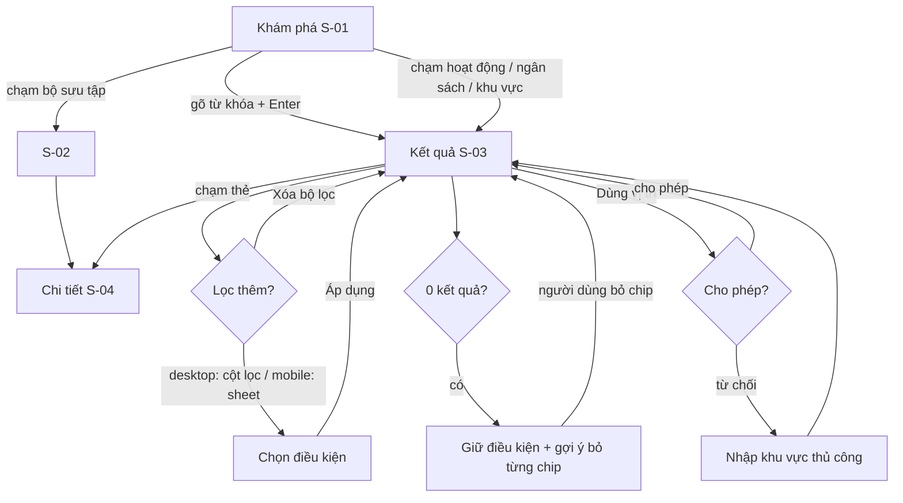
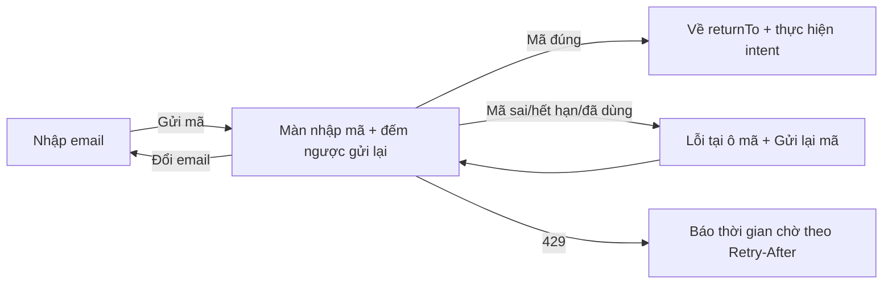
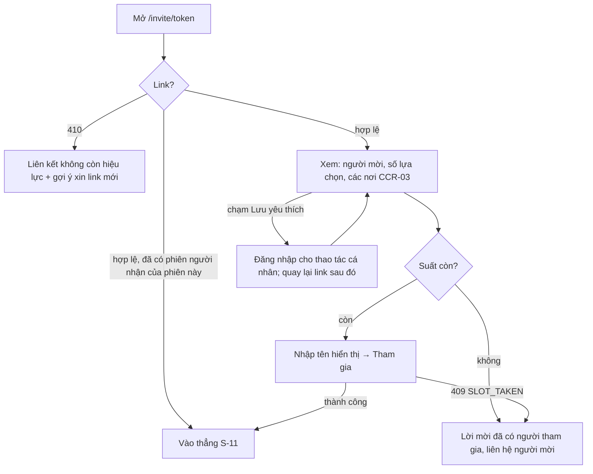
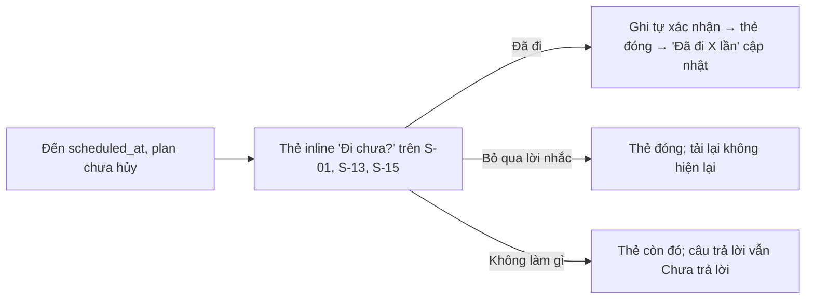

# 03 — User Flows (PHASE 3)

Mỗi flow UF-xx tương ứng UC-xx. Định dạng: **Entry → Intent → Actions → Decisions → Success → Error/Recovery → Exit**. Ở mọi flow, lỗi mạng/5xx đều hiện ErrorState có mã tra cứu và Thử lại, giữ dữ liệu đã nhập (UC EX-03). Phần dưới chỉ ghi các nhánh đặc thù.
Ký hiệu: [PROP] đề xuất chờ duyệt · [CCR] chờ contract · [OQ] chờ PO.

## UF-01 Tìm địa điểm phù hợp (UC-001) — Khách/Thành viên

- **Decisions:** bộ lọc kết hợp AND giữa các nhóm; nhãn trong nhóm dùng “ít nhất một” hoặc “phải đủ”, và quy tắc này hiển thị ngay cạnh tên nhóm.
- **Success:** danh sách đúng bộ lọc; URL phản ánh điều kiện (chia sẻ được, Back quay lại đúng).
- **Error:** bản đồ lỗi → tự về dạng danh sách, bộ lọc giữ nguyên (AC-002); bộ lọc chưa hỗ trợ (dev, 501) → báo trong dev.
- **Exit:** chi tiết, so sánh, hoặc rời trang.

## UF-02 Xem chi tiết (UC-002)

Entry: thẻ địa điểm, link chia sẻ, bộ sưu tập, so sánh, kế hoạch.
Actions: cuộn theo thứ tự FR-05 → Lưu / So sánh / Lên kế hoạch / Gọi / Chỉ đường / Báo sai.
Decisions: **chưa đăng nhập + Lưu/Lên kế hoạch** → `/login?returnTo=/places/:id&intent=save|plan` → sau đăng nhập quay lại và **mở luôn** dialog Lưu hoặc form kế hoạch, không tự lưu khi người dùng chưa xác nhận [PROP A-11].
Error: 404 (nơi ẩn hoặc không tồn tại) → trang “Không tìm thấy địa điểm” + nút về Khám phá, không gợi ý lý do (AC-004).
Đã đăng nhập và có lượt đi → dòng “Đã đi X lần” cạnh tên [CCR-01].

## UF-03 So sánh (UC-003)

Entry: nút “So sánh” trên thẻ/chi tiết → id vào khay (localStorage).
Decisions: khay đã 3 → nút thứ 4 bị chặn, hiện thông báo “Bạn chỉ có thể so sánh tối đa 3 địa điểm” kèm nút mở khay để bỏ bớt (AC-005). Khay 1 nơi → nút “So sánh” bị khóa, có gợi ý “Thêm ít nhất 1 nơi nữa”.
Success: bảng/thẻ so sánh, trường thiếu hiện “Chưa có thông tin” (AC-006).
Exit: chọn một nơi → UF-12; bỏ nơi; quay lại tìm.

## UF-04 Đăng nhập (UC-004)

Server luôn trả 202 khi gửi mã → UI luôn hiển thị “Nếu email hợp lệ, mã đã được gửi”, không tiết lộ email đã có tài khoản hay chưa. Không hỏi thông tin quan hệ.

## UF-05 Quản lý tài khoản (UC-005)

Sửa tên/ảnh → Lưu (toast). Đổi email → dialog nhập email mới → nhập mã gửi tới email mới → thành công; trước khi xác minh xong, email cũ vẫn hiển thị là email hiện tại (AC-009). Xóa tài khoản → ConfirmDialog nêu hậu quả (thu hồi phiên và link riêng) + gõ xác nhận → đăng xuất → trang thông báo “Đã nhận yêu cầu xóa tài khoản” (không nói “đã xóa”, OQ-17). Đăng xuất → xóa cache → về Khám phá.

## UF-06 Danh sách đã lưu (UC-006)

Lưu từ thẻ/chi tiết → dialog chọn danh sách (có sẵn hoặc tạo mới ngay trong dialog) → toast “Đã lưu vào <tên>” + nút Hoàn tác (gọi remove). Nơi đã có trong danh sách → ô chọn đã tick sẵn; chọn lại không tạo trùng (AC-011).
Đã lưu → tạo/đổi tên/xóa danh sách (Confirm: “Kế hoạch và địa điểm không bị xóa”, AC-012). Nơi bị ẩn → thẻ xám + “Địa điểm này hiện không hiển thị”, không chọn được cho lời mời.

## UF-07 Tạo lời mời cùng chọn (UC-007) — Thành viên

Entry: “Mời người ấy cùng chọn” trên S-08.
Actions: danh sách có 2–5 nơi khả dụng → tick sẵn tất cả; >5 → không tick sẵn, người dùng tự chọn → Tạo lời mời.
Decisions: số nơi không hợp lệ → nút khóa + “Hãy chọn từ 2 đến 5 địa điểm” (AC-014).
Success: panel link: Sao chép / Chia sẻ (Web Share) + cảnh báo **“Ai có liên kết này đều xem được và có thể tham gia thay người ấy. Chỉ gửi cho người bạn muốn mời.”** + hạn link (AC-013). Link chỉ hiển thị một lần, nên rời trang khi chưa sao chép sẽ có cảnh báo; nếu mất link thì dùng “Cấp link mới” ở UF-11.
Exit: “Xem phiên” → S-11 (trạng thái chờ người nhận).

## UF-08 Người nhận mở link (UC-008) — **không cần tài khoản (CR-001)**

- **Không bao giờ** redirect sang đăng nhập chỉ để xem (AC-055/056).
- Chưa có CCR-03: P chỉ hiện người mời + số lựa chọn + nút Tham gia; các nơi hiện sau khi tham gia.

## UF-09 Bỏ phiếu (UC-009) — Chủ tạo & người nhận

Mỗi nơi có hai nút **Thích** / **Bỏ qua**. Chưa chạm nút nào thì hiển thị nhãn “Chưa trả lời” (không mặc định chọn sẵn). Chạm lại nút đang chọn **không** bỏ chọn (tránh nhầm trạng thái); muốn đổi thì chạm nút còn lại.
Cập nhật lạc quan → lỗi thì hoàn tác và báo. Thanh tiến độ “Bạn đã trả lời x/n” → “Xem kết quả”.
Phiên FINALIZED hoặc mất quyền → nút khóa, banner “Phiên đã được chốt” / “Bạn không còn quyền truy cập phiên này” (AC-018).
Phiếu của người kia: mặc định **không hiển thị** từng phiếu, chỉ hiển thị nhóm “Cả hai cùng thích” [OQ-07].

## UF-10 Chốt (UC-010) — Chủ tạo

S-12 → nhóm “Cả hai cùng thích” (đặt đầu) + “Các nơi khác” → chủ tạo chọn **bất kỳ nơi nào** (hệ thống không tự chọn, AC-019) → form ngày giờ/ghi chú → “Chốt và tạo kế hoạch”.
Không có nơi trùng → thông điệp + hai lựa chọn: chọn một nơi bất kỳ, hoặc tạo phiên mới.
Điều kiện được chốt (chưa có người nhận? chưa trả lời hết?): [OQ-08]; mặc định [PROP] chỉ bật sau khi người nhận đã tham gia.
Lỗi → không báo đã chốt, giữ form (AC-020). Thành công → S-15, phiên chuyển chỉ xem.
Người nhận ở S-12: thấy kết quả, không có nút chốt; dòng “<Tên người mời> sẽ chọn nơi cuối cùng”.

## UF-11 Quản lý lời mời (UC-011) — Chủ tạo

Trên S-11 (khu “Chia sẻ”): trạng thái link (còn hạn đến …/đã thu hồi/hết hạn) · **Thu hồi** (Confirm: “Người đang dùng link này sẽ mất quyền ngay”) · **Cấp link mới** (link cũ không khôi phục được) · **Loại người nhận** (Confirm). Người không phải chủ tạo không thấy khu này (server vẫn chặn, AC-022).

## UF-12 Tạo kế hoạch (UC-012)

Entry: chi tiết, so sánh, chốt phiên. Chọn ngày + giờ (hiển thị rõ “giờ Việt Nam”), ghi chú tùy chọn → Lưu.
Decisions: thời điểm đã qua → lỗi tại ô thời gian; 409 nơi đóng → “Địa điểm đóng cửa vào thời gian bạn chọn” tại ô thời gian, gợi ý xem giờ mở cửa (AC-024); 201 kèm `HOURS_UNKNOWN` → kế hoạch đã lưu, trên S-15 có cảnh báo “Chưa có thông tin giờ mở cửa, hãy kiểm tra trước khi đi”.
Success: S-15 với “Kế hoạch này chưa giữ chỗ tại địa điểm” (AC-023).

## UF-13 Quản lý kế hoạch (UC-013)

Chủ: Sửa (giờ/ghi chú/đổi nơi) · Hủy (Confirm) · Chỉ đường (mở app bản đồ theo tọa độ) · Thêm vào lịch (.ics, kèm ghi chú “Nếu đổi lịch, hãy cập nhật lại lịch của bạn” [PROP OQ-12]).
Người nhận (phiên người nhận): chỉ xem, không có nút sửa/hủy (AC-025). Plan ĐÃ HỦY: chỉ xem, không nhắc. Plan ĐÃ QUA GIỜ: chỉ xem [OQ-10]. Nơi bị ẩn sau khi lên kế hoạch → cảnh báo, đổi nơi chỉ cho phép nơi đang hiển thị (AC-026).

## UF-14 Lời nhắc “Đi chưa?” (UC-014, CR-001) — người được nhắc [OQ-10: mặc định chủ kế hoạch]

- **Không** modal, **không** popup kế tiếp, **không** gợi ý quán khác/đổi lịch, **không** nút “Chưa đi” (AC-057/058, AC-P12).
- Bấm “Đã đi” lặp lại hoặc tải lại → số lần không tăng (AC-054); nút khóa khi đang gửi.
- Web đang mở đúng giờ hẹn → thẻ xuất hiện khi dữ liệu nhắc được làm mới (khi focus lại tab, và định kỳ 60 s khi đang ở S-01/S-13/S-15) [CCR-02].

## UF-15 Báo sai (UC-015)

Chi tiết → “Báo thông tin sai” → dialog: lý do (radio) · mô tả · ảnh (tùy chọn) → Gửi → “Cảm ơn bạn. Mã báo sai: …”. Thông tin địa điểm không đổi ngay (AC-030). 429 → “Bạn đã gửi nhiều báo cáo, thử lại sau X phút”. Không cần đăng nhập (AC-029).

## UF-16 Hỗ trợ (UC-016)

Tài khoản → Hỗ trợ → Danh sách (trạng thái) → Tạo yêu cầu (nhóm, chủ đề, nội dung, tệp) hoặc mở chi tiết → luồng tin nhắn (chỉ public) → trả lời khi đang xử lý/chờ khách. Ticket đã đóng → không có ô trả lời, có nút “Gửi yêu cầu mới” [OQ-13].

## UF-17 Thông báo (UC-017)

Chuông (badge chưa đọc) → danh sách → chạm → đánh dấu đã đọc + mở đối tượng; đối tượng không còn quyền → “Không tìm thấy” (AC-033). Không có cài đặt tiếp thị trong F1 (AC-034 thuộc backend).

## Kiểm tra theo vai trò

| Flow | Khách | Thành viên | Người nhận (phiên khách) | Thành viên làm người nhận |
|---|---|---|---|---|
| UF-01–03, 15 | ✅ | ✅ | ✅ | ✅ |
| UF-04 | ✅ (trở thành TV) | — | Không bắt buộc | — |
| UF-05–07, 12, 16, 17 | → đăng nhập | ✅ | → đăng nhập | ✅ |
| UF-08 | ✅ | ✅ | ✅ | ✅ (vẫn tham gia bằng tên hiển thị; liên kết tài khoản với phiên người nhận: chưa có yêu cầu) |
| UF-09 | — | Chủ tạo | ✅ | ✅ |
| UF-10, 11 | — | Chỉ chủ tạo | Không | Không |
| UF-13 | — | Chủ: sửa/hủy | Chỉ xem (khi grant còn hiệu lực, OQ-09) | Chỉ xem |
| UF-14 | — | Chủ kế hoạch [OQ-10] | Không (mặc định) | Không (mặc định) |
